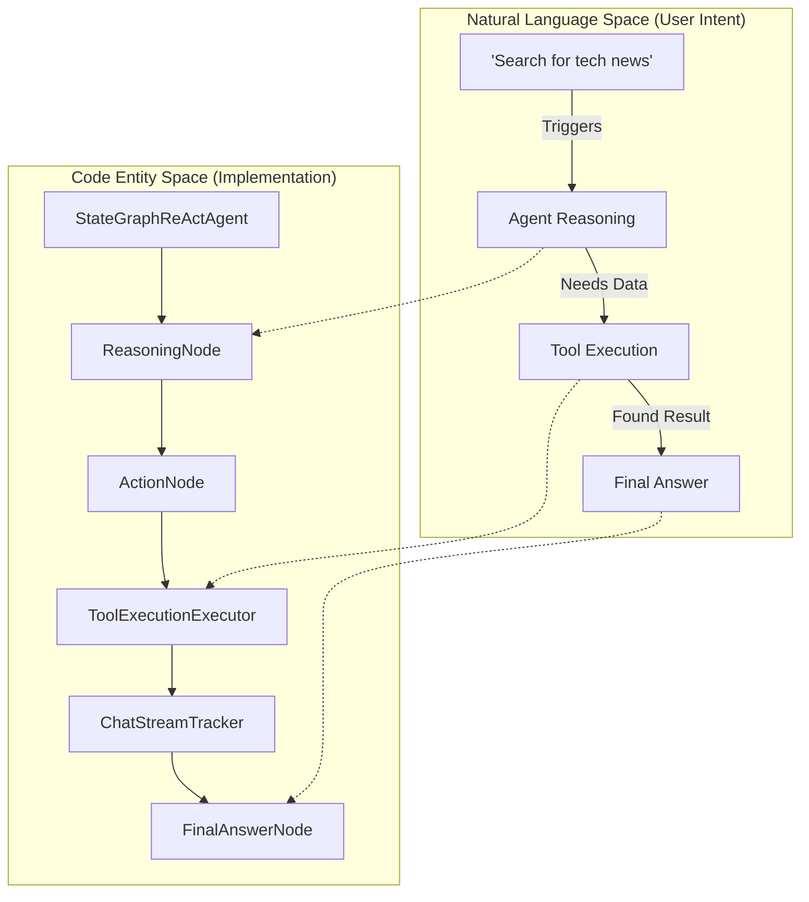
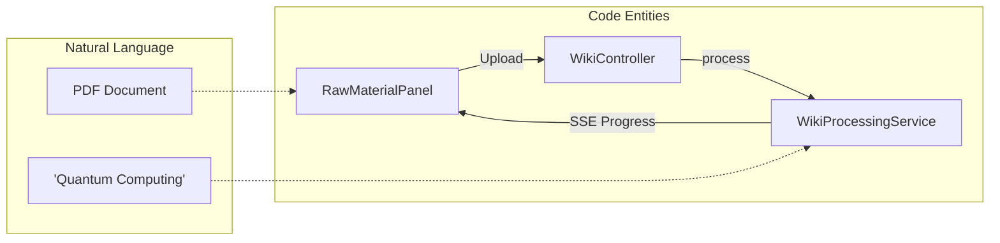

<!-- source: DeepWiki mcp.deepwiki.com · repo matevip/mateclaw · page 14 Glossary · fetched 2026-10-26 -->

# Glossary

Relevant source files

The following files were used as context for generating this wiki page:

- [README.md](README.md)
- [README_zh.md](README_zh.md)
- [assets/images/preview.png](assets/images/preview.png)
- [mateclaw-server/src/main/java/vip/mate/agent/AgentGraphBuilder.java](mateclaw-server/src/main/java/vip/mate/agent/AgentGraphBuilder.java)
- [mateclaw-server/src/main/java/vip/mate/agent/BaseAgent.java](mateclaw-server/src/main/java/vip/mate/agent/BaseAgent.java)
- [mateclaw-server/src/main/java/vip/mate/agent/chatmodel/AgentClaudeCodeChatModelBuilder.java](mateclaw-server/src/main/java/vip/mate/agent/chatmodel/AgentClaudeCodeChatModelBuilder.java)
- [mateclaw-server/src/main/java/vip/mate/agent/chatmodel/AgentOpenAiCompatibleChatModelBuilder.java](mateclaw-server/src/main/java/vip/mate/agent/chatmodel/AgentOpenAiCompatibleChatModelBuilder.java)
- [mateclaw-server/src/main/java/vip/mate/agent/chatmodel/ClaudeCodeIdentityChatModelDecorator.java](mateclaw-server/src/main/java/vip/mate/agent/chatmodel/ClaudeCodeIdentityChatModelDecorator.java)
- [mateclaw-server/src/main/java/vip/mate/agent/chatmodel/ClaudeCodeSystemArrayExchangeFilter.java](mateclaw-server/src/main/java/vip/mate/agent/chatmodel/ClaudeCodeSystemArrayExchangeFilter.java)
- [mateclaw-server/src/main/java/vip/mate/agent/chatmodel/ClaudeCodeSystemArrayInterceptor.java](mateclaw-server/src/main/java/vip/mate/agent/chatmodel/ClaudeCodeSystemArrayInterceptor.java)
- [mateclaw-server/src/main/java/vip/mate/agent/chatmodel/DeepSeekV4ThinkingDecorator.java](mateclaw-server/src/main/java/vip/mate/agent/chatmodel/DeepSeekV4ThinkingDecorator.java)
- [mateclaw-server/src/main/java/vip/mate/agent/chatmodel/RateLimitDiagnosticExchangeFilter.java](mateclaw-server/src/main/java/vip/mate/agent/chatmodel/RateLimitDiagnosticExchangeFilter.java)
- [mateclaw-server/src/main/java/vip/mate/agent/chatmodel/RateLimitDiagnosticInterceptor.java](mateclaw-server/src/main/java/vip/mate/agent/chatmodel/RateLimitDiagnosticInterceptor.java)
- [mateclaw-server/src/main/java/vip/mate/agent/graph/NodeStreamingChatHelper.java](mateclaw-server/src/main/java/vip/mate/agent/graph/NodeStreamingChatHelper.java)
- [mateclaw-server/src/main/java/vip/mate/agent/graph/executor/ToolExecutionExecutor.java](mateclaw-server/src/main/java/vip/mate/agent/graph/executor/ToolExecutionExecutor.java)
- [mateclaw-server/src/main/java/vip/mate/agent/graph/node/ReasoningNode.java](mateclaw-server/src/main/java/vip/mate/agent/graph/node/ReasoningNode.java)
- [mateclaw-server/src/main/java/vip/mate/channel/web/ChatController.java](mateclaw-server/src/main/java/vip/mate/channel/web/ChatController.java)
- [mateclaw-server/src/main/java/vip/mate/llm/anthropic/oauth/ClaudeCodeApiHeaders.java](mateclaw-server/src/main/java/vip/mate/llm/anthropic/oauth/ClaudeCodeApiHeaders.java)
- [mateclaw-server/src/main/java/vip/mate/llm/anthropic/oauth/ClaudeCodeTokenRefresher.java](mateclaw-server/src/main/java/vip/mate/llm/anthropic/oauth/ClaudeCodeTokenRefresher.java)
- [mateclaw-server/src/main/java/vip/mate/llm/model/ModelFamily.java](mateclaw-server/src/main/java/vip/mate/llm/model/ModelFamily.java)
- [mateclaw-server/src/main/java/vip/mate/memory/controller/DreamController.java](mateclaw-server/src/main/java/vip/mate/memory/controller/DreamController.java)
- [mateclaw-server/src/main/java/vip/mate/memory/fact/repository/FactMapper.java](mateclaw-server/src/main/java/vip/mate/memory/fact/repository/FactMapper.java)
- [mateclaw-server/src/main/java/vip/mate/memory/service/MorningCardService.java](mateclaw-server/src/main/java/vip/mate/memory/service/MorningCardService.java)
- [mateclaw-server/src/main/java/vip/mate/wiki/controller/WikiController.java](mateclaw-server/src/main/java/vip/mate/wiki/controller/WikiController.java)
- [mateclaw-server/src/main/resources/db/data-en.sql](mateclaw-server/src/main/resources/db/data-en.sql)
- [mateclaw-server/src/main/resources/db/data-mysql-en.sql](mateclaw-server/src/main/resources/db/data-mysql-en.sql)
- [mateclaw-server/src/main/resources/db/data-mysql-zh.sql](mateclaw-server/src/main/resources/db/data-mysql-zh.sql)
- [mateclaw-server/src/main/resources/db/data-zh.sql](mateclaw-server/src/main/resources/db/data-zh.sql)
- [mateclaw-ui/src/api/index.ts](mateclaw-ui/src/api/index.ts)
- [mateclaw-ui/src/i18n/locales/en-US.ts](mateclaw-ui/src/i18n/locales/en-US.ts)
- [mateclaw-ui/src/i18n/locales/zh-CN.ts](mateclaw-ui/src/i18n/locales/zh-CN.ts)
- [mateclaw-ui/src/stores/useMemoryStore.ts](mateclaw-ui/src/stores/useMemoryStore.ts)
- [mateclaw-ui/src/types/index.ts](mateclaw-ui/src/types/index.ts)
- [mateclaw-ui/src/views/Memory/components/MemoryBrowser.vue](mateclaw-ui/src/views/Memory/components/MemoryBrowser.vue)
- [mateclaw-ui/src/views/Memory/components/MorningCard.vue](mateclaw-ui/src/views/Memory/components/MorningCard.vue)
- [mateclaw-ui/src/views/Memory/index.vue](mateclaw-ui/src/views/Memory/index.vue)
- [mateclaw-ui/src/views/Wiki/components/RawMaterialPanel.vue](mateclaw-ui/src/views/Wiki/components/RawMaterialPanel.vue)

This page provides definitions for codebase-specific terms, architectural patterns, and domain concepts used within the MateClaw platform. It serves as a technical reference for onboarding engineers to understand how natural language concepts map to specific Java classes and Vue components.

## Core Architectural Concepts

### Agent Graph
The execution engine of MateClaw is based on a directed graph where nodes represent processing steps (LLM reasoning, tool execution) and edges represent state transitions. This is implemented using `spring-ai-alibaba-graph-core` [mateclaw-server/src/main/java/vip/mate/agent/AgentGraphBuilder.java:4-8]().

| Term | Definition | Code Entity |
|:---|:---|:---|
| **StateGraph** | The underlying structure defining nodes and edges for an agent's lifecycle. | `com.alibaba.cloud.ai.graph.StateGraph` |
| **Reasoning Node** | A node that calls an LLM to decide the next action or provide an answer. | `vip.mate.agent.graph.node.ReasoningNode` |
| **Action Node** | A node responsible for executing one or more tools. | `vip.mate.agent.graph.node.ActionNode` |
| **Observation Node**| A node that processes the results of tool executions (observations). | `vip.mate.agent.graph.node.ObservationNode` |
| **Summarizing Node**| A specialized node that condenses large tool outputs to fit context windows. | `vip.mate.agent.graph.node.SummarizingNode` |

**Sources:** [mateclaw-server/src/main/java/vip/mate/agent/AgentGraphBuilder.java:38-51](), [mateclaw-server/src/main/java/vip/mate/agent/graph/node/ReasoningNode.java](), [mateclaw-server/src/main/java/vip/mate/agent/AgentGraphBuilder.java:181]()

### Provider Failover & Health
MateClaw implements a multi-provider strategy to ensure high availability. If a primary LLM provider fails (e.g., 401 Unauthorized or Rate Limit), the system automatically routes the request to a fallback provider [README.md:39-46]().

*   **Provider Health Tracker**: Monitors success/failure rates and places failing providers into a "cooldown" state [mateclaw-server/src/main/java/vip/mate/agent/AgentGraphBuilder.java:126]().
*   **Model Protocol**: An abstraction (e.g., `ANTHROPIC_CLAUDE_CODE`, `OPENAI`) that determines which builder is used to construct the `ChatModel` [mateclaw-server/src/main/java/vip/mate/agent/chatmodel/AgentClaudeCodeChatModelBuilder.java:87-89]().
*   **Cooldown Window**: A temporary period where a failing provider is parked to avoid latency on every turn [README.md:43]().

**Sources:** [README.md:39-46](), [mateclaw-server/src/main/java/vip/mate/agent/AgentGraphBuilder.java:126-130](), [mateclaw-server/src/main/java/vip/mate/agent/chatmodel/AgentClaudeCodeChatModelBuilder.java:87-92]()

## Natural Language to Code Mapping

The following diagram bridges user-facing concepts (Natural Language Space) with their internal implementations (Code Entity Space).

### Agent Execution Pipeline
Title: Agent Turn Lifecycle Mapping

**Sources:** [mateclaw-server/src/main/java/vip/mate/agent/AgentGraphBuilder.java:38-44](), [mateclaw-server/src/main/java/vip/mate/agent/graph/executor/ToolExecutionExecutor.java](), [mateclaw-server/src/main/java/vip/mate/channel/web/ChatStreamTracker.java]()

## Domain Specific Terms

### LLM Wiki
A knowledge management system that transforms "Raw Materials" (PDFs, Markdown, Web Scrapes) into structured, interlinked Wiki pages [README.md:47-53]().

*   **Raw Material**: The original uploaded file before processing [mateclaw-ui/src/views/Wiki/components/RawMaterialPanel.vue]().
*   **Ingestion Pipeline**: The process where raw materials are digested into structured pages with `[[links]]` and citations [README.md:51]().
*   **Slug Claims**: A mechanism to manage canonical page identifiers and prevent duplicate creation during concurrent ingestion.

### Memory & Dreaming
MateClaw's long-term memory system [README.md:76-80]().

*   **Memory Emergence**: The process of "dreaming" where the system periodically reviews conversation logs to extract facts [mateclaw-ui/src/stores/useMemoryStore.ts]().
*   **Morning Card**: A UI component presenting a daily briefing of what the AI learned during its dreaming phase [mateclaw-ui/src/views/Memory/components/MorningCard.vue]().
*   **Workspace Files**: Specific Markdown files used as persistent structured memory: `MEMORY.md`, `PROFILE.md`, `SOUL.md`, and `AGENTS.md` [README.md:78]().

**Sources:** [mateclaw-ui/src/views/Memory/index.vue](), [mateclaw-ui/src/views/Memory/components/MorningCard.vue](), [README.md:76-80]()

### Streaming & SSE
Communication between the backend and the Vue frontend uses Server-Sent Events (SSE) [mateclaw-server/src/main/java/vip/mate/channel/web/ChatController.java:74-75]().

*   **ChatStreamTracker**: Manages the lifecycle of SSE emitters and allows for "reconnection" to an existing stream if the network drops [mateclaw-server/src/main/java/vip/mate/channel/web/ChatController.java:59]().
*   **RunState**: An in-memory object tracking the current progress of an agent turn [mateclaw-server/src/main/java/vip/mate/channel/web/ChatController.java:112]().
*   **Utf8SseEmitter**: A specialized emitter ensuring UTF-8 charset declaration to prevent character encoding issues in specific browsers [mateclaw-server/src/main/java/vip/mate/channel/web/ChatController.java:83]().

### Wiki Ingestion Data Flow
Title: Raw Material to Wiki Page Transition

**Sources:** [mateclaw-server/src/main/java/vip/mate/wiki/controller/WikiController.java](), [mateclaw-ui/src/views/Wiki/components/RawMaterialPanel.vue]()

## Frontend Interface Glossary

| UI Term | Description | Vue Component / Key |
|:---|:---|:---|
| **Chat Console** | The main interface for interacting with agents. | `ChatConsole.vue` |
| **Message Bubble** | Renders individual turns, including "Thinking" segments and tool calls. | `MessageBubble.vue` |
| **Deep Thinking** | A toggle for models (like DeepSeek R1) that support explicit reasoning chains. | `chat.thinking` [mateclaw-ui/src/i18n/locales/zh-CN.ts:52]() |
| **Approval Bar** | UI element that appears when a tool requires Human-in-the-Loop (HIL) permission. | `chat.approvalRequired` [mateclaw-ui/src/i18n/locales/en-US.ts:157]() |
| **Segmented View**| The Claude Code-style rendering of thinking, tool calls, and content. | `MessageSegment` [mateclaw-ui/src/types/index.ts:135]() |

**Sources:** [mateclaw-ui/src/types/index.ts:135-158](), [mateclaw-ui/src/i18n/locales/zh-CN.ts:46-215]()

## Abbreviations Reference

*   **HIL**: Human-in-the-Loop. Refers to manual approval required for sensitive tools [mateclaw-ui/src/i18n/locales/en-US.ts:157]().
*   **MCP**: Model Context Protocol. A standard for agents to interact with external tools over stdio/SSE [README.md:82]().
*   **SSE**: Server-Sent Events. The protocol used for real-time response streaming [mateclaw-server/src/main/java/vip/mate/channel/web/ChatController.java:73-75]().
*   **RBAC**: Role-Based Access Control. Security model for workspaces, models, and tools [README.md:88]().
*   **OAuth (Claude Code)**: A specific protocol allowing users to use their Claude Pro/Max subscription token for API access [mateclaw-server/src/main/java/vip/mate/agent/chatmodel/AgentClaudeCodeChatModelBuilder.java:27-30]().

**Sources:** [README.md](), [mateclaw-server/src/main/java/vip/mate/channel/web/ChatController.java](), [mateclaw-server/src/main/java/vip/mate/agent/chatmodel/AgentClaudeCodeChatModelBuilder.java]()