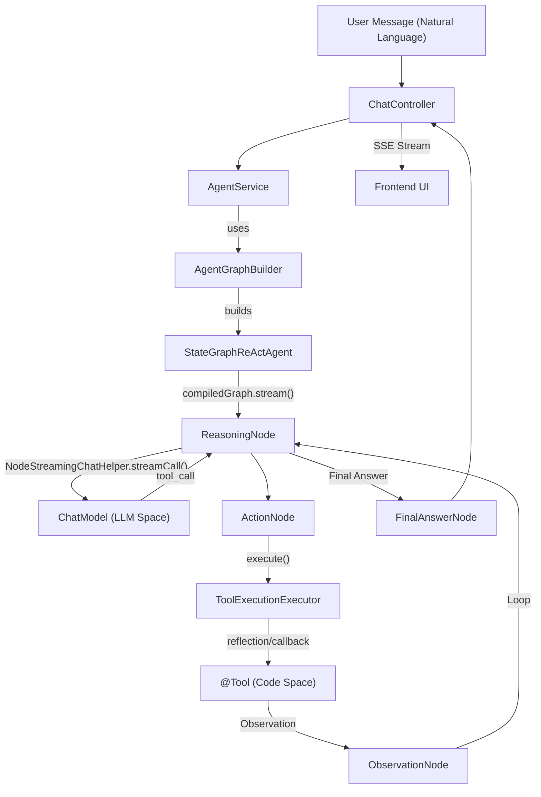
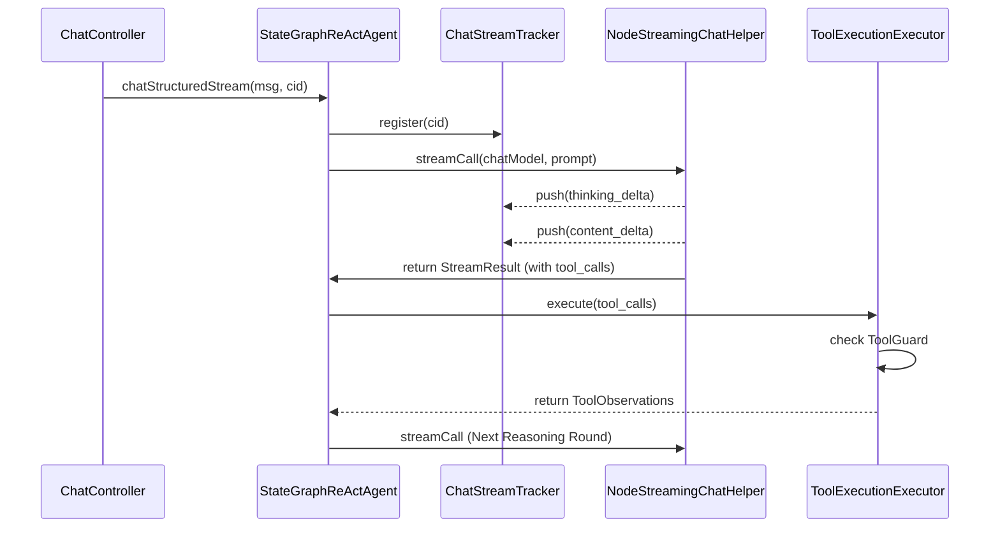

<!-- source: DeepWiki mcp.deepwiki.com · repo matevip/mateclaw · page 2 Core Agent Runtime · fetched 2026-10-26 -->

# Core Agent Runtime

Relevant source files

The following files were used as context for generating this wiki page:

- [mateclaw-server/src/main/java/vip/mate/agent/AgentGraphBuilder.java](mateclaw-server/src/main/java/vip/mate/agent/AgentGraphBuilder.java)
- [mateclaw-server/src/main/java/vip/mate/agent/AgentService.java](mateclaw-server/src/main/java/vip/mate/agent/AgentService.java)
- [mateclaw-server/src/main/java/vip/mate/agent/BaseAgent.java](mateclaw-server/src/main/java/vip/mate/agent/BaseAgent.java)
- [mateclaw-server/src/main/java/vip/mate/agent/ThinkingLevelHolder.java](mateclaw-server/src/main/java/vip/mate/agent/ThinkingLevelHolder.java)
- [mateclaw-server/src/main/java/vip/mate/agent/graph/NodeStreamingChatHelper.java](mateclaw-server/src/main/java/vip/mate/agent/graph/NodeStreamingChatHelper.java)
- [mateclaw-server/src/main/java/vip/mate/agent/graph/StateGraphReActAgent.java](mateclaw-server/src/main/java/vip/mate/agent/graph/StateGraphReActAgent.java)
- [mateclaw-server/src/main/java/vip/mate/agent/graph/executor/ToolExecutionExecutor.java](mateclaw-server/src/main/java/vip/mate/agent/graph/executor/ToolExecutionExecutor.java)
- [mateclaw-server/src/main/java/vip/mate/agent/graph/node/ReasoningNode.java](mateclaw-server/src/main/java/vip/mate/agent/graph/node/ReasoningNode.java)
- [mateclaw-server/src/main/java/vip/mate/agent/graph/node/SummarizingNode.java](mateclaw-server/src/main/java/vip/mate/agent/graph/node/SummarizingNode.java)
- [mateclaw-server/src/main/java/vip/mate/agent/graph/plan/StateGraphPlanExecuteAgent.java](mateclaw-server/src/main/java/vip/mate/agent/graph/plan/StateGraphPlanExecuteAgent.java)
- [mateclaw-server/src/main/java/vip/mate/agent/model/AgentEntity.java](mateclaw-server/src/main/java/vip/mate/agent/model/AgentEntity.java)
- [mateclaw-server/src/main/java/vip/mate/channel/service/ChannelService.java](mateclaw-server/src/main/java/vip/mate/channel/service/ChannelService.java)
- [mateclaw-server/src/main/java/vip/mate/channel/web/ChatController.java](mateclaw-server/src/main/java/vip/mate/channel/web/ChatController.java)
- [mateclaw-server/src/main/java/vip/mate/channel/web/ChatStreamTracker.java](mateclaw-server/src/main/java/vip/mate/channel/web/ChatStreamTracker.java)
- [mateclaw-server/src/main/java/vip/mate/config/GraphObservationProperties.java](mateclaw-server/src/main/java/vip/mate/config/GraphObservationProperties.java)
- [mateclaw-server/src/main/java/vip/mate/cron/service/CronJobService.java](mateclaw-server/src/main/java/vip/mate/cron/service/CronJobService.java)
- [mateclaw-server/src/main/java/vip/mate/exception/MateClawException.java](mateclaw-server/src/main/java/vip/mate/exception/MateClawException.java)
- [mateclaw-server/src/main/java/vip/mate/memory/event/ConversationCompletionPublisher.java](mateclaw-server/src/main/java/vip/mate/memory/event/ConversationCompletionPublisher.java)
- [mateclaw-server/src/main/java/vip/mate/tool/mcp/service/McpServerService.java](mateclaw-server/src/main/java/vip/mate/tool/mcp/service/McpServerService.java)
- [mateclaw-server/src/main/java/vip/mate/tool/service/ToolService.java](mateclaw-server/src/main/java/vip/mate/tool/service/ToolService.java)
- [mateclaw-server/src/main/java/vip/mate/workspace/core/service/WorkspaceService.java](mateclaw-server/src/main/java/vip/mate/workspace/core/service/WorkspaceService.java)
- [mateclaw-server/src/main/resources/application.yml](mateclaw-server/src/main/resources/application.yml)
- [mateclaw-server/src/main/resources/db/migration/h2/V4__agent_thinking_level.sql](mateclaw-server/src/main/resources/db/migration/h2/V4__agent_thinking_level.sql)
- [mateclaw-server/src/main/resources/db/schema-mysql.sql](mateclaw-server/src/main/resources/db/schema-mysql.sql)
- [mateclaw-server/src/main/resources/db/schema.sql](mateclaw-server/src/main/resources/db/schema.sql)

The Core Agent Runtime is the central execution engine of MateClaw. It transforms natural language intents into actionable sequences by orchestrating LLM reasoning, tool invocation, and state management. Built on a directed acyclic graph (DAG) architecture using `spring-ai-alibaba-graph-core`, the runtime ensures that complex multi-turn interactions are predictable, observable, and secure.

## Architectural Overview

The runtime operates as a state machine where each "turn" of a conversation is a traversal through a `StateGraph`. The engine decouples the high-level reasoning logic from low-level execution details like streaming SSE delivery and tool sandboxing.

### Core Components Mapping

| System Concept | Code Entity | Role |
|:---|:---|:---|
| **Graph Assembler** | `AgentGraphBuilder` | Constructs the `StateGraph` and wires nodes. |
| **Agent Instance** | `BaseAgent` | Abstract base for `StateGraphReActAgent` and `StateGraphPlanExecuteAgent`. |
| **Streaming Hub** | `ChatStreamTracker` | Manages process-local SSE buffers and reconnection logic. |
| **Execution Helper**| `NodeStreamingChatHelper` | Bridges `ChatModel` streams to the `ChatStreamTracker` and handles failover. |
| **Tool Runner** | `ToolExecutionExecutor` | Executes tool calls with parallel/sequential logic and security guards. |

### Natural Language to Code Entity Space

The following diagram illustrates how a user's natural language request flows through the primary code entities of the runtime.

**Request Processing Pipeline**

**Sources:** [mateclaw-server/src/main/java/vip/mate/agent/AgentGraphBuilder.java:135-150](), [mateclaw-server/src/main/java/vip/mate/agent/graph/StateGraphReActAgent.java:91-110](), [mateclaw-server/src/main/java/vip/mate/agent/graph/node/ReasoningNode.java:51-85](), [mateclaw-server/src/main/java/vip/mate/agent/AgentService.java:115-140]()

---

## StateGraph & Agent Patterns

MateClaw supports two primary agentic patterns implemented as `StateGraph` architectures:

1.  **ReAct (Reasoning + Acting):** A tight loop of `ReasoningNode` -> `ActionNode` -> `ObservationNode`. It is best for interactive tasks where each step depends on the previous outcome. [mateclaw-server/src/main/java/vip/mate/agent/graph/StateGraphReActAgent.java:30-45]()
2.  **Plan-and-Execute:** A structured flow where goals are decomposed into steps and executed sequentially. [mateclaw-server/src/main/java/vip/mate/agent/graph/plan/StateGraphPlanExecuteAgent.java:42-58]()

The `AgentGraphBuilder` assembles these graphs, injecting system-level constraints like `MAX_ITERATIONS_HARD_CEILING` (default 100) and `TOOL_USE_ENFORCEMENT` prompts to ensure model discipline. [mateclaw-server/src/main/java/vip/mate/agent/BaseAgent.java:51-52](), [mateclaw-server/src/main/java/vip/mate/agent/graph/node/ReasoningNode.java:75-85]()

For details, see [StateGraph & Agent Patterns (#2.1)].

**Sources:** [mateclaw-server/src/main/java/vip/mate/agent/BaseAgent.java:51-52](), [mateclaw-server/src/main/java/vip/mate/agent/graph/node/ReasoningNode.java:75-85](), [mateclaw-server/src/main/java/vip/mate/agent/graph/plan/StateGraphPlanExecuteAgent.java:42-58]()

---

## Streaming & SSE Delivery

Streaming in MateClaw is "node-driven." Instead of waiting for the entire graph to finish, the `NodeStreamingChatHelper` captures deltas from the `ChatModel` and pushes them to the `ChatStreamTracker` in real-time. [mateclaw-server/src/main/java/vip/mate/agent/graph/NodeStreamingChatHelper.java:32-37]()

*   **Buffer Management:** `ChatStreamTracker` maintains a process-local buffer (max 16,000 events) to support client reconnection without losing "thinking" or "content" segments. [mateclaw-server/src/main/java/vip/mate/channel/web/ChatStreamTracker.java:56-79]()
*   **Interruption:** Users can issue a `USER_STOP` or `USER_INTERRUPT_WITH_FOLLOWUP`, which sets a `stopRequested` flag in the `RunState`, causing graph nodes to abort gracefully. [mateclaw-server/src/main/java/vip/mate/channel/web/ChatStreamTracker.java:69-85]()

For details, see [Streaming & SSE Delivery (#2.2)].

**Sources:** [mateclaw-server/src/main/java/vip/mate/channel/web/ChatStreamTracker.java:53-135](), [mateclaw-server/src/main/java/vip/mate/agent/graph/NodeStreamingChatHelper.java:32-37](), [mateclaw-server/src/main/java/vip/mate/channel/web/ChatController.java:75-140]()

---

## Tool Execution & Security

Tool execution is handled by the `ToolExecutionExecutor`, which follows a two-phase model:
1.  **Preparation:** Validates JSON arguments and runs `ToolGuard` to determine if a call is `ALLOW`, `NEEDS_APPROVAL`, or `BLOCK`. [mateclaw-server/src/main/java/vip/mate/agent/graph/executor/ToolExecutionExecutor.java:28-32]()
2.  **Execution:** Dispatches calls to virtual threads. It distinguishes between `concurrencySafe` tools and `unsafe` tools like `browser_use` or `write_file` which are run sequentially. [mateclaw-server/src/main/java/vip/mate/agent/graph/executor/ToolExecutionExecutor.java:42-58]()

The runtime also enforces a three-layer budget for tool results to prevent context window overflow, spilling oversized results to disk via `ToolResultStorage`. [mateclaw-server/src/main/java/vip/mate/agent/graph/executor/ToolExecutionExecutor.java:64-73]()

For details, see [Tool Execution & Security (#2.3)].

**Sources:** [mateclaw-server/src/main/java/vip/mate/agent/graph/executor/ToolExecutionExecutor.java:28-35](), [mateclaw-server/src/main/java/vip/mate/agent/graph/executor/ToolExecutionExecutor.java:64-73](), [mateclaw-server/src/main/resources/application.yml:175-180]()

---

## Conversation & History Management

The `ConversationWindowManager` and `ConversationService` manage the context window of the agent.

*   **Progressive Loading:** Long conversations load messages in stages, loading only the necessary window (default 128k tokens) for the LLM. [mateclaw-server/src/main/java/vip/mate/agent/BaseAgent.java:180-198](), [mateclaw-server/src/main/resources/application.yml:193]()
*   **Context Compression:** When the `compact-trigger-ratio` is met, the `SummarizingNode` condenses observations to free up space. [mateclaw-server/src/main/java/vip/mate/agent/graph/node/SummarizingNode.java:31-42](), [mateclaw-server/src/main/resources/application.yml:194]()
*   **Thinking Level:** Supports per-request `reasoning_effort` (high/medium/low) via `ThinkingLevelHolder`. [mateclaw-server/src/main/java/vip/mate/agent/ThinkingLevelHolder.java:1-15](), [mateclaw-server/src/main/java/vip/mate/agent/AgentService.java:130-140]()

For details, see [Conversation & History Management (#2.4)].

**Sources:** [mateclaw-server/src/main/java/vip/mate/agent/BaseAgent.java:179-208](), [mateclaw-server/src/main/java/vip/mate/agent/graph/node/SummarizingNode.java:31-42](), [mateclaw-server/src/main/resources/application.yml:190-196](), [mateclaw-server/src/main/java/vip/mate/agent/AgentService.java:124-140]()

---

## Component Interaction Diagram

This diagram shows the relationship between the core runtime classes during a standard ReAct turn.

**Runtime Interaction Flow**

**Sources:** [mateclaw-server/src/main/java/vip/mate/agent/graph/StateGraphReActAgent.java:158-180](), [mateclaw-server/src/main/java/vip/mate/agent/graph/NodeStreamingChatHelper.java:32-37](), [mateclaw-server/src/main/java/vip/mate/agent/graph/executor/ToolExecutionExecutor.java:28-35]()

---

