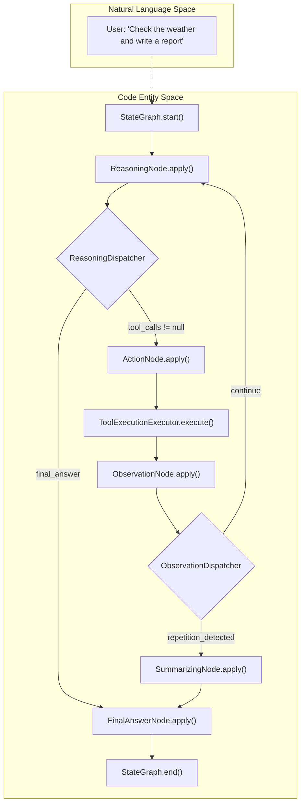
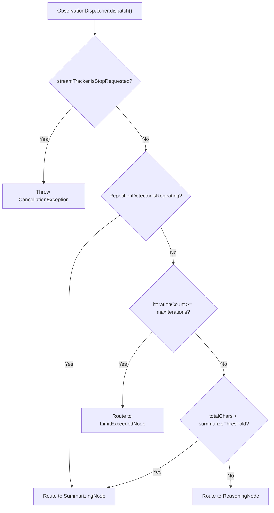

<!-- source: DeepWiki mcp.deepwiki.com · repo matevip/mateclaw · page 2.1 StateGraph & Agent Patterns · fetched 2026-10-26 -->

# StateGraph & Agent Patterns

Relevant source files

The following files were used as context for generating this wiki page:

- [mateclaw-server/src/main/java/vip/mate/agent/AgentGraphBuilder.java](mateclaw-server/src/main/java/vip/mate/agent/AgentGraphBuilder.java)
- [mateclaw-server/src/main/java/vip/mate/agent/BaseAgent.java](mateclaw-server/src/main/java/vip/mate/agent/BaseAgent.java)
- [mateclaw-server/src/main/java/vip/mate/agent/GraphEventPublisher.java](mateclaw-server/src/main/java/vip/mate/agent/GraphEventPublisher.java)
- [mateclaw-server/src/main/java/vip/mate/agent/context/ConversationWindowManager.java](mateclaw-server/src/main/java/vip/mate/agent/context/ConversationWindowManager.java)
- [mateclaw-server/src/main/java/vip/mate/agent/context/RuntimeContextInjector.java](mateclaw-server/src/main/java/vip/mate/agent/context/RuntimeContextInjector.java)
- [mateclaw-server/src/main/java/vip/mate/agent/graph/NodeStreamingChatHelper.java](mateclaw-server/src/main/java/vip/mate/agent/graph/NodeStreamingChatHelper.java)
- [mateclaw-server/src/main/java/vip/mate/agent/graph/RepetitionDetector.java](mateclaw-server/src/main/java/vip/mate/agent/graph/RepetitionDetector.java)
- [mateclaw-server/src/main/java/vip/mate/agent/graph/edge/ObservationDispatcher.java](mateclaw-server/src/main/java/vip/mate/agent/graph/edge/ObservationDispatcher.java)
- [mateclaw-server/src/main/java/vip/mate/agent/graph/edge/ReasoningDispatcher.java](mateclaw-server/src/main/java/vip/mate/agent/graph/edge/ReasoningDispatcher.java)
- [mateclaw-server/src/main/java/vip/mate/agent/graph/executor/ToolExecutionExecutor.java](mateclaw-server/src/main/java/vip/mate/agent/graph/executor/ToolExecutionExecutor.java)
- [mateclaw-server/src/main/java/vip/mate/agent/graph/executor/ToolResultProperties.java](mateclaw-server/src/main/java/vip/mate/agent/graph/executor/ToolResultProperties.java)
- [mateclaw-server/src/main/java/vip/mate/agent/graph/executor/ToolResultStorage.java](mateclaw-server/src/main/java/vip/mate/agent/graph/executor/ToolResultStorage.java)
- [mateclaw-server/src/main/java/vip/mate/agent/graph/node/ActionNode.java](mateclaw-server/src/main/java/vip/mate/agent/graph/node/ActionNode.java)
- [mateclaw-server/src/main/java/vip/mate/agent/graph/node/FinalAnswerNode.java](mateclaw-server/src/main/java/vip/mate/agent/graph/node/FinalAnswerNode.java)
- [mateclaw-server/src/main/java/vip/mate/agent/graph/node/ObservationNode.java](mateclaw-server/src/main/java/vip/mate/agent/graph/node/ObservationNode.java)
- [mateclaw-server/src/main/java/vip/mate/agent/graph/node/ReasoningNode.java](mateclaw-server/src/main/java/vip/mate/agent/graph/node/ReasoningNode.java)
- [mateclaw-server/src/main/java/vip/mate/agent/graph/plan/edge/PlanGenerationDispatcher.java](mateclaw-server/src/main/java/vip/mate/agent/graph/plan/edge/PlanGenerationDispatcher.java)
- [mateclaw-server/src/main/java/vip/mate/agent/graph/plan/node/PlanGenerationNode.java](mateclaw-server/src/main/java/vip/mate/agent/graph/plan/node/PlanGenerationNode.java)
- [mateclaw-server/src/main/java/vip/mate/agent/graph/plan/node/StepExecutionNode.java](mateclaw-server/src/main/java/vip/mate/agent/graph/plan/node/StepExecutionNode.java)
- [mateclaw-server/src/main/java/vip/mate/agent/graph/plan/state/PlanStateAccessor.java](mateclaw-server/src/main/java/vip/mate/agent/graph/plan/state/PlanStateAccessor.java)
- [mateclaw-server/src/main/java/vip/mate/agent/graph/state/DirectToolOutput.java](mateclaw-server/src/main/java/vip/mate/agent/graph/state/DirectToolOutput.java)
- [mateclaw-server/src/main/java/vip/mate/agent/graph/state/FinishReason.java](mateclaw-server/src/main/java/vip/mate/agent/graph/state/FinishReason.java)
- [mateclaw-server/src/main/java/vip/mate/agent/graph/state/MateClawStateAccessor.java](mateclaw-server/src/main/java/vip/mate/agent/graph/state/MateClawStateAccessor.java)
- [mateclaw-server/src/main/java/vip/mate/agent/graph/state/MateClawStateKeys.java](mateclaw-server/src/main/java/vip/mate/agent/graph/state/MateClawStateKeys.java)
- [mateclaw-server/src/main/java/vip/mate/channel/web/ChatController.java](mateclaw-server/src/main/java/vip/mate/channel/web/ChatController.java)
- [mateclaw-server/src/main/java/vip/mate/llm/cache/LlmCacheMetricsAggregator.java](mateclaw-server/src/main/java/vip/mate/llm/cache/LlmCacheMetricsAggregator.java)
- [mateclaw-server/src/main/java/vip/mate/tool/ConcurrencyUnsafe.java](mateclaw-server/src/main/java/vip/mate/tool/ConcurrencyUnsafe.java)
- [mateclaw-server/src/main/java/vip/mate/tool/builtin/SkillFileTool.java](mateclaw-server/src/main/java/vip/mate/tool/builtin/SkillFileTool.java)
- [mateclaw-server/src/main/java/vip/mate/workspace/conversation/vo/MessageVO.java](mateclaw-server/src/main/java/vip/mate/workspace/conversation/vo/MessageVO.java)
- [mateclaw-server/src/main/resources/prompts/graph/limit-exceeded-system.txt](mateclaw-server/src/main/resources/prompts/graph/limit-exceeded-system.txt)
- [mateclaw-server/src/main/resources/prompts/graph/summarize-system.txt](mateclaw-server/src/main/resources/prompts/graph/summarize-system.txt)
- [mateclaw-server/src/main/resources/prompts/graph/summarize-user.txt](mateclaw-server/src/main/resources/prompts/graph/summarize-user.txt)
- [mateclaw-server/src/test/java/vip/mate/agent/graph/RepetitionDetectorTest.java](mateclaw-server/src/test/java/vip/mate/agent/graph/RepetitionDetectorTest.java)
- [mateclaw-ui/src/App.vue](mateclaw-ui/src/App.vue)
- [mateclaw-ui/src/components/chat/ContentSegment.vue](mateclaw-ui/src/components/chat/ContentSegment.vue)

MateClaw utilizes `spring-ai-alibaba-graph-core` to implement sophisticated agentic workflows. The system abstracts complex LLM interactions into directed graphs where nodes represent discrete processing steps (Reasoning, Action, Observation) and edges manage the state-dependent routing logic.

## Graph Assembly via AgentGraphBuilder

The `AgentGraphBuilder` class is the central factory for constructing agent instances. It resolves model configurations, tool bindings, and security policies before compiling the `StateGraph` into an executable `CompiledGraph` [mateclaw-server/src/main/java/vip/mate/agent/AgentGraphBuilder.java:92-135]().

### ReAct Graph Pattern
The ReAct (Reasoning and Acting) pattern is implemented in `StateGraphReActAgent` [mateclaw-server/src/main/java/vip/mate/agent/graph/StateGraphReActAgent.java:30-49](). It follows a cyclic "Thought → Action → Observation" loop:

1.  **ReasoningNode**: The LLM determines the next step.
2.  **ReasoningDispatcher**: Decides if a tool call is needed or if the agent should provide a final answer [mateclaw-server/src/main/java/vip/mate/agent/graph/edge/ReasoningDispatcher.java:1-30]().
3.  **ActionNode**: Orchestrates tool execution via `ToolExecutionExecutor` [mateclaw-server/src/main/java/vip/mate/agent/graph/executor/ToolExecutionExecutor.java:39-48]().
4.  **ObservationNode**: Captures tool outputs and formats them for the next reasoning round.
5.  **ObservationDispatcher**: Monitors for repetition or budget exhaustion, routing to `SummarizingNode` if the context becomes too dense [mateclaw-server/src/main/java/vip/mate/agent/graph/edge/ObservationDispatcher.java:1-40]().

### Plan-Execute Graph Pattern
The `StateGraphPlanExecuteAgent` implements a higher-level decomposition strategy [mateclaw-server/src/main/java/vip/mate/agent/graph/plan/StateGraphPlanExecuteAgent.java:30-50]():

1.  **PlanGenerationNode**: Triage the goal into a direct answer, a single-step plan, or a multi-step sequence (2–6 steps) [mateclaw-server/src/main/java/vip/mate/agent/graph/plan/node/PlanGenerationNode.java:67-93]().
2.  **StepExecutionNode**: Executes individual steps using an internal ReAct loop limited to 5 tool calls per step to prevent runaway costs [mateclaw-server/src/main/java/vip/mate/agent/graph/plan/node/StepExecutionNode.java:58-58]().
3.  **FinalAnswerNode**: Synthesizes all step results into a cohesive response.

**Sources:** [mateclaw-server/src/main/java/vip/mate/agent/AgentGraphBuilder.java:92-135](), [mateclaw-server/src/main/java/vip/mate/agent/graph/plan/node/PlanGenerationNode.java:48-93](), [mateclaw-server/src/main/java/vip/mate/agent/graph/plan/node/StepExecutionNode.java:47-75]().

---

## Node Types & Responsibilities

Specialized nodes handle specific phases of the agentic lifecycle, ensuring separation of concerns between reasoning, execution, and state maintenance.

| Node Type | Class | Primary Responsibility |
| :--- | :--- | :--- |
| **Reasoning** | `ReasoningNode` | Calls LLM to generate `thought` and `tool_calls`. Appends `TOOL_USE_ENFORCEMENT` instructions to prevent "narration-only" failure modes [mateclaw-server/src/main/java/vip/mate/agent/graph/node/ReasoningNode.java:75-85](). |
| **Action** | `ActionNode` | Passes tool calls to `ToolExecutionExecutor`. Manages parallel vs. sequential execution based on `@ConcurrencyUnsafe` [mateclaw-server/src/main/java/vip/mate/agent/graph/executor/ToolExecutionExecutor.java:28-34](). |
| **Observation** | `ObservationNode` | Ingests tool results into the graph state. Detects `returnDirect` flags to bypass further reasoning [mateclaw-server/src/main/java/vip/mate/agent/graph/state/DirectToolOutput.java:1-15](). |
| **Summarizing** | `SummarizingNode` | Compresses `observationHistory` using structured prompts (`summarize-system.txt`) when context limits are approached [mateclaw-server/src/main/resources/prompts/graph/summarize-system.txt:1-39](). |
| **FinalAnswer** | `FinalAnswerNode` | The terminal node that extracts the final string response and manages clean-up. |

### Reasoning & Action Flow
This diagram maps the transition from user intent to the code-level execution of nodes.

Title: ReAct Node Execution & State Transition

**Sources:** [mateclaw-server/src/main/java/vip/mate/agent/graph/node/ReasoningNode.java:51-103](), [mateclaw-server/src/main/java/vip/mate/agent/graph/executor/ToolExecutionExecutor.java:39-75](), [mateclaw-server/src/main/java/vip/mate/agent/graph/edge/ReasoningDispatcher.java:1-30]().

---

## State Management: Keys & Accessors

The graph state is a `Map<String, Object>` managed by the underlying graph core. MateClaw uses typed accessors to ensure memory safety and consistent key usage across different node implementations.

### Key State Keys (`MateClawStateKeys`)
*   `MESSAGES`: The conversation history used for LLM context [mateclaw-server/src/main/java/vip/mate/agent/graph/state/MateClawStateKeys.java:20-25]().
*   `OBSERVATION_HISTORY`: A list of raw tool outputs from the current turn [mateclaw-server/src/main/java/vip/mate/agent/graph/state/MateClawStateKeys.java:30-35]().
*   `ITERATION_COUNT`: Tracks the number of ReAct cycles to prevent infinite loops [mateclaw-server/src/main/java/vip/mate/agent/graph/state/MateClawStateKeys.java:40-45]().
*   `FORCED_TOOL_CALL`: Used for replaying tool calls after Human-in-the-loop (HIL) approval [mateclaw-server/src/main/java/vip/mate/agent/graph/node/ReasoningNode.java:43-46]().

### Accessors
*   `MateClawStateAccessor`: Provides helper methods like `totalObservationChars()` and `latestAssistantMessage()` to simplify node logic [mateclaw-server/src/main/java/vip/mate/agent/graph/state/MateClawStateAccessor.java:1-50]().
*   `PlanStateAccessor`: Specialized for Plan-Execute graphs, managing `planSteps` and `currentStepIndex` [mateclaw-server/src/main/java/vip/mate/agent/graph/plan/state/PlanStateAccessor.java:1-40]().

---

## Safety & Limit Handling

MateClaw implements several guards to prevent agent "runaway" and context overflow, ensuring system stability even with autonomous loops.

### Repetition Detection
The `RepetitionDetector` monitors the `OBSERVATION_HISTORY`. If the agent calls the same tool with identical arguments multiple times without making progress, the `ObservationDispatcher` triggers a transition to the `SummarizingNode` or `FinalAnswerNode` to break the loop [mateclaw-server/src/main/java/vip/mate/agent/graph/RepetitionDetector.java:1-25]().

### Budget & Iteration Limits
1.  **Iteration Ceiling**: ReAct agents are limited by `MAX_ITERATIONS_HARD_CEILING` (default 100) [mateclaw-server/src/main/java/vip/mate/agent/BaseAgent.java:51-52]().
2.  **Observation Budget**: 
    *   **Layer 1**: Hard truncation at 8,000 chars per result in `ToolExecutionExecutor` [mateclaw-server/src/main/java/vip/mate/agent/graph/executor/ToolExecutionExecutor.java:75-75]().
    *   **Layer 2**: Spilling to disk via `ToolResultStorage` if results exceed `perResultThresholdChars` (default 16,000) [mateclaw-server/src/main/java/vip/mate/agent/graph/executor/ToolResultProperties.java:47-47]().
    *   **Layer 3**: Aggregate turn budget (`perTurnBudgetChars`, default 32,000) [mateclaw-server/src/main/java/vip/mate/agent/graph/executor/ToolResultProperties.java:54-54]().

### Edge Dispatchers
Dispatchers determine the next node in the graph based on the current state and limit thresholds.

Title: Observation Dispatcher Logic

**Sources:** [mateclaw-server/src/main/java/vip/mate/agent/graph/edge/ObservationDispatcher.java:1-40](), [mateclaw-server/src/main/java/vip/mate/agent/graph/RepetitionDetector.java:1-20](), [mateclaw-server/src/main/java/vip/mate/agent/graph/executor/ToolResultProperties.java:35-55]().

---

## Streaming Integration

While the `StateGraph` manages the logical flow, `NodeStreamingChatHelper` manages the real-time delivery of tokens to the user via `ChatStreamTracker` [mateclaw-server/src/main/java/vip/mate/agent/graph/NodeStreamingChatHelper.java:30-40]().

*   **Model-Driven**: The LLM stream chunks are intercepted by the helper.
*   **Thinking Relays**: `thinking_delta` (reasoning content) is broadcasted immediately to the UI to provide transparency during long reasoning phases [mateclaw-server/src/main/java/vip/mate/agent/graph/NodeStreamingChatHelper.java:33-34]().
*   **Fallback Chain**: The helper implements an ordered fallback chain (RFC-009) to switch providers if the primary model fails or is rate-limited [mateclaw-server/src/main/java/vip/mate/agent/graph/NodeStreamingChatHelper.java:50-58]().

**Sources:** [mateclaw-server/src/main/java/vip/mate/agent/graph/NodeStreamingChatHelper.java:45-84](), [mateclaw-server/src/main/java/vip/mate/channel/web/ChatStreamTracker.java:24-41]().

---

