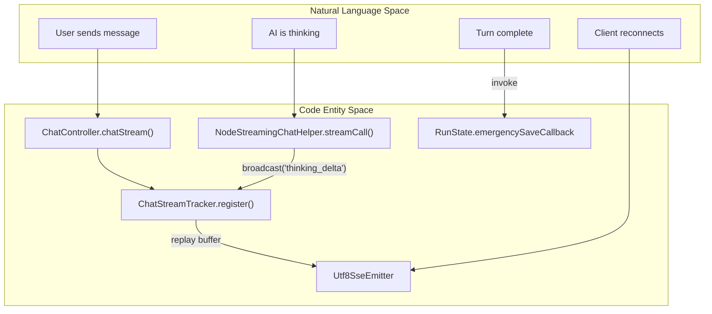
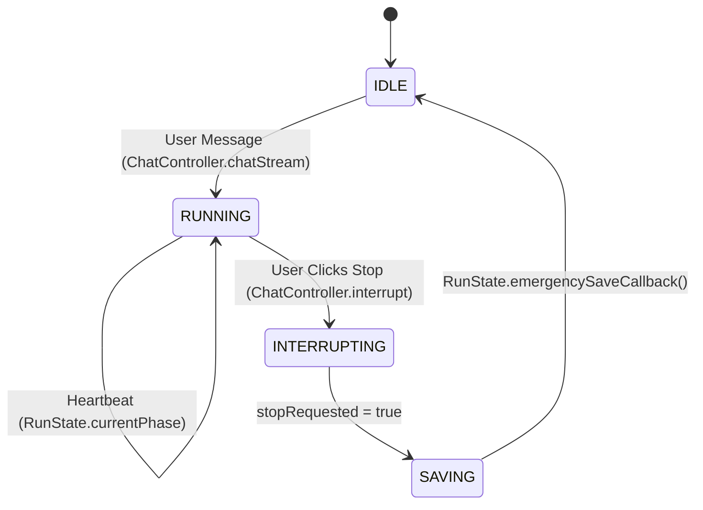

<!-- source: DeepWiki mcp.deepwiki.com · repo matevip/mateclaw · page 2.2 Streaming & SSE Delivery · fetched 2026-10-26 -->

# Streaming & SSE Delivery

Relevant source files

The following files were used as context for generating this wiki page:

- [mateclaw-server/src/main/java/vip/mate/agent/AgentGraphBuilder.java](mateclaw-server/src/main/java/vip/mate/agent/AgentGraphBuilder.java)
- [mateclaw-server/src/main/java/vip/mate/agent/BaseAgent.java](mateclaw-server/src/main/java/vip/mate/agent/BaseAgent.java)
- [mateclaw-server/src/main/java/vip/mate/agent/controller/AgentController.java](mateclaw-server/src/main/java/vip/mate/agent/controller/AgentController.java)
- [mateclaw-server/src/main/java/vip/mate/agent/graph/NodeStreamingChatHelper.java](mateclaw-server/src/main/java/vip/mate/agent/graph/NodeStreamingChatHelper.java)
- [mateclaw-server/src/main/java/vip/mate/agent/graph/StateGraphReActAgent.java](mateclaw-server/src/main/java/vip/mate/agent/graph/StateGraphReActAgent.java)
- [mateclaw-server/src/main/java/vip/mate/agent/graph/executor/ToolExecutionExecutor.java](mateclaw-server/src/main/java/vip/mate/agent/graph/executor/ToolExecutionExecutor.java)
- [mateclaw-server/src/main/java/vip/mate/agent/graph/node/ReasoningNode.java](mateclaw-server/src/main/java/vip/mate/agent/graph/node/ReasoningNode.java)
- [mateclaw-server/src/main/java/vip/mate/agent/graph/node/SummarizingNode.java](mateclaw-server/src/main/java/vip/mate/agent/graph/node/SummarizingNode.java)
- [mateclaw-server/src/main/java/vip/mate/agent/graph/plan/StateGraphPlanExecuteAgent.java](mateclaw-server/src/main/java/vip/mate/agent/graph/plan/StateGraphPlanExecuteAgent.java)
- [mateclaw-server/src/main/java/vip/mate/channel/web/ChatController.java](mateclaw-server/src/main/java/vip/mate/channel/web/ChatController.java)
- [mateclaw-server/src/main/java/vip/mate/channel/web/ChatStreamTracker.java](mateclaw-server/src/main/java/vip/mate/channel/web/ChatStreamTracker.java)
- [mateclaw-server/src/main/java/vip/mate/channel/web/Utf8SseEmitter.java](mateclaw-server/src/main/java/vip/mate/channel/web/Utf8SseEmitter.java)
- [mateclaw-server/src/main/java/vip/mate/channel/webchat/WebChatController.java](mateclaw-server/src/main/java/vip/mate/channel/webchat/WebChatController.java)
- [mateclaw-server/src/main/java/vip/mate/config/GraphObservationProperties.java](mateclaw-server/src/main/java/vip/mate/config/GraphObservationProperties.java)
- [mateclaw-server/src/main/java/vip/mate/memory/controller/DreamEventBroadcaster.java](mateclaw-server/src/main/java/vip/mate/memory/controller/DreamEventBroadcaster.java)
- [mateclaw-server/src/main/java/vip/mate/memory/event/DreamCompletedEvent.java](mateclaw-server/src/main/java/vip/mate/memory/event/DreamCompletedEvent.java)
- [mateclaw-server/src/main/java/vip/mate/memory/event/DreamFailedEvent.java](mateclaw-server/src/main/java/vip/mate/memory/event/DreamFailedEvent.java)
- [mateclaw-server/src/main/java/vip/mate/wiki/controller/WikiResearchController.java](mateclaw-server/src/main/java/vip/mate/wiki/controller/WikiResearchController.java)
- [mateclaw-server/src/main/java/vip/mate/wiki/repository/WikiChunkMapper.java](mateclaw-server/src/main/java/vip/mate/wiki/repository/WikiChunkMapper.java)
- [mateclaw-server/src/main/resources/application.yml](mateclaw-server/src/main/resources/application.yml)

MateClaw employs a decoupled producer-consumer architecture for real-time AI responses. By separating the LLM execution pipeline from the HTTP connection lifecycle, the system achieves robust delivery, supporting client reconnections, message queuing, and emergency state preservation.

## Architectural Overview

The streaming system is centered around `ChatStreamTracker`, which acts as a process-local event bus and buffer manager. Unlike traditional SSE implementations where the AI logic is tightly coupled to a single HTTP request, MateClaw's `ChatController` initiates an asynchronous `AgentGraph` execution that pushes events to the tracker.

### Key Components

| Component | Role | File Reference |
| :--- | :--- | :--- |
| `ChatStreamTracker` | Manages `RunState` lifecycles, event buffering, and subscriber (emitter) multiplexing. | [mateclaw-server/src/main/java/vip/mate/channel/web/ChatStreamTracker.java:53-53]() |
| `RunState` | Inner class holding the state of a single conversation turn, including buffers and message queues. | [mateclaw-server/src/main/java/vip/mate/channel/web/ChatStreamTracker.java:76-133]() |
| `Utf8SseEmitter` | Specialized `SseEmitter` that enforces `UTF-8` charset to prevent mojibake in non-UTF8 environments. | [mateclaw-server/src/main/java/vip/mate/channel/web/Utf8SseEmitter.java:31-31]() |
| `NodeStreamingChatHelper` | Utility used by Graph Nodes to push `content_delta` and `thinking_delta` to the tracker. | [mateclaw-server/src/main/java/vip/mate/agent/graph/NodeStreamingChatHelper.java:45-45]() |
| `ChatController` | Entry point for SSE requests; handles both new streams and reconnection logic. | [mateclaw-server/src/main/java/vip/mate/channel/web/ChatController.java:54-54]() |

**Sources:** [mateclaw-server/src/main/java/vip/mate/channel/web/ChatStreamTracker.java:53-133](), [mateclaw-server/src/main/java/vip/mate/channel/web/ChatController.java:54-140](), [mateclaw-server/src/main/java/vip/mate/agent/graph/NodeStreamingChatHelper.java:45-45]()

## SSE Delivery Pipeline

The delivery pipeline follows a "Register-Attach-Broadcast" pattern. This allows a user to refresh their browser or switch devices without losing the stream of an in-flight agent run.

### Data Flow: Producer to Consumer

1.  **Registration**: `ChatController` calls `streamTracker.register(conversationId)` to initialize a `RunState`. [mateclaw-server/src/main/java/vip/mate/channel/web/ChatController.java:191-191]()
2.  **Attachment**: The HTTP request thread creates a `Utf8SseEmitter` and calls `streamTracker.attach()`. If the buffer contains historical events for the current turn, they are replayed to the new emitter. [mateclaw-server/src/main/java/vip/mate/channel/web/ChatController.java:108-108]()
3.  **Execution**: The `AgentService` starts the `StateGraph`. Nodes (e.g., `ReasoningNode`, `SummarizingNode`) use `NodeStreamingChatHelper` to emit deltas. [mateclaw-server/src/main/java/vip/mate/agent/graph/node/ReasoningNode.java:46-47]()
4.  **Broadcasting**: `streamTracker.broadcast()` sends the event to all active `SseEmitter` subscribers and stores it in a bounded `buffer` (max 16,000 events). [mateclaw-server/src/main/java/vip/mate/channel/web/ChatStreamTracker.java:232-232]()

### Natural Language to Code Entity Space: Streaming Lifecycle

Title: Streaming Entity Mapping

**Sources:** [mateclaw-server/src/main/java/vip/mate/channel/web/ChatStreamTracker.java:23-48](), [mateclaw-server/src/main/java/vip/mate/channel/web/ChatStreamTracker.java:173-185](), [mateclaw-server/src/main/java/vip/mate/channel/web/ChatController.java:75-83](), [mateclaw-server/src/main/java/vip/mate/agent/graph/NodeStreamingChatHelper.java:32-34]()

## Buffer & Reconnection Management

`ChatStreamTracker` maintains a `buffer` of `SseEvent` objects within each `RunState`. This buffer ensures that if a connection drops during a long-running task, the client receives the full history upon reconnecting.

*   **Buffer Size**: Limited to 16,000 events. When exceeded, the system drops the oldest `thinking_delta` events to prioritize final content. [mateclaw-server/src/main/java/vip/mate/channel/web/ChatStreamTracker.java:56-56]()
*   **Sticky Sessions**: In multi-node deployments, the system assumes a single-instance model. Load balancers MUST be configured for sticky sessions based on `conversationId`. [mateclaw-server/src/main/java/vip/mate/channel/web/ChatStreamTracker.java:30-36]()
*   **Heartbeats**: A background `ScheduledExecutorService` sends heartbeats to prevent intermediate proxies from closing "idle" SSE connections. [mateclaw-server/src/main/java/vip/mate/channel/web/ChatStreamTracker.java:162-167]()
*   **Reconnection Logic**: If `request.getReconnect()` is true, `ChatController` attempts to `attach` to an existing `RunState`. If it fails, it distinguishes between "stream finished" and "stream not local" (multi-node routing issue). [mateclaw-server/src/main/java/vip/mate/channel/web/ChatController.java:107-133]()

**Sources:** [mateclaw-server/src/main/java/vip/mate/channel/web/ChatStreamTracker.java:55-58](), [mateclaw-server/src/main/java/vip/mate/channel/web/ChatStreamTracker.java:162-167](), [mateclaw-server/src/main/java/vip/mate/channel/web/ChatController.java:86-138]()

## Interrupt & Queue Pipeline

MateClaw supports two types of interrupts via the `InterruptType` enum:
1.  **USER_STOP**: Terminating the current turn immediately, stopping all further execution. [mateclaw-server/src/main/java/vip/mate/channel/web/ChatStreamTracker.java:71-71]()
2.  **USER_INTERRUPT_WITH_FOLLOWUP**: Interrupting the current turn to process a new high-priority message, with the previous turn's context preserved and new messages queued. [mateclaw-server/src/main/java/vip/mate/channel/web/ChatStreamTracker.java:73-73]()

### State Transitions and Queuing

The `RunState` contains a `messageQueue` (a `ConcurrentLinkedQueue`) to handle messages sent while the agent is busy. The `stopRequested` flag is checked by graph nodes to trigger early exit. [mateclaw-server/src/main/java/vip/mate/channel/web/ChatStreamTracker.java:85-85](), [mateclaw-server/src/main/java/vip/mate/channel/web/ChatStreamTracker.java:107-107]()

Title: Interrupt and Queue Logic

**Sources:** [mateclaw-server/src/main/java/vip/mate/channel/web/ChatStreamTracker.java:69-74](), [mateclaw-server/src/main/java/vip/mate/channel/web/ChatStreamTracker.java:107-107](), [mateclaw-server/src/main/java/vip/mate/channel/web/ChatController.java:231-255]()

## Emergency Save & JVM Shutdown

To prevent data loss during server restarts or crashes, `RunState` includes an `emergencySaveCallback`. This `Runnable` is registered by `ChatController` and captures the accumulated assistant content and tool calls.

*   **Trigger**: Invoked during `onShutdown()` via `@PreDestroy` or when a stream is explicitly stopped. [mateclaw-server/src/main/java/vip/mate/channel/web/ChatStreamTracker.java:110-119](), [mateclaw-server/src/main/java/vip/mate/channel/web/ChatStreamTracker.java:323-332]()
*   **Idempotency**: The callback is designed to be idempotent, as it may race with the normal `doOnComplete` persistence logic. [mateclaw-server/src/main/java/vip/mate/channel/web/ChatStreamTracker.java:115-118]()

**Sources:** [mateclaw-server/src/main/java/vip/mate/channel/web/ChatStreamTracker.java:110-120](), [mateclaw-server/src/main/java/vip/mate/channel/web/ChatStreamTracker.java:323-332]()

## Event Types & StreamDelta

The system broadcasts structured events through `ChatStreamTracker`. Common event names include:

| Event Name | Data Payload | Purpose |
| :--- | :--- | :--- |
| `content_delta` | `{"text": "..."}` | Incremental assistant response text. [mateclaw-server/src/main/java/vip/mate/agent/graph/NodeStreamingChatHelper.java:34-34]() |
| `thinking_delta` | `{"text": "..."}` | Incremental reasoning/thinking text. [mateclaw-server/src/main/java/vip/mate/agent/graph/NodeStreamingChatHelper.java:34-34]() |
| `phase` | `{"name": "...", "data": {}}` | Updates on the current agent phase (e.g., `thinking`, `summarizing`). [mateclaw-server/src/main/java/vip/mate/agent/graph/node/SummarizingNode.java:89-92]() |
| `done` | `{"status": "completed"}` | Signals the end of the stream. [mateclaw-server/src/main/java/vip/mate/channel/web/ChatController.java:113-113]() |
| `error` | `{"message": "..."}` | Signals a fatal execution error. [mateclaw-server/src/main/java/vip/mate/channel/web/ChatController.java:93-93]() |

**Sources:** [mateclaw-server/src/main/java/vip/mate/agent/graph/NodeStreamingChatHelper.java:30-37](), [mateclaw-server/src/main/java/vip/mate/agent/graph/node/SummarizingNode.java:89-92](), [mateclaw-server/src/main/java/vip/mate/channel/web/ChatController.java:93-113]()

---

