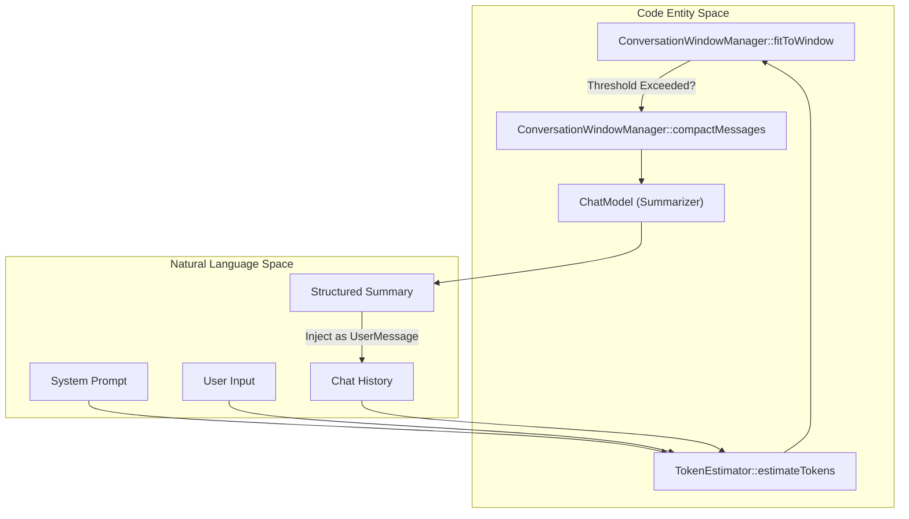
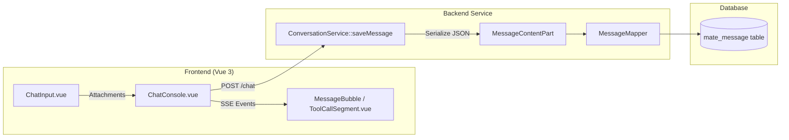

<!-- source: DeepWiki mcp.deepwiki.com · repo matevip/mateclaw · page 2.4 Conversation & History Management · fetched 2026-10-26 -->

# Conversation & History Management

Relevant source files

The following files were used as context for generating this wiki page:

- [mateclaw-server/src/main/java/vip/mate/agent/context/ConversationWindowManager.java](mateclaw-server/src/main/java/vip/mate/agent/context/ConversationWindowManager.java)
- [mateclaw-server/src/main/java/vip/mate/agent/graph/RepetitionDetector.java](mateclaw-server/src/main/java/vip/mate/agent/graph/RepetitionDetector.java)
- [mateclaw-server/src/main/java/vip/mate/agent/graph/edge/ReasoningDispatcher.java](mateclaw-server/src/main/java/vip/mate/agent/graph/edge/ReasoningDispatcher.java)
- [mateclaw-server/src/main/java/vip/mate/agent/graph/node/ObservationNode.java](mateclaw-server/src/main/java/vip/mate/agent/graph/node/ObservationNode.java)
- [mateclaw-server/src/main/java/vip/mate/config/WebSocketConfig.java](mateclaw-server/src/main/java/vip/mate/config/WebSocketConfig.java)
- [mateclaw-server/src/main/java/vip/mate/tool/builtin/DelegateAgentTool.java](mateclaw-server/src/main/java/vip/mate/tool/builtin/DelegateAgentTool.java)
- [mateclaw-server/src/main/java/vip/mate/tool/builtin/DelegationContext.java](mateclaw-server/src/main/java/vip/mate/tool/builtin/DelegationContext.java)
- [mateclaw-server/src/main/java/vip/mate/workspace/conversation/ConversationService.java](mateclaw-server/src/main/java/vip/mate/workspace/conversation/ConversationService.java)
- [mateclaw-server/src/main/java/vip/mate/workspace/conversation/controller/ConversationController.java](mateclaw-server/src/main/java/vip/mate/workspace/conversation/controller/ConversationController.java)
- [mateclaw-server/src/main/java/vip/mate/workspace/conversation/model/ConversationEntity.java](mateclaw-server/src/main/java/vip/mate/workspace/conversation/model/ConversationEntity.java)
- [mateclaw-server/src/main/java/vip/mate/workspace/conversation/model/MessageContentPart.java](mateclaw-server/src/main/java/vip/mate/workspace/conversation/model/MessageContentPart.java)
- [mateclaw-server/src/main/resources/db/migration/h2/V5__conversation_parent.sql](mateclaw-server/src/main/resources/db/migration/h2/V5__conversation_parent.sql)
- [mateclaw-server/src/main/resources/prompts/graph/limit-exceeded-system.txt](mateclaw-server/src/main/resources/prompts/graph/limit-exceeded-system.txt)
- [mateclaw-server/src/test/java/vip/mate/agent/graph/RepetitionDetectorTest.java](mateclaw-server/src/test/java/vip/mate/agent/graph/RepetitionDetectorTest.java)
- [mateclaw-ui/src/components/chat/ChatInput.vue](mateclaw-ui/src/components/chat/ChatInput.vue)
- [mateclaw-ui/src/components/chat/ToolCallSegment.vue](mateclaw-ui/src/components/chat/ToolCallSegment.vue)
- [mateclaw-ui/src/composables/chat/useChat.ts](mateclaw-ui/src/composables/chat/useChat.ts)
- [mateclaw-ui/src/composables/chat/useStream.ts](mateclaw-ui/src/composables/chat/useStream.ts)
- [mateclaw-ui/src/composables/useToolLabel.ts](mateclaw-ui/src/composables/useToolLabel.ts)
- [mateclaw-ui/src/views/ChatConsole.vue](mateclaw-ui/src/views/ChatConsole.vue)

The Conversation and History Management system in MateClaw is responsible for the persistence, retrieval, and optimization of agentic interactions. It manages the lifecycle of `ConversationEntity` and `MessageEntity` objects, provides context window optimization via the `ConversationWindowManager`, and facilitates complex multi-agent collaboration through parent-child delegation.

## Conversation Architecture

MateClaw distinguishes between top-level user conversations and internal child conversations used for delegation. All conversations are workspace-aware and linked to specific agents.

### Key Entities
*   **ConversationEntity**: Represents a chat session. It tracks `conversationId`, `agentId`, `username`, `workspaceId`, and `streamStatus` [mateclaw-server/src/main/java/vip/mate/workspace/conversation/model/ConversationEntity.java:15-35]().
*   **MessageEntity**: Represents an individual turn in a conversation. It supports multiple roles (`user`, `assistant`, `system`, `tool`) and stores rich metadata like `toolCalls`, `tokenUsage`, and `content_parts` [mateclaw-server/src/main/java/vip/mate/workspace/conversation/model/MessageEntity.java:15-40]().

### Data Flow: Message Persistence
The `ConversationService` acts as the primary orchestrator for CRUD operations on history.

| Function | Description | Source |
| :--- | :--- | :--- |
| `getOrCreateConversation` | Retrieves an existing session or initializes a new one with default metadata. | [mateclaw-server/src/main/java/vip/mate/workspace/conversation/ConversationService.java:114-132]() |
| `listConversations` | Fetches a user's conversations, excluding child delegation sessions from the sidebar. | [mateclaw-server/src/main/java/vip/mate/workspace/conversation/ConversationService.java:61-100]() |
| `saveMessage` | Persists a message and its associated `MessageContentPart` list. | [mateclaw-server/src/main/java/vip/mate/workspace/conversation/ConversationService.java:232-261]() |
| `renameConversation` | Updates the title of a conversation via `ConversationMapper`. | [mateclaw-server/src/main/java/vip/mate/workspace/conversation/ConversationService.java:185-195]() |

### Conversation Parent/Child Relationships
To support multi-agent collaboration, MateClaw implements a hierarchical conversation model. When an agent uses the `DelegateAgentTool`, a child conversation is created with a `parent_conversation_id` reference [mateclaw-server/src/main/java/vip/mate/workspace/conversation/ConversationService.java:137-146](). These child sessions are filtered out of the main UI sidebar by the `isNull(ConversationEntity::getParentConversationId)` condition to keep the user interface clean [mateclaw-server/src/main/java/vip/mate/workspace/conversation/ConversationService.java:64-67]().

Sources: [mateclaw-server/src/main/java/vip/mate/workspace/conversation/ConversationService.java:42-160](), [mateclaw-server/src/main/java/vip/mate/workspace/conversation/model/ConversationEntity.java:15-35]()

---

## Context Window Management (RFC-052)

The `ConversationWindowManager` (Hermes-style) manages the LLM context window by applying a four-stage compression strategy when token usage exceeds the `compactTriggerRatio` [mateclaw-server/src/main/java/vip/mate/agent/context/ConversationWindowManager.java:28-52]().

### Compression Pipeline
1.  **Soft Trim**: Truncates long tool results to a "head + tail" format [mateclaw-server/src/main/java/vip/mate/agent/context/ConversationWindowManager.java:30]().
2.  **Hard Clear**: Replaces old tool results with placeholders to save space [mateclaw-server/src/main/java/vip/mate/agent/context/ConversationWindowManager.java:31]().
3.  **Pre-Prune**: Strips unnecessary metadata before sending history to a summarizer LLM [mateclaw-server/src/main/java/vip/mate/agent/context/ConversationWindowManager.java:32]().
4.  **LLM Iterative Summary**: Generates a structured summary (Goals, Progress, Decisions, Files) and injects it as a `UserMessage` to avoid system-level instruction leakage [mateclaw-server/src/main/java/vip/mate/agent/context/ConversationWindowManager.java:33-45]().

### Token Budgeting Logic
The manager calculates a dynamic `historyBudget` by subtracting the system prompt, current user message, and a 5% safety margin from the model's `maxInputTokens` [mateclaw-server/src/main/java/vip/mate/agent/context/ConversationWindowManager.java:142-154](). To prevent infinite loops in small-context models (e.g., 8K), the reserved tokens are capped at 50% of the total window using `reservedCap` [mateclaw-server/src/main/java/vip/mate/agent/context/ConversationWindowManager.java:148-153]().

### Context Compression Flow
Title: "Context Window Optimization Logic"

Sources: [mateclaw-server/src/main/java/vip/mate/agent/context/ConversationWindowManager.java:103-160](), [mateclaw-server/src/main/java/vip/mate/agent/context/ConversationWindowManager.java:56-67]()

---

## Agent-to-Agent Delegation

The `DelegateAgentTool` enables complex multi-agent workflows by allowing one agent to spawn child agents.

### Delegation Modes
*   **Serial Delegation**: `delegateToAgent` spawns a single child agent and waits for a final reply [mateclaw-server/src/main/java/vip/mate/tool/builtin/DelegateAgentTool.java:77-124]().
*   **Parallel Delegation**: `delegateParallel` executes up to 3 child agents simultaneously using JDK 21 Virtual Threads via `DELEGATION_EXECUTOR` [mateclaw-server/src/main/java/vip/mate/tool/builtin/DelegateAgentTool.java:134-151]().

### Security & Recursion Control
To prevent infinite loops and resource exhaustion, the system enforces:
*   **Max Depth**: Hard limit of 3 levels of delegation [mateclaw-server/src/main/java/vip/mate/tool/builtin/DelegateAgentTool.java:41]().
*   **Tool Blocking**: Child agents are automatically denied access to `delegateToAgent`, `delegateParallel`, and `listAvailableAgents` defined in `CHILD_DENIED_TOOLS` [mateclaw-server/src/main/java/vip/mate/tool/builtin/DelegateAgentTool.java:53-57]().
*   **Context Tracking**: `DelegationContext` uses a `ThreadLocal` stack to maintain parent IDs and denied tool sets across nested calls [mateclaw-server/src/main/java/vip/mate/tool/builtin/DelegationContext.java:16-47]().

### Real-time Event Relay
During delegation, child agent progress is relayed back to the parent session via `ChatStreamTracker` using SSE events like `delegation_start` and `delegation_progress` [mateclaw-server/src/main/java/vip/mate/tool/builtin/DelegateAgentTool.java:105-112]().

Sources: [mateclaw-server/src/main/java/vip/mate/tool/builtin/DelegateAgentTool.java:39-160](), [mateclaw-server/src/main/java/vip/mate/tool/builtin/DelegationContext.java:21-65]()

---

## Message Content & Multimodal Injection

Messages in MateClaw are composed of `MessageContentPart` objects, allowing for multimodal and rich-text content.

### Content Part Types
*   **Text**: Standard chat text.
*   **Image**: Base64 or URL references for vision-capable models.
*   **File/Attachment**: References to files uploaded via `ChatInput.vue` [mateclaw-ui/src/components/chat/ChatInput.vue:12-58]().

### Multimodal Data Flow
Title: "Multimodal Message Processing"

Sources: [mateclaw-server/src/main/java/vip/mate/workspace/conversation/ConversationService.java:232-261](), [mateclaw-ui/src/components/chat/ToolCallSegment.vue:61-89](), [mateclaw-ui/src/components/chat/ChatInput.vue:12-58]()

---

## Shared and System Conversations

MateClaw supports specialized conversation types for external channels and automated tasks:

1.  **Shared Conversations**: Used for IM channels (WeChat, Feishu). These are owned by the `SYSTEM_USER` ("system") to ensure they remain visible in the administrative console regardless of the specific external sender [mateclaw-server/src/main/java/vip/mate/workspace/conversation/ConversationService.java:155-175]().
2.  **Child Conversations**: Created during delegation, these are marked with a `parentConversationId` and titled "子任务" (Sub-task) [mateclaw-server/src/main/java/vip/mate/workspace/conversation/ConversationService.java:137-146]().
3.  **Stream Tracking**: The `ChatStreamTracker` provides real-time status of whether a conversation is currently "running" or "idle" [mateclaw-server/src/main/java/vip/mate/workspace/conversation/controller/ConversationController.java:148-159]().

Sources: [mateclaw-server/src/main/java/vip/mate/workspace/conversation/ConversationService.java:155-180](), [mateclaw-server/src/main/java/vip/mate/workspace/conversation/controller/ConversationController.java:143-160]()

---

