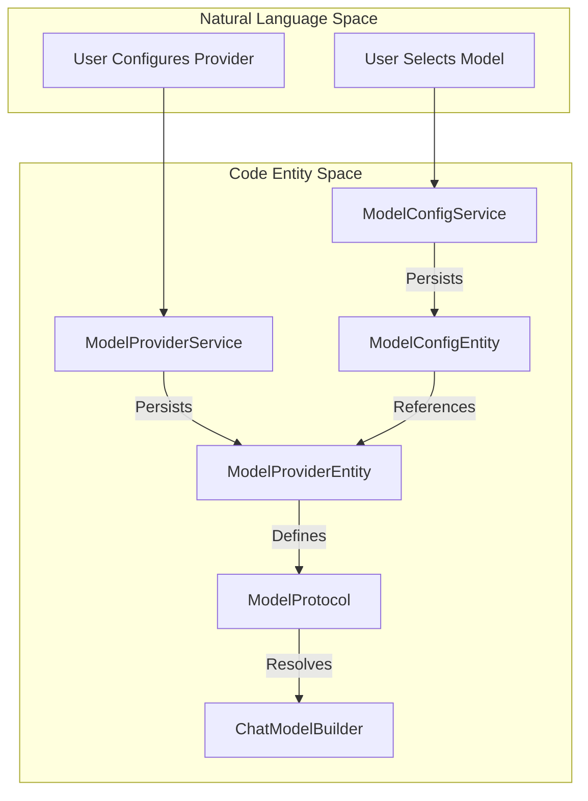
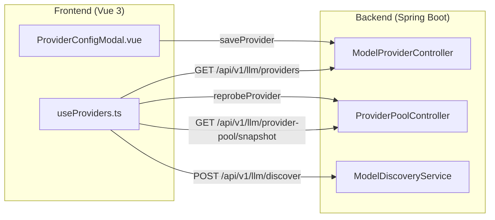

<!-- source: DeepWiki mcp.deepwiki.com · repo matevip/mateclaw · page 3.1 Provider Management & Failover · fetched 2026-10-26 -->

# Provider Management & Failover

<details>
<summary>Relevant source files</summary>

The following files were used as context for generating this wiki page:

- [mateclaw-server/src/main/java/vip/mate/llm/config/OllamaAutoDiscoveryRunner.java](mateclaw-server/src/main/java/vip/mate/llm/config/OllamaAutoDiscoveryRunner.java)
- [mateclaw-server/src/main/java/vip/mate/llm/failover/FallbackEntry.java](mateclaw-server/src/main/java/vip/mate/llm/failover/FallbackEntry.java)
- [mateclaw-server/src/main/java/vip/mate/llm/failover/ProviderHealthProperties.java](mateclaw-server/src/main/java/vip/mate/llm/failover/ProviderHealthProperties.java)
- [mateclaw-server/src/main/java/vip/mate/llm/failover/ProviderHealthTracker.java](mateclaw-server/src/main/java/vip/mate/llm/failover/ProviderHealthTracker.java)
- [mateclaw-server/src/main/java/vip/mate/llm/failover/probe/AnthropicListModelsProbe.java](mateclaw-server/src/main/java/vip/mate/llm/failover/probe/AnthropicListModelsProbe.java)
- [mateclaw-server/src/main/java/vip/mate/llm/failover/probe/DashScopeListModelsProbe.java](mateclaw-server/src/main/java/vip/mate/llm/failover/probe/DashScopeListModelsProbe.java)
- [mateclaw-server/src/main/java/vip/mate/llm/failover/probe/OpenAiCompatibleListModelsProbe.java](mateclaw-server/src/main/java/vip/mate/llm/failover/probe/OpenAiCompatibleListModelsProbe.java)
- [mateclaw-server/src/main/java/vip/mate/llm/model/ModelInfoDTO.java](mateclaw-server/src/main/java/vip/mate/llm/model/ModelInfoDTO.java)
- [mateclaw-server/src/main/java/vip/mate/llm/model/ProviderConfigRequest.java](mateclaw-server/src/main/java/vip/mate/llm/model/ProviderConfigRequest.java)
- [mateclaw-server/src/main/java/vip/mate/llm/service/ModelProviderService.java](mateclaw-server/src/main/java/vip/mate/llm/service/ModelProviderService.java)
- [mateclaw-server/src/main/resources/application-mysql.yml](mateclaw-server/src/main/resources/application-mysql.yml)
- [mateclaw-server/src/main/resources/db/migration/h2/V14__embedding_model_config.sql](mateclaw-server/src/main/resources/db/migration/h2/V14__embedding_model_config.sql)
- [mateclaw-server/src/main/resources/db/migration/h2/V15__purge_unavailable_dashscope_models.sql](mateclaw-server/src/main/resources/db/migration/h2/V15__purge_unavailable_dashscope_models.sql)
- [mateclaw-server/src/main/resources/db/migration/mysql/V11__skill_synthesis.sql](mateclaw-server/src/main/resources/db/migration/mysql/V11__skill_synthesis.sql)
- [mateclaw-server/src/main/resources/db/migration/mysql/V12__wiki_chunk_table.sql](mateclaw-server/src/main/resources/db/migration/mysql/V12__wiki_chunk_table.sql)
- [mateclaw-server/src/main/resources/db/migration/mysql/V13__wiki_chunk_embedding.sql](mateclaw-server/src/main/resources/db/migration/mysql/V13__wiki_chunk_embedding.sql)
- [mateclaw-server/src/main/resources/db/migration/mysql/V14__embedding_model_config.sql](mateclaw-server/src/main/resources/db/migration/mysql/V14__embedding_model_config.sql)
- [mateclaw-server/src/main/resources/db/migration/mysql/V15__purge_unavailable_dashscope_models.sql](mateclaw-server/src/main/resources/db/migration/mysql/V15__purge_unavailable_dashscope_models.sql)
- [mateclaw-server/src/main/resources/db/migration/mysql/V2__workspace_base_path.sql](mateclaw-server/src/main/resources/db/migration/mysql/V2__workspace_base_path.sql)
- [mateclaw-server/src/main/resources/db/migration/mysql/V4__agent_thinking_level.sql](mateclaw-server/src/main/resources/db/migration/mysql/V4__agent_thinking_level.sql)
- [mateclaw-server/src/main/resources/db/migration/mysql/V5__conversation_parent.sql](mateclaw-server/src/main/resources/db/migration/mysql/V5__conversation_parent.sql)
- [mateclaw-server/src/main/resources/db/migration/mysql/V7__wiki_last_processed_hash.sql](mateclaw-server/src/main/resources/db/migration/mysql/V7__wiki_last_processed_hash.sql)
- [mateclaw-server/src/test/java/vip/mate/agent/graph/ErrorClassificationTest.java](mateclaw-server/src/test/java/vip/mate/agent/graph/ErrorClassificationTest.java)
- [mateclaw-server/src/test/java/vip/mate/agent/graph/NodeStreamingChatHelperFallbackChainTest.java](mateclaw-server/src/test/java/vip/mate/agent/graph/NodeStreamingChatHelperFallbackChainTest.java)
- [mateclaw-server/src/test/java/vip/mate/llm/failover/ProviderHealthTrackerTest.java](mateclaw-server/src/test/java/vip/mate/llm/failover/ProviderHealthTrackerTest.java)
- [mateclaw-server/src/test/java/vip/mate/llm/failover/probe/OpenAiCompatibleListModelsProbeTest.java](mateclaw-server/src/test/java/vip/mate/llm/failover/probe/OpenAiCompatibleListModelsProbeTest.java)
- [mateclaw-ui/src/views/Settings/Models/modals/ProviderConfigModal.vue](mateclaw-ui/src/views/Settings/Models/modals/ProviderConfigModal.vue)
- [mateclaw-ui/src/views/Settings/Models/useProviders.ts](mateclaw-ui/src/views/Settings/Models/useProviders.ts)

</details>


This section describes how MateClaw abstracts multiple LLM providers, maintains a prioritized failover chain, and monitors provider health to ensure agent reliability. The system supports a "Model-First" architecture where the agent runtime can seamlessly pivot between different backends (e.g., failing over from a rate-limited OpenAI instance to a local Ollama or DashScope instance) without interrupting the user experience.

## Core Service Architecture

The provider layer is governed by three primary services that manage the lifecycle of configurations and runtime instances.

*   **ModelProviderService**: Manages the lifecycle of `ModelProviderEntity` records, including CRUD operations for custom providers and registration of plugin-based `ChatModel` instances [mateclaw-server/src/main/java/vip/mate/llm/service/ModelProviderService.java:25-62]().
*   **ModelConfigService**: Handles individual model settings (temperature, max tokens) and selection of default models, distinguishing between `chat` and `embedding` types [mateclaw-server/src/main/java/vip/mate/llm/service/ModelConfigService.java:22-34](), [mateclaw-server/src/main/resources/db/migration/h2/V14__embedding_model_config.sql:3-14]().
*   **ModelDiscoveryService**: Provides protocol-aware discovery and probing. It uses virtual threads to parallel-test models against their native protocols to ensure they are actually usable before presenting them to the user [mateclaw-server/src/main/java/vip/mate/llm/service/ModelDiscoveryService.java:28-45]().

### Provider Entity Relationships
The following diagram illustrates how configurations relate to the runtime builders.

**Provider Configuration to Code Entity Mapping**

Sources: [mateclaw-server/src/main/java/vip/mate/llm/service/ModelProviderService.java:74-92](), [mateclaw-server/src/main/java/vip/mate/llm/service/ModelConfigService.java:103-136](), [mateclaw-server/src/main/java/vip/mate/llm/model/ModelProtocol.java]()

## Failover & Health Tracking

MateClaw implements a sophisticated failover mechanism defined in RFC-009. When the primary provider fails with specific error types (e.g., billing issues, model not found, or empty responses), the `NodeStreamingChatHelper` traverses a `fallbackChain` of `FallbackEntry` objects [mateclaw-server/src/test/java/vip/mate/agent/graph/NodeStreamingChatHelperFallbackChainTest.java:24-48]().

### ProviderHealthTracker Lifecycle
The `ProviderHealthTracker` monitors the status of each provider using a cooldown/reprobe lifecycle:
1.  **Failure Detection**: When a `ChatModel` call fails, the error is classified.
2.  **Cooldown**: If the error is considered a provider-level fault, the provider is put into a "cooldown" state.
3.  **Reprobe**: After a configurable duration, the tracker attempts a health probe (e.g., a lightweight `/v1/models` call) to see if the provider has recovered [mateclaw-server/src/main/java/vip/mate/llm/failover/ProviderHealthTracker.java]().

**Health Monitoring Flow**
```mermaid
stateDiagram-v2
    [*] --> "HEALTHY"
    "HEALTHY" --> "COOLDOWN" : "Classification: BILLING / RATE_LIMIT"
    "COOLDOWN" --> "REPROBING" : "Cooldown Timer Expired"
    "REPROBING" --> "HEALTHY" : "Probe Success"
    "REPROBING" --> "COOLDOWN" : "Probe Failed"
```
Sources: [mateclaw-server/src/test/java/vip/mate/agent/graph/NodeStreamingChatHelperFallbackChainTest.java:91-98](), [mateclaw-server/src/main/java/vip/mate/llm/failover/ProviderHealthTracker.java]()

### Health Probes
Probes are protocol-specific implementations that verify connectivity without generating full completions:
*   **OpenAiCompatibleListModelsProbe**: Calls the `/v1/models` endpoint. It handles various path depths (e.g., `/v1` vs root) and treats 404/405/410 as "fail-open" since some vendors don't implement the models list [mateclaw-server/src/main/java/vip/mate/llm/failover/probe/OpenAiCompatibleListModelsProbe.java:47-111]().
*   **DashScopeListModelsProbe**: Probes DashScope by hitting its OpenAI-compatible `/v1/models` endpoint at the `compatible-mode` URL, which authenticates with the same API key [mateclaw-server/src/main/java/vip/mate/llm/failover/probe/DashScopeListModelsProbe.java:30-57]().
*   **AnthropicListModelsProbe**: Verifies the Anthropic API key via the `/v1/models` endpoint, validating the `x-api-key` and `anthropic-version` headers [mateclaw-server/src/main/java/vip/mate/llm/failover/probe/AnthropicListModelsProbe.java:38-59]().

## Ollama Auto-Discovery

To simplify local development, MateClaw includes an `OllamaAutoDiscoveryRunner`. This component runs asynchronously on startup to detect a local Ollama instance [mateclaw-server/src/main/java/vip/mate/llm/config/OllamaAutoDiscoveryRunner.java:36-66]().

*   **Discovery**: It pings the default Ollama port (11434) and fetches all pulled models [mateclaw-server/src/main/java/vip/mate/llm/config/OllamaAutoDiscoveryRunner.java:69-78]().
*   **Smart Activation**: It automatically enables models in the UI and rewrites seed tags (e.g., `llama3:latest` to `llama3:8b`) to match what is actually installed, preventing 404 errors on runtime calls [mateclaw-server/src/main/java/vip/mate/llm/config/OllamaAutoDiscoveryRunner.java:113-125]().
*   **Capability Awareness**: It identifies models that lack tool-calling support (e.g., `deepseek-r1`, `phi3`, `gemma`) and avoids setting them as the default agent model to prevent runtime 400 "does not support tools" errors [mateclaw-server/src/main/java/vip/mate/llm/config/OllamaAutoDiscoveryRunner.java:50-58]().

Sources: [mateclaw-server/src/main/java/vip/mate/llm/config/OllamaAutoDiscoveryRunner.java:36-132]()

## Settings → Models UI

The frontend architecture for model management is centered around the `useProviders` composable, which synchronizes the local Vue state with the backend provider pool and handles manual reprobing [mateclaw-ui/src/views/Settings/Models/useProviders.ts:8-115]().

### Key UI Components
*   **Provider Management**: The UI displays provider status (Healthy/Cooldown) using the `providerPool` snapshot [mateclaw-ui/src/views/Settings/Models/useProviders.ts:77-89]().
*   **ProviderConfigModal.vue**: Allows editing of API keys, Base URLs, and `fallbackPriority`. A priority of `0` excludes a provider from the failover chain [mateclaw-ui/src/views/Settings/Models/modals/ProviderConfigModal.vue:127-139]().
*   **OAuth Support**: Specifically for `anthropic-claude-code`, the UI supports an OAuth-based flow instead of static API keys [mateclaw-ui/src/views/Settings/Models/modals/ProviderConfigModal.vue:28-61]().

**UI State Management Diagram**

Sources: [mateclaw-ui/src/views/Settings/Models/useProviders.ts:96-115](), [mateclaw-ui/src/views/Settings/Models/modals/ProviderConfigModal.vue:1-151]()

## Implementation Details Table

| Feature | Code Entity | Description |
| :--- | :--- | :--- |
| **Failover Chain** | `FallbackEntry` | A record containing a `providerId` and a pre-built `ChatModel` instance [mateclaw-server/src/main/java/vip/mate/llm/failover/FallbackEntry.java](). |
| **Error Classification** | `NodeStreamingChatHelper.ErrorType` | Enums like `BILLING`, `EMPTY_RESPONSE`, and `MODEL_NOT_FOUND` that trigger failover [mateclaw-server/src/test/java/vip/mate/agent/graph/NodeStreamingChatHelperFallbackChainTest.java:91-98](). |
| **Thinking Detection** | `ModelInfoDTO.computeSupportsThinking` | Logic that detects if a model supports Anthropic extended thinking or OpenAI reasoning effort based on model name and family [mateclaw-server/src/main/java/vip/mate/llm/model/ModelInfoDTO.java:56-63](). |
| **Custom Providers** | `ModelProviderService.createCustomProvider` | Logic for registering third-party OpenAI-compatible endpoints with custom ID/Name [mateclaw-server/src/main/java/vip/mate/llm/service/ModelProviderService.java:94-123](). |
| **Embedding Support** | `V14__embedding_model_config.sql` | Migration adding `model_type` to distinguish chat from embedding models in the UI and knowledge base [mateclaw-server/src/main/resources/db/migration/mysql/V14__embedding_model_config.sql:1-16](). |

Sources: [mateclaw-server/src/main/java/vip/mate/llm/service/ModelProviderService.java](), [mateclaw-server/src/main/java/vip/mate/llm/model/ModelInfoDTO.java](), [mateclaw-server/src/main/resources/db/migration/mysql/V14__embedding_model_config.sql]()

---

