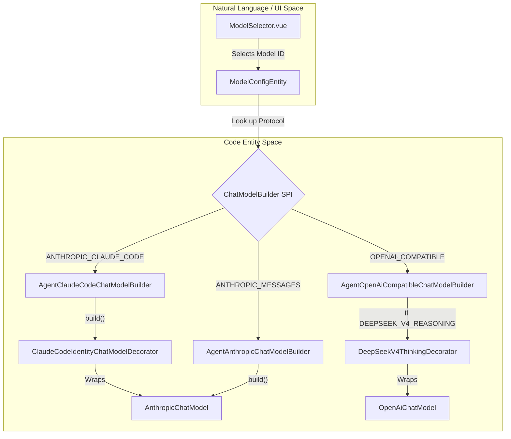
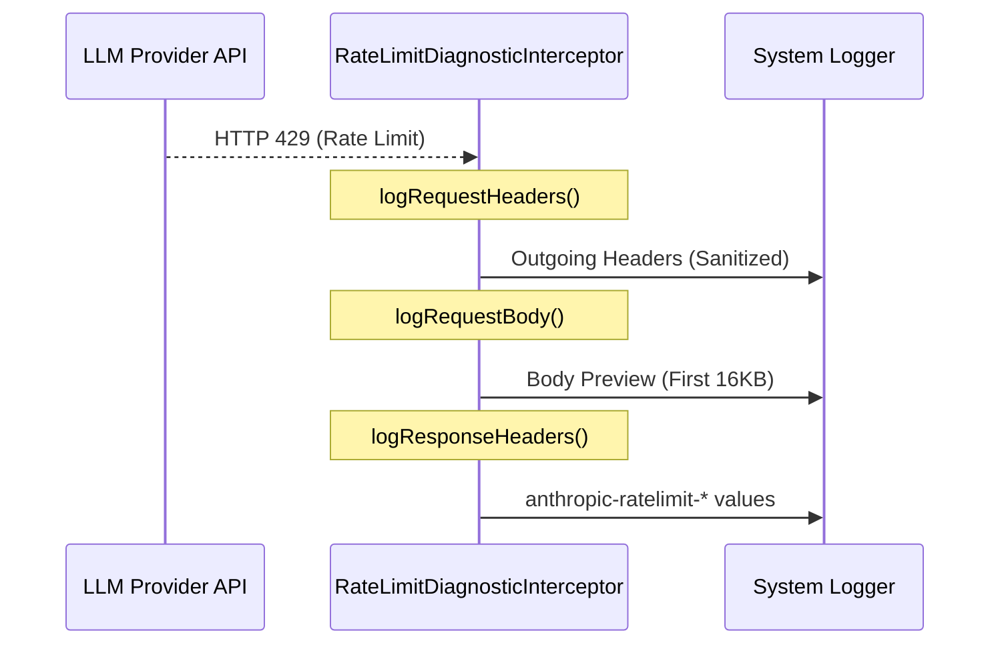

<!-- source: DeepWiki mcp.deepwiki.com · repo matevip/mateclaw · page 3.2 ChatModel Builders & Decorators · fetched 2026-10-26 -->

# ChatModel Builders & Decorators

Relevant source files

The following files were used as context for generating this wiki page:

- [mateclaw-server/src/main/java/vip/mate/agent/chatmodel/AgentAnthropicChatModelBuilder.java](mateclaw-server/src/main/java/vip/mate/agent/chatmodel/AgentAnthropicChatModelBuilder.java)
- [mateclaw-server/src/main/java/vip/mate/agent/chatmodel/AgentClaudeCodeChatModelBuilder.java](mateclaw-server/src/main/java/vip/mate/agent/chatmodel/AgentClaudeCodeChatModelBuilder.java)
- [mateclaw-server/src/main/java/vip/mate/agent/chatmodel/AgentDashScopeChatModelBuilder.java](mateclaw-server/src/main/java/vip/mate/agent/chatmodel/AgentDashScopeChatModelBuilder.java)
- [mateclaw-server/src/main/java/vip/mate/agent/chatmodel/AgentOpenAiCompatibleChatModelBuilder.java](mateclaw-server/src/main/java/vip/mate/agent/chatmodel/AgentOpenAiCompatibleChatModelBuilder.java)
- [mateclaw-server/src/main/java/vip/mate/agent/chatmodel/ClaudeCodeIdentityChatModelDecorator.java](mateclaw-server/src/main/java/vip/mate/agent/chatmodel/ClaudeCodeIdentityChatModelDecorator.java)
- [mateclaw-server/src/main/java/vip/mate/agent/chatmodel/ClaudeCodeSystemArrayExchangeFilter.java](mateclaw-server/src/main/java/vip/mate/agent/chatmodel/ClaudeCodeSystemArrayExchangeFilter.java)
- [mateclaw-server/src/main/java/vip/mate/agent/chatmodel/ClaudeCodeSystemArrayInterceptor.java](mateclaw-server/src/main/java/vip/mate/agent/chatmodel/ClaudeCodeSystemArrayInterceptor.java)
- [mateclaw-server/src/main/java/vip/mate/agent/chatmodel/DeepSeekV4ThinkingDecorator.java](mateclaw-server/src/main/java/vip/mate/agent/chatmodel/DeepSeekV4ThinkingDecorator.java)
- [mateclaw-server/src/main/java/vip/mate/agent/chatmodel/RateLimitDiagnosticExchangeFilter.java](mateclaw-server/src/main/java/vip/mate/agent/chatmodel/RateLimitDiagnosticExchangeFilter.java)
- [mateclaw-server/src/main/java/vip/mate/agent/chatmodel/RateLimitDiagnosticInterceptor.java](mateclaw-server/src/main/java/vip/mate/agent/chatmodel/RateLimitDiagnosticInterceptor.java)
- [mateclaw-server/src/main/java/vip/mate/llm/anthropic/oauth/ClaudeCodeApiHeaders.java](mateclaw-server/src/main/java/vip/mate/llm/anthropic/oauth/ClaudeCodeApiHeaders.java)
- [mateclaw-server/src/main/java/vip/mate/llm/anthropic/oauth/ClaudeCodeTokenRefresher.java](mateclaw-server/src/main/java/vip/mate/llm/anthropic/oauth/ClaudeCodeTokenRefresher.java)
- [mateclaw-server/src/main/java/vip/mate/llm/cache/CachePlanContext.java](mateclaw-server/src/main/java/vip/mate/llm/cache/CachePlanContext.java)
- [mateclaw-server/src/main/java/vip/mate/llm/model/ModelFamily.java](mateclaw-server/src/main/java/vip/mate/llm/model/ModelFamily.java)
- [mateclaw-server/src/main/java/vip/mate/llm/model/ModelProtocol.java](mateclaw-server/src/main/java/vip/mate/llm/model/ModelProtocol.java)
- [mateclaw-server/src/main/java/vip/mate/llm/model/ProviderInfoDTO.java](mateclaw-server/src/main/java/vip/mate/llm/model/ProviderInfoDTO.java)
- [mateclaw-server/src/main/java/vip/mate/llm/service/ModelConfigService.java](mateclaw-server/src/main/java/vip/mate/llm/service/ModelConfigService.java)
- [mateclaw-server/src/main/java/vip/mate/llm/service/ModelDiscoveryService.java](mateclaw-server/src/main/java/vip/mate/llm/service/ModelDiscoveryService.java)
- [mateclaw-server/src/main/java/vip/mate/memory/event/MemoryWriteEvent.java](mateclaw-server/src/main/java/vip/mate/memory/event/MemoryWriteEvent.java)
- [mateclaw-server/src/main/java/vip/mate/memory/service/SoulSummarizerService.java](mateclaw-server/src/main/java/vip/mate/memory/service/SoulSummarizerService.java)
- [mateclaw-server/src/main/java/vip/mate/memory/service/StructuredMemoryService.java](mateclaw-server/src/main/java/vip/mate/memory/service/StructuredMemoryService.java)
- [mateclaw-server/src/main/java/vip/mate/memory/spi/MemoryManager.java](mateclaw-server/src/main/java/vip/mate/memory/spi/MemoryManager.java)
- [mateclaw-server/src/main/java/vip/mate/memory/spi/MemoryProvider.java](mateclaw-server/src/main/java/vip/mate/memory/spi/MemoryProvider.java)
- [mateclaw-server/src/main/resources/db/migration/h2/V42__claude_47_gpt_55_models.sql](mateclaw-server/src/main/resources/db/migration/h2/V42__claude_47_gpt_55_models.sql)
- [mateclaw-server/src/main/resources/db/migration/mysql/V42__claude_47_gpt_55_models.sql](mateclaw-server/src/main/resources/db/migration/mysql/V42__claude_47_gpt_55_models.sql)
- [mateclaw-ui/src/views/Settings/Models/ProviderCard.vue](mateclaw-ui/src/views/Settings/Models/ProviderCard.vue)
- [mateclaw-ui/src/views/Settings/Models/index.vue](mateclaw-ui/src/views/Settings/Models/index.vue)

The `ChatModel` layer in MateClaw abstracts the complexities of different LLM providers (Anthropic, OpenAI, DashScope, etc.) into a unified interface. It uses a strategy-based builder pattern to resolve a `ModelProtocol` to a concrete `ChatModel` implementation, often wrapping the raw model with decorators to handle provider-specific requirements like OAuth identity, tool prefixing, or thinking-mode payloads.

## Architecture Overview

The `AgentGraphBuilder` (and the underlying `ChatModelBuilder` SPI) is responsible for instantiating the correct model based on the `ModelProtocol` defined in the `ModelProviderEntity` [vip/mate/llm/chatmodel/ChatModelBuilder.java:19-21]().

### Model Resolution Flow

The following diagram illustrates how a user's model selection in the UI is resolved to a decorated `ChatModel` in the backend.

**Model Resolution & Decoration Pipeline**

Sources: [mateclaw-server/src/main/java/vip/mate/agent/chatmodel/AgentClaudeCodeChatModelBuilder.java:87-117](), [mateclaw-server/src/main/java/vip/mate/agent/chatmodel/AgentOpenAiCompatibleChatModelBuilder.java:38-62](), [mateclaw-server/src/main/java/vip/mate/llm/model/ModelProtocol.java:21-25]()

---

## Claude Code ChatModel Builder

The `AgentClaudeCodeChatModelBuilder` implements `ModelProtocol.ANTHROPIC_CLAUDE_CODE`. This builder allows users with a Claude Pro/Max plan to run MateClaw using their existing OAuth subscription tokens instead of a standard API key [mateclaw-server/src/main/java/vip/mate/agent/chatmodel/AgentClaudeCodeChatModelBuilder.java:25-30]().

### OAuth & Header Masquerading
To avoid being flagged by Anthropic's anti-abuse systems, the builder masquerades as the official Claude Code CLI by configuring specific headers in the `AnthropicApi` client [mateclaw-server/src/main/java/vip/mate/agent/chatmodel/AgentClaudeCodeChatModelBuilder.java:31-46]():
1.  **Authorization**: Uses `Bearer <oauth-token>` via `ClaudeCodeOAuthService` [mateclaw-server/src/main/java/vip/mate/agent/chatmodel/AgentClaudeCodeChatModelBuilder.java:93-96]().
2.  **User-Agent**: Set to a bare `claude-cli/<version>` string to match real CLI traffic [mateclaw-server/src/main/java/vip/mate/llm/anthropic/oauth/ClaudeCodeApiHeaders.java:60-75]().
3.  **Betas**: Includes `claude-code-20250219` and `oauth-2025-04-20` to prevent intermittent 500 errors [mateclaw-server/src/main/java/vip/mate/llm/anthropic/oauth/ClaudeCodeApiHeaders.java:32-37]().

### ClaudeCodeIdentityChatModelDecorator
This decorator applies identity transforms to every request to ensure the traffic shape matches real Claude Code traffic [mateclaw-server/src/main/java/vip/mate/agent/chatmodel/ClaudeCodeIdentityChatModelDecorator.java:27-45]().

| Transform | Implementation Detail |
| :--- | :--- |
| **System Prefix** | Prepends `"You are Claude Code, Anthropic's official CLI for Claude."` [mateclaw-server/src/main/java/vip/mate/agent/chatmodel/ClaudeCodeIdentityChatModelDecorator.java:70-71](). |
| **System Array Rewrite** | Uses `ClaudeCodeSystemArrayInterceptor` to rewrite the `system` field from a string to a JSON array of content blocks [mateclaw-server/src/main/java/vip/mate/agent/chatmodel/ClaudeCodeSystemArrayInterceptor.java:17-23](). |
| **Tool Prefixing** | Renames tools to `mcp_<name>` on outbound requests and strips the prefix on inbound responses [mateclaw-server/src/main/java/vip/mate/agent/chatmodel/ClaudeCodeIdentityChatModelDecorator.java:54-63](). |
| **Brand Scrubbing** | Replaces `"MateClaw"` with `"Claude Code"` in system prompts to avoid identity filter flags [mateclaw-server/src/main/java/vip/mate/agent/chatmodel/ClaudeCodeIdentityChatModelDecorator.java:51-53](). |

Sources: [mateclaw-server/src/main/java/vip/mate/agent/chatmodel/AgentClaudeCodeChatModelBuilder.java:124-145](), [mateclaw-server/src/main/java/vip/mate/agent/chatmodel/ClaudeCodeIdentityChatModelDecorator.java:105-141](), [mateclaw-server/src/main/java/vip/mate/agent/chatmodel/ClaudeCodeSystemArrayInterceptor.java:54-69]()

---

## Anthropic & Thinking Mode

The `AgentAnthropicChatModelBuilder` handles the standard `ANTHROPIC_MESSAGES` protocol. It maps MateClaw's internal `ThinkingLevel` (from `ThinkingLevelHolder`) to Anthropic's extended-thinking token budgets [mateclaw-server/src/main/java/vip/mate/agent/chatmodel/AgentAnthropicChatModelBuilder.java:29-35]().

### Thinking Budget Mapping
Budgets are resolved during the `buildAnthropicOptions` phase [mateclaw-server/src/main/java/vip/mate/agent/chatmodel/AgentAnthropicChatModelBuilder.java:119-121]():
*   **Low**: 4,096 tokens
*   **Medium**: 8,192 tokens
*   **High**: 16,384 tokens
*   **XHigh**: 24,576 tokens (exclusive to Claude 4.7) [mateclaw-server/src/main/java/vip/mate/agent/chatmodel/AgentAnthropicChatModelBuilder.java:140-141]().
*   **Max**: 32,768 tokens

For Claude 4.7 variants, detected via `isClaude47()`, the builder omits `temperature`, `top_p`, and `top_k` parameters entirely, as providing any value (even defaults) results in a 400 Bad Request when thinking is enabled [mateclaw-server/src/main/java/vip/mate/agent/chatmodel/AgentAnthropicChatModelBuilder.java:102-117]().

Sources: [mateclaw-server/src/main/java/vip/mate/agent/chatmodel/AgentAnthropicChatModelBuilder.java:128-147](), [mateclaw-server/src/main/java/vip/mate/agent/ThinkingLevelHolder.java:16-20]()

---

## DeepSeek V4 & OpenAI Compatibility

The `AgentOpenAiCompatibleChatModelBuilder` delegates to `AgentGraphBuilder` for basic API construction but adds specific logic for the DeepSeek V4 family [mateclaw-server/src/main/java/vip/mate/agent/chatmodel/AgentOpenAiCompatibleChatModelBuilder.java:20-25]().

### DeepSeekV4ThinkingDecorator
When `ModelFamily.detect()` identifies a model as `DEEPSEEK_V4_REASONING`, the builder wraps the `OpenAiChatModel` with the `DeepSeekV4ThinkingDecorator` [mateclaw-server/src/main/java/vip/mate/agent/chatmodel/AgentOpenAiCompatibleChatModelBuilder.java:58-60]().
*   **Payload Patching**: DeepSeek V4 requires a `thinking` object in the JSON payload (e.g., `{"thinking": {"type": "enabled"}}`) which is not part of the standard OpenAI specification [mateclaw-server/src/main/java/vip/mate/agent/chatmodel/DeepSeekV4ThinkingDecorator.java:1-30]().
*   **Reasoning Extraction**: The decorator handles the extraction and replay of the `reasoning_content` field from the provider's response stream.

Sources: [mateclaw-server/src/main/java/vip/mate/agent/chatmodel/AgentOpenAiCompatibleChatModelBuilder.java:44-62](), [mateclaw-server/src/main/java/vip/mate/llm/model/ModelFamily.java:15-20]()

---

## Diagnostic Interceptors

MateClaw uses interceptors to diagnose API failures, particularly for the sensitive Anthropic OAuth path.

### RateLimitDiagnosticInterceptor
This interceptor triggers on HTTP 429 status codes. It logs sanitized request headers, a 16KB preview of the request body, and `anthropic-ratelimit-*` response headers [mateclaw-server/src/main/java/vip/mate/agent/chatmodel/RateLimitDiagnosticInterceptor.java:14-25]().

**429 Diagnostic Flow**

This logging helps distinguish between three failure modes:
1.  **Quota Exhausted**: `tokens-remaining` is 0; `retry-after` is high.
2.  **Anti-abuse Fingerprint**: Rate limit headers are **absent** (indicates header/identity mismatch) [mateclaw-server/src/main/java/vip/mate/agent/chatmodel/RateLimitDiagnosticInterceptor.java:109-111]().
3.  **Burst Limit**: `tokens-remaining` is positive; `retry-after` is low.

Sources: [mateclaw-server/src/main/java/vip/mate/agent/chatmodel/RateLimitDiagnosticInterceptor.java:31-69](), [mateclaw-server/src/main/java/vip/mate/agent/chatmodel/RateLimitDiagnosticExchangeFilter.java:55-64]()

---

## Model Discovery & Protocol Filtering

The `ModelDiscoveryService` performs protocol-aware filtering during the discovery process to ensure only compatible models are presented to the user [mateclaw-server/src/main/java/vip/mate/llm/service/ModelDiscoveryService.java:126-133]().

### DashScope Protocol Filtering
DashScope's discovery endpoint often returns models that fail on its native protocol. The service applies several filters [mateclaw-server/src/main/java/vip/mate/llm/service/ModelDiscoveryService.java:139-140]():
*   **Explicit Deny List**: Blocks known failures like `qwen3.5-max` and `qwen3.6-plus` [mateclaw-server/src/main/java/vip/mate/llm/service/ModelDiscoveryService.java:52-57]().
*   **Modality Filtering**: Blocks non-chat prefixes such as `qwen-vl-` (Vision), `qwen-image-`, and `qwen-tts-` [mateclaw-server/src/main/java/vip/mate/llm/service/ModelDiscoveryService.java:85-107]().
*   **Parallel Probing**: Uses a virtual-thread executor (`PROBE_EXECUTOR`) to perform a real runtime probe on each model. Models that fail the probe are marked with `probeOk=false` in the UI [mateclaw-server/src/main/java/vip/mate/llm/service/ModelDiscoveryService.java:37-45]().

Sources: [mateclaw-server/src/main/java/vip/mate/llm/service/ModelDiscoveryService.java:141-158](), [mateclaw-server/src/main/java/vip/mate/llm/service/ModelDiscoveryService.java:65-76]()

---

