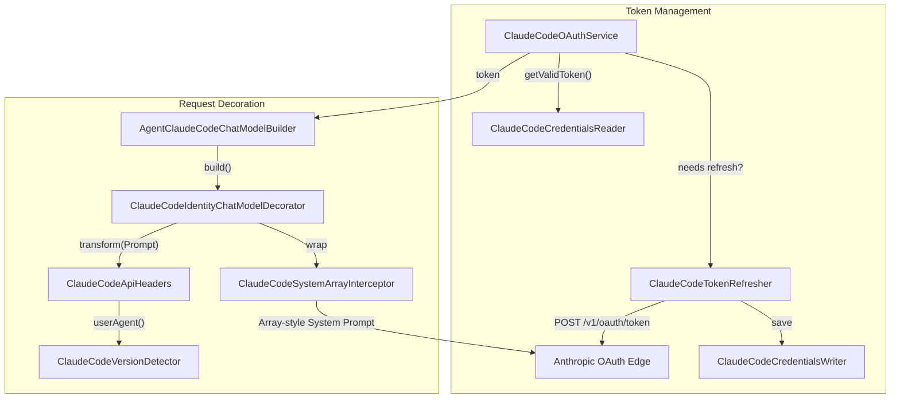
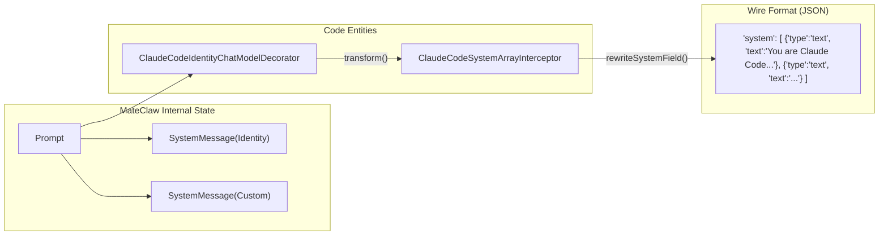

<!-- source: DeepWiki mcp.deepwiki.com · repo matevip/mateclaw · page 3.3 OAuth & Authentication Flows · fetched 2026-10-26 -->

# OAuth & Authentication Flows

Relevant source files

The following files were used as context for generating this wiki page:

- [mateclaw-server/src/main/java/vip/mate/agent/chatmodel/AgentClaudeCodeChatModelBuilder.java](mateclaw-server/src/main/java/vip/mate/agent/chatmodel/AgentClaudeCodeChatModelBuilder.java)
- [mateclaw-server/src/main/java/vip/mate/agent/chatmodel/AgentOpenAiCompatibleChatModelBuilder.java](mateclaw-server/src/main/java/vip/mate/agent/chatmodel/AgentOpenAiCompatibleChatModelBuilder.java)
- [mateclaw-server/src/main/java/vip/mate/agent/chatmodel/ClaudeCodeIdentityChatModelDecorator.java](mateclaw-server/src/main/java/vip/mate/agent/chatmodel/ClaudeCodeIdentityChatModelDecorator.java)
- [mateclaw-server/src/main/java/vip/mate/agent/chatmodel/ClaudeCodeSystemArrayExchangeFilter.java](mateclaw-server/src/main/java/vip/mate/agent/chatmodel/ClaudeCodeSystemArrayExchangeFilter.java)
- [mateclaw-server/src/main/java/vip/mate/agent/chatmodel/ClaudeCodeSystemArrayInterceptor.java](mateclaw-server/src/main/java/vip/mate/agent/chatmodel/ClaudeCodeSystemArrayInterceptor.java)
- [mateclaw-server/src/main/java/vip/mate/agent/chatmodel/DeepSeekV4ThinkingDecorator.java](mateclaw-server/src/main/java/vip/mate/agent/chatmodel/DeepSeekV4ThinkingDecorator.java)
- [mateclaw-server/src/main/java/vip/mate/agent/chatmodel/RateLimitDiagnosticExchangeFilter.java](mateclaw-server/src/main/java/vip/mate/agent/chatmodel/RateLimitDiagnosticExchangeFilter.java)
- [mateclaw-server/src/main/java/vip/mate/agent/chatmodel/RateLimitDiagnosticInterceptor.java](mateclaw-server/src/main/java/vip/mate/agent/chatmodel/RateLimitDiagnosticInterceptor.java)
- [mateclaw-server/src/main/java/vip/mate/llm/anthropic/oauth/ClaudeCodeApiHeaders.java](mateclaw-server/src/main/java/vip/mate/llm/anthropic/oauth/ClaudeCodeApiHeaders.java)
- [mateclaw-server/src/main/java/vip/mate/llm/anthropic/oauth/ClaudeCodeCredentials.java](mateclaw-server/src/main/java/vip/mate/llm/anthropic/oauth/ClaudeCodeCredentials.java)
- [mateclaw-server/src/main/java/vip/mate/llm/anthropic/oauth/ClaudeCodeCredentialsReader.java](mateclaw-server/src/main/java/vip/mate/llm/anthropic/oauth/ClaudeCodeCredentialsReader.java)
- [mateclaw-server/src/main/java/vip/mate/llm/anthropic/oauth/ClaudeCodeCredentialsWriter.java](mateclaw-server/src/main/java/vip/mate/llm/anthropic/oauth/ClaudeCodeCredentialsWriter.java)
- [mateclaw-server/src/main/java/vip/mate/llm/anthropic/oauth/ClaudeCodeOAuthService.java](mateclaw-server/src/main/java/vip/mate/llm/anthropic/oauth/ClaudeCodeOAuthService.java)
- [mateclaw-server/src/main/java/vip/mate/llm/anthropic/oauth/ClaudeCodeTokenRefresher.java](mateclaw-server/src/main/java/vip/mate/llm/anthropic/oauth/ClaudeCodeTokenRefresher.java)
- [mateclaw-server/src/main/java/vip/mate/llm/anthropic/oauth/ClaudeCodeVersionDetector.java](mateclaw-server/src/main/java/vip/mate/llm/anthropic/oauth/ClaudeCodeVersionDetector.java)
- [mateclaw-server/src/main/java/vip/mate/llm/controller/ClaudeCodeOAuthController.java](mateclaw-server/src/main/java/vip/mate/llm/controller/ClaudeCodeOAuthController.java)
- [mateclaw-server/src/main/java/vip/mate/llm/controller/OAuthController.java](mateclaw-server/src/main/java/vip/mate/llm/controller/OAuthController.java)
- [mateclaw-server/src/main/java/vip/mate/llm/model/ModelFamily.java](mateclaw-server/src/main/java/vip/mate/llm/model/ModelFamily.java)
- [mateclaw-server/src/main/java/vip/mate/llm/model/ModelProviderEntity.java](mateclaw-server/src/main/java/vip/mate/llm/model/ModelProviderEntity.java)
- [mateclaw-server/src/main/java/vip/mate/llm/oauth/OpenAIOAuthService.java](mateclaw-server/src/main/java/vip/mate/llm/oauth/OpenAIOAuthService.java)
- [mateclaw-server/src/main/resources/db/migration/h2/V21__provider_fallback_priority.sql](mateclaw-server/src/main/resources/db/migration/h2/V21__provider_fallback_priority.sql)
- [mateclaw-server/src/main/resources/db/migration/h2/V43__rfc062_claude_code_oauth_provider.sql](mateclaw-server/src/main/resources/db/migration/h2/V43__rfc062_claude_code_oauth_provider.sql)
- [mateclaw-server/src/main/resources/db/migration/mysql/V21__provider_fallback_priority.sql](mateclaw-server/src/main/resources/db/migration/mysql/V21__provider_fallback_priority.sql)
- [mateclaw-server/src/main/resources/db/migration/mysql/V43__rfc062_claude_code_oauth_provider.sql](mateclaw-server/src/main/resources/db/migration/mysql/V43__rfc062_claude_code_oauth_provider.sql)

This section describes MateClaw's implementation of OAuth 2.0 and identity-masking flows, specifically focusing on the integration with Anthropic (Claude Code) and OpenAI. These flows allow users to bring their own subscriptions (e.g., Claude Pro/Max) into the platform by authenticating as official CLI tools.

## Claude Code OAuth Lifecycle

RFC-062 introduces support for `ModelProtocol.ANTHROPIC_CLAUDE_CODE`, which enables MateClaw to use the user's Claude Code subscription token instead of a standard API key [mateclaw-server/src/main/java/vip/mate/agent/chatmodel/AgentClaudeCodeChatModelBuilder.java:25-29](). This allows users with existing entitlements to run MateClaw without incurring additional API costs.

### Authentication Service Stack
The lifecycle is managed by a dedicated service stack that handles token retrieval, automatic refreshing, and identity spoofing:

*   **`ClaudeCodeOAuthService`**: The entry point for obtaining valid tokens. It coordinates between the reader/writer components and the refresher, ensuring tokens are refreshed when within 60s of expiry [mateclaw-server/src/main/java/vip/mate/agent/chatmodel/AgentClaudeCodeChatModelBuilder.java:49-52]().
*   **`ClaudeCodeTokenRefresher`**: Handles the OAuth 2.0 `refresh_token` grant against Anthropic's public endpoints (`platform.claude.com` and `console.anthropic.com`) [mateclaw-server/src/main/java/vip/mate/llm/anthropic/oauth/ClaudeCodeTokenRefresher.java:20-30](). It uses the public Claude Code `CLIENT_ID` [mateclaw-server/src/main/java/vip/mate/llm/anthropic/oauth/ClaudeCodeTokenRefresher.java:45-45]().
*   **`ClaudeCodeCredentials`**: A data carrier for the `access_token`, `refresh_token`, and expiry timestamp [mateclaw-server/src/main/java/vip/mate/llm/anthropic/oauth/ClaudeCodeTokenRefresher.java:124-128]().
*   **`ClaudeCodeVersionDetector`**: Provides the current version string of the Claude CLI to ensure headers match real CLI traffic [mateclaw-server/src/main/java/vip/mate/llm/anthropic/oauth/ClaudeCodeApiHeaders.java:47-47]().

### Identity Transformation
Anthropic's OAuth edge enforces strict anti-abuse gates. If a request claims to be Claude Code but does not match the expected wire format or identity, it is rate-limited (often returning a generic "Error" message) or rejected with a 500 error [mateclaw-server/src/main/java/vip/mate/agent/chatmodel/ClaudeCodeIdentityChatModelDecorator.java:30-40]().

The `ClaudeCodeIdentityChatModelDecorator` applies several transforms:
1.  **System Prefix**: Prepends `"You are Claude Code, Anthropic's official CLI for Claude."` [mateclaw-server/src/main/java/vip/mate/agent/chatmodel/ClaudeCodeIdentityChatModelDecorator.java:69-71]().
2.  **MCP Prefixing**: Renames all outgoing tool definitions to include an `mcp_` prefix (e.g., `shell_execute` becomes `mcp_shell_execute`) [mateclaw-server/src/main/java/vip/mate/agent/chatmodel/ClaudeCodeIdentityChatModelDecorator.java:73-74](). This is required because real Claude Code runs tools through MCP servers [mateclaw-server/src/main/java/vip/mate/agent/chatmodel/ClaudeCodeIdentityChatModelDecorator.java:54-57]().
3.  **Branding Scrub**: Replaces `"MateClaw"` with `"Claude Code"` in system prompts to avoid identity contradictions that trip content filters [mateclaw-server/src/main/java/vip/mate/agent/chatmodel/ClaudeCodeIdentityChatModelDecorator.java:51-53]().

### Claude Code Authentication Data Flow

Title: Claude Code OAuth Token and Identity Flow

Sources: [mateclaw-server/src/main/java/vip/mate/agent/chatmodel/AgentClaudeCodeChatModelBuilder.java:49-56](), [mateclaw-server/src/main/java/vip/mate/llm/anthropic/oauth/ClaudeCodeTokenRefresher.java:48-51](), [mateclaw-server/src/main/java/vip/mate/agent/chatmodel/ClaudeCodeIdentityChatModelDecorator.java:46-64]().

## OpenAI OAuth Flow

The `OpenAIOAuthService` implements a PKCE-based OAuth 2.0 flow using the public OpenAI Codex CLI `client_id` (`app_EMoamEEZ73f0CkXaXp7hrann`) [mateclaw-server/src/main/java/vip/mate/llm/oauth/OpenAIOAuthService.java:58-60]().

### Deployment Modes
Because the OpenAI CLI redirect URI is hardcoded to `http://localhost:1455/auth/callback`, MateClaw supports two modes based on the deployment environment [mateclaw-server/src/main/java/vip/mate/llm/oauth/OpenAIOAuthService.java:30-52]():

1.  **LOCAL**: Starts a temporary `HttpServer` on port 1455 to capture the callback automatically. This is the default for desktop or localhost deployments [mateclaw-server/src/main/java/vip/mate/llm/oauth/OpenAIOAuthService.java:80-82]().
2.  **MANUAL_PASTE**: Used for remote server deployments where the browser cannot reach the server's localhost. The user performs the login, reaches a "Connection Refused" page on their machine, and copies the URL (containing the `code` and `state`) back into the MateClaw UI via `OAuthController.callbackPaste` [mateclaw-server/src/main/java/vip/mate/llm/oauth/OpenAIOAuthService.java:83-84](), [mateclaw-server/src/main/java/vip/mate/llm/controller/OAuthController.java:39-44]().

## Rate-Limit Diagnostics

To debug issues with Anthropic's anti-abuse gates, MateClaw employs diagnostic interceptors that trigger on HTTP 429 (Too Many Requests) [mateclaw-server/src/main/java/vip/mate/agent/chatmodel/RateLimitDiagnosticInterceptor.java:15-18]().

### Failure Mode Classification
The `RateLimitDiagnosticInterceptor` (and its WebFlux counterpart `RateLimitDiagnosticExchangeFilter`) logs specific headers to classify the failure [mateclaw-server/src/main/java/vip/mate/agent/chatmodel/RateLimitDiagnosticInterceptor.java:27-29]():

| Failure Mode | `tokens-remaining` | `retry-after` | Root Cause |
| :--- | :--- | :--- | :--- |
| **Quota Exhausted** | 0 | Thousands of seconds | User has hit their 5h Pro/Max limit [mateclaw-server/src/main/java/vip/mate/agent/chatmodel/RateLimitDiagnosticInterceptor.java:22-22](). |
| **Anti-abuse Gate** | (Absent) | (Absent) | Missing/incorrect identity headers or system prompt [mateclaw-server/src/main/java/vip/mate/agent/chatmodel/RateLimitDiagnosticInterceptor.java:23-23](). |
| **Burst Limit** | Large | Single-digit seconds | Per-minute rate limit exceeded [mateclaw-server/src/main/java/vip/mate/agent/chatmodel/RateLimitDiagnosticInterceptor.java:24-24](). |

Sources: [mateclaw-server/src/main/java/vip/mate/agent/chatmodel/RateLimitDiagnosticInterceptor.java:19-25](), [mateclaw-server/src/main/java/vip/mate/agent/chatmodel/RateLimitDiagnosticExchangeFilter.java:19-25]().

## System Array Interceptors

Anthropic's OAuth gate has a specific quirk: it rejects requests where the "Claude Code" identity prefix is merged into a single string with other system instructions. However, it accepts them if they are sent as separate elements in a JSON array [mateclaw-server/src/main/java/vip/mate/agent/chatmodel/ClaudeCodeSystemArrayInterceptor.java:21-24]().

MateClaw implements `ClaudeCodeSystemArrayInterceptor` (Sync) and `ClaudeCodeSystemArrayExchangeFilter` (Streaming) to perform this rewrite at the HTTP transport layer [mateclaw-server/src/main/java/vip/mate/agent/chatmodel/ClaudeCodeSystemArrayInterceptor.java:30-32]().

### Request Entity Mapping

Title: Anthropic OAuth Request Transformation

Sources: [mateclaw-server/src/main/java/vip/mate/agent/chatmodel/ClaudeCodeIdentityChatModelDecorator.java:112-124](), [mateclaw-server/src/main/java/vip/mate/agent/chatmodel/ClaudeCodeSystemArrayInterceptor.java:45-51]().

---

