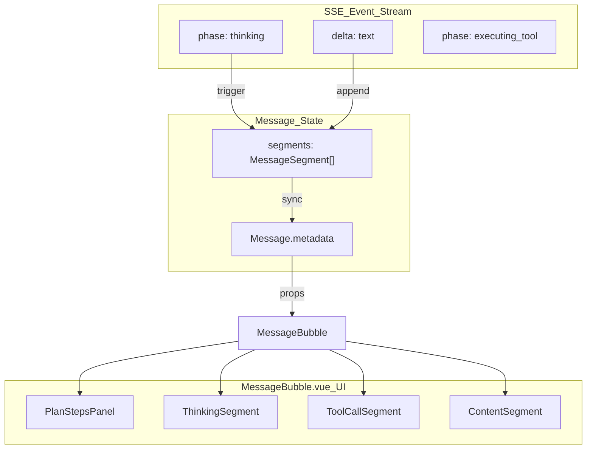
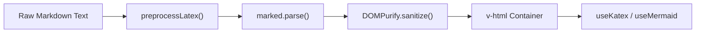

<!-- source: DeepWiki mcp.deepwiki.com · repo matevip/mateclaw · page 4.2 Message Rendering & Components · fetched 2026-10-26 -->

# Message Rendering & Components

Relevant source files

The following files were used as context for generating this wiki page:

- [mateclaw-server/src/main/java/vip/mate/agent/graph/plan/node/DirectAnswerNode.java](mateclaw-server/src/main/java/vip/mate/agent/graph/plan/node/DirectAnswerNode.java)
- [mateclaw-ui/TEST_CASES.md](mateclaw-ui/TEST_CASES.md)
- [mateclaw-ui/pnpm-lock.yaml](mateclaw-ui/pnpm-lock.yaml)
- [mateclaw-ui/src/assets/main.css](mateclaw-ui/src/assets/main.css)
- [mateclaw-ui/src/components/chat/BrowserTimeline.vue](mateclaw-ui/src/components/chat/BrowserTimeline.vue)
- [mateclaw-ui/src/components/chat/CompressionSummary.vue](mateclaw-ui/src/components/chat/CompressionSummary.vue)
- [mateclaw-ui/src/components/chat/MessageBubble.vue](mateclaw-ui/src/components/chat/MessageBubble.vue)
- [mateclaw-ui/src/components/chat/MessageList.vue](mateclaw-ui/src/components/chat/MessageList.vue)
- [mateclaw-ui/src/components/chat/ModelSelector.vue](mateclaw-ui/src/components/chat/ModelSelector.vue)
- [mateclaw-ui/src/components/chat/PlanStepsPanel.vue](mateclaw-ui/src/components/chat/PlanStepsPanel.vue)
- [mateclaw-ui/src/components/chat/ThinkingSegment.vue](mateclaw-ui/src/components/chat/ThinkingSegment.vue)
- [mateclaw-ui/src/components/chat/UserMessageContent.vue](mateclaw-ui/src/components/chat/UserMessageContent.vue)
- [mateclaw-ui/src/composables/useKatexRenderer.ts](mateclaw-ui/src/composables/useKatexRenderer.ts)
- [mateclaw-ui/src/composables/useMarkdownRenderer.ts](mateclaw-ui/src/composables/useMarkdownRenderer.ts)
- [mateclaw-ui/src/composables/useMermaidRenderer.ts](mateclaw-ui/src/composables/useMermaidRenderer.ts)
- [mateclaw-ui/src/views/AgentContext.vue](mateclaw-ui/src/views/AgentContext.vue)

This page details the frontend architecture for message rendering and interactive chat components in MateClaw. The system employs a segmented rendering strategy that allows real-time updates of thinking processes, tool executions, and markdown content as they stream from the backend.

## Message Segmented View

MateClaw utilizes a "Segmented View" for assistant messages, inspired by modern AI interfaces like Claude Code. This approach breaks down a single assistant turn into discrete, typed segments that can be rendered with specialized UI components.

### Implementation & Data Flow

The `MessageBubble` component acts as the orchestrator, switching between the `useSegmentedView` (modern) and a traditional merged view for legacy compatibility [mateclaw-ui/src/components/chat/MessageBubble.vue:21-35]().

**Segment Types:**
*   **`ThinkingSegment`**: Renders the LLM's internal reasoning process (Chain of Thought). It supports a collapsible interface and automatically collapses when the reasoning phase completes [mateclaw-ui/src/components/chat/ThinkingSegment.vue:21-23](). It also provides a `lengthHint` for long reasoning chains [mateclaw-ui/src/components/chat/ThinkingSegment.vue:25-29]().
*   **`ToolCallSegment`**: Displays active or completed tool executions, including arguments and success/failure states [mateclaw-ui/src/components/chat/MessageBubble.vue:28-28]().
*   **`ContentSegment`**: Renders the final markdown response intended for the user [mateclaw-ui/src/components/chat/MessageBubble.vue:29-29]().

### Specialized UI Panels

Beyond standard text, MateClaw integrates specific panels for complex agent behaviors:
*   **`PlanStepsPanel`**: Displays the high-level execution plan and current progress for Plan-Execute agents [mateclaw-ui/src/components/chat/MessageBubble.vue:25-25]().
*   **`BrowserTimeline`**: Visualizes browser-based actions (navigation, clicks, screenshots) performed by the `BrowserUseTool` [mateclaw-ui/src/components/chat/MessageBubble.vue:105-105]().
*   **`CompressionSummary`**: A specialized view for system messages indicating that conversation history has been summarized/compressed to save context window space [mateclaw-ui/src/components/chat/CompressionSummary.vue:28-42]().

**Entity Mapping: Rendering Logic**

| System Concept | Frontend Component | Code Reference |
| :--- | :--- | :--- |
| Message Container | `MessageBubble.vue` | [mateclaw-ui/src/components/chat/MessageBubble.vue:1-3]() |
| Thinking UI | `ThinkingSegment.vue` | [mateclaw-ui/src/components/chat/ThinkingSegment.vue:32-46]() |
| User Message | `UserMessageContent.vue` | [mateclaw-ui/src/components/chat/UserMessageContent.vue:43-61]() |
| Compression Info | `CompressionSummary.vue` | [mateclaw-ui/src/components/chat/CompressionSummary.vue:27-43]() |
| Model Picker | `ModelSelector.vue` | [mateclaw-ui/src/components/chat/ModelSelector.vue:1-59]() |

**Message Segment Assembly Diagram**

Sources: [mateclaw-ui/src/components/chat/MessageBubble.vue:21-32](), [mateclaw-ui/src/components/chat/ThinkingSegment.vue:1-12]()

## Markdown Rendering Pipeline

MateClaw provides a high-fidelity Markdown renderer via the `useMarkdownRenderer` composable. It integrates several libraries to handle technical content and provides security through sanitization.

### Key Features
1.  **Code Highlighting**: Uses `highlight.js` with a custom list of known languages and a fallback mechanism [mateclaw-ui/src/composables/useMarkdownRenderer.ts:21-37]().
2.  **LaTeX Support**: A two-phase process. `preprocessLatex` extracts math blocks (e.g., `$$...$$`, `\[...\]`, `\(...\)`) and replaces them with HTML placeholders [mateclaw-ui/src/composables/useMarkdownRenderer.ts:73-169](). `useKatexRenderer` then mounts the actual KaTeX output [mateclaw-ui/src/composables/useKatexRenderer.ts:26-30]().
3.  **Mermaid Diagrams**: Similar to LaTeX, `useMermaidRenderer` scans for `.mermaid-block` placeholders and renders SVG diagrams using the `mermaid` library [mateclaw-ui/src/composables/useMermaidRenderer.ts:43-48](). It supports reactive theme switching for diagrams [mateclaw-ui/src/composables/useMermaidRenderer.ts:137-140]().
4.  **Sanitization**: All output is processed through `DOMPurify` to prevent XSS [mateclaw-ui/src/composables/useMarkdownRenderer.ts:4-4]().
5.  **User Content Handling**: Unlike assistant messages, user messages are rendered as plain text via `UserMessageContent` to avoid markdown-related visual noise and include auto-collapse logic for prompts exceeding 8 lines [mateclaw-ui/src/components/chat/UserMessageContent.vue:7-17]().

**Markdown Data Flow**

Sources: [mateclaw-ui/src/composables/useMarkdownRenderer.ts:1-5](), [mateclaw-ui/src/composables/useKatexRenderer.ts:1-20](), [mateclaw-ui/src/components/chat/UserMessageContent.vue:25-30]()

## Chat Interaction Components

### ChatInput & Approval Bar
The `ChatInput.vue` component handles user message entry, file attachments, and Human-in-the-loop (HIL) approvals.

*   **Approval Bar**: When a tool requires approval, the standard input area is replaced by an approval interface. Users can approve or deny the pending execution [mateclaw-ui/src/components/chat/MessageBubble.vue:108-119]().
*   **Deep Thinking Toggle**: Provides a mechanism to enable/disable "Reasoning Effort" for supported models.
*   **Attachment Support**: Users can upload files which are then processed and sent as multimodal parts or context.

### MessageList & Auto-Scroll
The `MessageList` component manages the vertical stack of message bubbles. It uses the `useStickToBottom` composable to ensure the view stays pinned to the latest content during streaming [mateclaw-ui/src/components/chat/MessageList.vue:154-158]().

*   **Smart Scrolling**: Monitors the `messages` array and automatically scrolls to the bottom on updates if the user hasn't manually scrolled up [mateclaw-ui/src/components/chat/MessageList.vue:169-176]().
*   **Load More**: Supports paginated loading of older messages via a `loadMoreRef` trigger [mateclaw-ui/src/components/chat/MessageList.vue:42-50]().

### Model Selector
The `ModelSelector` component allows users to switch LLM configurations per conversation. It groups models by provider (Cloud vs Local) and includes a search filter for large model lists [mateclaw-ui/src/components/chat/ModelSelector.vue:121-147]().

Sources: [mateclaw-ui/src/components/chat/MessageList.vue:1-188](), [mateclaw-ui/src/components/chat/ModelSelector.vue:154-172](), [mateclaw-ui/src/components/chat/UserMessageContent.vue:43-61]()

---

