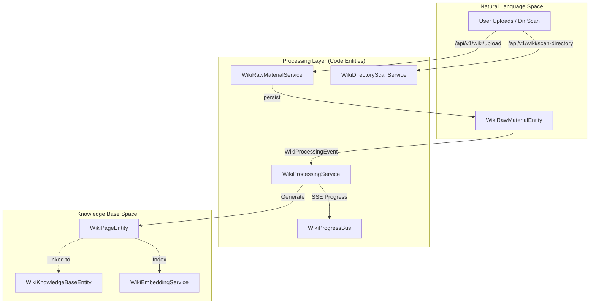
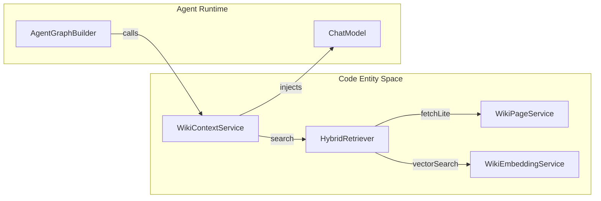

<!-- source: DeepWiki mcp.deepwiki.com · repo matevip/mateclaw · page 5 LLM Wiki Knowledge Base · fetched 2026-10-26 -->

# LLM Wiki Knowledge Base

Relevant source files

The following files were used as context for generating this wiki page:

- [mateclaw-server/src/main/java/vip/mate/wiki/WikiAutoConfiguration.java](mateclaw-server/src/main/java/vip/mate/wiki/WikiAutoConfiguration.java)
- [mateclaw-server/src/main/java/vip/mate/wiki/controller/WikiController.java](mateclaw-server/src/main/java/vip/mate/wiki/controller/WikiController.java)
- [mateclaw-server/src/main/java/vip/mate/wiki/dto/WikiPageLite.java](mateclaw-server/src/main/java/vip/mate/wiki/dto/WikiPageLite.java)
- [mateclaw-server/src/main/java/vip/mate/wiki/event/WikiProcessingListener.java](mateclaw-server/src/main/java/vip/mate/wiki/event/WikiProcessingListener.java)
- [mateclaw-server/src/main/java/vip/mate/wiki/model/WikiPageEntity.java](mateclaw-server/src/main/java/vip/mate/wiki/model/WikiPageEntity.java)
- [mateclaw-server/src/main/java/vip/mate/wiki/model/WikiRawMaterialEntity.java](mateclaw-server/src/main/java/vip/mate/wiki/model/WikiRawMaterialEntity.java)
- [mateclaw-server/src/main/java/vip/mate/wiki/repository/WikiPageMapper.java](mateclaw-server/src/main/java/vip/mate/wiki/repository/WikiPageMapper.java)
- [mateclaw-server/src/main/java/vip/mate/wiki/service/HybridRetriever.java](mateclaw-server/src/main/java/vip/mate/wiki/service/HybridRetriever.java)
- [mateclaw-server/src/main/java/vip/mate/wiki/service/WikiContextService.java](mateclaw-server/src/main/java/vip/mate/wiki/service/WikiContextService.java)
- [mateclaw-server/src/main/java/vip/mate/wiki/service/WikiKnowledgeBaseService.java](mateclaw-server/src/main/java/vip/mate/wiki/service/WikiKnowledgeBaseService.java)
- [mateclaw-server/src/main/java/vip/mate/wiki/service/WikiRawMaterialService.java](mateclaw-server/src/main/java/vip/mate/wiki/service/WikiRawMaterialService.java)
- [mateclaw-server/src/main/java/vip/mate/wiki/service/WikiRelationService.java](mateclaw-server/src/main/java/vip/mate/wiki/service/WikiRelationService.java)
- [mateclaw-server/src/main/resources/db/migration/h2/V40__rfc051_page_locked.sql](mateclaw-server/src/main/resources/db/migration/h2/V40__rfc051_page_locked.sql)
- [mateclaw-server/src/main/resources/db/migration/h2/V41__rfc051_page_archived.sql](mateclaw-server/src/main/resources/db/migration/h2/V41__rfc051_page_archived.sql)
- [mateclaw-server/src/main/resources/db/migration/h2/V7__wiki_last_processed_hash.sql](mateclaw-server/src/main/resources/db/migration/h2/V7__wiki_last_processed_hash.sql)
- [mateclaw-server/src/main/resources/db/migration/h2/V8__wiki_raw_progress.sql](mateclaw-server/src/main/resources/db/migration/h2/V8__wiki_raw_progress.sql)
- [mateclaw-server/src/main/resources/db/migration/mysql/V41__rfc051_page_archived.sql](mateclaw-server/src/main/resources/db/migration/mysql/V41__rfc051_page_archived.sql)
- [mateclaw-server/src/test/java/vip/mate/wiki/service/WikiRawMaterialDedupTest.java](mateclaw-server/src/test/java/vip/mate/wiki/service/WikiRawMaterialDedupTest.java)
- [mateclaw-server/src/test/java/vip/mate/wiki/service/WikiRawMaterialRecoveryTest.java](mateclaw-server/src/test/java/vip/mate/wiki/service/WikiRawMaterialRecoveryTest.java)
- [mateclaw-ui/src/api/index.ts](mateclaw-ui/src/api/index.ts)
- [mateclaw-ui/src/i18n/locales/en-US.ts](mateclaw-ui/src/i18n/locales/en-US.ts)
- [mateclaw-ui/src/i18n/locales/zh-CN.ts](mateclaw-ui/src/i18n/locales/zh-CN.ts)
- [mateclaw-ui/src/stores/useWikiStore.ts](mateclaw-ui/src/stores/useWikiStore.ts)
- [mateclaw-ui/src/views/Wiki/components/RawMaterialPanel.vue](mateclaw-ui/src/views/Wiki/components/RawMaterialPanel.vue)
- [mateclaw-ui/src/views/Wiki/components/WikiPageViewer.vue](mateclaw-ui/src/views/Wiki/components/WikiPageViewer.vue)
- [mateclaw-ui/src/views/Wiki/index.vue](mateclaw-ui/src/views/Wiki/index.vue)

The Wiki module in MateClaw transforms unstructured raw materials (documents, text, URLs) into a structured, interlinked knowledge base that agents can use for retrieval-augmented generation (RAG). It implements a two-phase ingestion pipeline, hybrid retrieval (semantic + keyword), and a rich UI for managing knowledge entities.

## Module Architecture

The Wiki system is built around the `WikiKnowledgeBaseEntity`, which acts as a container for `WikiRawMaterialEntity` (the inputs) and `WikiPageEntity` (the structured outputs).

### Knowledge Flow Diagram
This diagram shows how raw content enters the system and is transformed into structured pages accessible by the `AgentGraph`.

**Sources:** [mateclaw-server/src/main/java/vip/mate/wiki/controller/WikiController.java:47-57](), [mateclaw-server/src/main/java/vip/mate/wiki/service/WikiRawMaterialService.java:101-118](), [mateclaw-server/src/main/java/vip/mate/wiki/service/WikiRawMaterialService.java:125-169](), [mateclaw-server/src/main/java/vip/mate/wiki/controller/WikiController.java:214-225]()

## Ingestion & Transformation

The ingestion pipeline handles file extraction, deduplication, and LLM-driven content structuring.

*   **Deduplication:** Before processing, `WikiRawMaterialService` computes a SHA-256 hash of the content to prevent duplicate processing within the same Knowledge Base [mateclaw-server/src/main/java/vip/mate/wiki/service/WikiRawMaterialService.java:89-99](). For binary files like PDF or DOCX, it hashes the raw bytes directly to ensure stability [mateclaw-server/src/main/java/vip/mate/wiki/service/WikiRawMaterialService.java:135-158]().
*   **Two-Phase Digest:** The system uses a "Route" phase to plan the structure and a "Merge/BatchCreate" phase to generate final pages. Progress is tracked via `progressPhase`, `progressTotal`, and `progressDone` fields [mateclaw-ui/src/stores/useWikiStore.ts:29-32]().
*   **Resilience:** The system supports a "Partial Resume" mode where re-processing a failed material can preserve previously generated pages [mateclaw-server/src/main/java/vip/mate/wiki/service/WikiRawMaterialService.java:43-51]().

For details, see [Ingestion Pipeline](#5.1).

## Retrieval & Agent Integration

The `WikiContextService` bridges the Knowledge Base to the Agent's reasoning loop by providing relevant context snippets.

| Component | Function | Code Reference |
| :--- | :--- | :--- |
| **HybridRetriever** | Performs keyword (DB LIKE) and semantic (vector) search with RRF fusion and relation boosting. | [mateclaw-server/src/main/java/vip/mate/wiki/service/HybridRetriever.java:79-103]() |
| **Context Builder** | Injects `<wiki-relevant>` snippets into agent prompts, including citations and relevance reasons. | [mateclaw-server/src/main/java/vip/mate/wiki/service/WikiContextService.java:35-69]() |
| **System Pages** | Filters out system pages like `overview` or `log` from search results to maintain focus. | [mateclaw-server/src/main/java/vip/mate/wiki/service/HybridRetriever.java:120-122]() |

### Retrieval Integration Diagram
This diagram illustrates how the `WikiContextService` interacts with retrieval entities to provide context to the `ChatModel`.

**Sources:** [mateclaw-server/src/main/java/vip/mate/wiki/service/WikiContextService.java:35-54](), [mateclaw-server/src/main/java/vip/mate/wiki/service/HybridRetriever.java:85-113](), [mateclaw-server/src/main/java/vip/mate/wiki/service/WikiContextService.java:88-100]()

For details, see [Wiki Pages, Retrieval & Enrichment](#5.2).

## Wiki User Interface

The frontend provides a comprehensive management suite for knowledge bases and structured pages.

*   **Layout:** The main view (`Wiki/index.vue`) features a sidebar for KB selection and a grouped page list supporting batch operations [mateclaw-ui/src/views/Wiki/index.vue:19-97]().
*   **Raw Material Panel:** Supports drag-and-drop file uploads and directory scanning with real-time HTTP upload progress tracking [mateclaw-ui/src/views/Wiki/components/RawMaterialPanel.vue:5-37](), [mateclaw-ui/src/views/Wiki/components/RawMaterialPanel.vue:113-126]().
*   **Page Viewer:** Renders Wiki pages with Markdown, resolves `[[Wiki Links]]` to internal routes, and handles page protection status (locked/system) [mateclaw-ui/src/views/Wiki/components/WikiPageViewer.vue:116-132](), [mateclaw-ui/src/views/Wiki/components/WikiPageViewer.vue:32-45]().
*   **State Management:** `useWikiStore` centralizes state for knowledge bases, pages, and active filters (e.g., filtering pages by their source raw material) [mateclaw-ui/src/stores/useWikiStore.ts:65-76](), [mateclaw-ui/src/stores/useWikiStore.ts:123-131]().

For details, see [Wiki UI](#5.3).

**Sources:** [mateclaw-ui/src/views/Wiki/index.vue](), [mateclaw-ui/src/views/Wiki/components/RawMaterialPanel.vue](), [mateclaw-ui/src/views/Wiki/components/WikiPageViewer.vue](), [mateclaw-ui/src/stores/useWikiStore.ts]()

---

