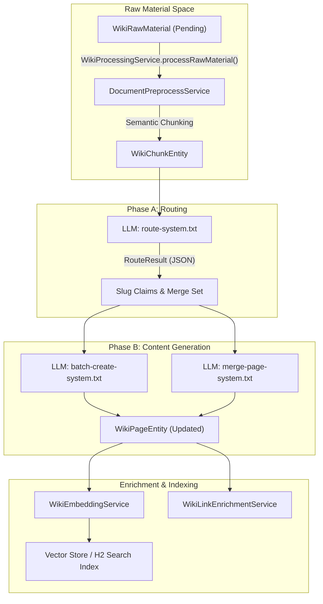
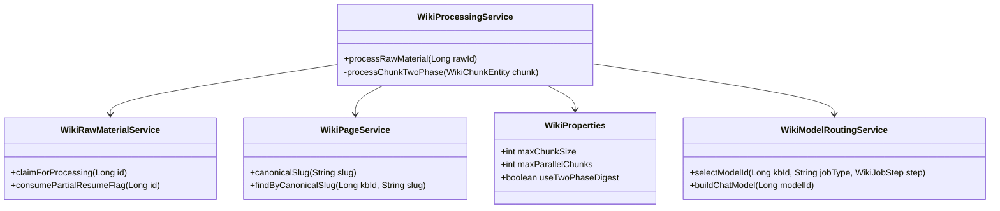

<!-- source: DeepWiki mcp.deepwiki.com · repo matevip/mateclaw · page 5.1 Ingestion Pipeline · fetched 2026-10-26 -->

# Ingestion Pipeline

Relevant source files

The following files were used as context for generating this wiki page:

- [mateclaw-server/src/main/java/vip/mate/wiki/WikiProperties.java](mateclaw-server/src/main/java/vip/mate/wiki/WikiProperties.java)
- [mateclaw-server/src/main/java/vip/mate/wiki/dto/GeneratedPage.java](mateclaw-server/src/main/java/vip/mate/wiki/dto/GeneratedPage.java)
- [mateclaw-server/src/main/java/vip/mate/wiki/dto/RouteResult.java](mateclaw-server/src/main/java/vip/mate/wiki/dto/RouteResult.java)
- [mateclaw-server/src/main/java/vip/mate/wiki/dto/RoutedPageMeta.java](mateclaw-server/src/main/java/vip/mate/wiki/dto/RoutedPageMeta.java)
- [mateclaw-server/src/main/java/vip/mate/wiki/dto/WikiChunkDraft.java](mateclaw-server/src/main/java/vip/mate/wiki/dto/WikiChunkDraft.java)
- [mateclaw-server/src/main/java/vip/mate/wiki/job/WikiKbConfig.java](mateclaw-server/src/main/java/vip/mate/wiki/job/WikiKbConfig.java)
- [mateclaw-server/src/main/java/vip/mate/wiki/job/WikiModelRoutingService.java](mateclaw-server/src/main/java/vip/mate/wiki/job/WikiModelRoutingService.java)
- [mateclaw-server/src/main/java/vip/mate/wiki/job/strategy/GlobalDefaultStepModelStrategy.java](mateclaw-server/src/main/java/vip/mate/wiki/job/strategy/GlobalDefaultStepModelStrategy.java)
- [mateclaw-server/src/main/java/vip/mate/wiki/job/strategy/KbDefaultModelStrategy.java](mateclaw-server/src/main/java/vip/mate/wiki/job/strategy/KbDefaultModelStrategy.java)
- [mateclaw-server/src/main/java/vip/mate/wiki/model/WikiChunkEntity.java](mateclaw-server/src/main/java/vip/mate/wiki/model/WikiChunkEntity.java)
- [mateclaw-server/src/main/java/vip/mate/wiki/service/DocumentPreprocessService.java](mateclaw-server/src/main/java/vip/mate/wiki/service/DocumentPreprocessService.java)
- [mateclaw-server/src/main/java/vip/mate/wiki/service/WikiBatchCreateParser.java](mateclaw-server/src/main/java/vip/mate/wiki/service/WikiBatchCreateParser.java)
- [mateclaw-server/src/main/java/vip/mate/wiki/service/WikiChunkService.java](mateclaw-server/src/main/java/vip/mate/wiki/service/WikiChunkService.java)
- [mateclaw-server/src/main/java/vip/mate/wiki/service/WikiContentNormalizer.java](mateclaw-server/src/main/java/vip/mate/wiki/service/WikiContentNormalizer.java)
- [mateclaw-server/src/main/java/vip/mate/wiki/service/WikiPageService.java](mateclaw-server/src/main/java/vip/mate/wiki/service/WikiPageService.java)
- [mateclaw-server/src/main/java/vip/mate/wiki/service/WikiProcessingService.java](mateclaw-server/src/main/java/vip/mate/wiki/service/WikiProcessingService.java)
- [mateclaw-server/src/main/resources/db/migration/h2/V35__skill_security_scan_result.sql](mateclaw-server/src/main/resources/db/migration/h2/V35__skill_security_scan_result.sql)
- [mateclaw-server/src/main/resources/db/migration/h2/V36__skill_i18n_name.sql](mateclaw-server/src/main/resources/db/migration/h2/V36__skill_i18n_name.sql)
- [mateclaw-server/src/main/resources/db/migration/h2/V37__wiki_page_source_entries.sql](mateclaw-server/src/main/resources/db/migration/h2/V37__wiki_page_source_entries.sql)
- [mateclaw-server/src/main/resources/db/migration/h2/V39__rfc051_chunk_metadata.sql](mateclaw-server/src/main/resources/db/migration/h2/V39__rfc051_chunk_metadata.sql)
- [mateclaw-server/src/main/resources/db/migration/mysql/V35__skill_security_scan_result.sql](mateclaw-server/src/main/resources/db/migration/mysql/V35__skill_security_scan_result.sql)
- [mateclaw-server/src/main/resources/db/migration/mysql/V36__skill_i18n_name.sql](mateclaw-server/src/main/resources/db/migration/mysql/V36__skill_i18n_name.sql)
- [mateclaw-server/src/main/resources/db/migration/mysql/V39__rfc051_chunk_metadata.sql](mateclaw-server/src/main/resources/db/migration/mysql/V39__rfc051_chunk_metadata.sql)
- [mateclaw-server/src/main/resources/prompts/wiki/batch-create-system.txt](mateclaw-server/src/main/resources/prompts/wiki/batch-create-system.txt)
- [mateclaw-server/src/main/resources/prompts/wiki/batch-create-user.txt](mateclaw-server/src/main/resources/prompts/wiki/batch-create-user.txt)
- [mateclaw-server/src/main/resources/prompts/wiki/create-page-system.txt](mateclaw-server/src/main/resources/prompts/wiki/create-page-system.txt)
- [mateclaw-server/src/main/resources/prompts/wiki/create-page-user.txt](mateclaw-server/src/main/resources/prompts/wiki/create-page-user.txt)
- [mateclaw-server/src/main/resources/prompts/wiki/route-system.txt](mateclaw-server/src/main/resources/prompts/wiki/route-system.txt)
- [mateclaw-server/src/main/resources/prompts/wiki/route-user.txt](mateclaw-server/src/main/resources/prompts/wiki/route-user.txt)
- [mateclaw-ui/src/views/Wiki/components/WikiGraphView.vue](mateclaw-ui/src/views/Wiki/components/WikiGraphView.vue)

The Wiki Ingestion Pipeline is responsible for transforming raw unstructured data (PDFs, DOCX, text) into a structured, interlinked knowledge base of Wiki pages. It employs a multi-stage process involving semantic chunking, document analysis, and a two-phase LLM digestion strategy to ensure high-quality knowledge extraction while remaining resilient to LLM failures and rate limits.

## Core Architecture & Data Flow

The pipeline is primarily orchestrated by the `WikiProcessingService` [vip/mate/wiki/service/WikiProcessingService.java:46](). It handles the transition from a `WikiRawMaterialEntity` (the uploaded file) to multiple `WikiPageEntity` records.

### High-Level Ingestion Flow

1.  **Material Acquisition**: Raw files are uploaded and stored. A content hash is generated for deduplication. If the hash matches a previous successful run, the process is short-circuited unless forced [vip/mate/wiki/service/WikiProcessingService.java:168-175]().
2.  **Ingest Mode Selection**: Supports `eager` (heavy LLM extraction) or `lazy` (chunk + embed only) modes via `WikiKbConfig` [vip/mate/wiki/job/WikiKbConfig.java:16-22]().
3.  **Document Analysis**: (Optional) A global pass over the first 15,000 characters to create a "Concept Map" that guides subsequent chunk routing [vip/mate/wiki/service/WikiProcessingService.java:160-167]().
4.  **Semantic Chunking**: The document is split into manageable segments based on `maxChunkSize` (default: 15,000 chars) [vip/mate/wiki/WikiProperties.java:25]().
5.  **Two-Phase Digest**:
    *   **Phase A (Route)**: LLM decides which pages to create or update [vip/mate/wiki/service/WikiProcessingService.java:625-635]().
    *   **Phase B (Merge/BatchCreate)**: LLM generates actual markdown content for those pages [vip/mate/wiki/service/WikiProcessingService.java:655-665]().
6.  **Vectorization**: Pages and chunks are embedded for hybrid retrieval [vip/mate/wiki/service/WikiEmbeddingService.java:120-130]().

### Data Flow Diagram

"Wiki Ingestion Flow"

**Sources:** [vip/mate/wiki/service/WikiProcessingService.java:139-160](), [vip/mate/wiki/service/WikiProcessingService.java:625-665](), [vip/mate/wiki/dto/RouteResult.java:20-30]()

---

## Two-Phase Digest Strategy

To avoid hitting output token limits and gateway timeouts (e.g., Nginx 60s), MateClaw splits content generation into two distinct LLM interactions.

### Phase A: Route
The `RouteResult` DTO identifies concepts that need new pages (`create`) and existing pages that require updates (`update`) [vip/mate/wiki/dto/RouteResult.java:20-25](). The system uses `route-system.txt` to enforce strict JSON output containing only metadata (slug, title, summary), never page content [prompts/wiki/route-system.txt:52-64]().

### Phase B: Merge / BatchCreate
*   **BatchCreate**: New pages are generated in sub-batches defined by `batchCreatePageSize` (default: 2) [vip/mate/wiki/WikiProperties.java:91-99](). This ensures output stays under provider completion limits (~2k-3k tokens) [vip/mate/wiki/WikiProperties.java:96-97]().
*   **Merge**: If a concept already exists, new information is merged into the existing `WikiPageEntity` using the `merge-page-system.txt` prompt logic.

### Class Association Diagram

"Ingestion Service Architecture"

**Sources:** [vip/mate/wiki/service/WikiProcessingService.java:46-60](), [vip/mate/wiki/service/WikiPageService.java:165-180](), [vip/mate/wiki/WikiProperties.java:12-50](), [vip/mate/wiki/job/WikiModelRoutingService.java:29-40]()

---

## Slug & Identity Management

MateClaw uses "Canonical Slugs" to ensure that parallel ingestion tasks don't create duplicate pages for the same concept due to minor spelling or hyphenation differences.

*   **Normalization**: Slugs are normalized by converting to lowercase and removing all hyphens and underscores [vip/mate/wiki/service/WikiPageService.java:165-168](). For example, `shennong-bencao-jing` and `shen-nong-ben-cao-jing` both become `shennongbencaojing`.
*   **Deduplication**: The `ProgressCounter` maintains a `slugClaims` map (`canonicalSlug` → `originalSlug`). The first chunk to claim a concept "wins," and subsequent chunks must use the winner's slug for updates [vip/mate/wiki/service/WikiProcessingService.java:115-122]().
*   **Merge Dedup**: A `mergedSlugs` set prevents the same page from being merged multiple times within a single raw material run [vip/mate/wiki/service/WikiProcessingService.java:124-131]().

---

## LLM Resilience and Retries

The ingestion pipeline is designed to handle transient LLM failures (rate limits, 5xx errors) without losing progress.

*   **Error Classification**: Errors are classified into transient (retryable) and fatal. The pipeline uses `RetryTemplate` to manage these attempts [vip/mate/wiki/service/WikiProcessingService.java:12]().
*   **Model Routing**: `WikiModelRoutingService` selects the best model for each step (e.g., `heavy_ingest.create_page`) based on KB-level overrides or system defaults [vip/mate/wiki/job/WikiModelRoutingService.java:62-86]().
*   **Tunables**:
    *   `llmMaxAttempts`: Maximum retries per chunk (default: 5) [vip/mate/wiki/WikiProperties.java:80]().
    *   `llmMaxTotalDurationMs`: Hard timeout for all retries in a single chunk (default: 4 minutes) [vip/mate/wiki/WikiProperties.java:88]().
*   **Partial Resume**: If a job fails partially, the system can consume a partial resume flag to skip successfully processed components [vip/mate/wiki/service/WikiProcessingService.java:154-155]().

---

## Progress Tracking & SSE Events

The `WikiProgressBus` broadcasts real-time ingestion status to the frontend via Server-Sent Events (SSE).

*   **ProgressCounter**: A per-run atomic counter tracks `total`, `done`, and `failed` counts across parallel tasks [vip/mate/wiki/service/WikiProcessingService.java:107-113]().
*   **Concurrency Control**: 
    *   `maxParallelRawMaterials`: Limits concurrent document processing (default: 3) [vip/mate/wiki/WikiProperties.java:33]().
    *   `maxParallelChunks`: Serialized to 1 to prevent stale-index collisions [vip/mate/wiki/WikiProperties.java:44]().
    *   `maxParallelPhaseBPages`: Parallelizes page generation within a chunk (default: 3) [vip/mate/wiki/WikiProperties.java:54]().

**Sources:**
*   **Ingestion Logic**: [vip/mate/wiki/service/WikiProcessingService.java]()
*   **Configuration**: [vip/mate/wiki/WikiProperties.java](), [vip/mate/wiki/job/WikiKbConfig.java]()
*   **Slug Management**: [vip/mate/wiki/service/WikiPageService.java]()
*   **Model Routing**: [vip/mate/wiki/job/WikiModelRoutingService.java]()
*   **Prompts**: [mateclaw-server/src/main/resources/prompts/wiki/route-system.txt](), [mateclaw-server/src/main/resources/prompts/wiki/batch-create-system.txt]()

---

