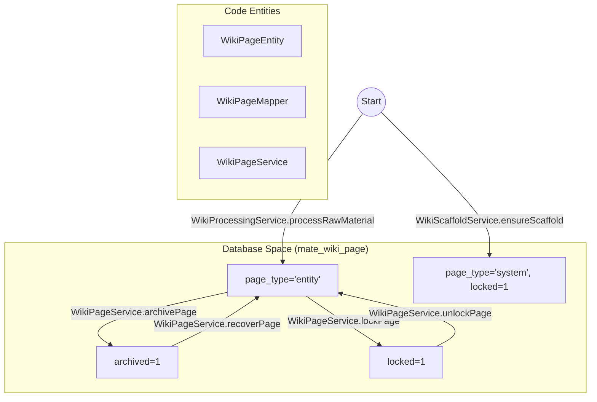
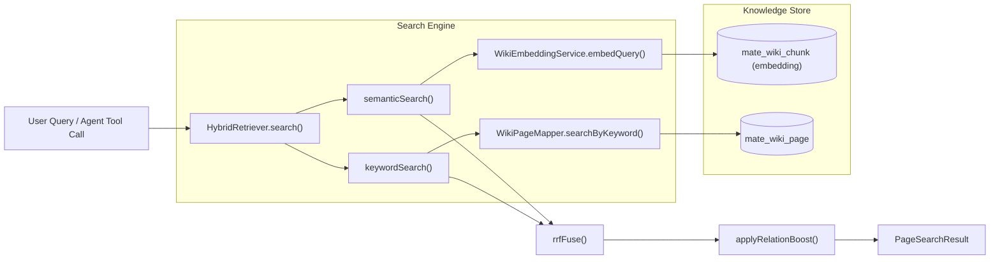

<!-- source: DeepWiki mcp.deepwiki.com · repo matevip/mateclaw · page 5.2 Wiki Pages, Retrieval & Enrichment · fetched 2026-10-26 -->

# Wiki Pages, Retrieval & Enrichment

Relevant source files

The following files were used as context for generating this wiki page:

- [mateclaw-server/src/main/java/vip/mate/llm/controller/ModelConfigController.java](mateclaw-server/src/main/java/vip/mate/llm/controller/ModelConfigController.java)
- [mateclaw-server/src/main/java/vip/mate/llm/embedding/EmbeddingModelFactory.java](mateclaw-server/src/main/java/vip/mate/llm/embedding/EmbeddingModelFactory.java)
- [mateclaw-server/src/main/java/vip/mate/llm/model/EmbeddingProtocol.java](mateclaw-server/src/main/java/vip/mate/llm/model/EmbeddingProtocol.java)
- [mateclaw-server/src/main/java/vip/mate/llm/model/ModelConfigEntity.java](mateclaw-server/src/main/java/vip/mate/llm/model/ModelConfigEntity.java)
- [mateclaw-server/src/main/java/vip/mate/wiki/WikiProperties.java](mateclaw-server/src/main/java/vip/mate/wiki/WikiProperties.java)
- [mateclaw-server/src/main/java/vip/mate/wiki/controller/WikiAdminController.java](mateclaw-server/src/main/java/vip/mate/wiki/controller/WikiAdminController.java)
- [mateclaw-server/src/main/java/vip/mate/wiki/dto/EnrichmentBatchPlan.java](mateclaw-server/src/main/java/vip/mate/wiki/dto/EnrichmentBatchPlan.java)
- [mateclaw-server/src/main/java/vip/mate/wiki/dto/EnrichmentPlan.java](mateclaw-server/src/main/java/vip/mate/wiki/dto/EnrichmentPlan.java)
- [mateclaw-server/src/main/java/vip/mate/wiki/dto/EnrichmentReplacement.java](mateclaw-server/src/main/java/vip/mate/wiki/dto/EnrichmentReplacement.java)
- [mateclaw-server/src/main/java/vip/mate/wiki/dto/PageCitationWithRaw.java](mateclaw-server/src/main/java/vip/mate/wiki/dto/PageCitationWithRaw.java)
- [mateclaw-server/src/main/java/vip/mate/wiki/dto/WikiPageLite.java](mateclaw-server/src/main/java/vip/mate/wiki/dto/WikiPageLite.java)
- [mateclaw-server/src/main/java/vip/mate/wiki/event/WikiKbDirtyEvent.java](mateclaw-server/src/main/java/vip/mate/wiki/event/WikiKbDirtyEvent.java)
- [mateclaw-server/src/main/java/vip/mate/wiki/job/WikiChunkTokenBackfillJob.java](mateclaw-server/src/main/java/vip/mate/wiki/job/WikiChunkTokenBackfillJob.java)
- [mateclaw-server/src/main/java/vip/mate/wiki/model/WikiKnowledgeBaseEntity.java](mateclaw-server/src/main/java/vip/mate/wiki/model/WikiKnowledgeBaseEntity.java)
- [mateclaw-server/src/main/java/vip/mate/wiki/model/WikiPageEntity.java](mateclaw-server/src/main/java/vip/mate/wiki/model/WikiPageEntity.java)
- [mateclaw-server/src/main/java/vip/mate/wiki/repository/WikiPageCitationMapper.java](mateclaw-server/src/main/java/vip/mate/wiki/repository/WikiPageCitationMapper.java)
- [mateclaw-server/src/main/java/vip/mate/wiki/repository/WikiPageMapper.java](mateclaw-server/src/main/java/vip/mate/wiki/repository/WikiPageMapper.java)
- [mateclaw-server/src/main/java/vip/mate/wiki/service/HybridRetriever.java](mateclaw-server/src/main/java/vip/mate/wiki/service/HybridRetriever.java)
- [mateclaw-server/src/main/java/vip/mate/wiki/service/WikiCitationService.java](mateclaw-server/src/main/java/vip/mate/wiki/service/WikiCitationService.java)
- [mateclaw-server/src/main/java/vip/mate/wiki/service/WikiCompileService.java](mateclaw-server/src/main/java/vip/mate/wiki/service/WikiCompileService.java)
- [mateclaw-server/src/main/java/vip/mate/wiki/service/WikiEmbeddingService.java](mateclaw-server/src/main/java/vip/mate/wiki/service/WikiEmbeddingService.java)
- [mateclaw-server/src/main/java/vip/mate/wiki/service/WikiEnrichmentApplier.java](mateclaw-server/src/main/java/vip/mate/wiki/service/WikiEnrichmentApplier.java)
- [mateclaw-server/src/main/java/vip/mate/wiki/service/WikiKnowledgeBaseService.java](mateclaw-server/src/main/java/vip/mate/wiki/service/WikiKnowledgeBaseService.java)
- [mateclaw-server/src/main/java/vip/mate/wiki/service/WikiLinkEnrichmentService.java](mateclaw-server/src/main/java/vip/mate/wiki/service/WikiLinkEnrichmentService.java)
- [mateclaw-server/src/main/java/vip/mate/wiki/service/WikiLogService.java](mateclaw-server/src/main/java/vip/mate/wiki/service/WikiLogService.java)
- [mateclaw-server/src/main/java/vip/mate/wiki/service/WikiNarrativeService.java](mateclaw-server/src/main/java/vip/mate/wiki/service/WikiNarrativeService.java)
- [mateclaw-server/src/main/java/vip/mate/wiki/service/WikiOverviewService.java](mateclaw-server/src/main/java/vip/mate/wiki/service/WikiOverviewService.java)
- [mateclaw-server/src/main/java/vip/mate/wiki/service/WikiPageService.java](mateclaw-server/src/main/java/vip/mate/wiki/service/WikiPageService.java)
- [mateclaw-server/src/main/java/vip/mate/wiki/service/WikiProcessingService.java](mateclaw-server/src/main/java/vip/mate/wiki/service/WikiProcessingService.java)
- [mateclaw-server/src/main/java/vip/mate/wiki/service/WikiRelationService.java](mateclaw-server/src/main/java/vip/mate/wiki/service/WikiRelationService.java)
- [mateclaw-server/src/main/java/vip/mate/wiki/service/WikiScaffoldService.java](mateclaw-server/src/main/java/vip/mate/wiki/service/WikiScaffoldService.java)
- [mateclaw-server/src/main/java/vip/mate/wiki/tool/WikiTool.java](mateclaw-server/src/main/java/vip/mate/wiki/tool/WikiTool.java)
- [mateclaw-server/src/main/resources/db/migration/h2/V40__rfc051_page_locked.sql](mateclaw-server/src/main/resources/db/migration/h2/V40__rfc051_page_locked.sql)
- [mateclaw-server/src/main/resources/db/migration/h2/V41__rfc051_page_archived.sql](mateclaw-server/src/main/resources/db/migration/h2/V41__rfc051_page_archived.sql)
- [mateclaw-server/src/main/resources/db/migration/mysql/V41__rfc051_page_archived.sql](mateclaw-server/src/main/resources/db/migration/mysql/V41__rfc051_page_archived.sql)
- [mateclaw-server/src/main/resources/prompts/wiki/compile-system.txt](mateclaw-server/src/main/resources/prompts/wiki/compile-system.txt)
- [mateclaw-server/src/main/resources/prompts/wiki/compile-user.txt](mateclaw-server/src/main/resources/prompts/wiki/compile-user.txt)
- [mateclaw-server/src/main/resources/prompts/wiki/narrative-system.txt](mateclaw-server/src/main/resources/prompts/wiki/narrative-system.txt)
- [mateclaw-server/src/main/resources/prompts/wiki/narrative-user.txt](mateclaw-server/src/main/resources/prompts/wiki/narrative-user.txt)
- [mateclaw-ui/src/views/Wiki/components/CitationDrawer.vue](mateclaw-ui/src/views/Wiki/components/CitationDrawer.vue)
- [mateclaw-ui/src/views/Wiki/components/WikiConfig.vue](mateclaw-ui/src/views/Wiki/components/WikiConfig.vue)

This section covers the lifecycle management of structured Wiki pages, the hybrid retrieval engine that combines semantic and keyword search, and the enrichment services that maintain the inter-connectivity and health of the knowledge base.

## Wiki Page Lifecycle & Service

The `WikiPageService` manages the persistence and state of `WikiPageEntity` objects. It handles standard CRUD operations alongside specialized logic for Wiki-specific features like slug normalization and reference tracking.

### Key Implementation Details
*   **Slug Normalization**: The system uses `canonicalSlug` to strip hyphens and underscores, ensuring that `[[shennong-bencao-jing]]` and `[[shen_nong_ben_cao_jing]]` resolve to the same entity [mateclaw-server/src/main/java/vip/mate/wiki/service/WikiPageService.java:165-168]().
*   **Protection & Archiving**: Pages can be `locked` (preventing AI/tool deletion) or `archived` (hidden from default search/lists while preserving citations) [mateclaw-server/src/main/java/vip/mate/wiki/model/WikiPageEntity.java:62-74]().
*   **Caching**: A 5-minute TTL cache is maintained for page summaries to optimize context injection and LLM ingestion routines [mateclaw-server/src/main/java/vip/mate/wiki/service/WikiPageService.java:35-40]().
*   **Reference Tracking**: When the `WikiTool` is invoked by an agent, the system increments an in-memory `refCounter` to identify "Top Referenced" concepts [mateclaw-server/src/main/java/vip/mate/wiki/service/WikiPageService.java:43-52]().

### Wiki Page State Transitions
The following diagram illustrates how a page moves through various states within the `mate_wiki_page` table.

**Diagram: Wiki Page State Machine**

Sources: [mateclaw-server/src/main/java/vip/mate/wiki/service/WikiPageService.java:71-83](), [mateclaw-server/src/main/java/vip/mate/wiki/model/WikiPageEntity.java:49-74](), [mateclaw-server/src/main/java/vip/mate/wiki/service/WikiScaffoldService.java:43-51]().

---

## Retrieval & Vector Indexing

MateClaw utilizes a **Hybrid Retriever** that fuses results from three distinct search modes to provide the most relevant context to the agent.

### Hybrid Search Modes
1.  **Keyword**: Standard SQL `LIKE` queries against `title` and `content` [mateclaw-server/src/main/java/vip/mate/wiki/service/HybridRetriever.java:88-90]().
2.  **Semantic**: Vector similarity search using embeddings stored in the `mate_wiki_chunk` table [mateclaw-server/src/main/java/vip/mate/wiki/service/HybridRetriever.java:160-164]().
3.  **Hybrid (RRF)**: Reciprocal Rank Fusion combining the above two scores for optimal ranking [mateclaw-server/src/main/java/vip/mate/wiki/service/HybridRetriever.java:102]().

### Vector Indexing Pipeline
The `WikiEmbeddingService` manages the generation of vectors. It supports:
*   **Dynamic Resolution**: Resolves the embedding model based on Knowledge Base (KB) settings, system defaults (`embedding.default.model.id`), or enabled providers [mateclaw-server/src/main/java/vip/mate/wiki/service/WikiEmbeddingService.java:53-114]().
*   **Mean Pooling**: For chunks exceeding `embeddingMaxChars` (default 6000), the service splits content into sub-segments, embeds them individually, and performs mean pooling to create a single representative vector [mateclaw-server/src/main/java/vip/mate/wiki/service/WikiEmbeddingService.java:131-171]().

**Diagram: Hybrid Retrieval Data Flow**

Sources: [mateclaw-server/src/main/java/vip/mate/wiki/service/HybridRetriever.java:79-146](), [mateclaw-server/src/main/java/vip/mate/wiki/service/WikiEmbeddingService.java:122-140]().

---

## Enrichment & Scaffold Services

### WikiLink Enrichment
`WikiLinkEnrichmentService` implements a "replacement plan" strategy (RFC-031). Instead of asking the LLM to rewrite a whole page, the LLM provides a JSON plan of `[[link]]` insertions. Java code then applies these surgically to ensure the original prose remains unchanged byte-for-byte [mateclaw-server/src/main/java/vip/mate/wiki/service/WikiLinkEnrichmentService.java:32-40](). It supports batching multiple pages into a single LLM call to reduce overhead [mateclaw-server/src/main/java/vip/mate/wiki/service/WikiLinkEnrichmentService.java:84-121]().

### System Scaffold Pages
Every KB is initialized with two "System Pages" via `WikiScaffoldService`:
*   **Overview**: A deterministic dashboard of KB stats (Source count, Page count, Coverage) and a narrative summary [mateclaw-server/src/main/java/vip/mate/wiki/service/WikiOverviewService.java:85-141]().
*   **Log**: An append-only activity log that tracks ingestion and compilation events, capped at 10,000 characters [mateclaw-server/src/main/java/vip/mate/wiki/service/WikiLogService.java:14-34]().

### On-Demand Compilation
The `WikiCompileService` allows agents to synthesize a new Wiki page from raw evidence chunks.
1.  **Retrieve**: Fetches top `ChunkHit` items (default cap 8) via semantic search [mateclaw-server/src/main/java/vip/mate/wiki/service/WikiCompileService.java:91-95]().
2.  **Prompt**: Packages these chunks into an "Evidence Pack" for the LLM [mateclaw-server/src/main/java/vip/mate/wiki/service/WikiCompileService.java:104-119]().
3.  **Persist**: Saves the resulting Markdown and binds citations to the specific evidence chunks used [mateclaw-server/src/main/java/vip/mate/wiki/service/WikiCompileService.java:141-154]().

---

## Agent Interface: WikiTool

The `WikiTool` provides the primary interface for agents to interact with the knowledge base. It automatically resolves the `kbId` from the `agentId` so the LLM does not need to handle internal IDs [mateclaw-server/src/main/java/vip/mate/wiki/tool/WikiTool.java:32]().

| Tool Name | Purpose | Key Parameters |
| :--- | :--- | :--- |
| `wiki_read_page` | Reads page content with optional section extraction. Includes source file lineage [mateclaw-server/src/main/java/vip/mate/wiki/tool/WikiTool.java:82-121](). | `slug`, `maxChars`, `sectionHeading` |
| `wiki_list_pages` | Lists pages with keyword filtering; hides system pages [mateclaw-server/src/main/java/vip/mate/wiki/tool/WikiTool.java:129-159](). | `query` |
| `wiki_search_pages` | Performs hybrid search across the KB with snippets [mateclaw-server/src/main/java/vip/mate/wiki/tool/WikiTool.java:176](). | `query`, `mode`, `topK` |
| `wiki_compile_page` | Synthesizes a new page from raw materials on a topic [mateclaw-server/src/main/java/vip/mate/wiki/service/WikiCompileService.java:88-120](). | `topic`, `slug` |

Sources: [mateclaw-server/src/main/java/vip/mate/wiki/tool/WikiTool.java:32-174](), [mateclaw-server/src/main/java/vip/mate/wiki/service/WikiCompileService.java:88-120](), [mateclaw-server/src/main/java/vip/mate/wiki/service/WikiLogService.java:34-45]().

---

