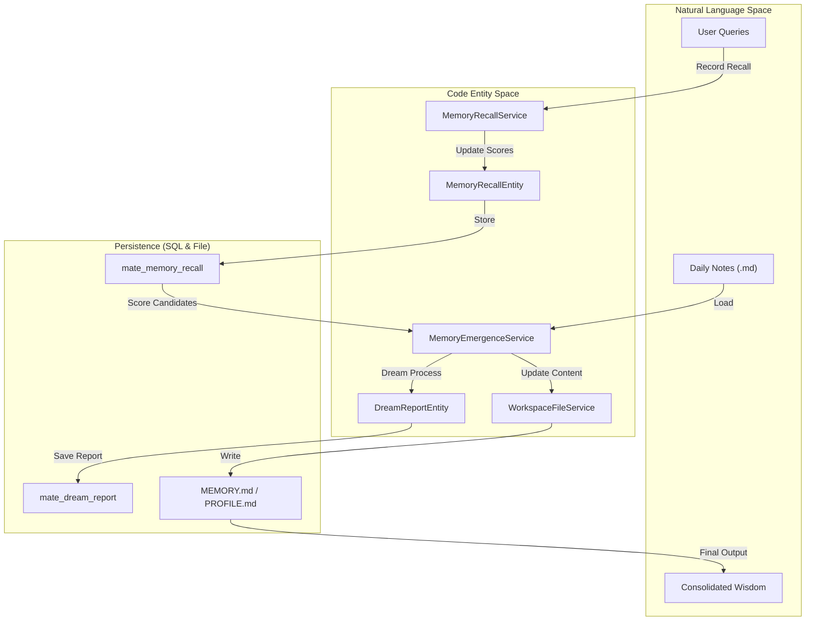
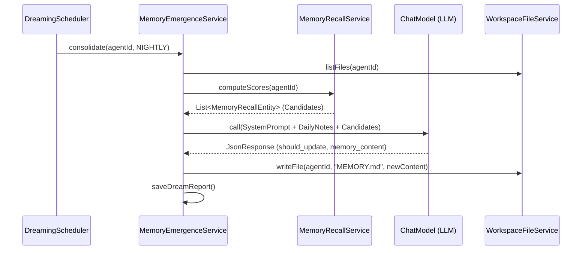

<!-- source: DeepWiki mcp.deepwiki.com · repo matevip/mateclaw · page 6 Memory & Dreaming System · fetched 2026-10-26 -->

# Memory & Dreaming System

Relevant source files

The following files were used as context for generating this wiki page:

- [README.md](README.md)
- [README_zh.md](README_zh.md)
- [assets/images/preview.png](assets/images/preview.png)
- [mateclaw-server/src/main/java/vip/mate/memory/MemoryProperties.java](mateclaw-server/src/main/java/vip/mate/memory/MemoryProperties.java)
- [mateclaw-server/src/main/java/vip/mate/memory/archive/MemoryArchiveService.java](mateclaw-server/src/main/java/vip/mate/memory/archive/MemoryArchiveService.java)
- [mateclaw-server/src/main/java/vip/mate/memory/controller/DreamController.java](mateclaw-server/src/main/java/vip/mate/memory/controller/DreamController.java)
- [mateclaw-server/src/main/java/vip/mate/memory/controller/MemoryController.java](mateclaw-server/src/main/java/vip/mate/memory/controller/MemoryController.java)
- [mateclaw-server/src/main/java/vip/mate/memory/fact/controller/FactController.java](mateclaw-server/src/main/java/vip/mate/memory/fact/controller/FactController.java)
- [mateclaw-server/src/main/java/vip/mate/memory/fact/repository/FactMapper.java](mateclaw-server/src/main/java/vip/mate/memory/fact/repository/FactMapper.java)
- [mateclaw-server/src/main/java/vip/mate/memory/model/DreamReportEntity.java](mateclaw-server/src/main/java/vip/mate/memory/model/DreamReportEntity.java)
- [mateclaw-server/src/main/java/vip/mate/memory/model/MemoryRecallEntity.java](mateclaw-server/src/main/java/vip/mate/memory/model/MemoryRecallEntity.java)
- [mateclaw-server/src/main/java/vip/mate/memory/repository/DreamReportMapper.java](mateclaw-server/src/main/java/vip/mate/memory/repository/DreamReportMapper.java)
- [mateclaw-server/src/main/java/vip/mate/memory/repository/MemoryRecallMapper.java](mateclaw-server/src/main/java/vip/mate/memory/repository/MemoryRecallMapper.java)
- [mateclaw-server/src/main/java/vip/mate/memory/scheduler/DreamingScheduler.java](mateclaw-server/src/main/java/vip/mate/memory/scheduler/DreamingScheduler.java)
- [mateclaw-server/src/main/java/vip/mate/memory/service/DreamMode.java](mateclaw-server/src/main/java/vip/mate/memory/service/DreamMode.java)
- [mateclaw-server/src/main/java/vip/mate/memory/service/DreamReport.java](mateclaw-server/src/main/java/vip/mate/memory/service/DreamReport.java)
- [mateclaw-server/src/main/java/vip/mate/memory/service/DreamStatus.java](mateclaw-server/src/main/java/vip/mate/memory/service/DreamStatus.java)
- [mateclaw-server/src/main/java/vip/mate/memory/service/MemoryEmergenceService.java](mateclaw-server/src/main/java/vip/mate/memory/service/MemoryEmergenceService.java)
- [mateclaw-server/src/main/java/vip/mate/memory/service/MemoryRecallService.java](mateclaw-server/src/main/java/vip/mate/memory/service/MemoryRecallService.java)
- [mateclaw-server/src/main/java/vip/mate/memory/service/MemoryRecallTracker.java](mateclaw-server/src/main/java/vip/mate/memory/service/MemoryRecallTracker.java)
- [mateclaw-server/src/main/java/vip/mate/memory/service/MorningCardService.java](mateclaw-server/src/main/java/vip/mate/memory/service/MorningCardService.java)
- [mateclaw-server/src/main/java/vip/mate/tool/builtin/WorkspaceMemoryTool.java](mateclaw-server/src/main/java/vip/mate/tool/builtin/WorkspaceMemoryTool.java)
- [mateclaw-server/src/main/resources/prompts/memory/contradiction-batch.txt](mateclaw-server/src/main/resources/prompts/memory/contradiction-batch.txt)
- [mateclaw-ui/src/stores/useMemoryStore.ts](mateclaw-ui/src/stores/useMemoryStore.ts)
- [mateclaw-ui/src/views/Memory/components/MemoryBrowser.vue](mateclaw-ui/src/views/Memory/components/MemoryBrowser.vue)
- [mateclaw-ui/src/views/Memory/components/MorningCard.vue](mateclaw-ui/src/views/Memory/components/MorningCard.vue)
- [mateclaw-ui/src/views/Memory/index.vue](mateclaw-ui/src/views/Memory/index.vue)

The Memory & Dreaming System is responsible for the long-term retention and synthesis of information across the MateClaw ecosystem. It manages the lifecycle of memory from immediate post-conversation extraction to background "dreaming" cycles that consolidate daily notes into structured workspace files.

### Memory Architecture Overview

The system bridges the gap between transient conversation history and permanent knowledge by utilizing a tiered storage approach:
1.  **Short-term:** Conversation history and daily notes (e.g., `memory/2026-04-01.md`).
2.  **Mid-term:** `MemoryRecallEntity` tracking, which scores the frequency and utility of information.
3.  **Long-term:** Structured files like `MEMORY.md`, `PROFILE.md`, and `SOUL.md` stored within the agent's workspace.

#### Code-to-Entity Mapping
The following diagram illustrates how natural language concepts are mapped to specific Java services and persistent storage entities.

**Memory Data Flow & Entity Mapping**

**Sources:** [mateclaw-server/src/main/java/vip/mate/memory/service/MemoryRecallService.java:41-121](), [mateclaw-server/src/main/java/vip/mate/memory/service/MemoryEmergenceService.java:80-113](), [mateclaw-server/src/main/java/vip/mate/memory/model/MemoryRecallEntity.java:17-18](), [mateclaw-server/src/main/java/vip/mate/memory/model/DreamReportEntity.java:1-20]().

---

## 6.1 Memory Lifecycle & Dreaming
The "Dreaming" process is the central mechanism for memory consolidation. It operates in two primary modes: `NIGHTLY` (scheduled via `DreamingScheduler`) and `FOCUSED` (triggered by the user for specific topics). 

- **Recall Tracking:** `MemoryRecallService` monitors how often specific snippets or files are accessed by the agent, assigning a `score` based on frequency and query diversity [mateclaw-server/src/main/java/vip/mate/memory/service/MemoryRecallService.java:149-176]().
- **Emergence:** `MemoryEmergenceService` invokes an LLM to review high-score candidates and daily notes, generating a `DreamReport` that summarizes what was learned or updated [mateclaw-server/src/main/java/vip/mate/memory/service/MemoryEmergenceService.java:128-141]().
- **Persistence:** Successful "dreams" result in updates to the `MEMORY.md` file in the agent's workspace [mateclaw-server/src/main/java/vip/mate/memory/service/MemoryEmergenceService.java:157-160]().

For details, see [Memory Lifecycle & Dreaming](#6.1).

**Dreaming Execution Logic**

**Sources:** [mateclaw-server/src/main/java/vip/mate/memory/scheduler/DreamingScheduler.java:37-66](), [mateclaw-server/src/main/java/vip/mate/memory/service/MemoryEmergenceService.java:71-157](), [mateclaw-server/src/main/java/vip/mate/memory/service/MemoryRecallService.java:149-176]().

---

## 6.2 Fact Extraction & Structured Memory
Beyond simple text consolidation, MateClaw extracts discrete "facts" and maintains structured profiles via `FactProjectionBuilder` and `FactController`.

- **Extraction:** Post-conversation listeners trigger memory extraction into daily notes. `FactProjectionBuilder` then transforms these into structured `FactEntity` records [mateclaw-server/src/main/java/vip/mate/memory/fact/controller/FactController.java:41-43]().
- **Workspace Files:** The system parses and maintains specialized files:
    - `MEMORY.md`: General facts and event history.
    - `PROFILE.md`: User preferences and identity details.
    - `SOUL.md`: The agent's own personality evolution [mateclaw-server/src/main/java/vip/mate/memory/MemoryProperties.java:94-97]().
- **Fact Management:** Users can "forget" facts, which triggers a metadata update in the canonical Markdown source and a projection rebuild [mateclaw-server/src/main/java/vip/mate/memory/fact/controller/FactController.java:61-114]().

For details, see [Fact Extraction & Structured Memory](#6.2).

**Sources:** [mateclaw-server/src/main/java/vip/mate/memory/fact/controller/FactController.java:37-155](), [mateclaw-server/src/main/java/vip/mate/memory/MemoryProperties.java:105-144]().

---

## 6.3 Memory UI (Morning Card & Browser)
The frontend provides transparency and Human-in-the-Loop (HiL) control over the memory system.

- **Memory Timeline:** Located in `Memory/index.vue`, this view displays a history of dream reports and allows users to manually trigger focused dreams [mateclaw-ui/src/views/Memory/index.vue:5-15]().
- **Morning Card:** A briefing component (`MorningCard.vue`) that greets the user with a summary of what the AI "learned" during the last dream cycle [mateclaw-ui/src/views/Memory/components/MorningCard.vue:3-16]().
- **Memory Browser:** A specialized editor (`MemoryBrowser.vue`) that parses workspace Markdown files, allowing users to browse and edit specific memory segments [mateclaw-ui/src/views/Memory/index.vue:105-107]().
- **SSE & Polling:** `useMemoryStore` utilizes a 15-second polling strategy to ensure compatibility with authenticated requests, fetching reports from `DreamController` [mateclaw-ui/src/stores/useMemoryStore.ts:68-73]().

For details, see [Memory UI (Morning Card & Browser)](#6.3).

**Sources:** [mateclaw-ui/src/views/Memory/index.vue:1-133](), [mateclaw-ui/src/views/Memory/components/MorningCard.vue:1-42](), [mateclaw-ui/src/stores/useMemoryStore.ts:23-87](), [mateclaw-server/src/main/java/vip/mate/memory/controller/DreamController.java:34-113]().

---
**Sources:**
- [mateclaw-server/src/main/java/vip/mate/memory/service/MemoryEmergenceService.java]()
- [mateclaw-server/src/main/java/vip/mate/memory/service/MemoryRecallService.java]()
- [mateclaw-server/src/main/java/vip/mate/memory/scheduler/DreamingScheduler.java]()
- [mateclaw-server/src/main/java/vip/mate/memory/controller/DreamController.java]()
- [mateclaw-server/src/main/java/vip/mate/memory/fact/controller/FactController.java]()
- [mateclaw-ui/src/views/Memory/index.vue]()
- [mateclaw-ui/src/stores/useMemoryStore.ts]()
- [mateclaw-ui/src/views/Memory/components/MorningCard.vue]()

---

