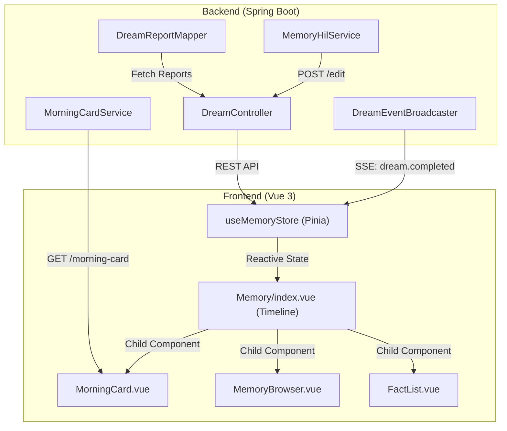
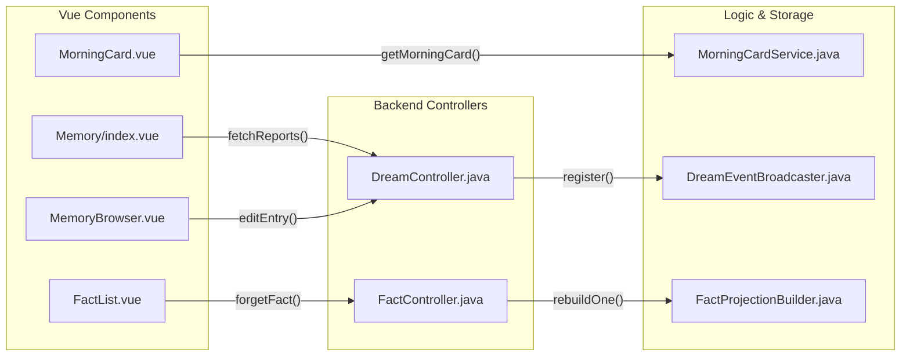

<!-- source: DeepWiki mcp.deepwiki.com · repo matevip/mateclaw · page 6.3 Memory UI (Morning Card & Browser) · fetched 2026-10-26 -->

# Memory UI (Morning Card & Browser)

Relevant source files

The following files were used as context for generating this wiki page:

- [README.md](README.md)
- [README_zh.md](README_zh.md)
- [assets/images/preview.png](assets/images/preview.png)
- [mateclaw-server/src/main/java/vip/mate/agent/controller/AgentController.java](mateclaw-server/src/main/java/vip/mate/agent/controller/AgentController.java)
- [mateclaw-server/src/main/java/vip/mate/channel/web/Utf8SseEmitter.java](mateclaw-server/src/main/java/vip/mate/channel/web/Utf8SseEmitter.java)
- [mateclaw-server/src/main/java/vip/mate/channel/webchat/WebChatController.java](mateclaw-server/src/main/java/vip/mate/channel/webchat/WebChatController.java)
- [mateclaw-server/src/main/java/vip/mate/memory/MemoryProperties.java](mateclaw-server/src/main/java/vip/mate/memory/MemoryProperties.java)
- [mateclaw-server/src/main/java/vip/mate/memory/controller/DreamController.java](mateclaw-server/src/main/java/vip/mate/memory/controller/DreamController.java)
- [mateclaw-server/src/main/java/vip/mate/memory/controller/DreamEventBroadcaster.java](mateclaw-server/src/main/java/vip/mate/memory/controller/DreamEventBroadcaster.java)
- [mateclaw-server/src/main/java/vip/mate/memory/event/DreamCompletedEvent.java](mateclaw-server/src/main/java/vip/mate/memory/event/DreamCompletedEvent.java)
- [mateclaw-server/src/main/java/vip/mate/memory/event/DreamFailedEvent.java](mateclaw-server/src/main/java/vip/mate/memory/event/DreamFailedEvent.java)
- [mateclaw-server/src/main/java/vip/mate/memory/fact/controller/FactController.java](mateclaw-server/src/main/java/vip/mate/memory/fact/controller/FactController.java)
- [mateclaw-server/src/main/java/vip/mate/memory/fact/repository/FactMapper.java](mateclaw-server/src/main/java/vip/mate/memory/fact/repository/FactMapper.java)
- [mateclaw-server/src/main/java/vip/mate/memory/service/MorningCardService.java](mateclaw-server/src/main/java/vip/mate/memory/service/MorningCardService.java)
- [mateclaw-server/src/main/java/vip/mate/wiki/controller/WikiResearchController.java](mateclaw-server/src/main/java/vip/mate/wiki/controller/WikiResearchController.java)
- [mateclaw-server/src/main/java/vip/mate/wiki/repository/WikiChunkMapper.java](mateclaw-server/src/main/java/vip/mate/wiki/repository/WikiChunkMapper.java)
- [mateclaw-server/src/main/resources/prompts/memory/contradiction-batch.txt](mateclaw-server/src/main/resources/prompts/memory/contradiction-batch.txt)
- [mateclaw-ui/src/stores/useMemoryStore.ts](mateclaw-ui/src/stores/useMemoryStore.ts)
- [mateclaw-ui/src/views/Memory/components/MemoryBrowser.vue](mateclaw-ui/src/views/Memory/components/MemoryBrowser.vue)
- [mateclaw-ui/src/views/Memory/components/MorningCard.vue](mateclaw-ui/src/views/Memory/components/MorningCard.vue)
- [mateclaw-ui/src/views/Memory/index.vue](mateclaw-ui/src/views/Memory/index.vue)

The Memory UI provides a unified interface for visualizing and managing an agent's long-term knowledge and the background "dreaming" processes that consolidate it. It consists of a timeline of dreaming events, a Morning Card briefing for human-in-the-loop (HiL) review, and a browser for structured workspace files.

## Memory Workspace Overview

The frontend entry point is `Memory/index.vue`, which serves as a shell for three primary functional areas:
1.  **Timeline**: A chronological list of `DreamReportEntity` records.
2.  **Morning Card**: A summary of recent memory changes for user acknowledgment.
3.  **Memory Browser**: A viewer for the agent's core identity and memory files (`MEMORY.md`, `PROFILE.md`, `SOUL.md`).

### Data Flow: Memory & Dreaming UI

The following diagram illustrates the flow from backend events to the frontend UI components.

**Memory System Architecture**

Sources: [mateclaw-server/src/main/java/vip/mate/memory/controller/DreamController.java:31-40](), [mateclaw-ui/src/views/Memory/index.vue:1-112](), [mateclaw-ui/src/stores/useMemoryStore.ts:23-30]()

---

## 1. Dream Timeline & useMemoryStore

The timeline displays the history of "Dreaming" sessions—background LLM tasks that consolidate conversation fragments into structured facts.

### Backend: DreamController & Events
The `DreamController` provides paginated access to `DreamReportEntity` records [mateclaw-server/src/main/java/vip/mate/memory/controller/DreamController.java:45-62](). 
*   **SSE Support**: `DreamEventBroadcaster` uses `Utf8SseEmitter` to push `dream.completed` and `dream.failed` events to the UI [mateclaw-server/src/main/java/vip/mate/memory/controller/DreamEventBroadcaster.java:38-48]().
*   **Manual Trigger**: Users can initiate a "Focused Dream" on a specific topic via the UI, which calls the backend to start a targeted memory emergence run [mateclaw-ui/src/views/Memory/index.vue:118-130]().

### Frontend: useMemoryStore
The `useMemoryStore` manages the state of the timeline. Notably, it implements **polling** as a fallback/alternative to SSE for dream events to ensure compatibility with authorization headers [mateclaw-ui/src/stores/useMemoryStore.ts:68-73]().
*   `fetchReports`: Retrieves the list of dream runs with stats like `promotedCount` (new facts) and `candidateCount` [mateclaw-ui/src/stores/useMemoryStore.ts:31-47]().
*   `subscribeEvents`: Polls every 15 seconds to refresh the timeline [mateclaw-ui/src/stores/useMemoryStore.ts:70-72]().

Sources: [mateclaw-server/src/main/java/vip/mate/memory/controller/DreamController.java:83-88](), [mateclaw-ui/src/stores/useMemoryStore.ts:5-21](), [mateclaw-server/src/main/java/vip/mate/channel/web/Utf8SseEmitter.java:1-15]()

---

## 2. Morning Card (Briefing Component)

The `MorningCard.vue` component provides a "daily briefing" for the user, summarizing the most recent memory consolidation.

| Feature | Implementation |
| :--- | :--- |
| **Visibility** | Only appears if a new dream report exists that the user hasn't "seen" [mateclaw-ui/src/views/Memory/components/MorningCard.vue:3-17](). |
| **Data Fetching** | Watches `agentId` to fetch `/morning-card` data [mateclaw-ui/src/views/Memory/components/MorningCard.vue:29-35](). |
| **Action** | `dismiss()` sends a POST request to `/morning-card/seen` with the `reportId` [mateclaw-ui/src/views/Memory/components/MorningCard.vue:37-41](). |

Sources: [mateclaw-ui/src/views/Memory/components/MorningCard.vue:29-35](), [mateclaw-server/src/main/java/vip/mate/memory/controller/DreamController.java:93-100]()

---

## 3. Memory Browser & Workspace Files

The `MemoryBrowser.vue` allows users to view and edit the markdown files that define the agent's persona and memory.

### Section Parsing & H2 Headers
The browser parses `MEMORY.md` based on H2 headers (`## Section Name`). This allows the UI to treat individual memory entries as discrete editable units.
*   **HiL Editing**: When a user edits a section, the backend identifies the section by its header and injects metadata markers [mateclaw-server/src/main/java/vip/mate/memory/controller/DreamController.java:131-135]().
*   **Protection**: Metadata markers (like `> Forgotten`) signal to the projection engine to adjust fact visibility or trust [mateclaw-server/src/main/java/vip/mate/memory/fact/controller/FactController.java:84-95]().

### Fact Management
The `FactList` and `FactTrustBar` components visualize atomic facts extracted by the `FactProjectionBuilder`.
*   **FactTrustBar**: Visualizes the confidence score or "trust level" derived from time decay and user feedback [mateclaw-server/src/main/java/vip/mate/memory/fact/controller/FactController.java:117-126]().
*   **CRUD**: `FactController` provides endpoints to `forget` or submit `feedback` on facts [mateclaw-server/src/main/java/vip/mate/memory/fact/controller/FactController.java:62-66]().

Sources: [mateclaw-ui/src/views/Memory/index.vue:103-112](), [mateclaw-server/src/main/java/vip/mate/memory/fact/controller/FactController.java:46-59](), [mateclaw-server/src/main/java/vip/mate/memory/MemoryProperties.java:126-144]()

---

## 4. Technical Implementation Detail

### REST API Endpoints
The following table maps UI actions to `DreamController` and `FactController` endpoints:

| UI Action | Method | Endpoint | Description |
| :--- | :--- | :--- | :--- |
| Load Timeline | `GET` | `/api/v1/memory/{agentId}/dream/reports` | List reports [mateclaw-server/src/main/java/vip/mate/memory/controller/DreamController.java:43-45]() |
| View Report | `GET` | `/api/v1/memory/{agentId}/dream/reports/{id}` | Get report detail [mateclaw-server/src/main/java/vip/mate/memory/controller/DreamController.java:65-67]() |
| Edit Entry | `POST` | `/api/v1/memory/{agentId}/dream/reports/{id}/entries/{key}/edit` | Write back user-edited metadata [mateclaw-server/src/main/java/vip/mate/memory/controller/DreamController.java:129-134]() |
| Forget Fact | `POST` | `/api/v1/memory/{agentId}/facts/{factId}/forget` | Rebuild projection with forget marker [mateclaw-server/src/main/java/vip/mate/memory/fact/controller/FactController.java:62-66]() |

### Code Mapping: Frontend to Backend
This diagram bridges UI components to their corresponding backend services and controllers.

**UI to Code Entity Mapping**

Sources: [mateclaw-server/src/main/java/vip/mate/memory/controller/DreamController.java:31-40](), [mateclaw-ui/src/views/Memory/index.vue:103-115](), [mateclaw-server/src/main/java/vip/mate/memory/fact/controller/FactController.java:37-43]()

---

