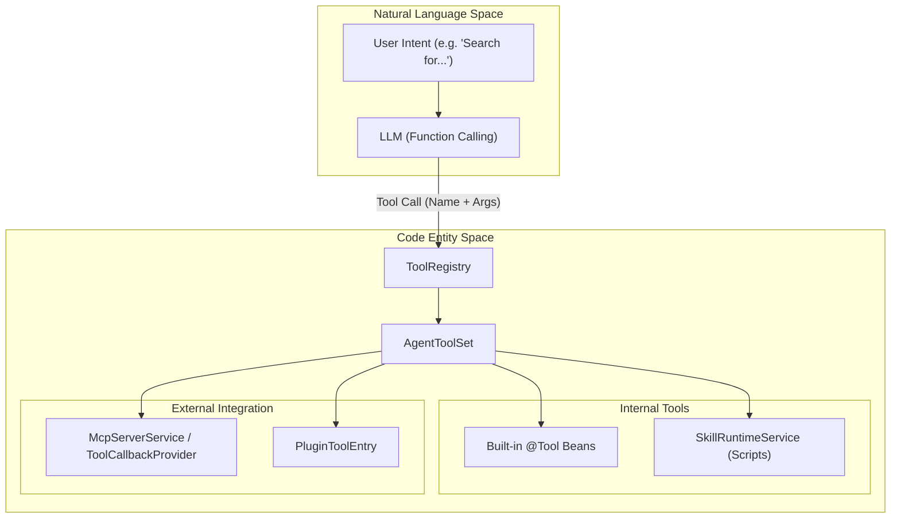
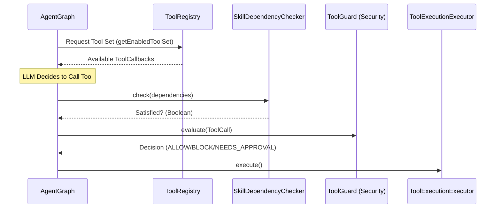

<!-- source: DeepWiki mcp.deepwiki.com · repo matevip/mateclaw · page 7 Tools & Skills · fetched 2026-10-26 -->

# Tools & Skills

Relevant source files

The following files were used as context for generating this wiki page:

- [mateclaw-server/src/main/java/vip/mate/MateClawApplication.java](mateclaw-server/src/main/java/vip/mate/MateClawApplication.java)
- [mateclaw-server/src/main/java/vip/mate/skill/controller/SkillController.java](mateclaw-server/src/main/java/vip/mate/skill/controller/SkillController.java)
- [mateclaw-server/src/main/java/vip/mate/skill/installer/BuiltinSkillSeedService.java](mateclaw-server/src/main/java/vip/mate/skill/installer/BuiltinSkillSeedService.java)
- [mateclaw-server/src/main/java/vip/mate/skill/model/SkillEntity.java](mateclaw-server/src/main/java/vip/mate/skill/model/SkillEntity.java)
- [mateclaw-server/src/main/java/vip/mate/skill/runtime/SkillDependencyChecker.java](mateclaw-server/src/main/java/vip/mate/skill/runtime/SkillDependencyChecker.java)
- [mateclaw-server/src/main/java/vip/mate/skill/runtime/SkillPackageResolver.java](mateclaw-server/src/main/java/vip/mate/skill/runtime/SkillPackageResolver.java)
- [mateclaw-server/src/main/java/vip/mate/skill/runtime/SkillRuntimeService.java](mateclaw-server/src/main/java/vip/mate/skill/runtime/SkillRuntimeService.java)
- [mateclaw-server/src/main/java/vip/mate/skill/service/SkillService.java](mateclaw-server/src/main/java/vip/mate/skill/service/SkillService.java)
- [mateclaw-server/src/main/java/vip/mate/tool/ToolRegistry.java](mateclaw-server/src/main/java/vip/mate/tool/ToolRegistry.java)
- [mateclaw-server/src/main/resources/db/data-en.sql](mateclaw-server/src/main/resources/db/data-en.sql)
- [mateclaw-server/src/main/resources/db/data-mysql-en.sql](mateclaw-server/src/main/resources/db/data-mysql-en.sql)
- [mateclaw-server/src/main/resources/db/data-mysql-zh.sql](mateclaw-server/src/main/resources/db/data-mysql-zh.sql)
- [mateclaw-server/src/main/resources/db/data-zh.sql](mateclaw-server/src/main/resources/db/data-zh.sql)
- [mateclaw-ui/src/types/index.ts](mateclaw-ui/src/types/index.ts)
- [mateclaw-ui/src/views/Agents.vue](mateclaw-ui/src/views/Agents.vue)
- [mateclaw-ui/src/views/Dashboard.vue](mateclaw-ui/src/views/Dashboard.vue)
- [mateclaw-ui/src/views/SkillMarket.vue](mateclaw-ui/src/views/SkillMarket.vue)

The **Tools & Skills** ecosystem provides MateClaw with its "hands" and "extended capabilities." While the Core Agent Runtime manages the reasoning loop, the tool layer handles the actual execution of side effects, data retrieval, and media generation. MateClaw distinguishes between **Built-in Tools** (statically defined in Java), **Skills** (dynamically loaded, AI-synthesizable packages), and **MCP Servers** (external tools following the Model Context Protocol).

### Tool Ecosystem Overview

The `ToolRegistry` serves as the central authority for all executable capabilities. It aggregates tools from three primary sources: Spring-managed beans annotated with `@Tool`, external MCP servers, and dynamically registered plugin tools [mateclaw-server/src/main/java/vip/mate/tool/ToolRegistry.java:38-42](). It provides a unified `AgentToolSet` to the agent graph, ensuring that tools are localized and availability-checked at runtime [mateclaw-server/src/main/java/vip/mate/tool/ToolRegistry.java:118-168]().

#### Tool Architecture & Discovery

**Sources:** [mateclaw-server/src/main/java/vip/mate/tool/ToolRegistry.java:118-168](), [mateclaw-ui/src/types/index.ts:106-113]()

---

### [Built-in Tools](#7.1)

Built-in tools are high-performance Java implementations for core OS and web interactions. They are typically defined as Spring `@Component` beans. Tool visibility and enablement are controlled via the `mate_tool` database table [mateclaw-server/src/main/java/vip/mate/tool/ToolRegistry.java:73-83]().

*   **Browser & Web**: `BrowserUseTool` (Playwright-based automation), `WebSearchTool` (supporting SearXNG, Tavily, and Google), and `UrlSafetyChecker`.
*   **System & Files**: `ShellExecuteTool` for terminal commands, `SkillFileTool` for workspace manipulation, and `DocumentExtractTool` for multi-format parsing.
*   **Data & Memory**: `SqlQueryTool` for database interaction and `WorkspaceMemoryTool` for accessing long-term context.

For details on configuration and the fallback chains for document extraction, see [Built-in Tools](#7.1).

**Sources:** [mateclaw-server/src/main/resources/db/data-zh.sql:11-27](), [mateclaw-server/src/main/java/vip/mate/tool/ToolRegistry.java:73-109]()

---

### [Skill System](#7.2)

Skills are portable, versioned packages that extend MateClaw without requiring a server restart. A Skill is defined by a `SKILL.md` manifest containing frontmatter (metadata and dependencies) and associated scripts [mateclaw-server/src/main/java/vip/mate/skill/model/SkillEntity.java:61-80]().

*   **Skill Categories**: Classified into `builtin`, `mcp`, and `dynamic` (user-defined) [mateclaw-server/src/main/java/vip/mate/skill/service/SkillService.java:27-31]().
*   **Security & Safety**: Skills undergo security scans; those with a `FAILED` status are blocked from execution to prevent malicious script runs [mateclaw-server/src/main/java/vip/mate/skill/service/SkillService.java:141-150]().
*   **Dependency Management**: `SkillDependencyChecker` validates the environment (OS, commands, env vars, and required internal tools) [mateclaw-server/src/main/java/vip/mate/skill/runtime/SkillDependencyChecker.java:49-110]().
*   **AI Synthesis**: Agents can autonomously generate new skills from conversation history via `SkillSynthesisService` [mateclaw-server/src/main/java/vip/mate/skill/controller/SkillController.java:155-183]().

For details on the Skill lifecycle and packaging, see [Skill System](#7.2).

**Sources:** [mateclaw-server/src/main/java/vip/mate/skill/model/SkillEntity.java:94-112](), [mateclaw-ui/src/types/index.ts:228-252]()

---

### [MCP (Model Context Protocol) Integration](#7.3)

MateClaw acts as an MCP Host, allowing it to connect to any MCP-compliant server (e.g., Claude Desktop tools, filesystem servers).

*   **Transports**: Supports `stdio`, `SSE`, and `streamable_http`.
*   **Discovery**: `McpServerService` automatically maps MCP tool definitions into the `ToolRegistry` via the `ToolCallbackProvider` interface [mateclaw-server/src/main/java/vip/mate/tool/ToolRegistry.java:141-147]().
*   **Context Sharing**: MCP tools can "Return Direct," allowing tool outputs to bypass LLM summarization for large data transfers.

For details on transport configuration and tool name prefixing, see [MCP (Model Context Protocol) Integration](#7.3).

**Sources:** [mateclaw-server/src/main/java/vip/mate/tool/ToolRegistry.java:120-121]()

---

### [Media Generation Tools](#7.4)

Media tools provide multimodal output capabilities, abstracted through a provider-based architecture. These are managed via the `mate_model_provider` configuration [mateclaw-server/src/main/resources/db/data-en.sql:31-85]().

| Capability | Providers | Code Entity |
| :--- | :--- | :--- |
| **Image Gen** | OpenAI (DALL-E), MiniMax | `OpenAiImageProvider` |
| **Video Gen** | MiniMax | `MiniMaxVideoProvider` |
| **Speech (TTS)** | System-native, DashScope | `TtsService` |
| **Transcribe (STT)** | OpenAI Whisper, DashScope | `SttService` |

Media results are managed via a `GeneratedFileCache` which provides single-use download endpoints for the UI. The frontend handles these via `ChatAttachment` objects [mateclaw-ui/src/types/index.ts:95-104]().

For details on provider-specific settings and audio processing, see [Media Generation Tools](#7.4).

**Sources:** [mateclaw-server/src/main/resources/db/data-en.sql:70-75](), [mateclaw-ui/src/types/index.ts:181-192]()

---

### Dependency & Security Workflow

Before any tool or skill is executed, it passes through a validation pipeline to ensure system stability and user safety. The `ToolRegistry` is the authoritative source for function names used during dependency checks [mateclaw-server/src/main/java/vip/mate/skill/runtime/SkillDependencyChecker.java:138-148]().

**Sources:** [mateclaw-server/src/main/java/vip/mate/skill/runtime/SkillDependencyChecker.java:149-163](), [mateclaw-ui/src/types/index.ts:122-132](), [mateclaw-server/src/main/java/vip/mate/tool/ToolRegistry.java:118-121]()

---

