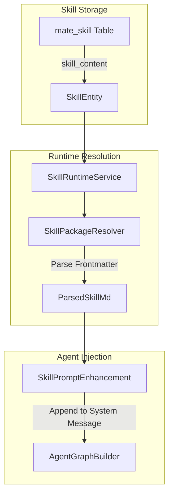
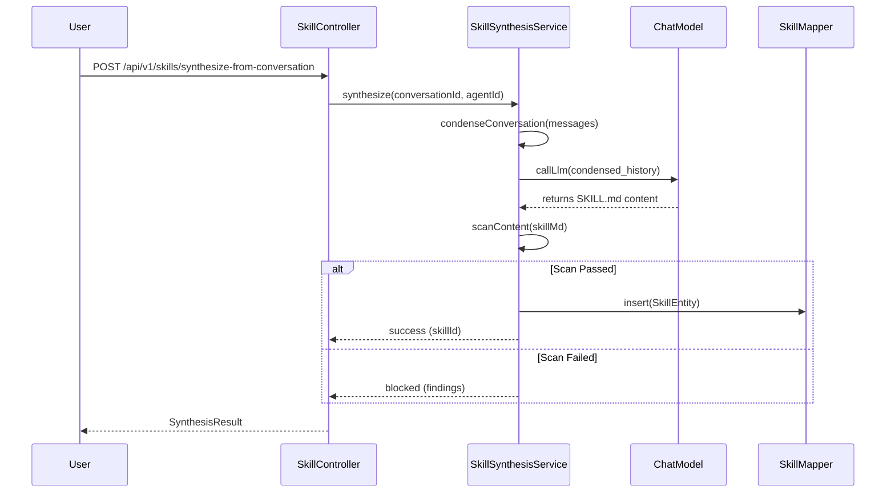
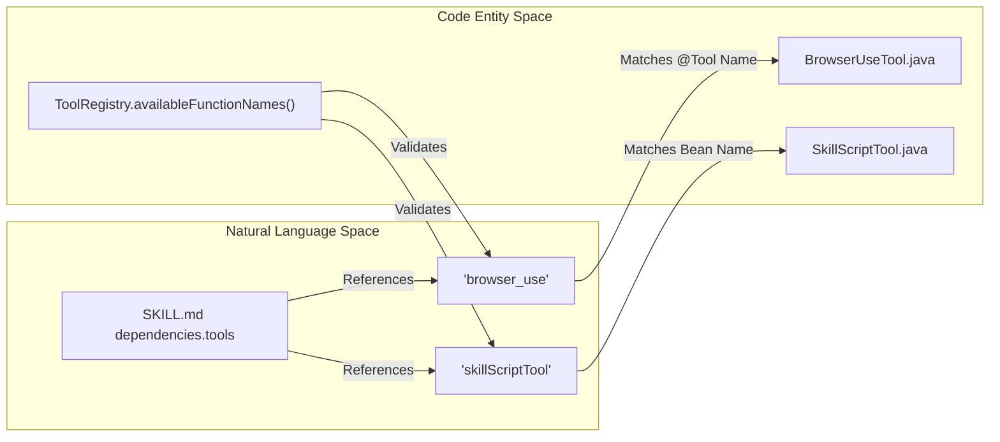

<!-- source: DeepWiki mcp.deepwiki.com · repo matevip/mateclaw · page 7.2 Skill System · fetched 2026-10-26 -->

# Skill System

Relevant source files

The following files were used as context for generating this wiki page:

- [mateclaw-server/src/main/java/vip/mate/MateClawApplication.java](mateclaw-server/src/main/java/vip/mate/MateClawApplication.java)
- [mateclaw-server/src/main/java/vip/mate/agent/binding/model/AgentSkillBinding.java](mateclaw-server/src/main/java/vip/mate/agent/binding/model/AgentSkillBinding.java)
- [mateclaw-server/src/main/java/vip/mate/agent/binding/model/AgentToolBinding.java](mateclaw-server/src/main/java/vip/mate/agent/binding/model/AgentToolBinding.java)
- [mateclaw-server/src/main/java/vip/mate/agent/binding/repository/AgentSkillBindingMapper.java](mateclaw-server/src/main/java/vip/mate/agent/binding/repository/AgentSkillBindingMapper.java)
- [mateclaw-server/src/main/java/vip/mate/agent/binding/repository/AgentToolBindingMapper.java](mateclaw-server/src/main/java/vip/mate/agent/binding/repository/AgentToolBindingMapper.java)
- [mateclaw-server/src/main/java/vip/mate/agent/binding/service/AgentBindingService.java](mateclaw-server/src/main/java/vip/mate/agent/binding/service/AgentBindingService.java)
- [mateclaw-server/src/main/java/vip/mate/audit/controller/AuditEventController.java](mateclaw-server/src/main/java/vip/mate/audit/controller/AuditEventController.java)
- [mateclaw-server/src/main/java/vip/mate/skill/controller/SkillController.java](mateclaw-server/src/main/java/vip/mate/skill/controller/SkillController.java)
- [mateclaw-server/src/main/java/vip/mate/skill/controller/SkillInstallController.java](mateclaw-server/src/main/java/vip/mate/skill/controller/SkillInstallController.java)
- [mateclaw-server/src/main/java/vip/mate/skill/installer/BuiltinSkillSeedService.java](mateclaw-server/src/main/java/vip/mate/skill/installer/BuiltinSkillSeedService.java)
- [mateclaw-server/src/main/java/vip/mate/skill/installer/SkillInstaller.java](mateclaw-server/src/main/java/vip/mate/skill/installer/SkillInstaller.java)
- [mateclaw-server/src/main/java/vip/mate/skill/installer/ZipSkillFetcher.java](mateclaw-server/src/main/java/vip/mate/skill/installer/ZipSkillFetcher.java)
- [mateclaw-server/src/main/java/vip/mate/skill/model/SkillEntity.java](mateclaw-server/src/main/java/vip/mate/skill/model/SkillEntity.java)
- [mateclaw-server/src/main/java/vip/mate/skill/runtime/SkillDependencyChecker.java](mateclaw-server/src/main/java/vip/mate/skill/runtime/SkillDependencyChecker.java)
- [mateclaw-server/src/main/java/vip/mate/skill/runtime/SkillPackageResolver.java](mateclaw-server/src/main/java/vip/mate/skill/runtime/SkillPackageResolver.java)
- [mateclaw-server/src/main/java/vip/mate/skill/runtime/SkillRuntimeService.java](mateclaw-server/src/main/java/vip/mate/skill/runtime/SkillRuntimeService.java)
- [mateclaw-server/src/main/java/vip/mate/skill/service/SkillService.java](mateclaw-server/src/main/java/vip/mate/skill/service/SkillService.java)
- [mateclaw-server/src/main/java/vip/mate/skill/synthesis/SkillSynthesisAutoConfiguration.java](mateclaw-server/src/main/java/vip/mate/skill/synthesis/SkillSynthesisAutoConfiguration.java)
- [mateclaw-server/src/main/java/vip/mate/skill/synthesis/SkillSynthesisProperties.java](mateclaw-server/src/main/java/vip/mate/skill/synthesis/SkillSynthesisProperties.java)
- [mateclaw-server/src/main/java/vip/mate/skill/synthesis/SkillSynthesisService.java](mateclaw-server/src/main/java/vip/mate/skill/synthesis/SkillSynthesisService.java)
- [mateclaw-server/src/main/java/vip/mate/skill/synthesis/SkillSynthesisSuggestor.java](mateclaw-server/src/main/java/vip/mate/skill/synthesis/SkillSynthesisSuggestor.java)
- [mateclaw-server/src/main/java/vip/mate/tool/ToolRegistry.java](mateclaw-server/src/main/java/vip/mate/tool/ToolRegistry.java)
- [mateclaw-server/src/main/java/vip/mate/tool/builtin/SkillManageTool.java](mateclaw-server/src/main/java/vip/mate/tool/builtin/SkillManageTool.java)
- [mateclaw-server/src/main/resources/db/migration/h2/V11__skill_synthesis.sql](mateclaw-server/src/main/resources/db/migration/h2/V11__skill_synthesis.sql)
- [mateclaw-server/src/main/resources/prompts/skill/synthesize-system.txt](mateclaw-server/src/main/resources/prompts/skill/synthesize-system.txt)
- [mateclaw-server/src/main/resources/skills/docx/SKILL.md](mateclaw-server/src/main/resources/skills/docx/SKILL.md)
- [mateclaw-server/src/main/resources/skills/steve_jobs_perspective/SKILL.md](mateclaw-server/src/main/resources/skills/steve_jobs_perspective/SKILL.md)
- [mateclaw-server/src/main/resources/skills/steve_jobs_perspective/references/product_philosophy.md](mateclaw-server/src/main/resources/skills/steve_jobs_perspective/references/product_philosophy.md)
- [mateclaw-server/src/main/resources/skills/steve_jobs_perspective/references/stanford_speech.md](mateclaw-server/src/main/resources/skills/steve_jobs_perspective/references/stanford_speech.md)
- [mateclaw-server/src/test/java/vip/mate/agent/binding/AgentBindingServiceTest.java](mateclaw-server/src/test/java/vip/mate/agent/binding/AgentBindingServiceTest.java)
- [mateclaw-ui/src/components/skill/ImportHubDialog.vue](mateclaw-ui/src/components/skill/ImportHubDialog.vue)
- [mateclaw-ui/src/views/Agents.vue](mateclaw-ui/src/views/Agents.vue)
- [mateclaw-ui/src/views/Dashboard.vue](mateclaw-ui/src/views/Dashboard.vue)
- [mateclaw-ui/src/views/SkillMarket.vue](mateclaw-ui/src/views/SkillMarket.vue)

The Skill System in MateClaw provides a mechanism for packaging, distributing, and executing domain-specific AI capabilities. Unlike standard tools which are stateless functions, a **Skill** is a cohesive package containing prompt enhancements (system instructions), supporting scripts (Python/Node.js/Bash), and reference materials (Markdown) [mateclaw-server/src/main/java/vip/mate/skill/model/SkillEntity.java:21-80]().

## Skill Packaging (SKILL.md)

Every skill is defined by a `SKILL.md` file located in its root directory. This file uses YAML frontmatter for metadata and Markdown for the execution protocol [mateclaw-server/src/main/java/vip/mate/skill/model/SkillEntity.java:62-80]().

### Structure of a Skill Package
*   **SKILL.md**: The entry point containing the skill's identity, dependencies, and "Operating Manual" for the Agent [mateclaw-server/src/main/resources/skills/docx/SKILL.md:1-16]().
*   **scripts/**: Executable logic (e.g., Python scripts for DOCX manipulation) [mateclaw-server/src/main/resources/skills/docx/SKILL.md:18-19]().
*   **references/**: Background knowledge or templates used by the agent during execution [mateclaw-server/src/main/resources/skills/steve_jobs_perspective/SKILL.md:116-121]().

### Data Flow: Skill to Prompt

**Sources:** [mateclaw-server/src/main/java/vip/mate/skill/model/SkillEntity.java:79-80](), [mateclaw-server/src/main/java/vip/mate/skill/runtime/SkillRuntimeService.java:113-121](), [mateclaw-server/src/main/java/vip/mate/skill/installer/BuiltinSkillSeedService.java:89-90]()

---

## Core Services

### SkillService & SkillEntity
`SkillService` manages the lifecycle of `SkillEntity` objects. It handles CRUD operations, status toggling, and provides filtered lists for the Agent runtime [mateclaw-server/src/main/java/vip/mate/skill/service/SkillService.java:38-50]().
*   **Skill Types**: `builtin` (system-provided), `mcp` (Model Context Protocol), and `dynamic` (user-defined) [mateclaw-server/src/main/java/vip/mate/skill/service/SkillService.java:27-31]().
*   **Security Filter**: The `listEnabledSkills` method ensures that only skills with a `PASSED` or `NULL` security scan status are loaded into the agent's context [mateclaw-server/src/main/java/vip/mate/skill/service/SkillService.java:145-151]().
*   **I18n Support**: `SkillEntity` supports locale-specific display names via `nameZh` and `nameEn` [mateclaw-server/src/main/java/vip/mate/skill/model/SkillEntity.java:25-37]().

### SkillRuntimeService
This service is responsible for the active execution state of skills.
*   **Prompt Enhancement**: `buildSkillPromptEnhancement()` aggregates the Markdown content of all enabled skills into a single block for the LLM [mateclaw-server/src/main/java/vip/mate/skill/controller/SkillController.java:112-121]().
*   **Active Tracking**: It maintains a cache of `ResolvedSkill` objects representing the current runtime state [mateclaw-server/src/main/java/vip/mate/skill/controller/SkillController.java:125-130]().

### SkillPackageResolver & DependencyChecker
The `SkillPackageResolver` parses the `SKILL.md` content and extracts dependencies.
*   **SkillDependencyChecker**: Validates if the host system has the required commands (e.g., `python3`, `node`), environment variables, and if the required MateClaw tools are enabled [mateclaw-server/src/main/java/vip/mate/skill/runtime/SkillDependencyChecker.java:49-110]().
*   **Authority**: The `ToolRegistry` is the authoritative source for checking tool availability, covering `@Tool` beans, MCP tools, and plugin tools [mateclaw-server/src/main/java/vip/mate/skill/runtime/SkillDependencyChecker.java:139-148]().

**Sources:** [mateclaw-server/src/main/java/vip/mate/skill/service/SkillService.java:38-50](), [mateclaw-server/src/main/java/vip/mate/skill/controller/SkillController.java:112-151](), [mateclaw-server/src/main/java/vip/mate/skill/runtime/SkillDependencyChecker.java:49-110](), [mateclaw-server/src/main/resources/skills/docx/SKILL.md:1-16]()

---

## Installation and Seeding

### BuiltinSkillSeedService
This service automates the synchronization of bundled skills from the classpath to the database on startup.
*   **Scan Logic**: It searches for `classpath*:skills/*/SKILL.md` [mateclaw-server/src/main/java/vip/mate/skill/installer/BuiltinSkillSeedService.java:55]().
*   **Merge Policy**: It performs an "upsert" based on the skill `name`. If a skill exists, it merges frontmatter fields into the database, preserving manual UI tweaks for fields omitted in the Markdown [mateclaw-server/src/main/java/vip/mate/skill/installer/BuiltinSkillSeedService.java:153-160]().

### SkillInstaller & ZipSkillFetcher
Facilitates importing skills from external sources (ClawHub).
*   **Zip Import**: `ZipSkillFetcher` handles the retrieval and extraction of skill archives.
*   **Workspace Sync**: The `SkillWorkspaceManager` ensures that skill files (scripts, references) are written to the physical filesystem so that tools like `SkillScriptTool` can execute them [mateclaw-server/src/main/java/vip/mate/skill/service/SkillService.java:41-42]().

**Sources:** [mateclaw-server/src/main/java/vip/mate/skill/installer/BuiltinSkillSeedService.java:53-121](), [mateclaw-server/src/main/java/vip/mate/skill/service/SkillService.java:186-191]()

---

## AI Skill Synthesis

MateClaw can autonomously generate new skills from conversation history via `SkillSynthesisService`.

### Synthesis Pipeline
1.  **Condensation**: The conversation is stripped of noise and truncated to fit LLM context windows [mateclaw-server/src/main/java/vip/mate/skill/synthesis/SkillSynthesisService.java:71-72]().
2.  **LLM Generation**: A specialized prompt (`synthesize-system.txt`) instructs the LLM to distill the conversation into a `SKILL.md` format [mateclaw-server/src/main/java/vip/mate/skill/synthesis/SkillSynthesisService.java:77-80]().
3.  **Security Scan**: The generated skill undergoes an immediate security scan. If it contains dangerous patterns, it is marked as `FAILED` and blocked from execution [mateclaw-server/src/main/java/vip/mate/skill/synthesis/SkillSynthesisService.java:104-110]().
4.  **Persistence**: The skill is saved to the `mate_skill` table and exported to the workspace filesystem [mateclaw-server/src/main/java/vip/mate/skill/synthesis/SkillSynthesisService.java:113-134]().

### Skill Synthesis Data Flow

**Sources:** [mateclaw-server/src/main/java/vip/mate/skill/synthesis/SkillSynthesisService.java:61-139](), [mateclaw-server/src/main/java/vip/mate/skill/controller/SkillController.java:156-183]()

---

## Agent-Skill Bindings

Skills are not globally applied to all agents but are bound based on status and context. Agents interact with skills through specific tools.

| Entity | Role in Skill System |
| :--- | :--- |
| `SkillManageTool` | Allows an Agent to autonomously enable, disable, or create skills during a conversation [mateclaw-server/src/main/java/vip/mate/tool/builtin/SkillManageTool.java:1-50](). |
| `SkillFileTool` | Provides the Agent with `read_skill_file` and `list_skill_files` capabilities to access skill assets [mateclaw-server/src/main/resources/skills/steve_jobs_perspective/SKILL.md:7](). |
| `SkillScriptTool` | Executes scripts located within the `scripts/` directory of a specific skill via `run_skill_script` [mateclaw-server/src/main/resources/skills/docx/SKILL.md:10](). |
| `AgentGraphBuilder` | Injects the aggregated skill prompt into the `SystemMessage` during graph construction [mateclaw-server/src/main/java/vip/mate/skill/controller/SkillController.java:112-121](). |

### Runtime Tool Resolution
The system bridges the gap between natural language tool requests and code entities through the `ToolRegistry`.

**Sources:** [mateclaw-server/src/main/java/vip/mate/tool/ToolRegistry.java:118-168](), [mateclaw-server/src/main/java/vip/mate/skill/runtime/SkillDependencyChecker.java:139-162](), [mateclaw-server/src/main/resources/skills/docx/SKILL.md:9-11]()

---

