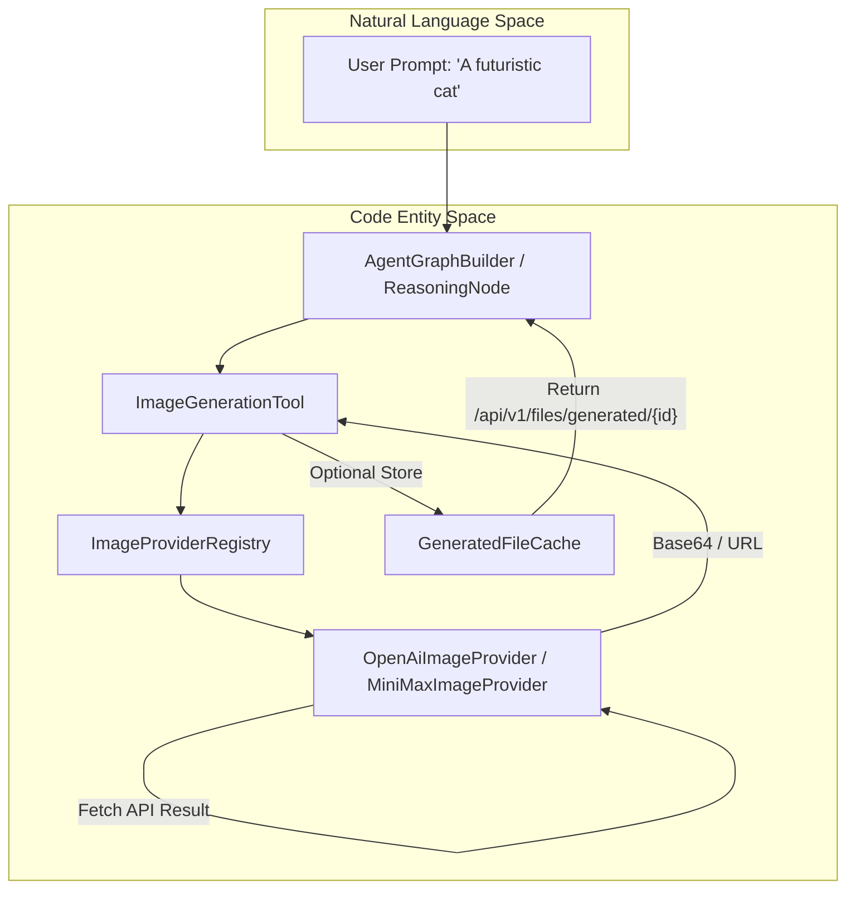
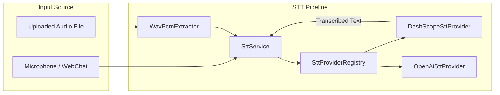

<!-- source: DeepWiki mcp.deepwiki.com · repo matevip/mateclaw · page 7.4 Media Generation Tools · fetched 2026-10-26 -->

# Media Generation Tools

Relevant source files

The following files were used as context for generating this wiki page:

- [mateclaw-server/pom.xml](mateclaw-server/pom.xml)
- [mateclaw-server/src/main/java/vip/mate/stt/AudioMimeTypes.java](mateclaw-server/src/main/java/vip/mate/stt/AudioMimeTypes.java)
- [mateclaw-server/src/main/java/vip/mate/stt/SttProvider.java](mateclaw-server/src/main/java/vip/mate/stt/SttProvider.java)
- [mateclaw-server/src/main/java/vip/mate/stt/SttProviderRegistry.java](mateclaw-server/src/main/java/vip/mate/stt/SttProviderRegistry.java)
- [mateclaw-server/src/main/java/vip/mate/stt/SttService.java](mateclaw-server/src/main/java/vip/mate/stt/SttService.java)
- [mateclaw-server/src/main/java/vip/mate/stt/WavPcmExtractor.java](mateclaw-server/src/main/java/vip/mate/stt/WavPcmExtractor.java)
- [mateclaw-server/src/main/java/vip/mate/stt/provider/DashScopeSttProvider.java](mateclaw-server/src/main/java/vip/mate/stt/provider/DashScopeSttProvider.java)
- [mateclaw-server/src/main/java/vip/mate/stt/provider/OpenAiSttProvider.java](mateclaw-server/src/main/java/vip/mate/stt/provider/OpenAiSttProvider.java)
- [mateclaw-server/src/main/java/vip/mate/system/model/SystemSettingsDTO.java](mateclaw-server/src/main/java/vip/mate/system/model/SystemSettingsDTO.java)
- [mateclaw-server/src/main/java/vip/mate/tool/builtin/DocumentExtractTool.java](mateclaw-server/src/main/java/vip/mate/tool/builtin/DocumentExtractTool.java)
- [mateclaw-server/src/main/java/vip/mate/tool/builtin/DocxRenderTool.java](mateclaw-server/src/main/java/vip/mate/tool/builtin/DocxRenderTool.java)
- [mateclaw-server/src/main/java/vip/mate/tool/builtin/TikaExtractor.java](mateclaw-server/src/main/java/vip/mate/tool/builtin/TikaExtractor.java)
- [mateclaw-server/src/main/java/vip/mate/tool/document/GeneratedFileCache.java](mateclaw-server/src/main/java/vip/mate/tool/document/GeneratedFileCache.java)
- [mateclaw-server/src/main/java/vip/mate/tool/document/GeneratedFileController.java](mateclaw-server/src/main/java/vip/mate/tool/document/GeneratedFileController.java)
- [mateclaw-server/src/main/java/vip/mate/tool/document/MarkdownDocxRenderer.java](mateclaw-server/src/main/java/vip/mate/tool/document/MarkdownDocxRenderer.java)
- [mateclaw-server/src/main/java/vip/mate/tool/image/provider/MiniMaxImageProvider.java](mateclaw-server/src/main/java/vip/mate/tool/image/provider/MiniMaxImageProvider.java)
- [mateclaw-server/src/main/java/vip/mate/tool/image/provider/OpenAiImageProvider.java](mateclaw-server/src/main/java/vip/mate/tool/image/provider/OpenAiImageProvider.java)
- [mateclaw-server/src/main/java/vip/mate/tool/video/provider/MiniMaxVideoProvider.java](mateclaw-server/src/main/java/vip/mate/tool/video/provider/MiniMaxVideoProvider.java)
- [mateclaw-server/src/main/resources/db/migration/h2/V47__agent_max_iterations_100.sql](mateclaw-server/src/main/resources/db/migration/h2/V47__agent_max_iterations_100.sql)
- [mateclaw-server/src/main/resources/db/migration/mysql/V47__agent_max_iterations_100.sql](mateclaw-server/src/main/resources/db/migration/mysql/V47__agent_max_iterations_100.sql)
- [mateclaw-ui/package.json](mateclaw-ui/package.json)
- [mateclaw-ui/src/views/Settings/Stt/index.vue](mateclaw-ui/src/views/Settings/Stt/index.vue)
- [mateclaw-ui/src/views/Settings/Video/index.vue](mateclaw-ui/src/views/Settings/Video/index.vue)

The Media Generation module provides a unified abstraction layer for creating and processing multimodal content, including images, video, and audio (TTS/STT). It integrates multiple cloud providers (OpenAI, MiniMax, DashScope) with a local caching and delivery system to support agentic workflows and multi-surface delivery.

## Image Generation

MateClaw supports multiple image generation providers through the `ImageGenerationProvider` interface. These providers are typically used by agents to visualize concepts or generate assets for documents.

### Providers and Implementation
*   **OpenAiImageProvider**: Supports DALL-E 3, DALL-E 2, and the `gpt-image-2` series. It maps virtual model IDs (`gpt-image-2-low/medium/high`) to specific API quality parameters [mateclaw-server/src/main/java/vip/mate/tool/image/provider/OpenAiImageProvider.java:44-51](). It returns either direct URLs or Base64 data strings [mateclaw-server/src/main/java/vip/mate/tool/image/provider/OpenAiImageProvider.java:160-186]().
*   **MiniMaxImageProvider**: Utilizes the `image-01` model. It shares configuration (API Key and Region) with the video provider to simplify setup for Hailuo AI users [mateclaw-server/src/main/java/vip/mate/tool/image/provider/MiniMaxImageProvider.java:48-58](). It supports various aspect ratios including 16:9 and 9:16 [mateclaw-server/src/main/java/vip/mate/tool/image/provider/MiniMaxImageProvider.java:90-91]().

### Data Flow: Text to Image
The following diagram illustrates how a natural language request for an image is transformed into a rendered asset.

**Image Generation Pipeline**

Sources: [mateclaw-server/src/main/java/vip/mate/tool/image/provider/OpenAiImageProvider.java:36-40](), [mateclaw-server/src/main/java/vip/mate/tool/image/provider/MiniMaxImageProvider.java:32-35](), [mateclaw-server/src/main/java/vip/mate/tool/document/GeneratedFileCache.java:8-10]()

## Video Generation

Video generation is handled by the `VideoGenerationProvider` SPI. Due to the high latency of video synthesis, the system uses an asynchronous submission and polling model.

### MiniMaxVideoProvider
The `MiniMaxVideoProvider` supports the Hailuo family of models (e.g., `MiniMax-Hailuo-2.3`). It features:
*   **Region Selection**: Allows switching between `global` (api.minimax.io) and `cn` (api.minimaxi.com) endpoints for optimized latency [mateclaw-server/src/main/java/vip/mate/tool/video/provider/MiniMaxVideoProvider.java:72-77]().
*   **Multimodal Input**: Supports both Text-to-Video and Image-to-Video (`I2V-01`) [mateclaw-server/src/main/java/vip/mate/tool/video/provider/MiniMaxVideoProvider.java:57-66]().
*   **Task Management**: Implements `submit` for initial request [mateclaw-server/src/main/java/vip/mate/tool/video/provider/MiniMaxVideoProvider.java:122-163]() and `checkStatus` for polling the synthesis progress [mateclaw-server/src/main/java/vip/mate/tool/video/provider/MiniMaxVideoProvider.java:166-180]().

Sources: [mateclaw-server/src/main/java/vip/mate/tool/video/provider/MiniMaxVideoProvider.java:37-51]()

## Audio Processing (TTS & STT)

### Text-to-Speech (TtsService)
The `TtsService` provides speech synthesis for voice-enabled channels (e.g., Talk Mode, WeChat voice replies).
*   **Providers**: Supports `edge-tts` (zero-config), `openai`, and `dashscope`.
*   **Configuration**: Users can set default voice, speed (0.5x - 2.0x), and auto-TTS modes in system settings [mateclaw-server/src/main/java/vip/mate/system/model/SystemSettingsDTO.java:92-105]().

### Speech-to-Text (SttService)
The `SttService` converts audio streams or files into text, primarily used for processing user voice inputs.
*   **DashScopeSttProvider**: High-accuracy provider for Chinese/English audio using Alibaba's DashScope [mateclaw-server/src/main/java/vip/mate/stt/provider/DashScopeSttProvider.java:1-20]().
*   **OpenAiSttProvider**: Leverages the Whisper model for multi-language transcription [mateclaw-server/src/main/java/vip/mate/stt/provider/OpenAiSttProvider.java:1-20]().
*   **WavPcmExtractor**: A utility used to normalize various audio formats (via MIME type detection) into a standard format suitable for STT engines [mateclaw-server/src/main/java/vip/mate/stt/WavPcmExtractor.java:1-15]().

**Audio Input Processing Flow**

Sources: [mateclaw-server/src/main/java/vip/mate/stt/SttService.java:1-20](), [mateclaw-server/src/main/java/vip/mate/stt/WavPcmExtractor.java:1-10](), [mateclaw-server/src/main/java/vip/mate/stt/SttProviderRegistry.java:1-10]()

## Document and File Utilities

### DocxRenderTool
A high-performance tool for generating Word documents from Markdown within the JVM, avoiding external Node.js dependencies.
*   **MarkdownDocxRenderer**: Uses Apache POI to parse a subset of Markdown (headings, bold, lists, tables, images) and render them into `.docx` format [mateclaw-server/src/main/java/vip/mate/tool/document/MarkdownDocxRenderer.java:66-103]().
*   **SVG Support**: Automatically rasterizes SVG images to PNG using Apache Batik before embedding them in the document [mateclaw-server/src/main/java/vip/mate/tool/document/MarkdownDocxRenderer.java:124-125]().
*   **Token Optimization**: Provides `renderDocxFromFile` to allow agents to assemble large documents on disk and render them without passing the full text through LLM tool arguments [mateclaw-server/src/main/java/vip/mate/tool/builtin/DocxRenderTool.java:109-126]().

### DocumentExtractTool
A resilient extraction tool with a multi-stage fallback chain for reading PDF and Office documents:
1.  **System Commands**: `pdftotext`, `pandoc`.
2.  **Native Java**: ZIP/XML parsing for `.docx` [mateclaw-server/src/main/java/vip/mate/tool/builtin/DocumentExtractTool.java:180-186]().
3.  **OCR**: For scanned PDFs.
4.  **TikaExtractor**: Last-resort extraction using Apache Tika [mateclaw-server/src/main/java/vip/mate/tool/builtin/DocumentExtractTool.java:48-54]().

Sources: [mateclaw-server/src/main/java/vip/mate/tool/builtin/DocxRenderTool.java:33-40](), [mateclaw-server/src/main/java/vip/mate/tool/builtin/DocumentExtractTool.java:32-38](), [mateclaw-server/src/main/java/vip/mate/tool/builtin/TikaExtractor.java:38-45]()

## File Delivery and Caching

### GeneratedFileCache
Temporary storage for media generated during a session.
*   **Storage**: Files are held in memory or local disk with a 10-minute expiration [mateclaw-server/src/main/java/vip/mate/tool/builtin/DocxRenderTool.java:89-91]().
*   **Endpoint**: Files are served via `GeneratedFileController` at `/api/v1/files/generated/{id}` [mateclaw-server/src/main/java/vip/mate/tool/document/GeneratedFileController.java:1-20]().
*   **Security**: Links are typically single-use or time-limited to prevent unauthorized access to session-specific artifacts.

## System Settings
Media providers are configured via the `SystemSettingsDTO`, which centralizes API keys and feature toggles for all generation capabilities [mateclaw-server/src/main/java/vip/mate/system/model/SystemSettingsDTO.java:38-117]().

| Feature | Key Settings | Supported Providers |
| :--- | :--- | :--- |
| **Video** | `videoEnabled`, `videoProvider`, `minimaxRegion` | DashScope, Zhipu, fal.ai, Kling, MiniMax |
| **Image** | `imageEnabled`, `imageProvider` | DashScope, OpenAI, fal.ai, MiniMax |
| **TTS** | `ttsEnabled`, `ttsProvider`, `ttsDefaultVoice` | Edge-TTS, OpenAI, DashScope |
| **STT** | `sttEnabled`, `sttProvider` | OpenAI, DashScope |

Sources: [mateclaw-server/src/main/java/vip/mate/system/model/SystemSettingsDTO.java:7-117](), [mateclaw-ui/src/views/Settings/Video/index.vue:24-40]()

---

