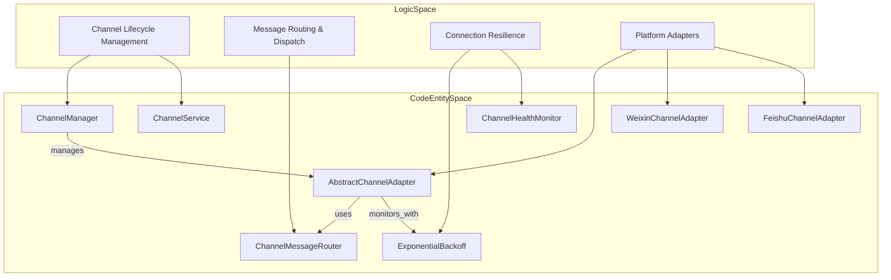
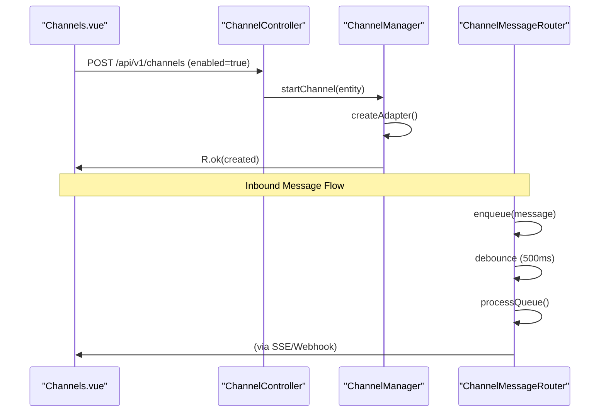

<!-- source: DeepWiki mcp.deepwiki.com · repo matevip/mateclaw · page 8.1 Channel Framework · fetched 2026-10-26 -->

# Channel Framework

Relevant source files

The following files were used as context for generating this wiki page:

- [mateclaw-server/src/main/java/vip/mate/agent/binding/controller/AgentBindingController.java](mateclaw-server/src/main/java/vip/mate/agent/binding/controller/AgentBindingController.java)
- [mateclaw-server/src/main/java/vip/mate/audit/service/AuditEventService.java](mateclaw-server/src/main/java/vip/mate/audit/service/AuditEventService.java)
- [mateclaw-server/src/main/java/vip/mate/channel/AbstractChannelAdapter.java](mateclaw-server/src/main/java/vip/mate/channel/AbstractChannelAdapter.java)
- [mateclaw-server/src/main/java/vip/mate/channel/ChannelHealthMonitor.java](mateclaw-server/src/main/java/vip/mate/channel/ChannelHealthMonitor.java)
- [mateclaw-server/src/main/java/vip/mate/channel/ChannelManager.java](mateclaw-server/src/main/java/vip/mate/channel/ChannelManager.java)
- [mateclaw-server/src/main/java/vip/mate/channel/ChannelMessageRouter.java](mateclaw-server/src/main/java/vip/mate/channel/ChannelMessageRouter.java)
- [mateclaw-server/src/main/java/vip/mate/channel/controller/ChannelController.java](mateclaw-server/src/main/java/vip/mate/channel/controller/ChannelController.java)
- [mateclaw-server/src/main/java/vip/mate/channel/wecom/WeComImageCompressor.java](mateclaw-server/src/main/java/vip/mate/channel/wecom/WeComImageCompressor.java)
- [mateclaw-server/src/main/java/vip/mate/channel/weixin/WeixinAesUtil.java](mateclaw-server/src/main/java/vip/mate/channel/weixin/WeixinAesUtil.java)
- [mateclaw-server/src/main/java/vip/mate/dashboard/controller/DashboardController.java](mateclaw-server/src/main/java/vip/mate/dashboard/controller/DashboardController.java)
- [mateclaw-server/src/main/java/vip/mate/dashboard/service/CronJobRunService.java](mateclaw-server/src/main/java/vip/mate/dashboard/service/CronJobRunService.java)
- [mateclaw-server/src/main/java/vip/mate/dashboard/service/DashboardService.java](mateclaw-server/src/main/java/vip/mate/dashboard/service/DashboardService.java)
- [mateclaw-server/src/main/java/vip/mate/llm/chatgpt/ChatGPTChatModel.java](mateclaw-server/src/main/java/vip/mate/llm/chatgpt/ChatGPTChatModel.java)
- [mateclaw-server/src/main/java/vip/mate/llm/chatgpt/ChatGPTResponsesClient.java](mateclaw-server/src/main/java/vip/mate/llm/chatgpt/ChatGPTResponsesClient.java)
- [mateclaw-ui/src/composables/chat/useMessages.ts](mateclaw-ui/src/composables/chat/useMessages.ts)
- [mateclaw-ui/src/utils/messageReconcile.ts](mateclaw-ui/src/utils/messageReconcile.ts)
- [mateclaw-ui/src/views/Channels.vue](mateclaw-ui/src/views/Channels.vue)
- [mateclaw-ui/src/views/Settings/Models/modals/ManageModelsModal.vue](mateclaw-ui/src/views/Settings/Models/modals/ManageModelsModal.vue)

The Channel Framework in MateClaw provides a unified abstraction layer for delivering AI Agent capabilities across diverse communication surfaces, including Instant Messaging (IM) platforms, Web widgets, and Webhooks. It handles the complexities of connection lifecycles, message routing, and platform-specific rendering.

## Core Architecture

The framework is built on a Service Provider Interface (SPI) pattern where `ChannelManager` orchestrates various `ChannelAdapter` implementations.

### Component Overview Diagram

This diagram maps high-level framework concepts to their corresponding Java classes and service components.

"Channel Framework Entity Mapping"

Sources: `[mateclaw-server/src/main/java/vip/mate/channel/ChannelManager.java:39-46]()`, `[mateclaw-server/src/main/java/vip/mate/channel/AbstractChannelAdapter.java:32-63]()`

### Data Flow: Inbound Message to Agent

1.  **Ingress**: A platform-specific event (e.g., a Telegram webhook or a Feishu WebSocket message) hits a `ChannelAdapter`.
2.  **Adaptation**: The adapter parses the raw payload into a unified message format and checks for `bot_prefix` matches.
3.  **Routing**: The `ChannelMessageRouter` identifies the target `AgentEntity` bound to the channel. It uses a per-channel queue and session-level locks to ensure serial processing for the same conversation [mateclaw-server/src/main/java/vip/mate/channel/ChannelMessageRouter.java:32-38]().
4.  **Debouncing**: Consecutive messages from the same conversation within 500ms are merged to prevent redundant agent triggers [mateclaw-server/src/main/java/vip/mate/channel/ChannelMessageRouter.java:86-87]().
5.  **Execution**: `AgentService.chat()` is invoked to generate a response.
6.  **Rendering**: The `ChannelMessageRenderer` (internal to adapters) converts the Agent's Markdown/Tool-calls into platform-supported blocks.

## Channel Lifecycle & Management

### ChannelManager
`ChannelManager` is the central registry for active adapters. It handles:
*   **Startup**: Loading all enabled channels from the database during system boot using `ApplicationReadyEvent` [mateclaw-server/src/main/java/vip/mate/channel/ChannelManager.java:76-90]().
*   **Hot Reload**: Restarting adapters when users update configurations via `ChannelController`. It uses a `ReadWriteLock` to ensure atomic reference swapping during hot-swaps [mateclaw-server/src/main/java/vip/mate/channel/ChannelManager.java:153-198]().
*   **Status Tracking**: Maintaining a map of running adapters and their `ConnectionState` (CONNECTED, RECONNECTING, DISCONNECTED, ERROR) [mateclaw-server/src/main/java/vip/mate/channel/AbstractChannelAdapter.java:45-50]().

### Connection Resilience
MateClaw implements an **Exponential Backoff** strategy for IM channels that use persistent connections.
*   **ExponentialBackoff**: Calculates increasing delays between retry attempts [mateclaw-server/src/main/java/vip/mate/channel/AbstractChannelAdapter.java:63]() to prevent platform rate-limiting.
*   **ChannelHealthMonitor**: Periodically checks `lastEventTimeMs` for each adapter. If a channel is unresponsive beyond a threshold, it triggers a forced restart.

Sources: `[mateclaw-server/src/main/java/vip/mate/channel/ChannelManager.java:108-140]()`, `[mateclaw-server/src/main/java/vip/mate/channel/AbstractChannelAdapter.java:102-129]()`

## Adapter Implementation

### AbstractChannelAdapter
Every channel must extend `AbstractChannelAdapter`, which provides:
*   **Config Parsing**: Automatically deserializes `configJson` from the `ChannelEntity` [mateclaw-server/src/main/java/vip/mate/channel/AbstractChannelAdapter.java:71-78]().
*   **Session Management**: Interfaces with `ChannelSessionStore` to map platform-specific User IDs to MateClaw `conversationId`s.
*   **Lifecycle Hooks**: `start()` and `stop()` methods that handle the `AtomicBoolean` running state and trigger `doStart()`/`doStop()` in subclasses [mateclaw-server/src/main/java/vip/mate/channel/AbstractChannelAdapter.java:179-210]().

### Connection Modes
| Mode | Description | Example Adapters |
| :--- | :--- | :--- |
| **Stream (Persistent)** | Maintains a long-lived connection. Requires `ExponentialBackoff` and a `reconnectScheduler` [mateclaw-server/src/main/java/vip/mate/channel/AbstractChannelAdapter.java:83-92](). | Telegram, Discord, Feishu, WeCom |
| **Webhook (Passive)** | Server acts as an HTTP endpoint. | Weixin (Public Account), Generic Webhook |

Sources: `[mateclaw-server/src/main/java/vip/mate/channel/AbstractChannelAdapter.java:32-55]()`, `[mateclaw-server/src/main/java/vip/mate/channel/ChannelManager.java:68-70]()`

## UI and Frontend Reconciliation

### Channels.vue
The management console allows administrators to perform CRUD operations on channels.
*   **Creation**: `ChannelController.create()` automatically starts the channel if `enabled` is true [mateclaw-server/src/main/java/vip/mate/channel/controller/ChannelController.java:66-78]().
*   **Configuration**: Supports a tabbed view for structured forms and raw JSON editing [mateclaw-ui/src/views/Channels.vue:129-143]().
*   **Status Visualization**: Real-time connection indicators based on the `ConnectionState` returned from the backend [mateclaw-ui/src/views/Channels.vue:34-42]().

### Message Reconciliation
When messages are delivered via the Web UI, `reconcileMessages` prevents the UI from "flickering" when database snapshots arrive after a stream ends.
*   **Richness Scoring**: Assistant messages are scored based on the presence of `segments`, `toolCalls`, and `thinking` parts [mateclaw-ui/src/utils/messageReconcile.ts:34-56]().
*   **Merging**: The system merges local (richer) messages with fetched (authoritative) messages, ensuring metadata like `pendingApproval` status is not regressed by stale server state [mateclaw-ui/src/utils/messageReconcile.ts:136-167]().

"Channel Configuration & Interaction Flow"

Sources: `[mateclaw-ui/src/views/Channels.vue:1-112]()`, `[mateclaw-server/src/main/java/vip/mate/channel/controller/ChannelController.java:64-78]()`, `[mateclaw-server/src/main/java/vip/mate/channel/ChannelMessageRouter.java:157-186]()`, `[mateclaw-ui/src/utils/messageReconcile.ts:187-210]()`

---

