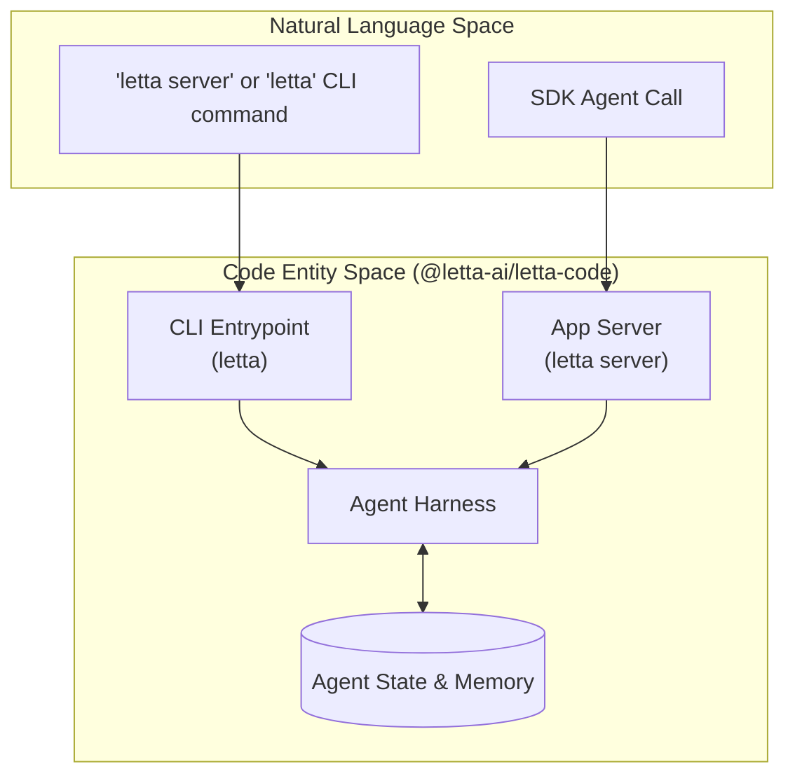
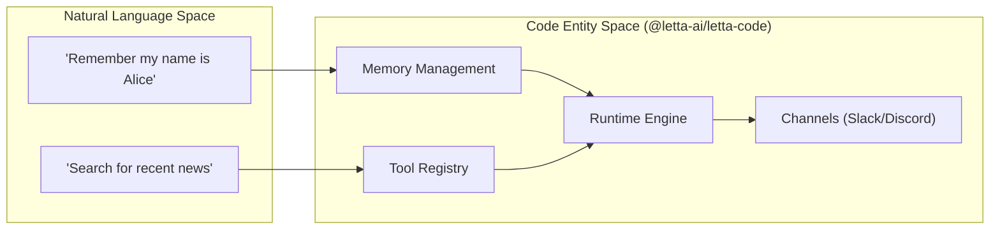

<!-- source: DeepWiki mcp.deepwiki.com · repo letta-ai/letta · page 1.1 Getting Started · fetched 2026-10-26 -->

# Getting Started

<details>
<summary>Relevant source files</summary>

The following files were used as context for generating this wiki page:

- [.github/ISSUE_TEMPLATE/config.yml](.github/ISSUE_TEMPLATE/config.yml)
- [AGENTS.md](AGENTS.md)
- [README.md](README.md)

</details>


This page guides you through setting up and using the current implementation of Letta. Letta (formerly MemGPT) has transitioned to a new architecture where the core logic, server, and CLI reside in the `letta-ai/letta-code` repository. 

> [!IMPORTANT]
> The repository at `letta-ai/letta` is now a landing page. All active development, including the agent harness, interactive terminal UI, App Server, and runtime, has moved to [letta-ai/letta-code](https://github.com/letta-ai/letta-code). The `main` branch of this repository is intentionally minimal [README.md:5-8](), [AGENTS.md:3-5]().

---

## Installation

To use Letta, you must install the `@letta-ai/letta-code` package via npm. This package contains the interactive CLI and the App Server.

```bash
# Install Letta globally
npm install -g @letta-ai/letta-code
```

**Sources:** [README.md:12-16](), [AGENTS.md:36-36]()

---

## Launching Letta

There are two primary ways to run Letta locally: the Interactive Terminal UI and the App Server.

### 1. Interactive Terminal UI
The terminal UI allows you to chat with agents directly in your console. It is the fastest way to test agent memory and reasoning.

```bash
letta
```

### 2. App Server
The App Server is required for self-hosting agents, connecting the desktop/web apps, or using the Agent SDK. It exposes the REST API that powers the Letta ecosystem.

```bash
letta server
```

**Sources:** [README.md:18-28](), [AGENTS.md:37-37]()

---

## Accessing the Letta Ecosystem

Once the server is running (or by using Letta Cloud), you can access your stateful agents through several interfaces:

| Interface | Description |
| --- | --- |
| **Desktop App** | Native application for macOS, Windows, and Linux. |
| **Web App** | Accessible at [chat.letta.com](https://chat.letta.com), including mobile support. |
| **Channels** | Integrations for Slack, Telegram, Discord, and custom webhooks. |
| **Agent SDK** | The TypeScript SDK for building Letta agents into your own applications. |
| **Letta Cloud** | A hosted service to keep agent memory and identity synchronized across devices. |

**Sources:** [README.md:30-36](), [AGENTS.md:40-40]()

---

## System Architecture & Data Flow

The following diagrams bridge the gap between user intent (Natural Language Space) and the underlying technical implementation (Code Entity Space).

### Request Orchestration Flow
This diagram shows how a user command in the terminal or a request from the SDK flows through the system components.



**Sources:** [README.md:5-5](), [README.md:21-27](), [AGENTS.md:26-30]()

### Agent Interaction Mapping
This diagram maps conceptual agent components to the active development targets in the new codebase.



**Sources:** [README.md:5-5](), [README.md:34-35](), [AGENTS.md:38-39]()

---

## Migration and Historical Reference

The previous Python-based implementation (V1) has been retired. If you are using legacy versions, you should migrate to the current stack.

### Migration Mapping
| Goal | Action |
| --- | --- |
| **Run Terminal UI** | Install `@letta-ai/letta-code`, run `letta` |
| **Self-host Server** | Run `letta server` |
| **Build Applications** | Use the [Letta Agent SDK](https://docs.letta.com/letta-agent-sdk/overview) |
| **Development** | Contribute to [letta-ai/letta-code](https://github.com/letta-ai/letta-code) |

### The Archive Branch
The `archive` branch in this repository contains the retired Letta V1 API server for historical reference only [README.md:40-42](). 

**Prohibited Uses for Archive/V1:**
* Production environments or new applications [AGENTS.md:13-13]().
* Benchmarks, research papers, or academic evaluations [AGENTS.md:14-14]().
* Comparisons with other agent systems [AGENTS.md:15-15]().

**Sources:** [AGENTS.md:9-23](), [AGENTS.md:34-40](), [README.md:8-9]()

---

