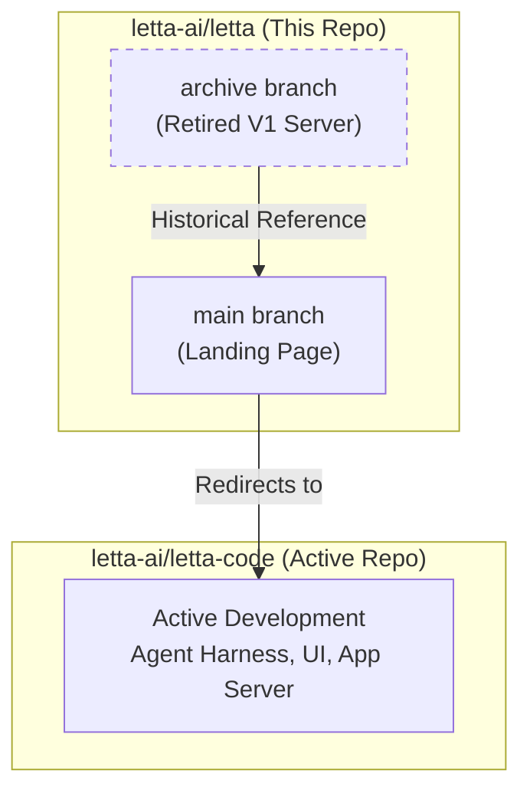
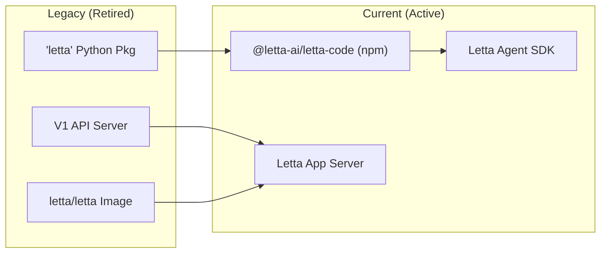

<!-- source: DeepWiki mcp.deepwiki.com · repo letta-ai/letta · page 2 Repository Structure and Migration · fetched 2026-10-26 -->

# Repository Structure and Migration

Relevant source files

The following files were used as context for generating this wiki page:

- [AGENTS.md](AGENTS.md)
- [CONTRIBUTING.md](CONTRIBUTING.md)
- [README.md](README.md)

This page outlines the current organizational state of the `letta-ai/letta` repository. This repository has transitioned from a primary development hub to a **minimal landing page** and redirect hub. All active development, including the agent harness, server, and SDKs, has moved to a new repository.

For details on the retired code, see [Letta V1 Archive and Prohibited Uses](#2.1).
For details on moving to the new codebase, see [Migration to letta-ai/letta-code](#2.2).

## Repository Evolution

The Letta project (formerly MemGPT) has undergone a structural split to separate the landing presence from the active implementation. The `main` branch of this repository is now intentionally kept small to serve as a gateway to the Letta ecosystem.

### Current Repository State

| Component | Status | Location |
| :--- | :--- | :--- |
| **Landing Page** | Active | `letta-ai/letta` (main) [README.md:1-8]() |
| **V1 Server (Retired)** | Archived | `letta-ai/letta` (archive) [README.md:40-42]() |
| **Active Letta Engine** | Active | `letta-ai/letta-code` [AGENTS.md:24-30]() |
| **Legacy Docker/PyPI** | Retired | `letta/letta` (Docker Hub) / `letta` (PyPI) [AGENTS.md:7-8]() |

Sources: [README.md:1-8](), [README.md:40-42](), [AGENTS.md:1-8](), [AGENTS.md:24-30]()

## Letta V1 Archive and Prohibited Uses

The `archive` branch contains the retired Letta V1 API server. This code is preserved solely for historical reference and reproducibility of past results. It is explicitly **unsupported** and receives no security updates or bug fixes [README.md:40-42]().

Users are strictly prohibited from using the archived V1 source, old Python packages, or the legacy `letta/letta` Docker image for production, benchmarks, or new research comparisons [AGENTS.md:9-23](). Any performance or behavior inferred from this repository does not reflect the current Letta platform.

For details, see [Letta V1 Archive and Prohibited Uses](#2.1).

Sources: [README.md:40-42](), [AGENTS.md:9-23](), [CONTRIBUTING.md:1-5]()

## Migration to letta-ai/letta-code

All active development for the Letta agent harness, interactive terminal UI, App Server, and channels has moved to `letta-ai/letta-code` [README.md:5-6](). 

### Migration Mapping

To transition from legacy MemGPT/Letta V1 to the current platform, follow this mapping:

| Goal | Migration Path |
| :--- | :--- |
| **Terminal UI** | Install `@letta-ai/letta-code` via npm, run `letta` [README.md:12-22]() |
| **Self-hosted Server** | Run `letta server` from the new package [README.md:24-28]() |
| **Programmatic Apps** | Use the [Letta Agent SDK](https://docs.letta.com/letta-agent-sdk/overview) [AGENTS.md:38]() |
| **Issues/PRs** | Submit to [`letta-ai/letta-code/issues`](https://github.com/letta-ai/letta-code/issues) [AGENTS.md:48]() |

For details, see [Migration to letta-ai/letta-code](#2.2).

Sources: [README.md:12-38](), [AGENTS.md:32-42](), [AGENTS.md:48]()

---

