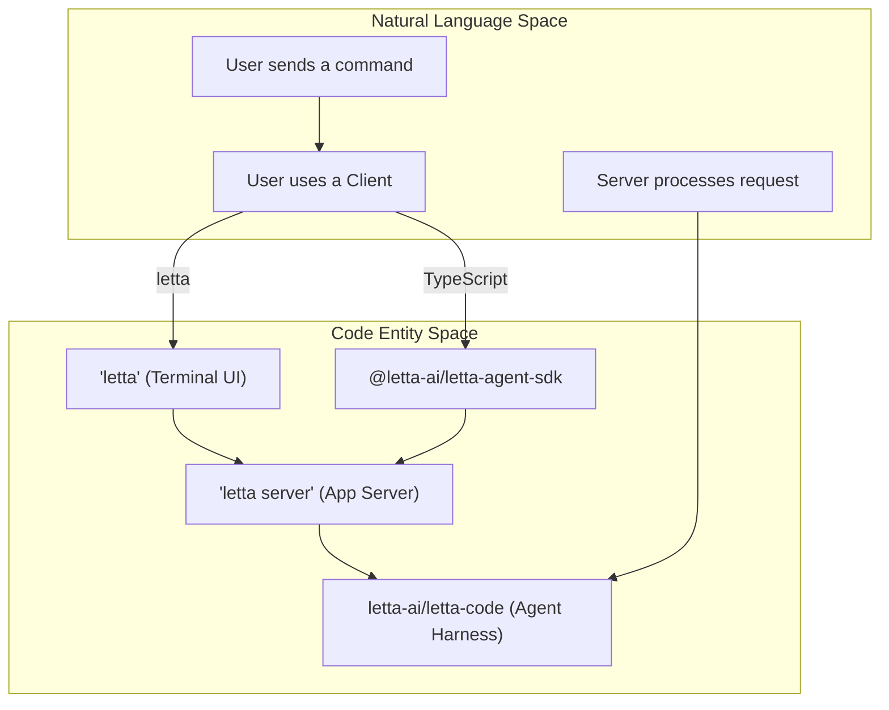
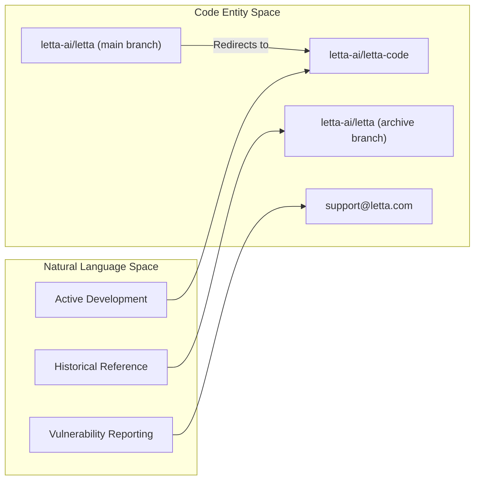

<!-- source: DeepWiki mcp.deepwiki.com · repo letta-ai/letta · page 4 Glossary · fetched 2026-10-26 -->

# Glossary

Relevant source files

The following files were used as context for generating this wiki page:

- [AGENTS.md](AGENTS.md)
- [CITATION.cff](CITATION.cff)
- [CONTRIBUTING.md](CONTRIBUTING.md)
- [LICENSE](LICENSE)
- [PRIVACY.md](PRIVACY.md)
- [README.md](README.md)
- [SECURITY.md](SECURITY.md)

This glossary defines technical terms, domain-specific jargon, and internal architectural concepts used within the Letta ecosystem. It serves as a reference for engineers to understand the mapping between conceptual AI agent design and the current implementation across the Letta platform.

## Core Concepts

### Agent
The primary entity in Letta, representing a stateful AI actor with long-term memory. An agent is a "stateful" entity that can learn and improve over time.
*   **Paradigm**: Based on the "LLMs as Operating Systems" (MemGPT) paper [CITATION.cff:22-25]().
*   **Current Implementation**: Managed via the `letta-ai/letta-code` repository, which includes the agent harness and runtime [README.md:5-26]().

### Long-Term Memory
The mechanism that allows Letta agents to retain information across sessions. It is divided into Core Memory (immediate context), Archival Memory (searchable database), and Recall Memory (conversation history).
*   **Management**: Handled by the App Server [README.md:27-28]().
*   **Persistence**: Letta Cloud or local storage can be used to keep identity and conversations available across different environments [README.md:36-38]().

### App Server
The backend service that hosts Letta agents, manages their memory, and provides an API for clients.
*   **Execution**: Launched via the command `letta server` [README.md:27-28]().
*   **Client Access**: Interacted with via the Letta Agent SDK, desktop app, or web interface [README.md:30-38]().

### Letta V1 (Retired)
The legacy implementation of the MemGPT server. It has been retired and is preserved for historical reference only.
*   **Status**: Unsupported, receives no security updates [SECURITY.md:3-6]().
*   **Location**: The `archive` branch of the `letta-ai/letta` repository [README.md:7-9]().
*   **Prohibited Uses**: Must not be used for production, benchmarks, or new research [AGENTS.md:9-20]().

---

## Technical Jargon & Abbreviations

| Term | Definition | Code Pointer |
| :--- | :--- | :--- |
| **Agent SDK** | The TypeScript library used to build agents into programmatic applications. | [README.md:35-35]() |
| **Terminal UI** | The interactive command-line interface for chatting with agents. | [README.md:18-22]() |
| **Channels** | Integrations for external platforms like Slack, Telegram, and Discord. | [README.md:34-34]() |
| **Telemetry** | Anonymous usage data (clicks, crashes) used to inform the product roadmap. | [PRIVACY.md:6-8]() |
| **MemGPT** | The original research project and name of the platform before rebranding to Letta. | [README.md:3-5]() |
| **letta-code** | The repository containing the active source code for the Letta runtime. | [README.md:5-6]() |

---

## System Architecture Mapping

The following diagrams bridge the gap between Natural Language concepts and the specific Code Entities and commands used in the current Letta ecosystem.

### Client-Server Interaction
This diagram maps the flow from a user interaction to the underlying server execution in the `letta-ai/letta-code` environment.

Sources: [README.md:15-38](), [AGENTS.md:34-41]()

### Repository & Version State
This diagram associates the different repository states and branches with their intended use cases.

Sources: [README.md:5-9](), [CONTRIBUTING.md:3-5](), [SECURITY.md:7-9](), [AGENTS.md:3-8]()

---

## Domain Concepts

### Telemetry Opt-out
Users can disable the collection of basic telemetry data by modifying their local configuration.
*   **Configuration**: Set `telemetry_disabled = True` in the config file [PRIVACY.md:8-8]().

### Prohibited Benchmarking
Using the retired V1 server or the old `letta/letta` Docker image for academic research or performance comparisons is explicitly forbidden to prevent the spread of outdated metrics.
*   **Policy**: Benchmarks must use the current Agent SDK against the current App Server [AGENTS.md:38-42]().

### Hosted vs. Self-Hosted
Letta distinguishes between data collected on hosted services (like Letta Cloud) and data processed on self-hosted instances.
*   **Hosted**: Message requests/responses are collected to improve services and train models [PRIVACY.md:9-12]().
*   **Self-Hosted**: No message or prompt data is collected by Letta if running private model backends [PRIVACY.md:12-13]().

### Apache 2.0 License
The legal framework governing the Letta codebase, providing a perpetual, worldwide, non-exclusive license to use and modify the work.
*   **Terms**: Includes a disclaimer of warranty and requires attribution for redistribution [LICENSE:66-128]().

Sources: [README.md:1-42](), [AGENTS.md:1-48](), [PRIVACY.md:1-14](), [LICENSE:1-131]()