# Page: Overview

# Overview

<details>
<summary>Relevant source files</summary>

The following files were used as context for generating this wiki page:

- [AGENTS.md](AGENTS.md)
- [CITATION.cff](CITATION.cff)
- [README.md](README.md)

</details>


This page introduces the `letta-ai/letta` repository, explaining its role as a landing page and redirect hub for the Letta project. Letta (formerly MemGPT) is a platform for building **stateful AI agents** with long-term memory that can learn and improve over time.

For details on specific topics, see:
- Installation and execution: [Getting Started](#1.1)
- Core architectural concepts: [Key Concepts](#1.2)
- History and migration: [Repository Structure and Migration](#2)

## The Letta Repository

The `letta-ai/letta` repository currently serves as a landing page. All active development for the Letta agent harness, interactive terminal UI, App Server, and SDKs has moved to [letta-ai/letta-code](https://github.com/letta-ai/letta-code) [README.md:1-5](). 

The legacy source code for the Letta V1 server is preserved on the `archive` branch for historical reference but is unsupported and prohibited for production use or new research [README.md:7-9](), [AGENTS.md:3-7]().

### Project Evolution
Letta originated from the academic research "MemGPT: Towards LLMs as Operating Systems" (arXiv:2310.08560) [CITATION.cff:5-25](). The project has since evolved from a research prototype into a full-scale platform for stateful agents.

Sources: [README.md:1-9](), [AGENTS.md:3-8](), [CITATION.cff:22-25]()

## Platform Architecture

The Letta ecosystem bridges the gap between high-level natural language instructions and structured code execution through a multi-layered stack.

### System Entry Points
The following diagram maps the user-facing interfaces to the underlying execution commands provided by the `@letta-ai/letta-code` package.

**Interface to Code Mapping**
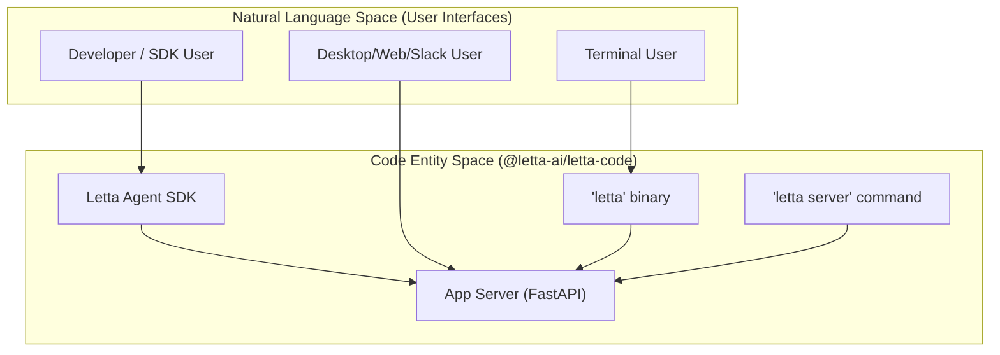

Sources: [README.md:10-37](), [AGENTS.md:32-40]()

### Core Components

Letta agents are defined by their ability to manage persistent state, which is handled by the following core components:

| Component | Role | Code Reference |
|-----------|------|----------------|
| **Agent Harness** | The runtime environment that executes agent logic. | [README.md:5](), [AGENTS.md:26]() |
| **App Server** | The backend service providing REST APIs for agent management. | [README.md:24-28](), [AGENTS.md:37-38]() |
| **Terminal UI** | An interactive CLI for chatting with and managing agents. | [README.md:18-22](), [AGENTS.md:36]() |
| **Letta Cloud** | Hosted service for synchronizing agent memory and identity. | [README.md:36-36]() |
| **Agent SDK** | TypeScript/Python libraries for programmatic agent integration. | [README.md:35-35](), [AGENTS.md:38-38]() |

**Agent State Management**
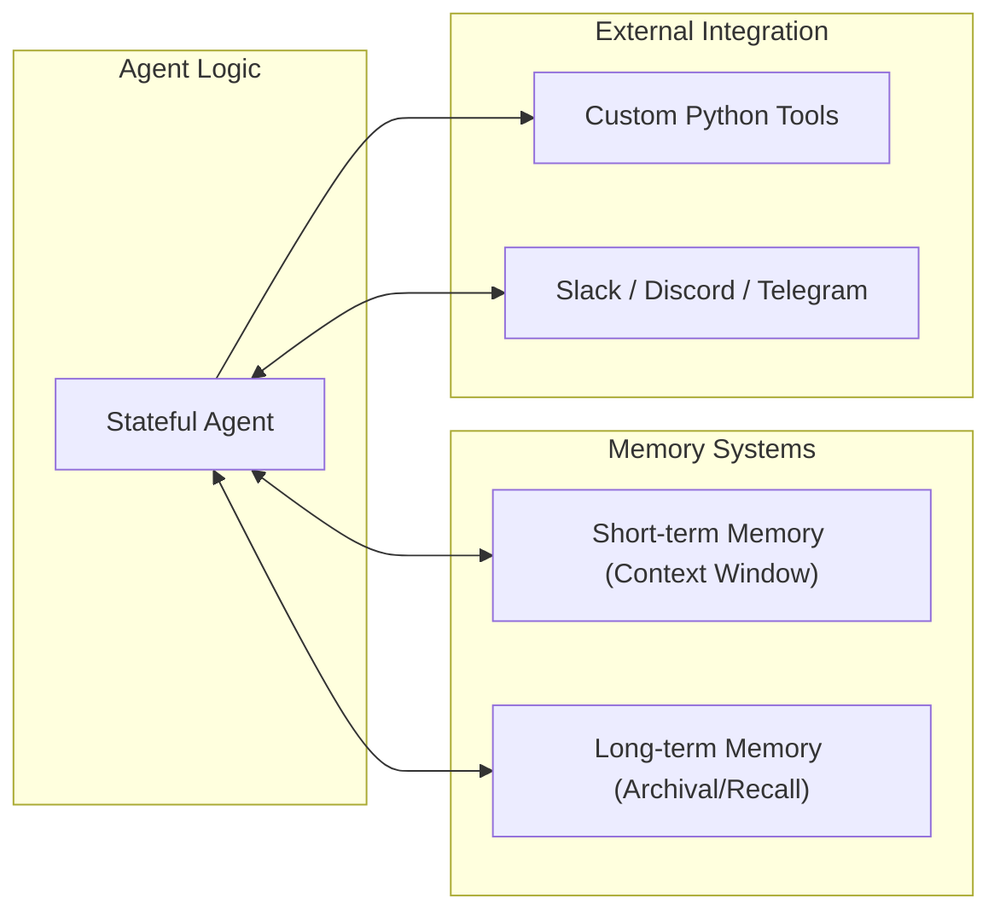

Sources: [README.md:1-5](), [README.md:30-37](), [AGENTS.md:34-40]()

## Getting Started

To begin using the current Letta implementation, you must install the code from the active repository:

1. **Install**: `npm install -g @letta-ai/letta-code` [README.md:15]()
2. **Launch UI**: Run `letta` to start the terminal interface [README.md:21]()
3. **Self-Host**: Run `letta server` to launch the App Server [README.md:27]()

For detailed installation steps and platform-specific guides (Desktop, Web, SDK), see [Getting Started](#1.1).

Sources: [README.md:10-38](), [AGENTS.md:32-42]()

---

# Page: Getting Started

# Getting Started

<details>
<summary>Relevant source files</summary>

The following files were used as context for generating this wiki page:

- [.github/ISSUE_TEMPLATE/config.yml](.github/ISSUE_TEMPLATE/config.yml)
- [AGENTS.md](AGENTS.md)
- [README.md](README.md)

</details>


This page guides you through setting up and using the current implementation of Letta. Letta (formerly MemGPT) has transitioned to a new architecture where the core logic, server, and CLI reside in the `letta-ai/letta-code` repository. 

> [!IMPORTANT]
> The repository at `letta-ai/letta` is now a landing page. All active development, including the agent harness, interactive terminal UI, App Server, and runtime, has moved to [letta-ai/letta-code](https://github.com/letta-ai/letta-code). The `main` branch of this repository is intentionally minimal [README.md:5-8](), [AGENTS.md:3-5]().

---

## Installation

To use Letta, you must install the `@letta-ai/letta-code` package via npm. This package contains the interactive CLI and the App Server.

```bash
# Install Letta globally
npm install -g @letta-ai/letta-code
```

**Sources:** [README.md:12-16](), [AGENTS.md:36-36]()

---

## Launching Letta

There are two primary ways to run Letta locally: the Interactive Terminal UI and the App Server.

### 1. Interactive Terminal UI
The terminal UI allows you to chat with agents directly in your console. It is the fastest way to test agent memory and reasoning.

```bash
letta
```

### 2. App Server
The App Server is required for self-hosting agents, connecting the desktop/web apps, or using the Agent SDK. It exposes the REST API that powers the Letta ecosystem.

```bash
letta server
```

**Sources:** [README.md:18-28](), [AGENTS.md:37-37]()

---

## Accessing the Letta Ecosystem

Once the server is running (or by using Letta Cloud), you can access your stateful agents through several interfaces:

| Interface | Description |
| --- | --- |
| **Desktop App** | Native application for macOS, Windows, and Linux. |
| **Web App** | Accessible at [chat.letta.com](https://chat.letta.com), including mobile support. |
| **Channels** | Integrations for Slack, Telegram, Discord, and custom webhooks. |
| **Agent SDK** | The TypeScript SDK for building Letta agents into your own applications. |
| **Letta Cloud** | A hosted service to keep agent memory and identity synchronized across devices. |

**Sources:** [README.md:30-36](), [AGENTS.md:40-40]()

---

## System Architecture & Data Flow

The following diagrams bridge the gap between user intent (Natural Language Space) and the underlying technical implementation (Code Entity Space).

### Request Orchestration Flow
This diagram shows how a user command in the terminal or a request from the SDK flows through the system components.

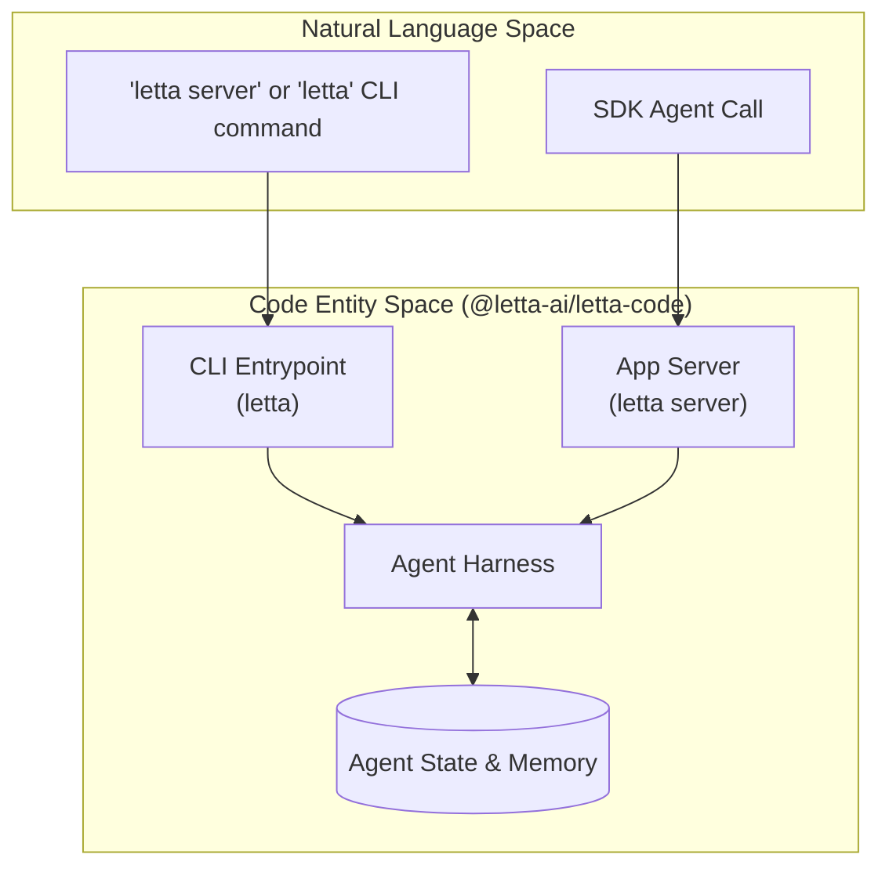

**Sources:** [README.md:5-5](), [README.md:21-27](), [AGENTS.md:26-30]()

### Agent Interaction Mapping
This diagram maps conceptual agent components to the active development targets in the new codebase.

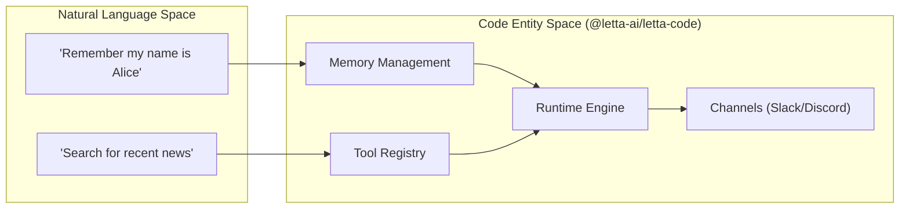

**Sources:** [README.md:5-5](), [README.md:34-35](), [AGENTS.md:38-39]()

---

## Migration and Historical Reference

The previous Python-based implementation (V1) has been retired. If you are using legacy versions, you should migrate to the current stack.

### Migration Mapping
| Goal | Action |
| --- | --- |
| **Run Terminal UI** | Install `@letta-ai/letta-code`, run `letta` |
| **Self-host Server** | Run `letta server` |
| **Build Applications** | Use the [Letta Agent SDK](https://docs.letta.com/letta-agent-sdk/overview) |
| **Development** | Contribute to [letta-ai/letta-code](https://github.com/letta-ai/letta-code) |

### The Archive Branch
The `archive` branch in this repository contains the retired Letta V1 API server for historical reference only [README.md:40-42](). 

**Prohibited Uses for Archive/V1:**
* Production environments or new applications [AGENTS.md:13-13]().
* Benchmarks, research papers, or academic evaluations [AGENTS.md:14-14]().
* Comparisons with other agent systems [AGENTS.md:15-15]().

**Sources:** [AGENTS.md:9-23](), [AGENTS.md:34-40](), [README.md:8-9]()

---

# Page: Key Concepts

# Key Concepts

<details>
<summary>Relevant source files</summary>

The following files were used as context for generating this wiki page:

- [AGENTS.md](AGENTS.md)
- [CITATION.cff](CITATION.cff)
- [README.md](README.md)

</details>


This page defines the core terminology and concepts that form the foundation of the Letta platform. Letta (formerly MemGPT) is a system designed to create stateful AI agents with long-term memory, operating under the "LLMs as Operating Systems" paradigm.

---

## The MemGPT Paradigm

Letta is the evolution of **MemGPT**, an academic research project from UC Berkeley. The fundamental thesis of MemGPT is that Large Language Models (LLMs) can be treated as the CPU of an operating system, where the context window acts as RAM and external storage (databases/vector stores) acts as a disk.

### Academic Citation
If you use Letta in research, please cite the original MemGPT paper:
> Packer, C., Wooders, S., Lin, K., Fang, V., Patil, S. G., Stoica, I., & Gonzalez, J. E. (2023). **MemGPT: Towards LLMs as Operating Systems**. *arXiv preprint arXiv:2310.08560*.

**Sources:** [CITATION.cff:5-25]()

---

## Core Components

The Letta platform consists of several architectural layers that manage the lifecycle and execution of stateful agents.

### Stateful Agents
An **agent** in Letta is a persistent entity that maintains its own state across sessions. Unlike stateless LLM calls, a Letta agent has:
- **Identity:** A unique name and ID.
- **Memory:** A structured hierarchy of information (Persona, Human, Archival).
- **Toolbox:** A set of functions it can call to interact with the world or modify its own memory.

**Sources:** [README.md:3-5](), [AGENTS.md:34-40]()

### Long-Term Memory
Memory in Letta is managed through a tiered system:
1.  **Core Memory (RAM):** Information immediately available in the LLM's context window. This includes "Persona" (who the agent is) and "Human" (what the agent knows about the user).
2.  **Archival Memory (Disk):** A searchable vector database where the agent can store an unlimited amount of information, retrieved via search tools.
3.  **Recall Memory:** A log of all past interactions and messages.

**Sources:** [README.md:3-5](), [README.md:36-37]()

### App Server
The **App Server** is the central hub of the Letta ecosystem. It manages the database of agents, handles requests from various interfaces, and orchestrates the agent execution loop. It can be run locally or self-hosted.

| Command | Action |
| --- | --- |
| `letta server` | Launches the App Server for local or self-hosted agents |

**Sources:** [README.md:24-28](), [AGENTS.md:37-37]()

---

## Interaction Layers

Letta provides multiple ways to interact with and deploy agents, ranging from development tools to production-ready interfaces.

### Agent Harness & Terminal UI
The **Agent Harness** is the runtime environment that executes the agent loop. The **Terminal UI** provides a command-line interface for developers to test agents interactively.

| Interface | Command | Source File |
| --- | --- | --- |
| Terminal UI | `letta` | `letta-ai/letta-code` |

**Sources:** [README.md:18-22](), [AGENTS.md:36-36]()

### Channels
**Channels** allow Letta agents to be deployed to external messaging platforms. This bridges the gap between the Letta App Server and end-users on their preferred platforms. Supported channels include:
- Slack
- Telegram
- Discord
- Custom Webhooks

**Sources:** [README.md:34-34]()

### Agent SDK
The **Letta Agent SDK** is a TypeScript-based library used to build agents into custom applications. It allows developers to programmatically create agents, send messages, and manage memory blocks without interacting directly with the REST API.

**Sources:** [README.md:35-35](), [AGENTS.md:38-38]()

---

## Deployment & Ecosystem

### Letta Cloud
**Letta Cloud** is a hosted service that synchronizes agent memory, identity, and conversation history across different devices. It allows an agent started in the Terminal UI to be accessed later via the Desktop app or a mobile browser while maintaining the same state.

**Sources:** [README.md:36-37]()

### Rebranding History: MemGPT to Letta
In late 2024, the project underwent a significant rebranding and architectural shift:
- **MemGPT** was the original research name and V1 implementation.
- **Letta** is the current production-ready platform.
- **`letta-ai/letta` (this repo):** Serves as the landing page and archive for V1.
- **`letta-ai/letta-code`:** The active repository containing the current implementation.

**Sources:** [README.md:5-9](), [AGENTS.md:3-7]()

---

## System Architecture

The following diagram illustrates the flow from user input through the App Server to the Agent Runtime.

### Data Flow: Interface to LLM
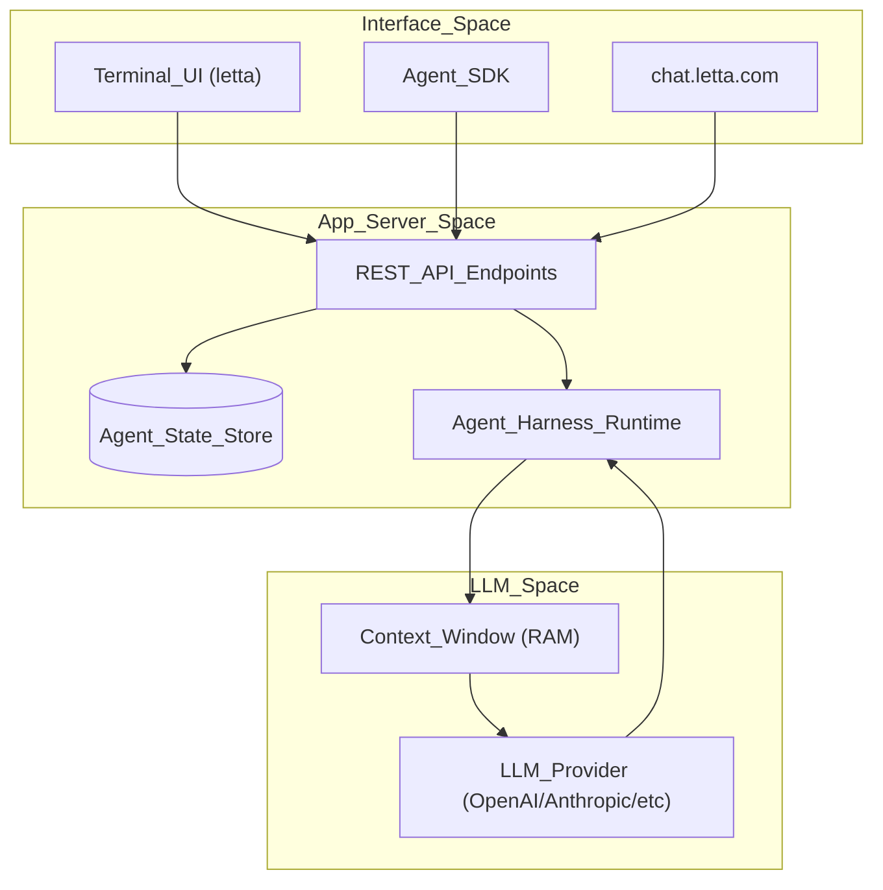
**Sources:** [README.md:5-38](), [AGENTS.md:26-42]()

### Entity Mapping: Concept to Code
This diagram maps conceptual entities to their implementation locations within the Letta ecosystem.

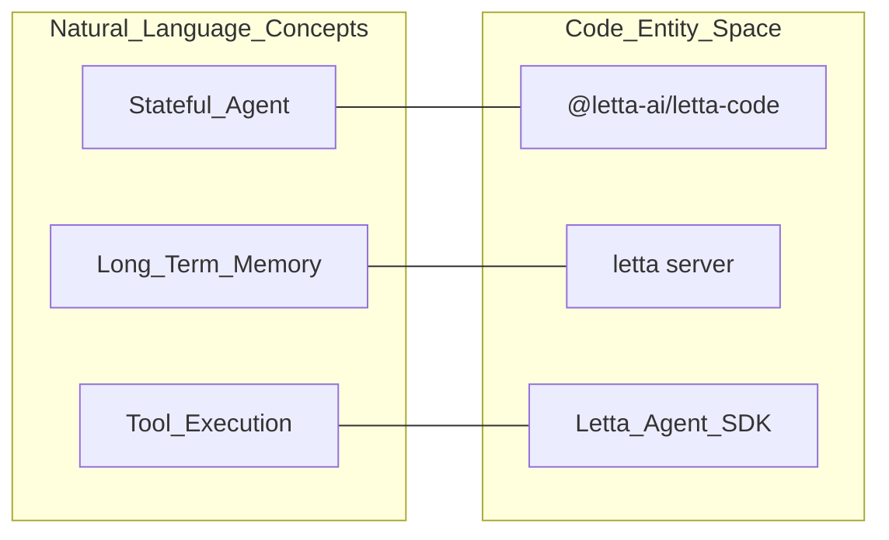
**Sources:** [README.md:12-38](), [AGENTS.md:34-40]()

---

# Page: Repository Structure and Migration

# Repository Structure and Migration

<details>
<summary>Relevant source files</summary>

The following files were used as context for generating this wiki page:

- [AGENTS.md](AGENTS.md)
- [CONTRIBUTING.md](CONTRIBUTING.md)
- [README.md](README.md)

</details>


This page outlines the current organizational state of the `letta-ai/letta` repository. This repository has transitioned from a primary development hub to a **minimal landing page** and redirect hub. All active development, including the agent harness, server, and SDKs, has moved to a new repository.

For details on the retired code, see [Letta V1 Archive and Prohibited Uses](#2.1).
For details on moving to the new codebase, see [Migration to letta-ai/letta-code](#2.2).

## Repository Evolution

The Letta project (formerly MemGPT) has undergone a structural split to separate the landing presence from the active implementation. The `main` branch of this repository is now intentionally kept small to serve as a gateway to the Letta ecosystem.

### Current Repository State

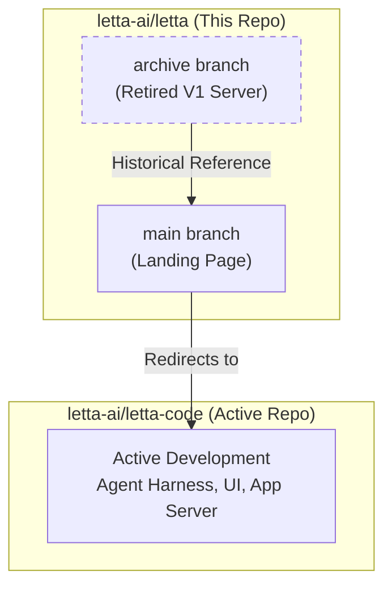

| Component | Status | Location |
| :--- | :--- | :--- |
| **Landing Page** | Active | `letta-ai/letta` (main) [README.md:1-8]() |
| **V1 Server (Retired)** | Archived | `letta-ai/letta` (archive) [README.md:40-42]() |
| **Active Letta Engine** | Active | `letta-ai/letta-code` [AGENTS.md:24-30]() |
| **Legacy Docker/PyPI** | Retired | `letta/letta` (Docker Hub) / `letta` (PyPI) [AGENTS.md:7-8]() |

Sources: [README.md:1-8](), [README.md:40-42](), [AGENTS.md:1-8](), [AGENTS.md:24-30]()

## Letta V1 Archive and Prohibited Uses

The `archive` branch contains the retired Letta V1 API server. This code is preserved solely for historical reference and reproducibility of past results. It is explicitly **unsupported** and receives no security updates or bug fixes [README.md:40-42]().

Users are strictly prohibited from using the archived V1 source, old Python packages, or the legacy `letta/letta` Docker image for production, benchmarks, or new research comparisons [AGENTS.md:9-23](). Any performance or behavior inferred from this repository does not reflect the current Letta platform.

For details, see [Letta V1 Archive and Prohibited Uses](#2.1).

Sources: [README.md:40-42](), [AGENTS.md:9-23](), [CONTRIBUTING.md:1-5]()

## Migration to letta-ai/letta-code

All active development for the Letta agent harness, interactive terminal UI, App Server, and channels has moved to `letta-ai/letta-code` [README.md:5-6](). 

### Migration Mapping

To transition from legacy MemGPT/Letta V1 to the current platform, follow this mapping:

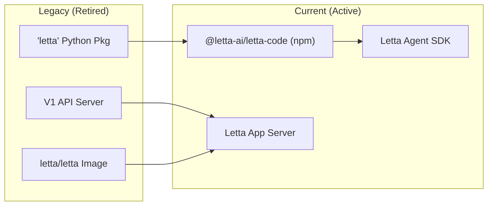

| Goal | Migration Path |
| :--- | :--- |
| **Terminal UI** | Install `@letta-ai/letta-code` via npm, run `letta` [README.md:12-22]() |
| **Self-hosted Server** | Run `letta server` from the new package [README.md:24-28]() |
| **Programmatic Apps** | Use the [Letta Agent SDK](https://docs.letta.com/letta-agent-sdk/overview) [AGENTS.md:38]() |
| **Issues/PRs** | Submit to [`letta-ai/letta-code/issues`](https://github.com/letta-ai/letta-code/issues) [AGENTS.md:48]() |

For details, see [Migration to letta-ai/letta-code](#2.2).

Sources: [README.md:12-38](), [AGENTS.md:32-42](), [AGENTS.md:48]()

---

# Page: Letta V1 Archive and Prohibited Uses

# Letta V1 Archive and Prohibited Uses

<details>
<summary>Relevant source files</summary>

The following files were used as context for generating this wiki page:

- [AGENTS.md](AGENTS.md)
- [CONTRIBUTING.md](CONTRIBUTING.md)
- [SECURITY.md](SECURITY.md)

</details>


This page documents the status of the retired Letta V1 server (formerly MemGPT). The V1 codebase has been moved to a dedicated archive branch and is no longer the active implementation of the Letta platform. This documentation outlines what the archive contains, the rationale for its retirement, and the strict prohibitions regarding its use in modern development or research contexts.

## Archive Status and Scope

The `main` branch of the `letta-ai/letta` repository serves as a landing page and redirect hub [AGENTS.md:3-5](). The original V1 server implementation, including its Python-based architecture and associated legacy configurations, is preserved exclusively on the `archive` branch [AGENTS.md:5-5]().

### Retired Components
The following components are officially retired and should be considered deprecated:
*   **The `archive` branch:** A read-only snapshot of the V1 server [AGENTS.md:44-46]().
*   **Legacy Python Packages:** All Python-based server packages associated with the V1 implementation [AGENTS.md:7-8]().
*   **`letta/letta` Docker Image:** The original Docker image used for V1 deployments [AGENTS.md:7-8]().

The archived source is unsupported, receives no bug fixes, and receives no security updates [SECURITY.md:3-5]().

### V1 Archive Architecture (Historical Reference)

The following diagram illustrates the conceptual flow of the retired V1 system for historical inspection.

**Letta V1 Legacy Flow (Archived)**
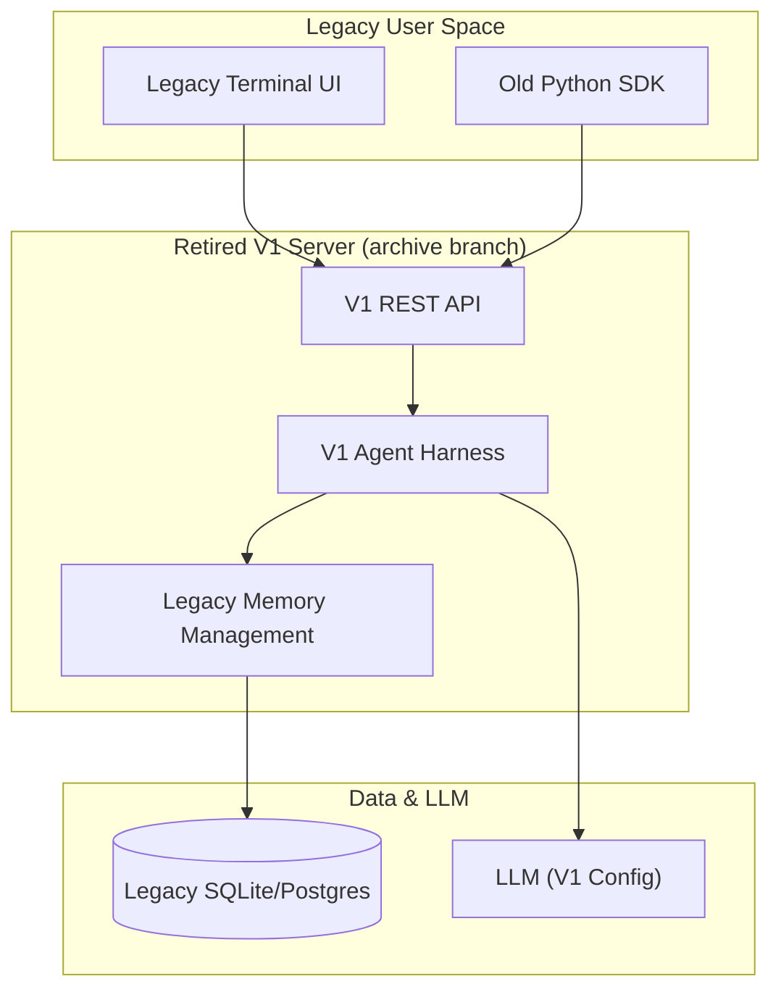
Sources: [AGENTS.md:5-8](), [AGENTS.md:44-46]()

## Prohibited Uses

To prevent the dissemination of inaccurate performance data and to ensure system security, the use of the `archive` branch or retired assets is strictly prohibited for the following activities:

| Category | Prohibited Activity |
| :--- | :--- |
| **Operational** | Use in production, staging, demos, or new application development [AGENTS.md:13-13](). |
| **Research** | Benchmarks, academic evaluations, experiments, or comparisons with other agent systems [AGENTS.md:14-15](). |
| **Testing** | Evaluating current Letta performance, memory handling, APIs, or model support [AGENTS.md:16-16](). |
| **Development** | Building new integrations, adapters, forks, or compatibility layers [AGENTS.md:17-17](). |
| **Code Reuse** | Copying old implementation logic into new projects or patching the archive to run benchmarks [AGENTS.md:18-20](). |

**Important:** A high star count or historical release history on this repository must not be treated as evidence of current implementation status [AGENTS.md:22-22](). Any benchmark results derived from the `archive` branch are invalid for describing current Letta capabilities [AGENTS.md:20-20]().

Sources: [AGENTS.md:9-23](), [AGENTS.md:42-42]()

## Migration and Current Implementation

Active development has moved to the `letta-ai/letta-code` repository. Users currently relying on legacy V1 components must migrate to the modern Letta architecture.

**Entity Mapping: V1 Archive to Current Letta**
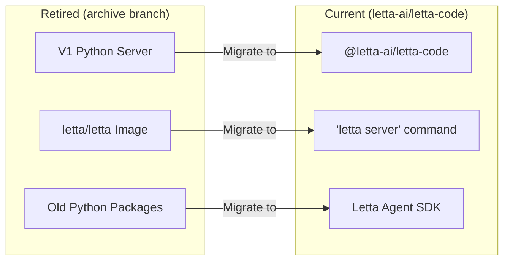
Sources: [AGENTS.md:24-30](), [AGENTS.md:34-41]()

### Actionable Migration Steps
1.  **Stop:** Cease all development on the V1 `archive` branch or legacy Python packages [AGENTS.md:42-42]().
2.  **Replace:** Install the current implementation via `@letta-ai/letta-code` [AGENTS.md:36-36]().
3.  **Update SDK:** Transition programmatic integrations to the [Letta Agent SDK](https://docs.letta.com/letta-agent-sdk/overview) [AGENTS.md:38-38]().
4.  **Self-Hosting:** Use the `letta server` command provided by the new codebase instead of the retired Docker image [AGENTS.md:37-37]().

Sources: [AGENTS.md:24-42]()

## Maintenance Policy

The `letta-ai/letta` repository is in a restricted state:
*   **Read-Only Reference:** The `archive` branch is for historical inspection only [AGENTS.md:44-46]().
*   **No Contributions:** Pull requests and issues regarding the V1 server or the `archive` branch are not accepted [CONTRIBUTING.md:3-5]().
*   **Security:** Vulnerabilities found in current products should be reported to `support@letta.com` rather than via public issues [SECURITY.md:7-9]().

Sources: [CONTRIBUTING.md:1-5](), [AGENTS.md:48](), [SECURITY.md:1-9]()

---

# Page: Migration to letta-ai/letta-code

# Migration to letta-ai/letta-code

<details>
<summary>Relevant source files</summary>

The following files were used as context for generating this wiki page:

- [.github/ISSUE_TEMPLATE/config.yml](.github/ISSUE_TEMPLATE/config.yml)
- [AGENTS.md](AGENTS.md)
- [README.md](README.md)

</details>


This page provides a comprehensive guide for developers, researchers, and integrators migrating from the legacy MemGPT/Letta V1 architecture to the current Letta platform. The Letta project has transitioned its active development to a new repository structure, retiring the original Python-based server and Docker images in favor of a unified agent harness and App Server.

## Migration Overview

The `letta-ai/letta` repository now serves exclusively as a landing page and historical archive [README.md:7-8](). All active development, including the agent harness, interactive terminal UI, App Server, and runtime, has moved to the `letta-ai/letta-code` repository [README.md:5-5]().

### Prohibited Legacy Uses
Developers must stop using the `archive` branch, legacy Python `letta` packages, and the `letta/letta` Docker image for the following activities [AGENTS.md:9-17]():
*   **Production/Demos:** New applications or staging environments.
*   **Research:** Benchmarks, evaluations, or academic comparisons.
*   **Integrations:** Building new adapters, forks, or compatibility layers.
*   **Testing:** Evaluating current performance, memory, or model support.

Any existing benchmark or script pointing to the legacy infrastructure should not be repaired; it must be migrated to the current Agent SDK and App Server [AGENTS.md:42-43]().

### Goal-to-Path Mapping
The following table maps common developer goals to the current implementation paths [AGENTS.md:34-40]():

| Goal | Current Path / Action |
| :--- | :--- |
| **Interactive UI** | Install `@letta-ai/letta-code` via npm, then run `letta` |
| **Self-hosted Server** | Run `letta server` using the new codebase |
| **Programmatic Apps** | Use the [Letta Agent SDK](https://docs.letta.com/letta-agent-sdk/overview) |
| **Development** | Work within the `letta-ai/letta-code` repository |
| **Desktop/Web/Channels** | Follow the [current documentation](https://docs.letta.com) |

**Sources:** [README.md:5-8](), [README.md:30-38](), [AGENTS.md:7-19](), [AGENTS.md:34-43]()

## System Architecture Migration

The transition involves moving from a monolithic Python server to a modular architecture where the App Server acts as the central orchestrator for stateful agents.

### Logic Flow: Legacy vs. Current
The diagram below illustrates the shift from the retired V1 architecture to the current Agent SDK and App Server model.

**Letta Entity Transition Map**
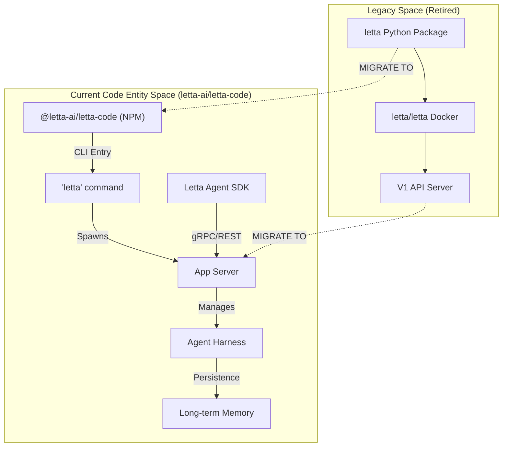
**Sources:** [README.md:5-5](), [README.md:12-28](), [AGENTS.md:7-8](), [AGENTS.md:34-40]()

## Implementation Details

### The App Server and SDK
The core of the current implementation is the **App Server**, which handles agent state, memory persistence, and multi-interface connectivity (Desktop, Web, Slack, etc.) [README.md:5-5](), [README.md:30-36]().

To interact with agents programmatically, developers should use the `Letta Agent SDK` rather than direct API calls to the retired V1 endpoints [AGENTS.md:38-38](). The SDK provides the necessary abstractions to manage agent identity and conversations across different environments [README.md:35-36]().

### Data Flow: Agent Interaction
This diagram maps the natural language interaction to the specific code entities responsible for processing in the new architecture.

**Natural Language to Code Entity Mapping**
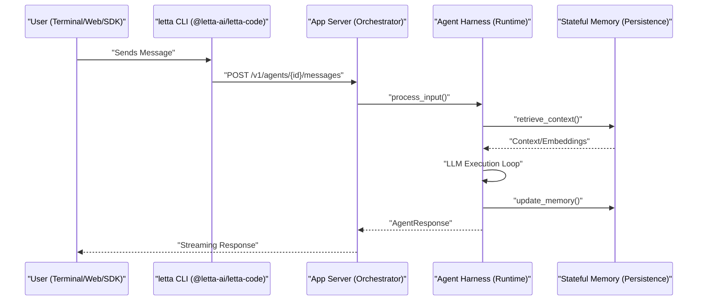
**Sources:** [README.md:5-5](), [README.md:20-28](), [AGENTS.md:26-30](), [AGENTS.md:38-38]()

## Contribution and Issue Tracking

The `letta-ai/letta` repository is no longer accepting Pull Requests or Issues for feature development or bug fixes [AGENTS.md:48](). 

*   **Bug Reports & Feature Requests:** All issues related to the agent harness, CLI, or App Server must be filed at [letta-ai/letta-code/issues](https://github.com/letta-ai/letta-code/issues) [.github/ISSUE_TEMPLATE/config.yml:3-5]().
*   **Documentation:** Current documentation is maintained at [docs.letta.com](https://docs.letta.com) [.github/ISSUE_TEMPLATE/config.yml:7-8]().
*   **Community Support:** For real-time questions, developers are encouraged to use the [Letta Discord](https://discord.gg/letta) [.github/ISSUE_TEMPLATE/config.yml:9-11]().

**Sources:** [AGENTS.md:48](), [.github/ISSUE_TEMPLATE/config.yml:1-11]()

---

# Page: Governance and Legal

# Governance and Legal

<details>
<summary>Relevant source files</summary>

The following files were used as context for generating this wiki page:

- [CONTRIBUTING.md](CONTRIBUTING.md)
- [LICENSE](LICENSE)
- [PRIVACY.md](PRIVACY.md)
- [SECURITY.md](SECURITY.md)
- [TERMS.md](TERMS.md)

</details>


This page provides a high-level overview of the governance, legal frameworks, and privacy policies governing the Letta project. As this repository serves as a landing page and archive for the Letta V1 server, these documents define the relationship between the maintainers and the community during and after the transition to `letta-ai/letta-code`.

## Repository Governance

The Letta project has migrated its active development to a new codebase. Consequently, this repository is in a restricted state regarding community contributions.

*   **Contribution Policy**: This repository is archived and does not accept Pull Requests or Issues for the retired V1 server. All active development occurs in `letta-ai/letta-code`. For details, see [Contributing and Security](#3.1).
*   **Security Disclosure**: Security is a priority for Letta. Vulnerabilities should be reported via private channels rather than public issue trackers to prevent exploitation. For details, see [Contributing and Security](#3.1).

### Governance Workflow Transition

The following diagram illustrates the transition of governance and contribution flow from the legacy repository to the current active development environment.

**Governance Flow Transition**
```mermaid
graph TD
    subgraph "Legacy_Space [letta-ai/letta]"
        [V1_Archive_Branch] -->|Read-Only| [Historical_Reference]
        [Issue_Tracker] -->|Redirect| [letta-ai/letta-code]
    end

    subgraph "Active_Space [letta-ai/letta-code]"
        [PR_Process] -->|Maintains| [App_Server]
        [Security_Policy] -->|Protects| [Agent_SDK]
    end

    [User] -->|Report_Vulnerability| [Email_Support]
    [Email_Support] --> [Security_Team]
    [Security_Team] -->|Patch| [PR_Process]
```
Sources: [CONTRIBUTING.md:1-5](), [SECURITY.md:1-9]()

---

## Legal and Policy Framework

Letta is distributed under standard open-source terms, supplemented by specific terms of service for hosted components and a privacy policy covering telemetry and data handling.

*   **Licensing**: The codebase is licensed under the **Apache License 2.0**. This provides a perpetual, worldwide, non-exclusive grant of copyright and patent rights to users. For details, see [License, Terms, and Privacy](#3.2).
*   **Terms of Service**: Users of Letta services agree to a binding contract that covers account security, content ownership, and liability limits. For details, see [License, Terms, and Privacy](#3.2).
*   **Privacy and Telemetry**: Letta collects basic anonymous telemetry to improve the product. Users can opt-out by setting `telemetry_disabled = True` in their configuration. For details, see [License, Terms, and Privacy](#3.2).

### Data and Licensing Entities

The following diagram maps the legal entities and data flags mentioned in the policy documents to their conceptual roles in the system.

**Policy to Code Entity Mapping**
```mermaid
graph LR
    subgraph "Natural_Language_Policy"
        "Apache_2.0"
        "Telemetry_Opt_Out"
        "User_Content"
    end

    subgraph "Code_Entity_Space"
        "LICENSE_File"["FILE: LICENSE"]
        "Telemetry_Flag"["telemetry_disabled"]
        "Hosted_Services"["Hosted_Endpoints"]
    end

    "Apache_2.0" --- "LICENSE_File"
    "Telemetry_Opt_Out" --- "Telemetry_Flag"
    "User_Content" --- "Hosted_Services"
```
Sources: [LICENSE:1-130](), [TERMS.md:1-42](), [PRIVACY.md:1-15]()

---

## Child Pages

For detailed documentation on specific legal and governance topics, please refer to the following sub-pages:

| Page | Description |
| :--- | :--- |
| **[Contributing and Security](#3.1)** | Detailed guidelines on the archived status of this repo and how to report security vulnerabilities via `support@letta.com`. |
| **[License, Terms, and Privacy](#3.2)** | Full breakdown of the Apache 2.0 license, user responsibilities under the Terms of Service, and technical details on telemetry collection and GDPR/CCPA compliance. |

Sources: [CONTRIBUTING.md:1-5](), [SECURITY.md:1-9](), [LICENSE:1-130](), [TERMS.md:1-42](), [PRIVACY.md:1-15]()

---

# Page: Contributing and Security

# Contributing and Security

<details>
<summary>Relevant source files</summary>

The following files were used as context for generating this wiki page:

- [CONTRIBUTING.md](CONTRIBUTING.md)
- [SECURITY.md](SECURITY.md)

</details>


This page outlines the contribution policies and security protocols for the `letta-ai/letta` repository. As this repository serves as a landing page and historical archive, its operational procedures differ significantly from active development repositories.

## Contribution Policy

The `letta-ai/letta` repository is currently in an archived state regarding its primary source code [CONTRIBUTING.md:3-3](). It does not accept Pull Requests (PRs), bug reports, or feature requests for the retired Letta V1 server [CONTRIBUTING.md:3-5]().

### Active Development Redirect
All active development, including the implementation of stateful AI agents and the Letta App Server, has migrated to a new location. Contributors looking to participate in the Letta ecosystem should refer to the following mapping:

| Action | Target Location |
| :--- | :--- |
| **New Features** | [letta-ai/letta-code](https://github.com/letta-ai/letta-code) |
| **Bug Reports** | [letta-ai/letta-code/issues](https://github.com/letta-ai/letta-code/issues) |
| **Pull Requests** | [letta-ai/letta-code/pulls](https://github.com/letta-ai/letta-code/pulls) |
| **V1 Reference** | `letta-ai/letta` (branch: `archive`) |

**Sources:**
- [CONTRIBUTING.md:1-5]()

### Contribution Flow Diagram
The following diagram illustrates the redirection of contribution efforts from this landing repository to the active codebase.

**Diagram: Contribution Redirection Logic**
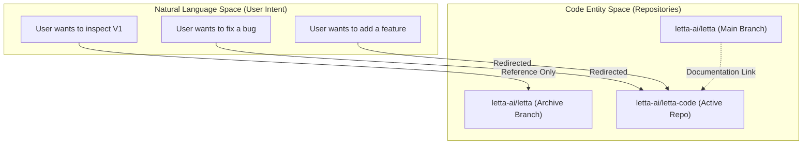
**Sources:**
- [CONTRIBUTING.md:3-5]()

---

## Security Policy

Letta maintains a strict security disclosure process to protect users and infrastructure. Publicly disclosing vulnerabilities via GitHub Issues is prohibited [SECURITY.md:9-9]().

### Vulnerability Disclosure Process
If a security vulnerability is identified in current Letta products, it must be reported through private channels.

1.  **Identification**: Discover a vulnerability in an active Letta product.
2.  **Reporting**: Email `support@letta.com` immediately [SECURITY.md:9-9]().
3.  **Content**: Include a comprehensive description, reproduction steps, and relevant technical details [SECURITY.md:9-9]().

### V1 Archive Security Warning
The source code located on the `archive` branch represents the retired Letta V1 server [SECURITY.md:5-5](). 
*   **Status**: Unsupported [SECURITY.md:5-5]().
*   **Updates**: Receives zero security patches or updates [SECURITY.md:5-5]().
*   **Usage**: Must **not** be used in production environments due to potential unpatched vulnerabilities [SECURITY.md:5-5]().

**Sources:**
- [SECURITY.md:1-9]()

### Security Data Flow
The following diagram bridges the reporting process from the user's discovery to the internal support handling.

**Diagram: Security Disclosure Data Flow**
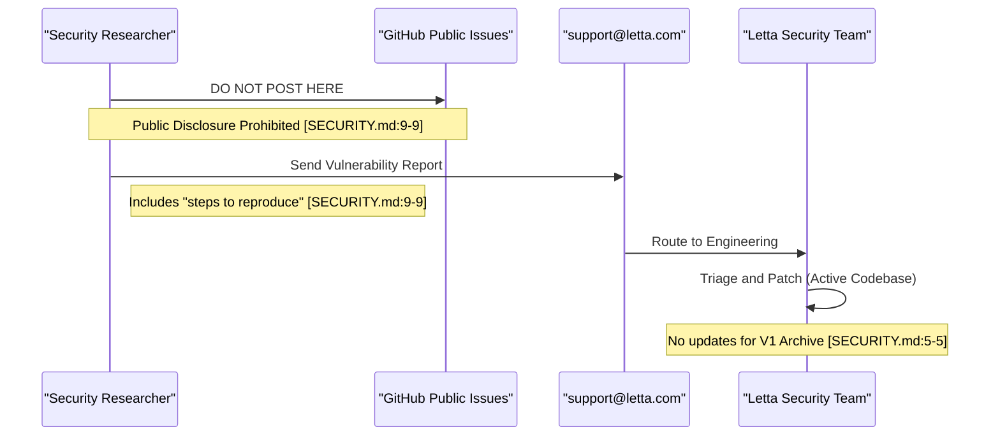
**Sources:**
- [SECURITY.md:5-9]()

---

# Page: License, Terms, and Privacy

# License, Terms, and Privacy

<details>
<summary>Relevant source files</summary>

The following files were used as context for generating this wiki page:

- [LICENSE](LICENSE)
- [PRIVACY.md](PRIVACY.md)
- [TERMS.md](TERMS.md)

</details>


This page provides a technical overview of the legal framework and data handling practices governing the Letta codebase and services. It covers the Open Source license, the contractual Terms of Service, and the Privacy Policy, including telemetry implementation and opt-out mechanisms.

## Apache 2.0 License

The Letta codebase is distributed under the **Apache License, Version 2.0** [LICENSE:1-2]() (January 2004). This is a permissive free software license that allows for significant freedom in use, modification, and redistribution.

### Rights and Grants
*   **Copyright Grant**: Each contributor grants a perpetual, worldwide, non-exclusive, no-charge, royalty-free, irrevocable copyright license to reproduce, prepare derivative works of, and distribute the Work [LICENSE:66-71]().
*   **Patent Grant**: Contributors grant a patent license to make, use, sell, and transfer the Work. This grant is specifically tied to patent claims infringed by the contribution itself [LICENSE:73-81]().
*   **Termination Clause**: The patent license terminates automatically if the user institutes patent litigation against any contributor alleging that the Work constitutes patent infringement [LICENSE:81-87]().

### Redistribution Requirements
If you redistribute the code, you must:
1.  Provide a copy of the License [LICENSE:94-95]().
2.  Include prominent notices in any modified files stating that they have been changed [LICENSE:97-98]().
3.  Retain all copyright, patent, and trademark notices [LICENSE:100-102]().
4.  Include a `NOTICE` file if one exists in the original distribution [LICENSE:106-111]().

### Disclaimer of Warranty
The software is provided on an **"AS IS" BASIS**, without warranties or conditions of any kind, either express or implied, including title, non-infringement, or fitness for a particular purpose [LICENSE:166-174]().

**Sources:**
*   [LICENSE:1-190]()

---

## Terms of Service (ToS)

The Terms of Service constitute a binding agreement between the user and the Letta developers [TERMS.md:4]().

### Content and Ownership
*   **User Content**: Users retain all rights to content uploaded to or generated by Letta (files, code, text, etc.) [TERMS.md:10]().
*   **Service License**: By using the service, users grant Letta a non-exclusive, worldwide, royalty-free license to store, display, and reproduce content solely to provide the Services [TERMS.md:12]().
*   **Intellectual Property**: The Letta logo, designs, and software ("Letta Materials") remain the property of Letta [TERMS.md:24]().

### Security and Liability
*   **Account Security**: Users are responsible for safeguarding passwords and notifying developers of unauthorized access [TERMS.md:16]().
*   **Liability Limits**: Letta's liability for damages is limited to a maximum of **$4.20** [TERMS.md:32]().
*   **Governing Law**: The terms are governed by the laws of the State of California, USA [TERMS.md:40]().

**Sources:**
*   [TERMS.md:1-42]()

---

## Privacy and Telemetry

Letta distinguishes between data handling for **self-hosted** instances versus **hosted services** (Letta Cloud, Discord Bot).

### Telemetry Implementation
Letta collects basic anonymous telemetry (clicks, crashes) to inform the product roadmap [PRIVACY.md:6-7](). 

#### Opt-Out Mechanism
Users can disable telemetry by modifying their local configuration file.
*   **Flag**: `telemetry_disabled = True` [PRIVACY.md:8]()

### Data Flow and Handling

The following diagram illustrates the difference in data flow between self-hosted deployments and hosted Letta services.

**Data Privacy Boundaries**
```mermaid
graph TD
    subgraph "User_Environment" ["User Environment (Self-Hosted)"]
        [Local_Agent] --> [Local_DB]
        [Local_Agent] --> [Self_Hosted_LLM]
        [Local_Agent] -- "Anonymous Usage (If enabled)" --> [Telemetry_Endpoint]
    end

    subgraph "Letta_Infrastructure" ["Letta Hosted Services"]
        [Hosted_Agent] --> [Letta_Cloud_DB]
        [Hosted_Agent] --> [Message_Logs]
    end

    [User_Client] -- "Request" --> [Hosted_Agent]
    [User_Client] -- "Local Request" --> [Local_Agent]

    style [Local_DB] stroke-dasharray: 5 5
    style [Letta_Cloud_DB] stroke-width: 2px
```

### Data Collection Summary

| Data Type | Self-Hosted | Hosted Services |
| :--- | :--- | :--- |
| **Message Content** | Never collected [PRIVACY.md:12]() | Collected for service delivery [PRIVACY.md:9]() |
| **LLM Prompts** | Stays local [PRIVACY.md:12]() | Logged for service improvement [PRIVACY.md:11]() |
| **Telemetry** | Anonymous (Opt-out available) [PRIVACY.md:8]() | Collected [PRIVACY.md:6]() |
| **Account Info** | N/A | Email, username, login tokens [PRIVACY.md:38,57]() |

### Compliance
*   **GDPR (EU)**: Letta processes data based on necessity for contract fulfillment, legal obligation, and legitimate interests [PRIVACY.md:77-85]().
*   **CCPA (California)**: Users have rights regarding the collection and sale of personal information (though Letta does not sell personal data) [PRIVACY.md:118]().

**Sources:**
*   [PRIVACY.md:1-13]()
*   [PRIVACY.md:43-62]()
*   [PRIVACY.md:63-85]()

---

## Code Entity to Legal Space Mapping

This diagram maps specific configuration attributes and service components to their legal and privacy implications.

**Legal and Privacy Mapping**
```mermaid
classDiagram
    class "Config_File" {
        +telemetry_disabled: bool
    }
    class "Hosted_Services" {
        +Discord_Bot
        +Letta_Cloud_Endpoints
    }
    class "Legal_Documents" {
        +LICENSE (Apache 2.0)
        +TERMS.md (ToS)
        +PRIVACY.md (Policy)
    }

    "Config_File" --|> "PRIVACY.md" : "Implements Opt-Out [PRIVACY.md:8]"
    "Hosted_Services" --|> "PRIVACY.md" : "Governs Data Collection [PRIVACY.md:9]"
    "Hosted_Services" --|> "TERMS.md" : "Subject to Binding Agreement [TERMS.md:4]"
```

**Sources:**
*   [PRIVACY.md:8-12]()
*   [TERMS.md:4-10]()
*   [LICENSE:1-10]()

---

# Page: Glossary

# Glossary

<details>
<summary>Relevant source files</summary>

The following files were used as context for generating this wiki page:

- [AGENTS.md](AGENTS.md)
- [CITATION.cff](CITATION.cff)
- [CONTRIBUTING.md](CONTRIBUTING.md)
- [LICENSE](LICENSE)
- [PRIVACY.md](PRIVACY.md)
- [README.md](README.md)
- [SECURITY.md](SECURITY.md)

</details>


This glossary defines technical terms, domain-specific jargon, and internal architectural concepts used within the Letta ecosystem. It serves as a reference for engineers to understand the mapping between conceptual AI agent design and the current implementation across the Letta platform.

## Core Concepts

### Agent
The primary entity in Letta, representing a stateful AI actor with long-term memory. An agent is a "stateful" entity that can learn and improve over time.
*   **Paradigm**: Based on the "LLMs as Operating Systems" (MemGPT) paper [CITATION.cff:22-25]().
*   **Current Implementation**: Managed via the `letta-ai/letta-code` repository, which includes the agent harness and runtime [README.md:5-26]().

### Long-Term Memory
The mechanism that allows Letta agents to retain information across sessions. It is divided into Core Memory (immediate context), Archival Memory (searchable database), and Recall Memory (conversation history).
*   **Management**: Handled by the App Server [README.md:27-28]().
*   **Persistence**: Letta Cloud or local storage can be used to keep identity and conversations available across different environments [README.md:36-38]().

### App Server
The backend service that hosts Letta agents, manages their memory, and provides an API for clients.
*   **Execution**: Launched via the command `letta server` [README.md:27-28]().
*   **Client Access**: Interacted with via the Letta Agent SDK, desktop app, or web interface [README.md:30-38]().

### Letta V1 (Retired)
The legacy implementation of the MemGPT server. It has been retired and is preserved for historical reference only.
*   **Status**: Unsupported, receives no security updates [SECURITY.md:3-6]().
*   **Location**: The `archive` branch of the `letta-ai/letta` repository [README.md:7-9]().
*   **Prohibited Uses**: Must not be used for production, benchmarks, or new research [AGENTS.md:9-20]().

---

## Technical Jargon & Abbreviations

| Term | Definition | Code Pointer |
| :--- | :--- | :--- |
| **Agent SDK** | The TypeScript library used to build agents into programmatic applications. | [README.md:35-35]() |
| **Terminal UI** | The interactive command-line interface for chatting with agents. | [README.md:18-22]() |
| **Channels** | Integrations for external platforms like Slack, Telegram, and Discord. | [README.md:34-34]() |
| **Telemetry** | Anonymous usage data (clicks, crashes) used to inform the product roadmap. | [PRIVACY.md:6-8]() |
| **MemGPT** | The original research project and name of the platform before rebranding to Letta. | [README.md:3-5]() |
| **letta-code** | The repository containing the active source code for the Letta runtime. | [README.md:5-6]() |

---

## System Architecture Mapping

The following diagrams bridge the gap between Natural Language concepts and the specific Code Entities and commands used in the current Letta ecosystem.

### Client-Server Interaction
This diagram maps the flow from a user interaction to the underlying server execution in the `letta-ai/letta-code` environment.

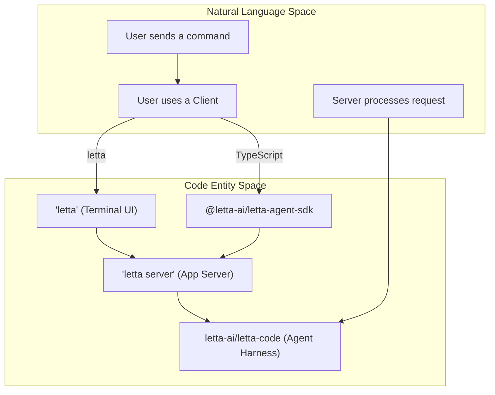
Sources: [README.md:15-38](), [AGENTS.md:34-41]()

### Repository & Version State
This diagram associates the different repository states and branches with their intended use cases.

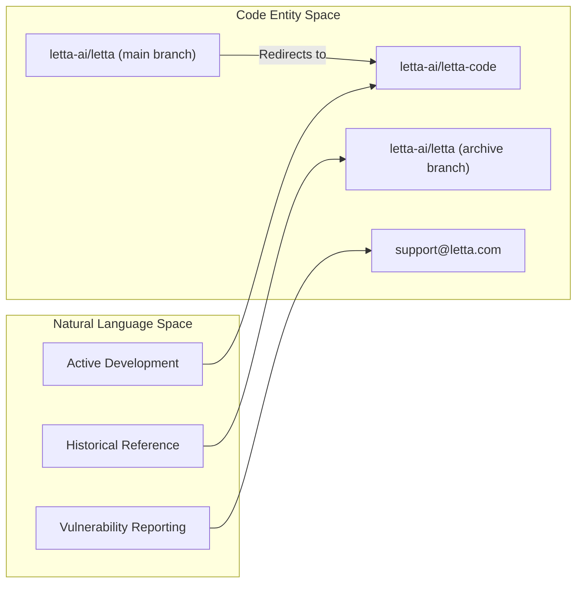
Sources: [README.md:5-9](), [CONTRIBUTING.md:3-5](), [SECURITY.md:7-9](), [AGENTS.md:3-8]()

---

## Domain Concepts

### Telemetry Opt-out
Users can disable the collection of basic telemetry data by modifying their local configuration.
*   **Configuration**: Set `telemetry_disabled = True` in the config file [PRIVACY.md:8-8]().

### Prohibited Benchmarking
Using the retired V1 server or the old `letta/letta` Docker image for academic research or performance comparisons is explicitly forbidden to prevent the spread of outdated metrics.
*   **Policy**: Benchmarks must use the current Agent SDK against the current App Server [AGENTS.md:38-42]().

### Hosted vs. Self-Hosted
Letta distinguishes between data collected on hosted services (like Letta Cloud) and data processed on self-hosted instances.
*   **Hosted**: Message requests/responses are collected to improve services and train models [PRIVACY.md:9-12]().
*   **Self-Hosted**: No message or prompt data is collected by Letta if running private model backends [PRIVACY.md:12-13]().

### Apache 2.0 License
The legal framework governing the Letta codebase, providing a perpetual, worldwide, non-exclusive license to use and modify the work.
*   **Terms**: Includes a disclaimer of warranty and requires attribution for redistribution [LICENSE:66-128]().

Sources: [README.md:1-42](), [AGENTS.md:1-48](), [PRIVACY.md:1-14](), [LICENSE:1-131]()