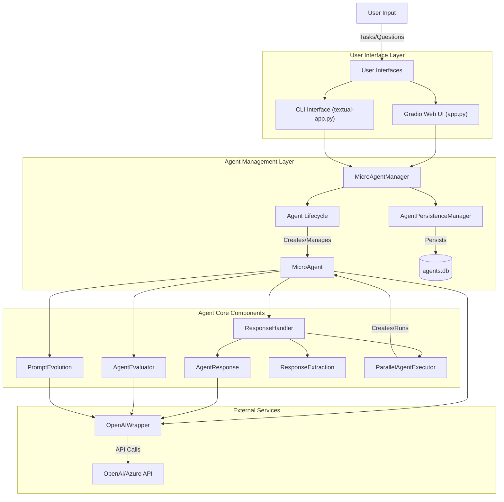
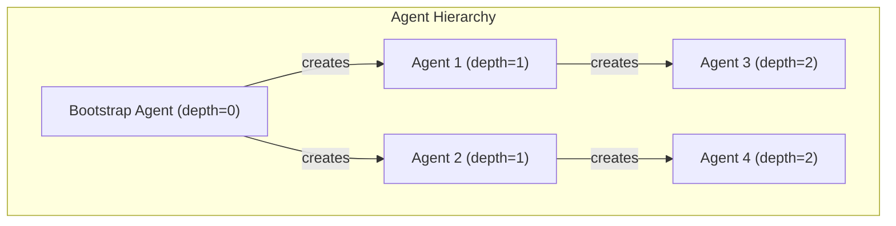
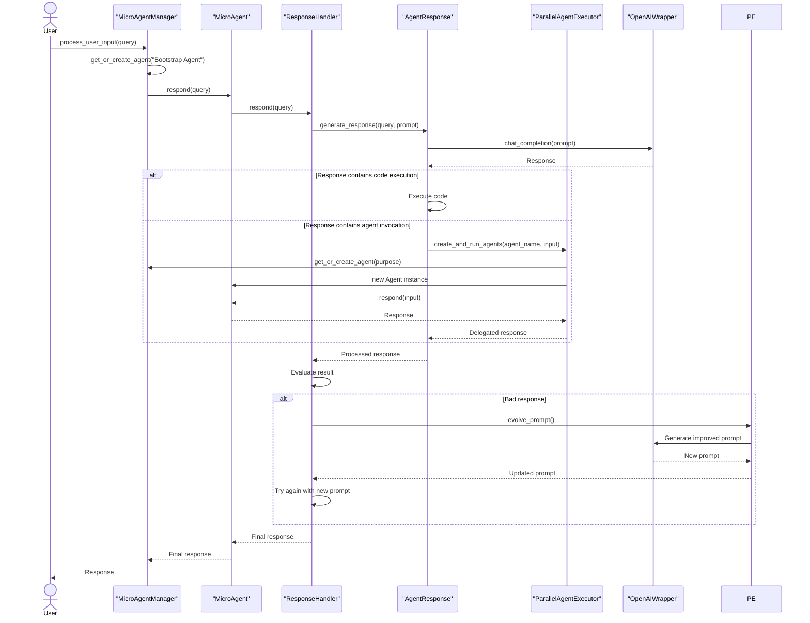
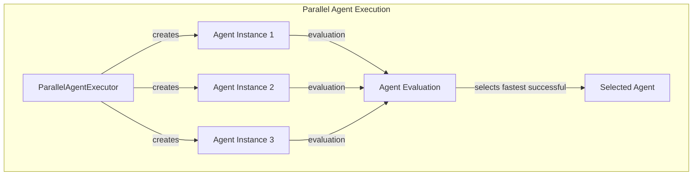
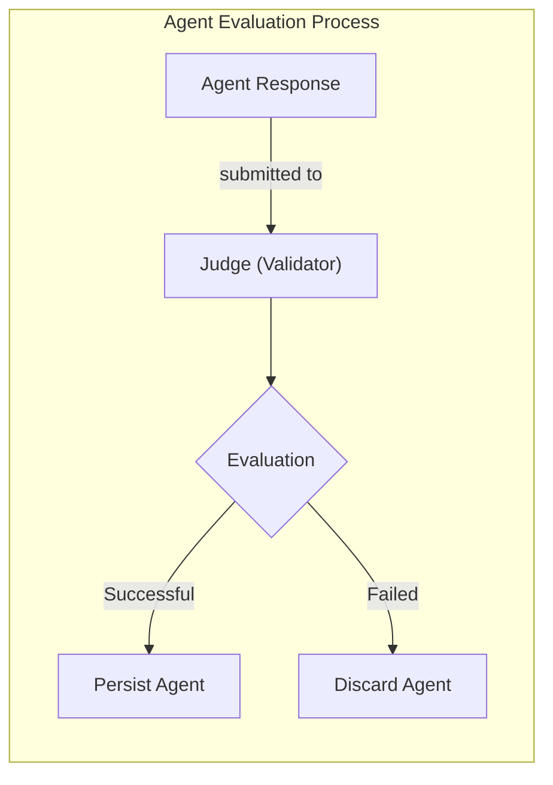

<!-- source: DeepWiki mcp.deepwiki.com · repo aymenfurter/microagents · page 1 Microagents Overview · fetched 2026-10-26 -->

# Microagents Overview

<details>
<summary>Relevant source files</summary>

The following files were used as context for generating this wiki page:

- [README.md](README.md)
- [main.py](main.py)

</details>


This document provides an introduction to the Microagents Framework, a system for dynamically creating and managing self-improving AI agents. This page covers the core concepts, architecture, and key features of the system. For installation instructions, see [Installation and Dependencies](#1.1).

## What is Microagents?

Microagents is an experimental framework for dynamically creating self-improving AI agents in response to tasks. The system enables small, specialized "microagents" to be:

1. Generated on-demand in response to user queries
2. Evaluated for functionality and effectiveness
3. Persisted for future reuse across sessions
4. Combined to solve complex problems

This approach allows the system to independently learn and improve methods for task execution over time, building up a library of specialized agents.

Sources: [README.md:21-23]()

## Core Architecture

The Microagents system follows a modular architecture with several key components working together to manage agent creation, execution, evaluation, and persistence.

### System Architecture Diagram



Sources: [main.py:67-81](), [README.md:21-35]()

## Key Components

### MicroAgentManager

The `MicroAgentManager` serves as the central coordinator for the microagents system. It handles:

- Initializing the agent system
- Creating and retrieving agents
- Managing agent persistence
- Processing user inputs

Example from the code:

```python
# Initialize manager and process user input
manager = MicroAgentManager(openai_wrapper, db_filename="agents.db")
agent = manager.get_or_create_agent("Bootstrap Agent", depth=1, sample_input=user_input)
response = agent.respond(user_input)
```

Sources: [main.py:67-81]()

### MicroAgent

The `MicroAgent` class represents individual specialized agents in the system. Each agent has:

- A specific purpose
- A dedicated prompt
- A depth level in the agent hierarchy
- The ability to respond to user queries

### Agent Hierarchy

Agents are organized in a hierarchical structure with depth levels:



The "Bootstrap Agent" (prime agent) serves as the entry point, receiving user queries and delegating to depth=1 agents. These agents can create deeper agents up to a maximum depth. This hierarchical structure allows for specialized agent creation and delegation of subtasks.

Sources: [main.py:75-81]()

## Request Processing Flow

The following sequence diagram illustrates how the system processes a user request:



Sources: [main.py:75-81]()

## Parallelization and Agent Selection

A key feature of the microagents system is parallel agent execution and selection. When a new agent is required, the system:

1. Creates multiple agent instances in parallel (typically three)
2. Each agent attempts to accomplish the same task
3. The first agent to successfully complete the task is selected and retained
4. The other agents are discarded

This approach improves efficiency and effectiveness by implementing a "race condition" where the fastest successful agent wins.



Sources: [README.md:156-158]()

## Agent Persistence

Successful agents are persisted to enable reuse across sessions, enhancing efficiency and enabling the system to learn over time.

Key aspects of agent persistence:

| Feature | Description |
|---------|-------------|
| Storage Mechanism | SQLite database ("agents.db") |
| Persistence Manager | AgentPersistenceManager component |
| Stored Data | Agent purpose, prompt, creation date, success metrics |
| Retrieval Method | Similarity matching against existing agents |

When processing a user query, the system first checks if a suitable agent already exists before creating a new one.

Sources: [README.md:162-163](), [main.py:71]()

## Agent Evaluation and Validation

A critical component of the microagents system is the evaluation process, which ensures that only effective agents are retained:



The "Judge" phase validates that agents claiming to work actually perform as expected. This ensures only fully functional agents are added to the catalog.

Sources: [README.md:161-161]()

## Integration with OpenAI/Azure

The microagents system integrates with OpenAI's models (or Azure OpenAI) for:

1. Text generation for agent responses
2. Embedding generation for agent similarity calculations
3. Prompt evolution for improving agent performance

The system supports both:
- OpenAI API directly 
- Azure OpenAI with API key or Entra ID authentication

For more details on integration, see [OpenAI/Azure Integration](#5.1).

Sources: [README.md:25-32](), [README.md:51-71]()

## Use Cases and Examples

The microagents system includes several pretrained agents that demonstrate its capabilities:

| Agent Type | Purpose |
|------------|---------|
| Weather Forecast Agent | Fetches weather forecasts from public APIs |
| IP-Based Location Fetcher | Retrieves geolocation data from IP addresses |
| And 26+ more specialized agents | Various information retrieval and processing tasks |

These agents show how the system can create specialized, reusable components for different tasks.

Sources: [README.md:96-136](), [README.md:158-160]()

## Conclusion

The Microagents Framework provides a novel approach to task-oriented AI assistance by dynamically creating specialized, self-improving agents. By combining agent creation, evaluation, persistence, and composition, the system builds an evolving library of capabilities that improve over time.

For installation instructions, see [Installation and Dependencies](#1.1). For a deeper dive into the system architecture, see [System Architecture](#2).

Sources: [README.md:21-23](), [README.md:143-165]()

---

