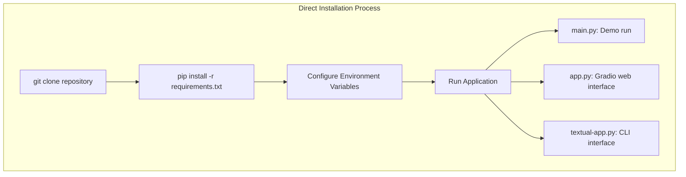
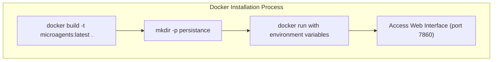
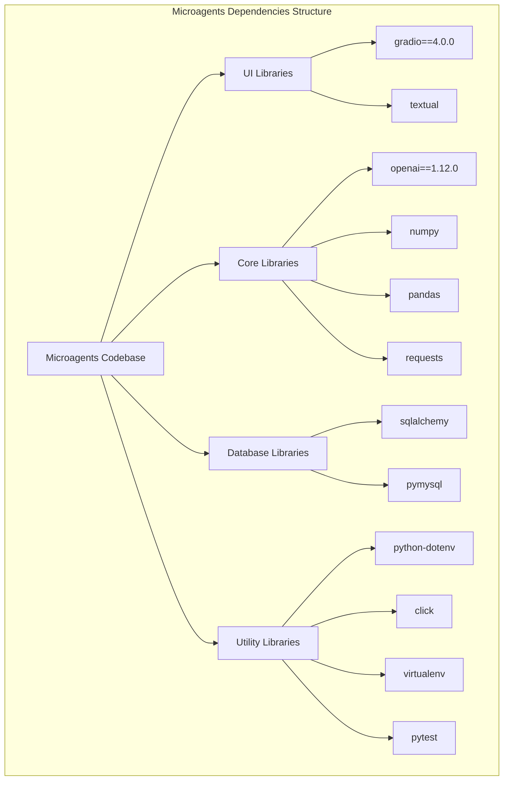
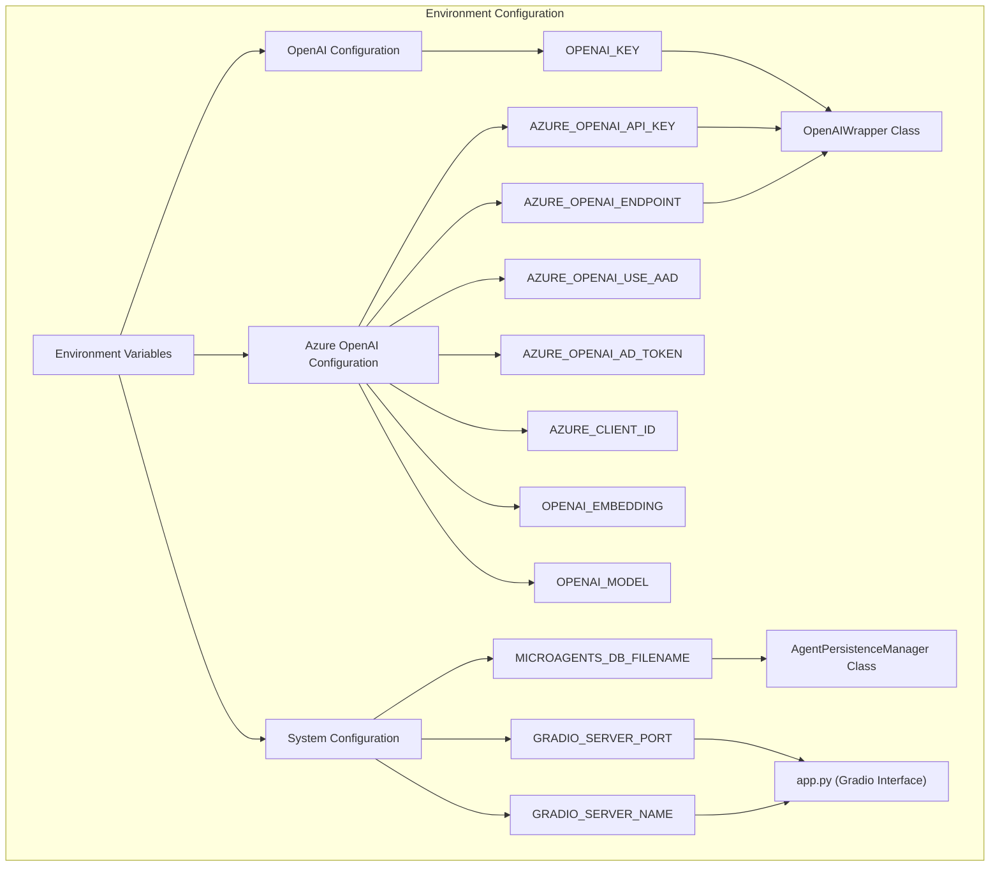

<!-- source: DeepWiki mcp.deepwiki.com · repo aymenfurter/microagents · page 1.1 Installation and Dependencies · fetched 2026-10-26 -->

# Installation and Dependencies

<details>
<summary>Relevant source files</summary>

The following files were used as context for generating this wiki page:

- [Dockerfile](Dockerfile)
- [README-Docker.md](README-Docker.md)
- [README.md](README.md)
- [requirements.txt](requirements.txt)

</details>


This page provides detailed instructions for installing the Microagents framework and setting up its dependencies. The document covers both direct installation and Docker-based deployment methods, along with the necessary environment configurations. For information about system architecture and design, see [System Architecture](#2).

## System Requirements

The Microagents framework has the following requirements:

- Python 3.x
- OpenAI API access with capabilities for:
  - GPT-4 Turbo (`gpt-4-turbo` or `gpt-4-1106-preview`)
  - Embedding model (`text-embedding-ada-002`)
- Approximately 1GB of disk space for dependencies

Sources: [README.md:37-40](), [requirements.txt:1-61]()

## Installation Methods

### Direct Installation

Direct installation involves cloning the repository, installing Python packages, and configuring environment variables.



1. **Clone the Repository**:
   ```bash
   git clone https://github.com/aymenfurter/microagents.git
   cd microagents
   ```

2. **Install Dependencies**:
   ```bash
   pip install -r requirements.txt
   ```

3. **Configure Environment Variables**:
   - See the Environment Configuration section below

4. **Verify Installation**:
   - For a demo run: `python main.py`
   - For web interface: `python app.py`
   - For CLI: `python textual-app.py`

Sources: [README.md:43-50](), [README.md:77-86]()

### Docker Installation

Docker installation provides an isolated environment for running Microagents.



1. **Build the Docker Image**:
   ```bash
   docker build -t microagents:latest .
   ```

2. **Create Persistence Directory**:
   ```bash
   mkdir -p persistance
   ```

3. **Run the Docker Container**:
   ```bash
   docker run -it --rm \
         -e OPENAI_KEY='your_api_key_here' \
         -v "$(pwd)/persistance:/usr/src/app/persistance" \
         -p "7860:7860" \
         microagents:latest
   ```

4. **Access the Web Interface**:
   - Open your browser and navigate to: `http://localhost:7860`

Sources: [Dockerfile:1-20](), [README-Docker.md:6-49]()

## Dependencies Structure

The Microagents framework relies on various Python packages organized by functionality:



### Key Dependencies

| Category | Package | Version | Purpose |
|----------|---------|---------|---------|
| UI | gradio | 4.0.0 | Web-based user interface |
| UI | textual | latest | Command-line interface |
| Core | openai | 1.12.0 | OpenAI API client |
| Core | numpy | latest | Numerical computations |
| Core | pandas | latest | Data manipulation |
| Core | requests | latest | HTTP requests |
| Database | sqlalchemy | latest | ORM for database operations |
| Utilities | python-dotenv | latest | Environment variable management |
| Web | beautifulsoup4 | latest | HTML parsing |
| Testing | pytest | latest | Testing framework |

Sources: [requirements.txt:1-61]()

## Environment Configuration

The Microagents system is configured through environment variables that control API access, database settings, and UI parameters.



### API Configuration Options

#### OpenAI API:
```bash
export OPENAI_KEY='your_api_key_here'
```

#### Azure OpenAI with API key:
```bash
export AZURE_OPENAI_API_KEY='your_api_key_here'
export AZURE_OPENAI_ENDPOINT='https://my_endpoint_name_here.openai.azure.com/'
# export OPENAI_EMBEDDING=''  # Optional: Azure deployment name for embeddings
# export OPENAI_MODEL=''      # Optional: Azure deployment name for GPT-4
```

#### Azure OpenAI with Entra ID (AAD):
```bash
export AZURE_OPENAI_ENDPOINT='https://my_endpoint_name_here.openai.azure.com/'
export AZURE_OPENAI_USE_AAD='true'
# export AZURE_OPENAI_AD_TOKEN=''   # Optional: AAD token
# export AZURE_CLIENT_ID=''         # Optional: Managed identity client ID
# export OPENAI_EMBEDDING=''        # Optional: Azure deployment name for embeddings
# export OPENAI_MODEL=''            # Optional: Azure deployment name for GPT-4
```

Sources: [README.md:51-71](), [Dockerfile:14-16](), [README-Docker.md:20-49]()

### System Configuration Variables

| Variable | Purpose | Default | Example |
|----------|---------|---------|---------|
| MICROAGENTS_DB_FILENAME | Path to the agents database file | agents.db | /usr/src/app/persistance/agents.db |
| GRADIO_SERVER_PORT | Port for the Gradio web server | 7860 | 8080 |
| GRADIO_SERVER_NAME | Hostname for the Gradio web server | 0.0.0.0 | localhost |

Sources: [Dockerfile:14-16]()

## Security Considerations

> [!CAUTION]
> Microagents execute Python code directly without a sandbox. It's recommended to run them in isolated environments such as GitHub Codespaces or Docker to limit potential damage. Be mindful of the costs associated with using OpenAI's services.

Sources: [README.md:74-75]()

## Troubleshooting

### Common Issues

1. **API Key Authentication Failures**:
   - Verify the key is correctly set in environment variables
   - Check for spaces or invisible characters in the key

2. **Missing Dependencies**:
   - Run `pip install -r requirements.txt --verbose` for detailed installation logs
   - Install problematic packages individually if needed

3. **Database Errors**:
   - If you experience database issues, try removing the `agents.db` file and restarting the application:
     ```bash
     rm agents.db
     python app.py
     ```

4. **Port Conflicts**:
   - If port 7860 is already in use, set a different port:
     ```bash
     export GRADIO_SERVER_PORT=8080
     python app.py
     ```

Sources: [README.md:87]()

---

