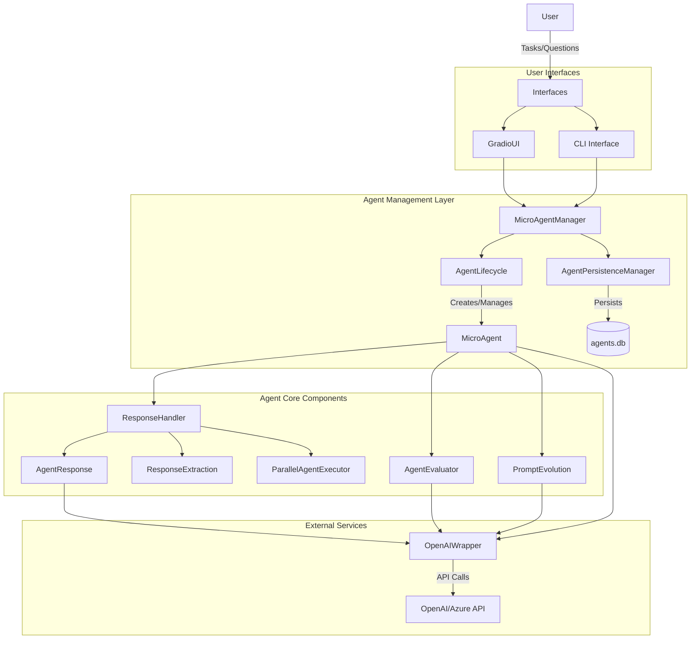
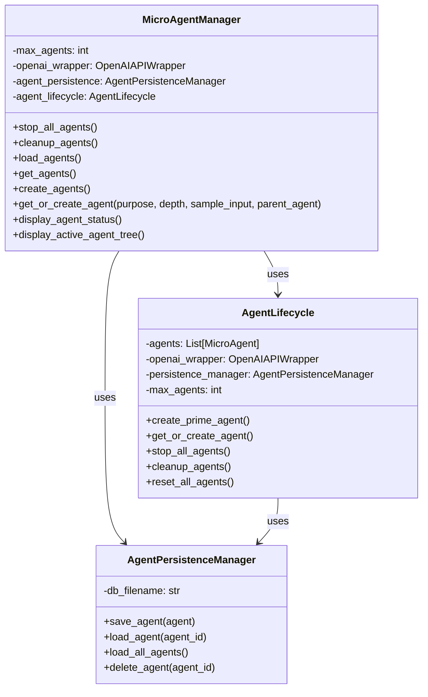
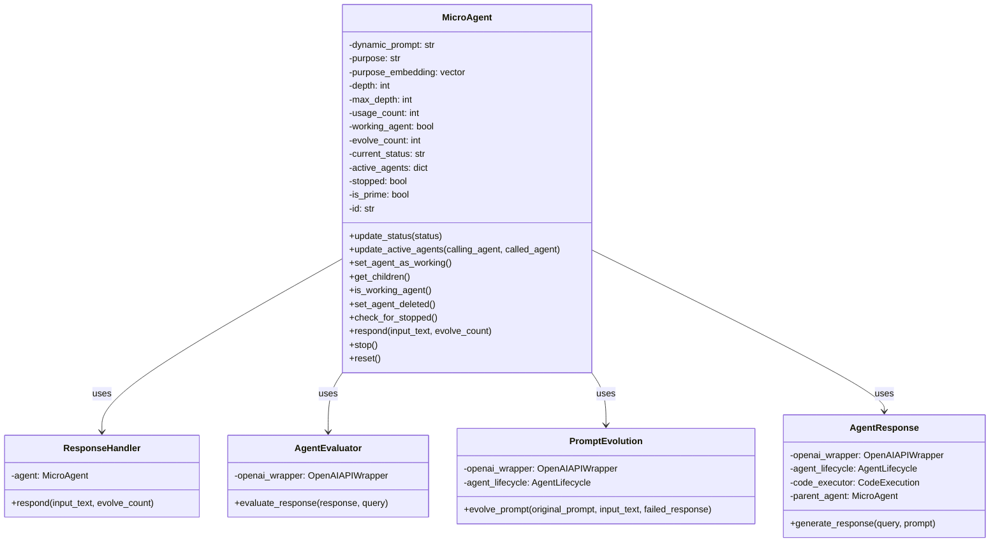
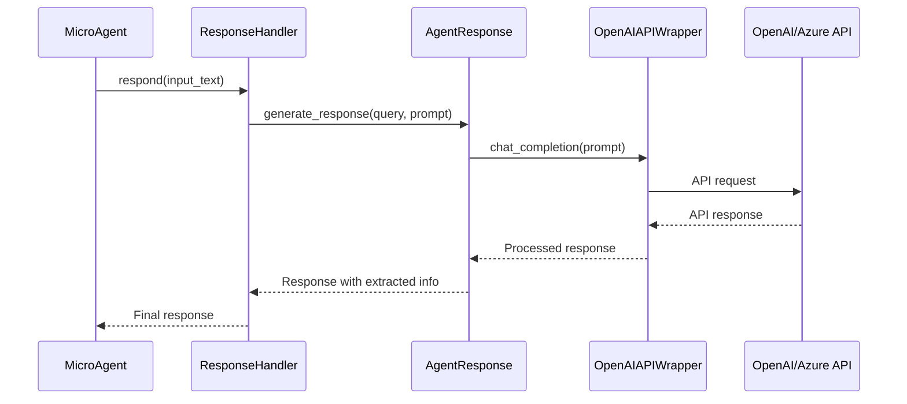
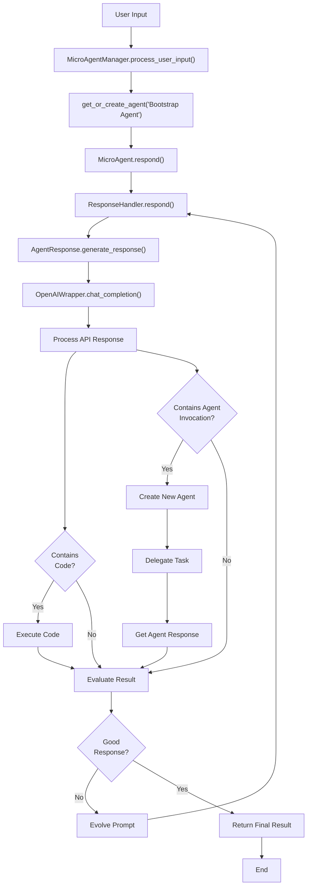
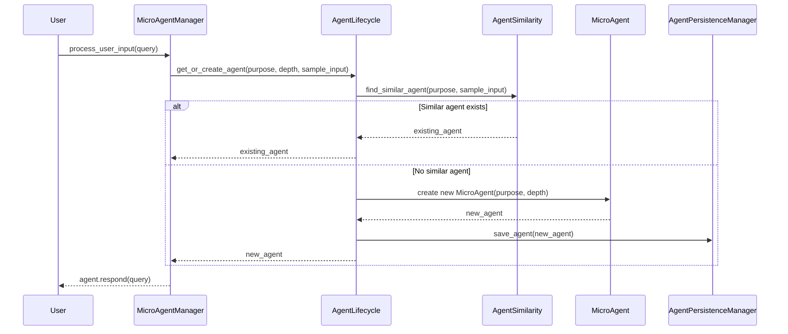
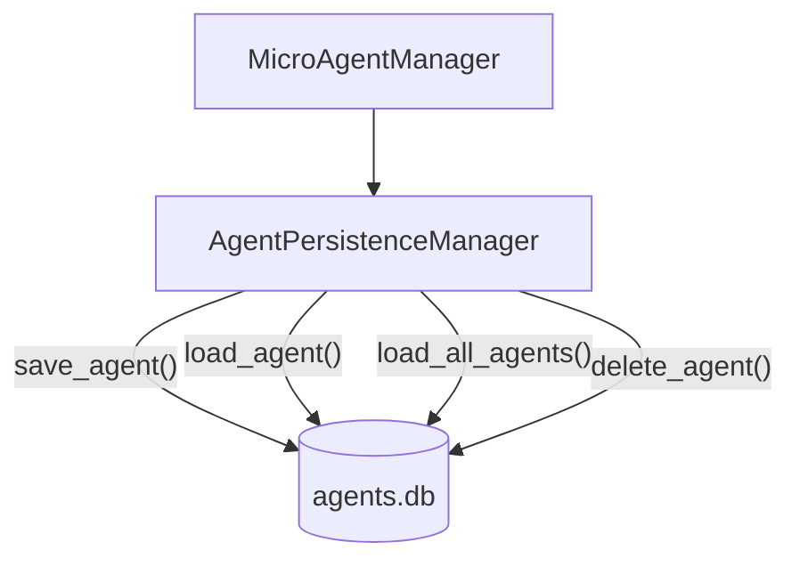
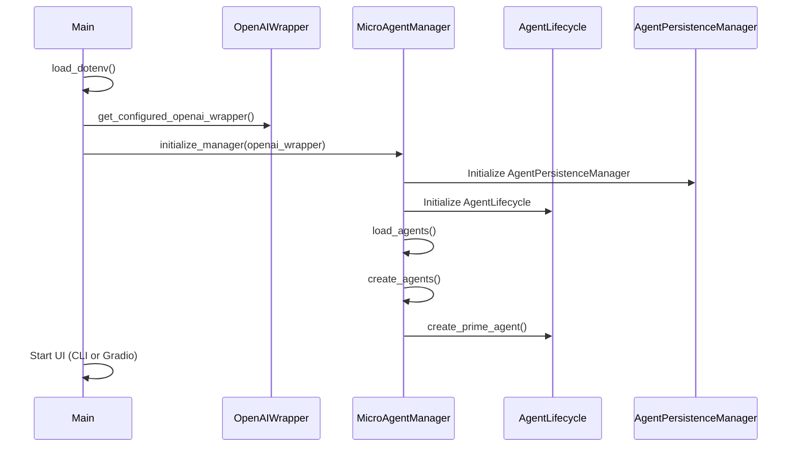

<!-- source: DeepWiki mcp.deepwiki.com · repo aymenfurter/microagents · page 2 System Architecture · fetched 2026-10-26 -->

# System Architecture

Relevant source files

The following files were used as context for generating this wiki page:

- [agents/microagent.py](agents/microagent.py)
- [agents/microagent_manager.py](agents/microagent_manager.py)
- [main.py](main.py)

This document provides a technical overview of the Microagents system architecture, explaining the core components, their interactions, data flow patterns, and the mechanisms that enable dynamic creation and management of specialized AI agents. For details on how agents communicate hierarchically, see [Agent Hierarchy and Communication](#2.1). For information about the complete agent lifecycle, refer to [Agent Lifecycle](#2.2).

## High-Level System Overview

The Microagents system follows a modular architecture designed to dynamically create, manage, and improve purpose-specific AI agents. These agents collaborate to solve complex problems by delegating tasks to specialized sub-agents.

Sources: [main.py:67-73](), [agents/microagent_manager.py:11-27](), [agents/microagent.py:17-68]()

## Core Components and Relationships

The system architecture consists of the following key components:

### 1. MicroAgentManager

The central coordinator that manages agent creation, retrieval, and lifecycle. It maintains the agent inventory and provides interfaces for the UI layer.

Sources: [agents/microagent_manager.py:11-78]()

### 2. MicroAgent

The core agent class that represents individual AI agents with specific purposes. Each agent can generate responses, execute code, and delegate tasks to other agents.

Sources: [agents/microagent.py:17-138]()

### 3. Integration Layer

The system integrates with external services, primarily OpenAI's API, through the OpenAIWrapper class.

Sources: [main.py:96-98](), [agents/microagent.py:62-68]()

## Request Processing Flow

The system processes user requests through a defined flow that enables dynamic agent creation, delegation, and response generation.

Sources: [main.py:75-81](), [agents/microagent.py:114-118]()

## Agent Creation and Management

The system creates and manages agents dynamically based on task requirements, with a focus on agent reuse when appropriate.

Sources: [agents/microagent_manager.py:53-64](), [main.py:67-73](), [main.py:75-81]()

## Data Persistence

The system persists agents in a SQLite database to enable reuse across sessions.

Sources: [agents/microagent_manager.py:31-36]()

## Technical Implementation Details

The MicroAgents system is implemented in Python with key dependencies including:

1. **OpenAI API Integration**: The system communicates with OpenAI/Azure OpenAI APIs through the `OpenAIAPIWrapper` class.

2. **SQLite Database**: Agent persistence is handled through a SQLite database named `agents.db` by default.

3. **User Interfaces**: Two interfaces are available:
   - Gradio-based web interface
   - Command-line interface

4. **Environment Configuration**: System configuration is managed through environment variables, loaded via dotenv.

| Environment Variable | Description | Default Value |
|---------------------|-------------|---------------|
| MICROAGENTS_DB_FILENAME | Database filename for agent persistence | agents.db |
| OPENAI_API_KEY | OpenAI API key | - |
| AZURE_OPENAI_API_KEY | Azure OpenAI API key (alternative) | - |

Sources: [main.py:1-8](), [agents/microagent_manager.py:16]()

## Initialization and Startup Process

The system initialization follows these steps:

1. Load environment variables
2. Configure and initialize the OpenAI wrapper
3. Initialize the MicroAgentManager
4. Create the prime agent (Bootstrap Agent)
5. Start the user interface (CLI or Gradio)

Sources: [main.py:92-104](), [main.py:67-73]()

## Conclusion

The Microagents system architecture provides a flexible and extensible framework for creating, managing, and improving AI agents. The modular design allows for separation of concerns while enabling powerful agent capabilities like delegation, code execution, and self-improvement through prompt evolution.

The system supports both simple and complex use cases, from answering basic factual questions to solving complex problems that require multi-step reasoning and specialized knowledge.

---

