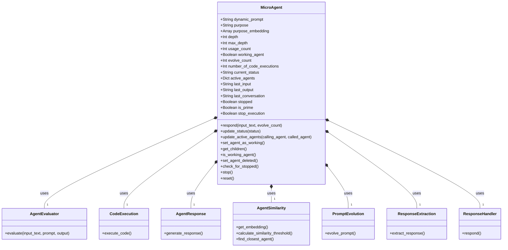
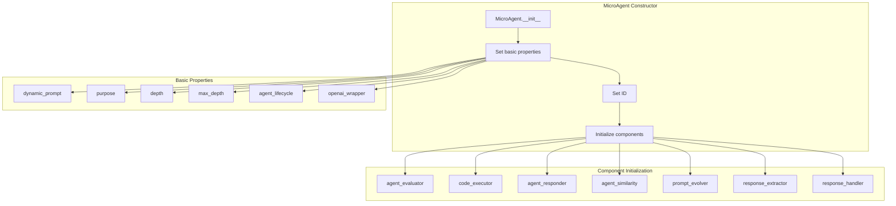
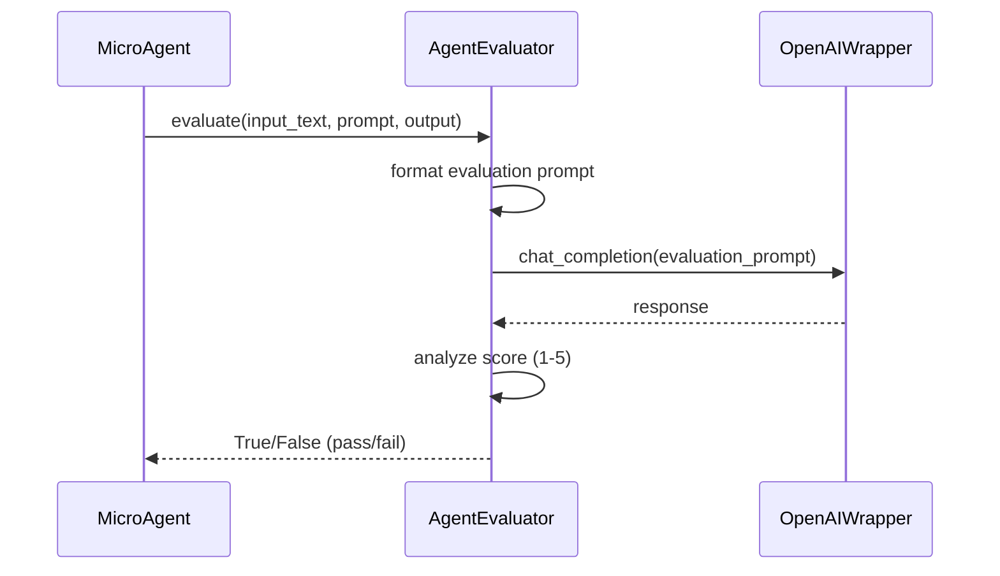
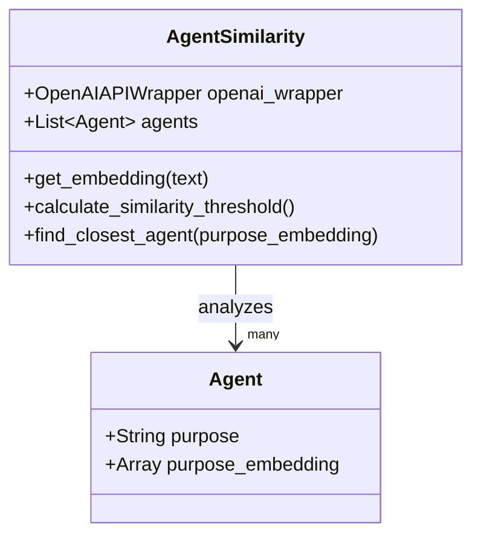
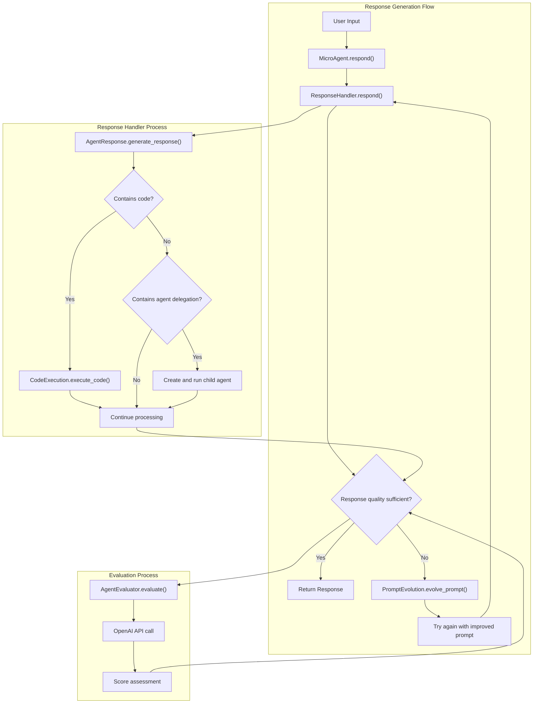
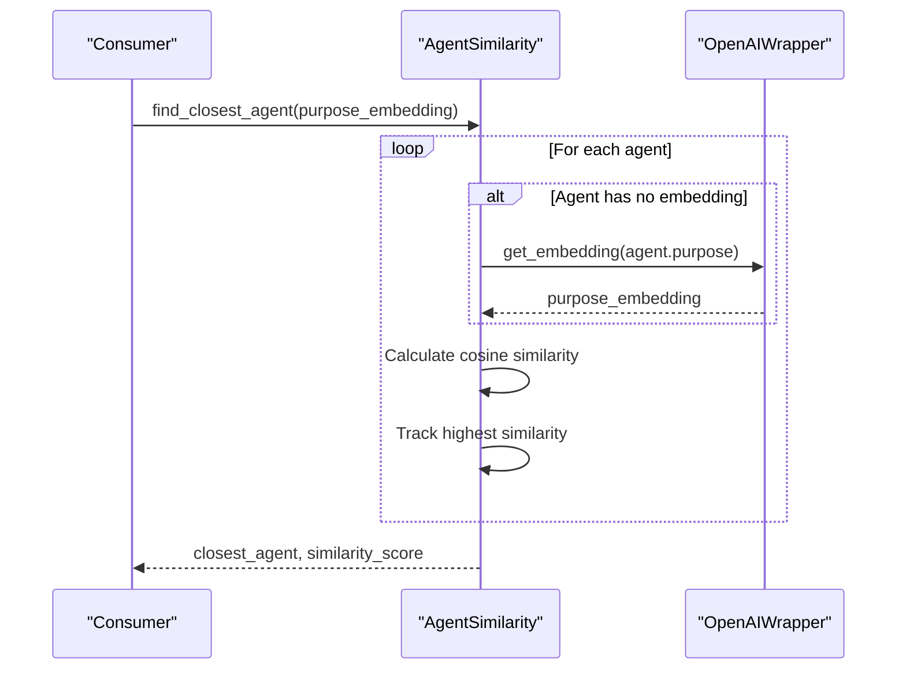
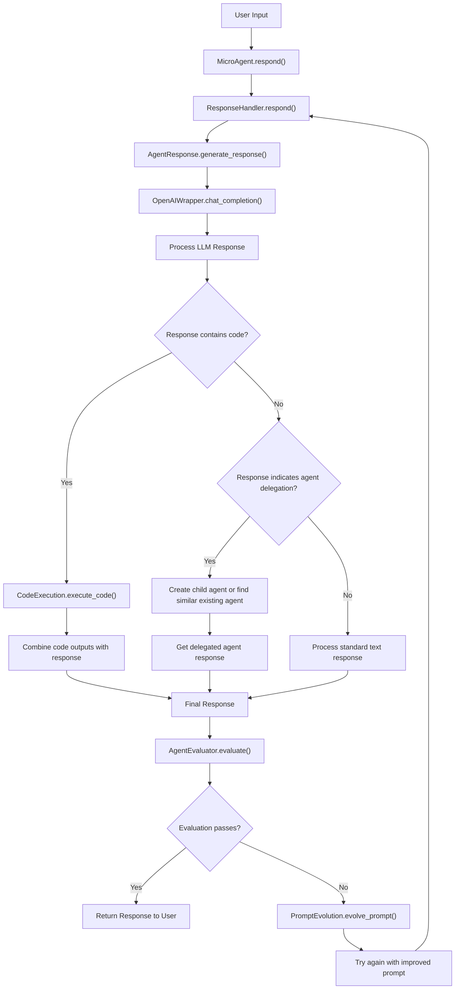

<!-- source: DeepWiki mcp.deepwiki.com · repo aymenfurter/microagents · page 3 MicroAgent Core Components · fetched 2026-10-26 -->

# MicroAgent Core Components

Relevant source files

The following files were used as context for generating this wiki page:

- [agents/agent_evaluation.py](agents/agent_evaluation.py)
- [agents/agent_similarity.py](agents/agent_similarity.py)
- [agents/microagent.py](agents/microagent.py)

This page documents the core components of the MicroAgent system, which form the foundation of the agent's functionality. The MicroAgent components handle response generation, agent evaluation, prompt evolution, and related functionality that enables microagents to process user queries and generate appropriate responses. For information about the overall system architecture, see [System Architecture](#2).

## MicroAgent Class Overview

The `MicroAgent` class serves as the central component in the microagents system. It encapsulates the behavior of small, purpose-driven agents that interact with the OpenAI API to process requests and generate responses.

Sources: [agents/microagent.py:17-138]()

## MicroAgent Initialization and Dependencies

The `MicroAgent` class is initialized with various parameters and dependencies that determine its behavior:

The MicroAgent constructor initializes:
1. Basic agent properties (purpose, depth, etc.)
2. Relationships (parent, prime agent status)
3. State tracking variables (usage count, status)
4. Core component instances that provide the agent's functionality

Sources: [agents/microagent.py:23-68]()

## Core Components and Their Functions

### 1. ResponseHandler

The `ResponseHandler` is the primary interface for generating responses to user inputs. It coordinates the response generation process, including evaluation, potential prompt evolution, and delegation to other agents when necessary.

When the `MicroAgent.respond()` method is called, it delegates to the `ResponseHandler.respond()` method, which manages the complete response generation flow.

Sources: [agents/microagent.py:114-118]()

### 2. AgentEvaluator

The `AgentEvaluator` assesses the quality of agent responses using OpenAI's model. It provides a critical feedback mechanism that helps determine if responses meet quality standards.

The evaluator uses a specific evaluation prompt template (`AGENT_EVALUATION_PROMPT`) to request a 1-5 score from the LLM, considering scores of 4-5 as passing and others as failing.

Sources: [agents/agent_evaluation.py:7-30]()

### 3. AgentSimilarity

The `AgentSimilarity` component calculates embeddings and similarity scores between agent purposes, enabling:
1. Finding similar agents for potential reuse
2. Avoiding duplication of agent functionality
3. Maintaining diversity among agents

The component uses cosine similarity between embedding vectors to determine how closely related agent purposes are.

Sources: [agents/agent_similarity.py:15-93]()

### 4. PromptEvolution

The `PromptEvolution` component helps improve prompts when responses don't meet quality standards. It uses the OpenAI API to generate improved prompts based on feedback from failed responses.

### 5. ResponseExtraction

The `ResponseExtraction` component parses and extracts structured information from the LLM's responses, making it easier to process and use the outputs.

### 6. AgentResponse

The `AgentResponse` component handles the actual generation of responses by interfacing with the OpenAI API. It's responsible for:
1. Formatting the prompt with the user's input
2. Sending requests to the API
3. Processing the raw responses
4. Handling special cases like code execution or agent delegation

### 7. CodeExecution

The `CodeExecution` component enables agents to execute code snippets included in responses, providing computational capabilities beyond text generation.

## Component Interaction Flow

The following diagram illustrates how these components interact during the response generation process:

Sources: [agents/microagent.py:114-118](), [agents/agent_evaluation.py:15-30]()

## Agent State Management

MicroAgent includes capabilities for tracking and managing agent state:

1. **Status Updates**: The `update_status()` method maintains the current status of the agent, which can be used for monitoring and debugging.

2. **Active Agent Tracking**: The `update_active_agents()` method maintains a record of agent delegation, tracking which agents have delegated to others.

3. **Agent Lifecycle Control**: Methods like `set_agent_as_working()`, `set_agent_deleted()`, and `stop()` control the agent's lifecycle.

4. **Stop Checking**: The `check_for_stopped()` method verifies if the agent has been stopped, raising an exception if so to halt processing.

Sources: [agents/microagent.py:70-130]()

## Agent Similarity Calculation

The similarity mechanism is crucial for agent reuse and specialization:

The similarity threshold calculation works by:
1. Collecting embeddings for all agents
2. Computing pairwise similarities
3. Finding the 98th percentile of similarity scores
4. Using this as a threshold to determine if a new agent is needed

For smaller agent collections (<250 agents), a fixed high threshold (0.999) is used to encourage agent creation.

Sources: [agents/agent_similarity.py:45-66](), [agents/agent_similarity.py:69-93]()

## MicroAgent Response Process

When a user request comes in, the complete response process follows this flow:

This process demonstrates how the various components work together to generate, evaluate, and potentially improve responses to user inputs.

Sources: [agents/microagent.py:114-118]()

---

