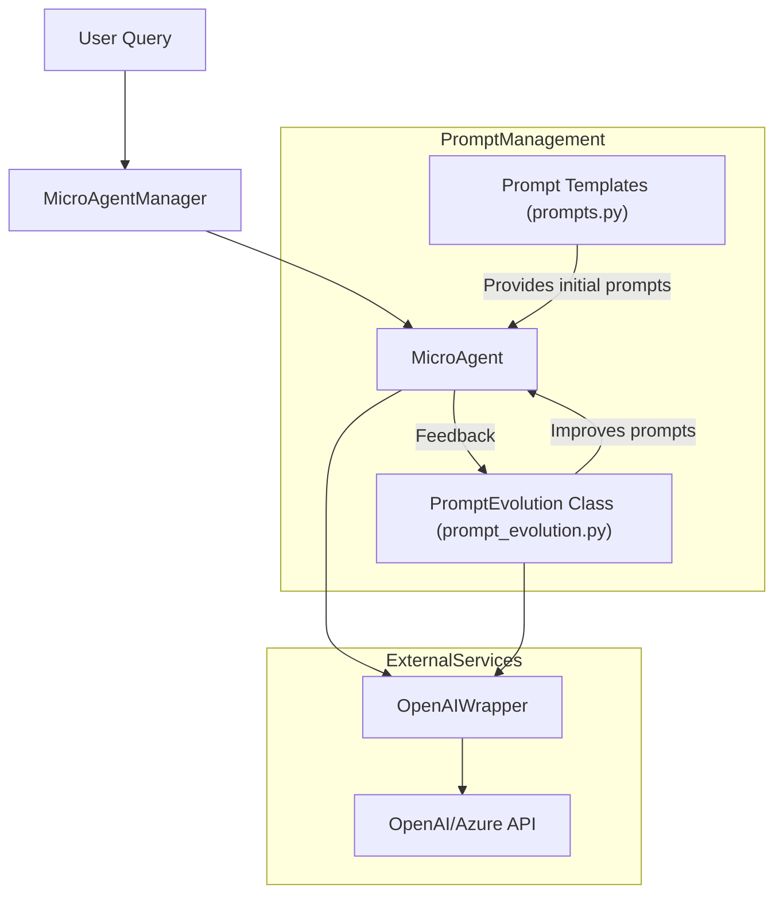
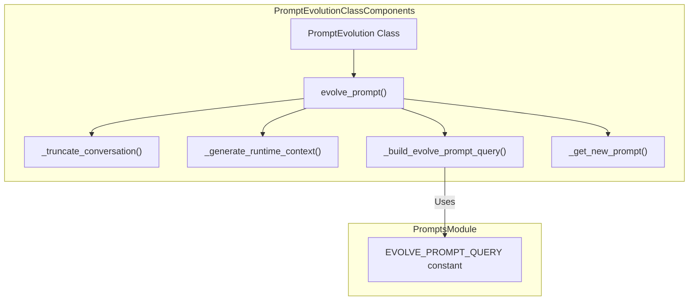
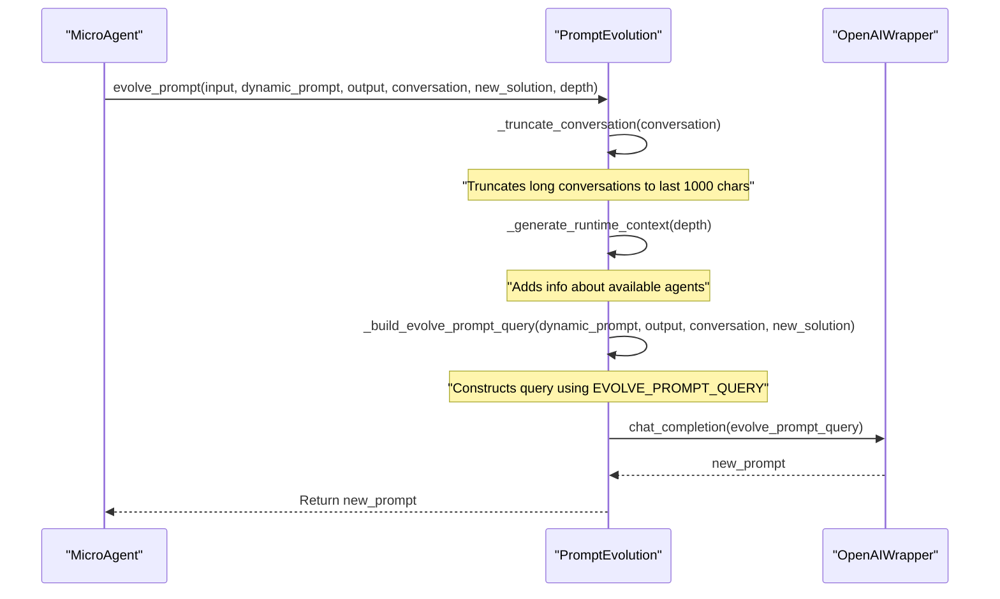
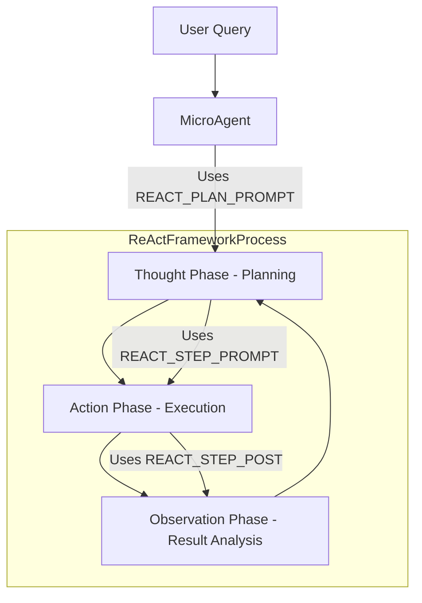

<!-- source: DeepWiki mcp.deepwiki.com · repo aymenfurter/microagents · page 4 Prompt Management System · fetched 2026-10-26 -->

# Prompt Management System

Relevant source files

The following files were used as context for generating this wiki page:

- [prompt_management/prompt_evolution.py](prompt_management/prompt_evolution.py)
- [prompt_management/prompts.py](prompt_management/prompts.py)
- [tests/test_agent_similarity.py](tests/test_agent_similarity.py)

## Introduction

The Prompt Management System is responsible for defining, managing, and evolving the prompts used by microagents in the system. It provides a structured framework for creating effective prompts, improving them based on performance feedback, and implementing the ReAct (Reasoning and Acting) pattern for agent interactions. The system ensures consistent agent behavior while allowing for optimization over time.

For information about agent evaluation metrics that use these prompts, see [Agent Evaluation and Evolution](#3.3).

## System Architecture

The Prompt Management System consists of two main components:
1. **Prompt Templates** - A collection of predefined templates in `prompts.py`
2. **Prompt Evolution** - A mechanism to improve prompts based on feedback (`PromptEvolution` class)

### Prompt Management Architecture

Sources: [prompt_management/prompts.py:1-225](), [prompt_management/prompt_evolution.py:1-62]()

## Prompt Templates

The system uses various prompt templates to structure agent interactions. These templates are defined in `prompts.py` and are organized into several categories:

### Common Prompt Parts

These form the foundation for most agent prompts:

| Template Name | Purpose | Line Numbers |
|---------------|---------|-------------|
| `COMMON_PROMPT_PART` | Base structure for agent communication using "packages" | 49-53 |
| `TIME_DATE_PART` | Provides current time and date information | 55-58 |
| `AGENT_PART` | Instructions for agent invocation and hierarchy rules | 61-83 |
| `STATIC_PRE_PROMPT` | Combines common parts for regular agents | 90-96 |
| `STATIC_PRE_PROMPT_PRIME` | Combines common parts for the prime agent | 86-87 |

Sources: [prompt_management/prompts.py:49-96]()

### ReAct Framework Templates

Templates implementing the ReAct framework for structured reasoning:

| Template Name | Purpose | Line Numbers |
|---------------|---------|-------------|
| `REACT_STEP_PROMPT` | Main prompt for decomposing tasks and reasoning | 41-42 |
| `REACT_STEP_POST` | Format for specifying actions after reasoning | 43 |
| `REACT_STEP_PROMPT_PRIME` | Special version for the prime agent | 44 |
| `REACT_STEP_POST_PRIME` | Special action format for the prime agent | 45 |
| `REACT_PLAN_PROMPT` | Format for planning before task execution | 46 |
| `REACT_PLAN_PROMPT_PRIME` | Special planning format for prime agent | 47 |
| `REACT_SYSTEM_PROMPT` | System prompt for ReAct conversations | 48 |

Sources: [prompt_management/prompts.py:41-48]()

### Evaluation and Engineering Prompts

Templates for evaluating agent performance and engineering new prompts:

| Template Name | Purpose | Line Numbers |
|---------------|---------|-------------|
| `AGENT_EVALUATION_PROMPT` | Evaluates agent responses on a 1-5 scale | 98-138 |
| `AGENT_NAME_EVALUATION_PROMPT` | Evaluates agent names for specificity | 140-171 |
| `GOAL_REACHED_PROMPT_TEMPLATE` | Determines if a goal was achieved | 31-34 |
| `PROMPT_ENGINEERING_TEMPLATE` | Creates detailed prompts for specific goals | 14-22 |
| `PROMPT_ENGINEERING_SYSTEM_PROMPT` | System prompt for prompt engineering | 36 |
| `EVOLVE_PROMPT_QUERY` | Template for evolving prompts based on feedback | 173-225 |

Sources: [prompt_management/prompts.py:14-36](), [prompt_management/prompts.py:98-225]()

### Additional Templates

Other utility templates:

| Template Name | Purpose | Line Numbers |
|---------------|---------|-------------|
| `STANDARD_SYSTEM_PROMPT` | Simple helpful assistant prompt | 24 |
| `EXTRACTION_PROMPT_TEMPLATE` | Extracts responses to specific questions | 26-29 |
| `EXAMPLES` | Example goals and corresponding prompts | 5-12 |
| `PRIME_PROMPT` | Special constraint for the prime agent | 38 |
| `PRIME_NAME` | Name of the prime/bootstrap agent | 39 |

Sources: [prompt_management/prompts.py:5-39]()

## Prompt Evolution

The `PromptEvolution` class in `prompt_evolution.py` provides mechanisms to improve prompts based on feedback. It analyzes agent performance and adapts prompts to be more effective.

### Prompt Evolution Components

Sources: [prompt_management/prompt_evolution.py:7-62]()

### Evolution Process Flow

Sources: [prompt_management/prompt_evolution.py:13-62]()

The evolution process includes these key steps:

1. **Input Collection**: The `evolve_prompt` method receives the current prompt, input/output text, conversation history, and agent depth.
2. **Conversation Truncation**: Long conversations are truncated to fit within token limits [prompt_management/prompt_evolution.py:40-44]()
3. **Runtime Context Generation**: Information about available agents is incorporated [prompt_management/prompt_evolution.py:46-50]()
4. **Evolution Query Construction**: A query is built using the `EVOLVE_PROMPT_QUERY` template [prompt_management/prompt_evolution.py:52-56]()
5. **New Prompt Generation**: The OpenAI API generates an improved prompt based on the query [prompt_management/prompt_evolution.py:58-62]()

## ReAct Framework Integration

The Prompt Management System incorporates the ReAct (Reasoning and Acting) framework, which provides a structured approach to agent reasoning and action.

### ReAct Framework Flow

Sources: [prompt_management/prompts.py:41-48]()

The ReAct framework includes:

1. **Thought Phase**: Agents plan their approach using the `REACT_PLAN_PROMPT` template
2. **Action Phase**: Agents determine actions (code execution or delegation) using `REACT_STEP_PROMPT`
3. **Observation Phase**: Agents observe and analyze results using the `REACT_STEP_POST` format

The system provides special versions of these prompts for the prime (Bootstrap) agent, which has unique constraints on its capabilities (primarily restricted to delegation only).

This structured reasoning pattern enables agents to break down complex tasks into manageable steps, delegate appropriately, and iteratively solve problems through a think-act-observe cycle.

Sources: [prompt_management/prompts.py:41-47](), [prompt_management/prompts.py:86-96]()

---

