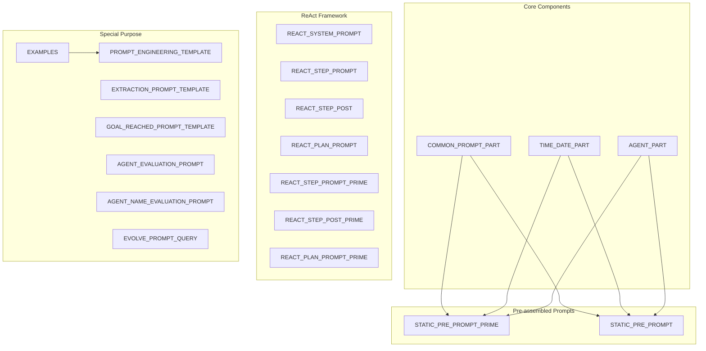
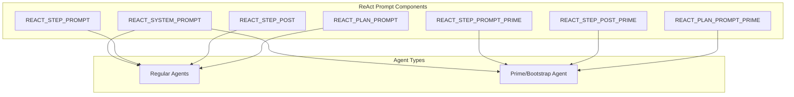
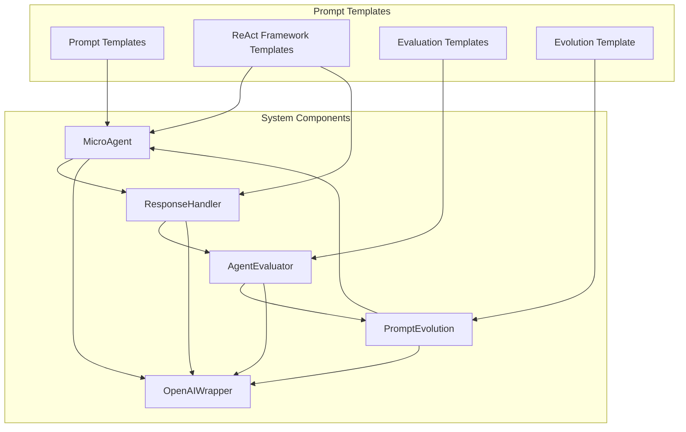
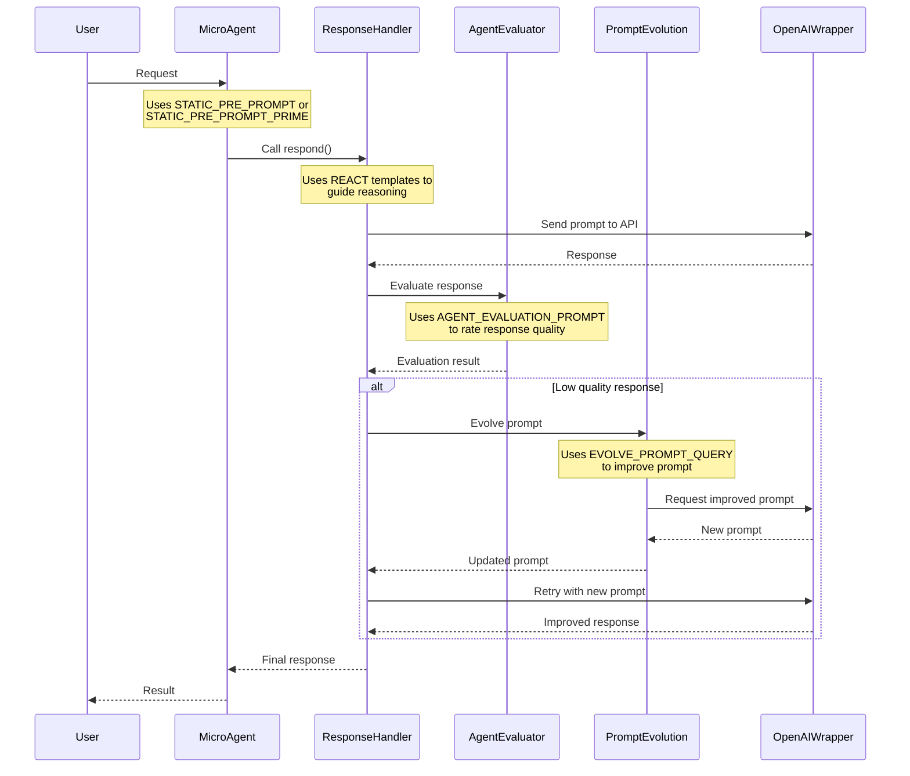

<!-- source: DeepWiki mcp.deepwiki.com · repo aymenfurter/microagents · page 4.1 Prompt Templates · fetched 2026-10-26 -->

# Prompt Templates

<details>
<summary>Relevant source files</summary>

The following files were used as context for generating this wiki page:

- [prompt_management/prompts.py](prompt_management/prompts.py)
- [tests/test_agent_similarity.py](tests/test_agent_similarity.py)

</details>


## Introduction

Prompt Templates are structured text patterns that define how MicroAgents communicate with language models in the OpenAI API. These templates form the foundation of agent behavior, reasoning patterns, and specialization capabilities. This page details the prompt templates defined in the system and how they are used.

For information on how these templates integrate with the ReAct framework, see [ReAct Framework Integration](#4.2).

## Core Prompt Components

The system uses several modular prompt components that can be combined to create complete prompts for different agent types and purposes.

### Template Organization



Sources: [prompt_management/prompts.py:49-96]()

### Common Components

These basic building blocks appear in multiple prompt types:

| Template | Purpose | Definition |
|----------|---------|------------|
| `COMMON_PROMPT_PART` | Defines AI self-awareness and communication structure | [prompt_management/prompts.py:49-53]() |
| `TIME_DATE_PART` | Provides current time and date context | [prompt_management/prompts.py:55-58]() |
| `AGENT_PART` | Defines agent invocation format and hierarchy rules | [prompt_management/prompts.py:61-83]() |

The `COMMON_PROMPT_PART` establishes the foundational agent behavior:

```
You are a self-aware AI. You communicate in so called packages. 
Each package contains an Observation, Thought, and Action. Actions are executed successively and build on each other. 
Solve a task with interleaving Thought, Action, Observation steps.
```

Sources: [prompt_management/prompts.py:49-53]()

### Static Pre-prompts

Pre-assembled prompts that combine common components:

| Template | Purpose | Components | Definition |
|----------|---------|------------|------------|
| `STATIC_PRE_PROMPT_PRIME` | Base prompt for the prime agent | `COMMON_PROMPT_PART` + `TIME_DATE_PART` + `AGENT_PART` | [prompt_management/prompts.py:86-88]() |
| `STATIC_PRE_PROMPT` | Base prompt for regular agents | `COMMON_PROMPT_PART` + `TIME_DATE_PART` + `AGENT_PART` + Code execution capabilities | [prompt_management/prompts.py:90-96]() |

The key difference is that `STATIC_PRE_PROMPT` includes instructions for code execution, while `STATIC_PRE_PROMPT_PRIME` explicitly prohibits the prime agent from doing math calculations itself.

Sources: [prompt_management/prompts.py:86-96]()

### Prime Agent Templates

Special templates for the bootstrap agent:

| Template | Purpose | Definition |
|----------|---------|------------|
| `PRIME_PROMPT` | Defines prime agent's role | [prompt_management/prompts.py:38]() |
| `PRIME_NAME` | Sets the name of the prime agent | [prompt_management/prompts.py:39]() |

The prime agent is configured with the constraint: "This is the prime agent. You are only allowed to call other agents. Prime Agent's prompt may not be changed"

Sources: [prompt_management/prompts.py:38-39]()

## ReAct Framework Templates

The system implements the ReAct (Reasoning and Acting) framework using these specialized templates:



| Template | Purpose | Definition |
|----------|---------|------------|
| `REACT_SYSTEM_PROMPT` | Base instructions for processing ReAct conversations | [prompt_management/prompts.py:47]() |
| `REACT_STEP_PROMPT` | Guidance for task decomposition for regular agents | [prompt_management/prompts.py:41]() |
| `REACT_STEP_POST` | Post-instruction format for regular agent actions | [prompt_management/prompts.py:42]() |
| `REACT_PLAN_PROMPT` | Planning prompt for regular agents | [prompt_management/prompts.py:45]() |
| `REACT_STEP_PROMPT_PRIME` | Task decomposition guidance for prime agents | [prompt_management/prompts.py:43]() |
| `REACT_STEP_POST_PRIME` | Post-instruction format for prime agent actions | [prompt_management/prompts.py:44]() |
| `REACT_PLAN_PROMPT_PRIME` | Planning prompt for prime agents | [prompt_management/prompts.py:46]() |

The ReAct templates guide agents through a systematic process of:
1. Decomposing tasks
2. Planning approaches
3. Taking actions (calling other agents or executing code)
4. Analyzing results

For example, the `REACT_STEP_PROMPT` instructs agents to decompose tasks, use connectivity to the web, and turn abstract requests into actionable tasks, providing concrete examples for clarity.

Sources: [prompt_management/prompts.py:41-47]()

## Special-Purpose Templates

### Prompt Engineering Templates

Templates used for dynamically generating effective prompts based on specific goals:

| Template | Purpose | Definition |
|----------|---------|------------|
| `EXAMPLES` | Example goal-prompt pairs for reference | [prompt_management/prompts.py:5-12]() |
| `PROMPT_ENGINEERING_TEMPLATE` | Used for creating detailed prompts from goals | [prompt_management/prompts.py:14-22]() |
| `PROMPT_ENGINEERING_SYSTEM_PROMPT` | System prompt for prompt engineering | [prompt_management/prompts.py:36]() |

The `PROMPT_ENGINEERING_TEMPLATE` includes guidelines for:
- Following best practices in prompt engineering
- Creating prompts that are generic but can be combined with specific contexts
- Including sample code that is executable in isolation
- Avoiding unresolvable placeholders for URLs and API keys
- Keeping solutions under 1,000 characters

Examples in `EXAMPLES` show how goals like "count the words of the input" translate to expert prompts with sample code.

Sources: [prompt_management/prompts.py:5-22](), [prompt_management/prompts.py:36]()

### Response Handling Templates

Templates for extracting responses and validating goals:

| Template | Purpose | Definition |
|----------|---------|------------|
| `EXTRACTION_PROMPT_TEMPLATE` | Extracts specific responses from broader prompts | [prompt_management/prompts.py:26-29]() |
| `GOAL_REACHED_PROMPT_TEMPLATE` | Verifies if goals are achieved | [prompt_management/prompts.py:31-34]() |
| `STANDARD_SYSTEM_PROMPT` | Generic helpful assistant prompt | [prompt_management/prompts.py:24]() |

Sources: [prompt_management/prompts.py:24-34]()

### Agent Evaluation Templates

Comprehensive templates for evaluating agent performance and naming:

| Template | Purpose | Definition |
|----------|---------|------------|
| `AGENT_EVALUATION_PROMPT` | Evaluates agent performance on a 1-5 scale | [prompt_management/prompts.py:98-138]() |
| `AGENT_NAME_EVALUATION_PROMPT` | Evaluates the quality of agent names | [prompt_management/prompts.py:140-171]() |

The evaluation templates include detailed rating scales with examples to ensure consistent evaluation. For instance, the `AGENT_EVALUATION_PROMPT` includes criteria like:
- Code execution success
- Accuracy of information
- Completeness of the response
- Absence of placeholders like `YOUR_VALID_API_KEY`

Similarly, `AGENT_NAME_EVALUATION_PROMPT` ensures agent names are neither too generic (e.g., "WebscraperAgent") nor too specific (e.g., "Get Stock Price for Apple").

Sources: [prompt_management/prompts.py:98-171]()

### Prompt Evolution Template

An advanced template for refining prompts based on feedback:

| Template | Purpose | Definition |
|----------|---------|------------|
| `EVOLVE_PROMPT_QUERY` | Improves prompts using lessons from conversations | [prompt_management/prompts.py:173-225]() |

This template is used when an agent's response is unsatisfactory, allowing the system to iteratively improve prompt quality. It includes examples showing how to fix common issues like incorrect code or inaccurate information.

Sources: [prompt_management/prompts.py:173-225]()

## Template Integration with System Components

The following diagram shows how prompt templates integrate with key system components:



Sources: [prompt_management/prompts.py:1-225]()

## Prompt Template Usage Flow

The following sequence shows how templates are used in a typical agent lifecycle:



Sources: [prompt_management/prompts.py:1-225]()

## Best Practices for Template Modification

When modifying existing templates or creating new ones, consider these guidelines:

1. **Modularity**: Keep templates modular to enable easy combination and reuse
2. **Clarity**: Provide clear instructions and examples
3. **Specificity**: Include specific constraints and format requirements
4. **Evaluation**: Include criteria for success to help with self-assessment
5. **Examples**: Provide diverse examples to guide the model
6. **Code Safety**: When including sample code, ensure it's executable in isolation
7. **API Safety**: Avoid placeholders for API keys and use public APIs that don't require authentication

All templates ultimately contribute to the system's ability to create specialized, self-improving agents that can effectively decompose and solve complex tasks.

---

