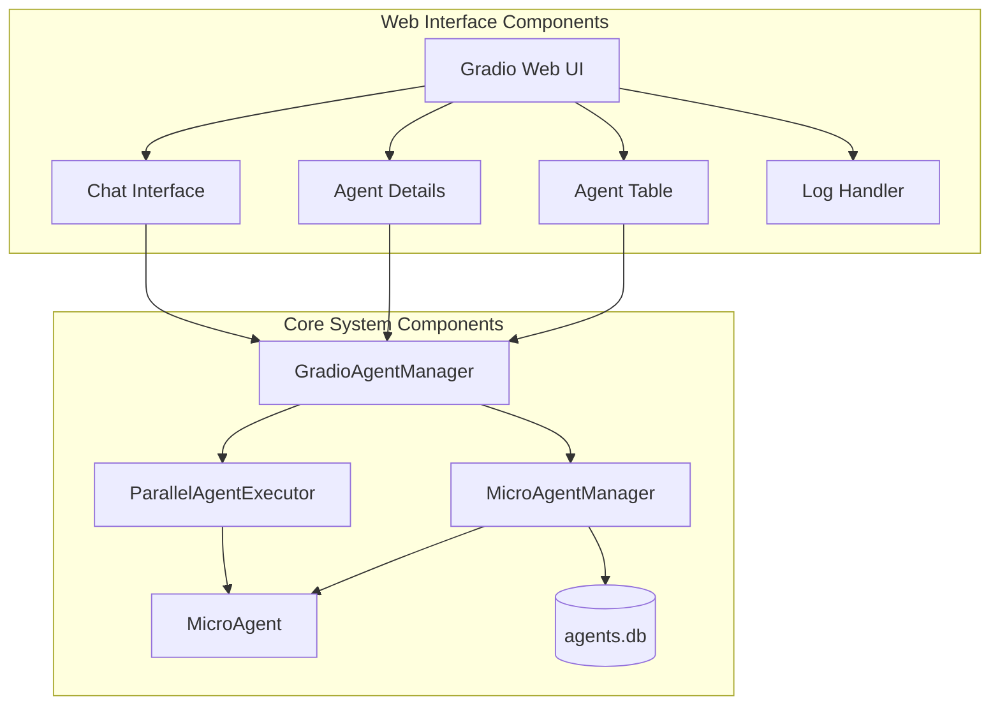
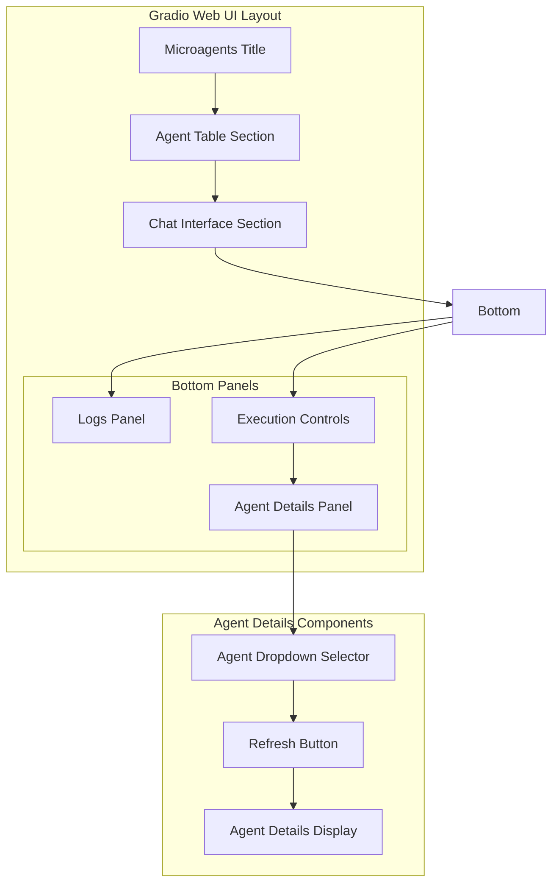
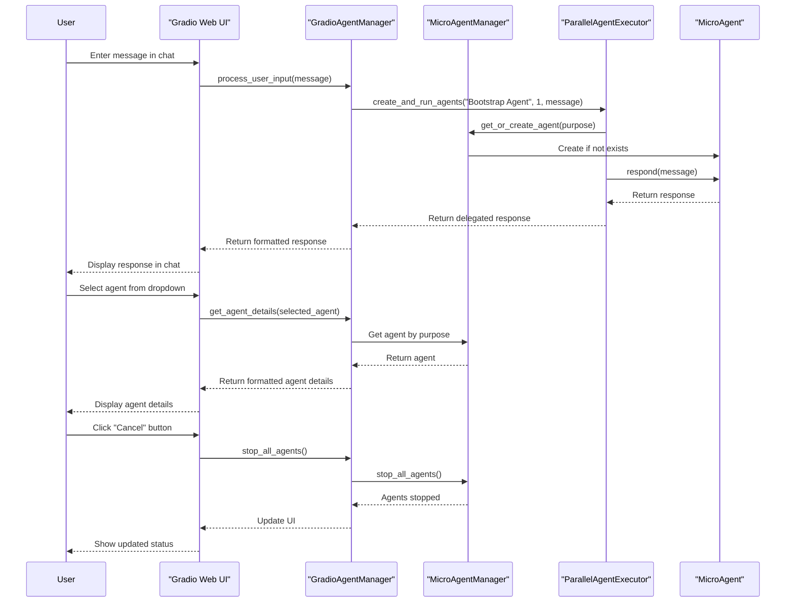

<!-- source: DeepWiki mcp.deepwiki.com · repo aymenfurter/microagents · page 6.1 Gradio Web Interface · fetched 2026-10-26 -->

# Gradio Web Interface

<details>
<summary>Relevant source files</summary>

The following files were used as context for generating this wiki page:

- [app.py](app.py)
- [gradio_ui/__init__.py](gradio_ui/__init__.py)
- [gradio_ui/agent_manager.py](gradio_ui/agent_manager.py)
- [gradio_ui/layout.py](gradio_ui/layout.py)
- [gradio_ui/log_handler.py](gradio_ui/log_handler.py)
- [gradio_ui/style.css](gradio_ui/style.css)
- [gradio_ui/utils.py](gradio_ui/utils.py)

</details>


This document describes the Gradio-based web interface for the microagents system. The interface provides an interactive way to interact with microagents, view their status, examine their properties, and monitor system logs. For information about the command-line interface, see [CLI Interface](#6.2).

## Overview

The microagents Gradio web interface offers a graphical user environment to interact with the agent system through a web browser. It provides a chat interface for inputting user queries, displays information about available agents, shows detailed agent properties, and provides real-time monitoring of system logs and agent execution.



Sources: [gradio_ui/layout.py:9-74](), [gradio_ui/agent_manager.py:12-134](), [app.py:1-9]()

## Architecture

The Gradio web interface is built using the Gradio library and serves as a wrapper around the core microagents system. It consists of multiple components that provide different functionalities:

```mermaid
classDiagram
    class create_layout {
        +create_layout() layout
    }
    
    class GradioAgentManager {
        -MicroAgentManager manager
        +stop_all_agents()
        +get_agents_info_flat() List[dict]
        +get_agents_info() List[dict]
        +sort_agents(agents) List[MicroAgent]
        +format_agent_info(agent, all_agents, format) dict
        +format_agent_info_details(agent) dict
        +get_agent_details(purpose) dict
        +process_user_input(user_input) str
        +update_agent_status(purpose, new_status)
    }
    
    class AgentTable {
        -GradioAgentManager agent_manager
        +display() gr.DataFrame
        +refresh() List[List]
    }
    
    class AgentDetails {
        -GradioAgentManager agent_manager
        +display(selected_agent) gr.Markdown
    }
    
    class ChatInterface {
        -GradioAgentManager agent_manager
        +display() gr.Chatbot
        +process_chat_input(message, history) Tuple
    }
    
    class ListLogHandler {
        -List log_messages
        +emit(record)
        +get_logs() List
        +clear_logs()
    }
    
    create_layout --> GradioAgentManager : creates
    create_layout --> AgentTable : creates
    create_layout --> AgentDetails : creates
    create_layout --> ChatInterface : creates
    create_layout --> ListLogHandler : creates
    
    GradioAgentManager --> "MicroAgentManager" : wraps
    AgentTable --> GradioAgentManager : uses
    AgentDetails --> GradioAgentManager : uses
    ChatInterface --> GradioAgentManager : uses
```

Sources: [gradio_ui/layout.py:9-74](), [gradio_ui/agent_manager.py:12-134](), [gradio_ui/log_handler.py:3-16]()

## UI Components

The Gradio web interface consists of several main UI components:

### 1. Agent Table

Displays a list of all available agents with their key properties, including:
- Agent name (with hierarchical structure)
- Status
- Depth in the agent hierarchy
- Evolve count
- Number of code executions
- Last input
- Working status

The agent table is automatically refreshed every second to show the latest agent information.

### 2. Chat Interface

Provides a conversational interface for interacting with the microagents system. User messages are processed through the Bootstrap Agent and responses are displayed in a chat-like format.

### 3. Logs Display

Shows real-time system logs, providing visibility into the operations of the agent system. Logs are automatically refreshed every second.

### 4. Current Execution Controls

Includes a Cancel button to stop all running agents, allowing users to terminate agent execution if needed.

### 5. Agent Details Panel

Displays detailed information about a selected agent, including:
- Purpose
- System prompt
- Last input
- Last output
- Last conversation

The panel includes a dropdown to select an agent and a refresh button to update the agent list.



Sources: [gradio_ui/layout.py:40-69]()

## Interaction Flow

The following sequence diagram illustrates the typical flow of interactions between a user and the microagents system through the Gradio web interface:



Sources: [gradio_ui/layout.py:25-72](), [gradio_ui/agent_manager.py:115-125]()

## Implementation Details

### GradioAgentManager

The `GradioAgentManager` class serves as a bridge between the Gradio UI and the core microagents system. It provides methods to:

1. Retrieve and format agent information
2. Process user input through agents
3. Update agent status
4. Stop all running agents

Key methods include:
- `process_user_input()`: Processes user queries through the Bootstrap Agent
- `get_agents_info()`: Retrieves and formats information about all agents
- `get_agent_details()`: Gets detailed information about a specific agent
- `stop_all_agents()`: Terminates all running agents

Sources: [gradio_ui/agent_manager.py:12-134]()

### Layout Creation

The `create_layout()` function in `layout.py` constructs the Gradio UI by:

1. Initializing a `GradioAgentManager` instance
2. Creating UI components (AgentTable, AgentDetails, ChatInterface)
3. Setting up a log handler for displaying system logs
4. Defining the layout structure using Gradio's Blocks interface
5. Configuring refresh mechanisms for dynamic content updates

Sources: [gradio_ui/layout.py:9-74]()

### Log Handling

The `ListLogHandler` class extends Python's logging.Handler to collect log messages in memory for display in the Gradio interface. It maintains a list of log messages and provides methods to:
- Add new log messages (`emit()`)
- Retrieve all log messages (`get_logs()`)
- Clear log messages (`clear_logs()`)

Sources: [gradio_ui/log_handler.py:3-16]()

## Usage

The Gradio web interface is launched by running the main application:

```python
python app.py
```

This initializes the Gradio interface and makes it available in a web browser, typically at http://localhost:7860.

The interface provides the following functionality:

1. **Chat with Agents**: Enter messages in the chat interface to interact with the agent system.
2. **View Agent Information**: See all available agents and their status in the agent table.
3. **Examine Agent Details**: Select an agent from the dropdown to view its detailed properties.
4. **Monitor System Logs**: View real-time system logs in the logs panel.
5. **Control Execution**: Use the Cancel button to stop all running agents.

Sources: [app.py:1-9]()

## UI Styling

The interface uses custom CSS styling defined in `style.css` to enhance the visual appearance of the UI components. The styling includes:
- General font and layout settings
- Custom styles for the agent table, logs display, and agent details
- Responsive design adjustments for different screen sizes

Sources: [gradio_ui/style.css:1-69]()

## Integration with Core System

The Gradio web interface integrates with the core microagents system through the `GradioAgentManager` class, which wraps the `MicroAgentManager`. This integration enables:

1. Creation and management of microagents
2. Processing of user input through agents
3. Retrieval of agent information and status
4. Persistence and retrieval of agents from the database

The interface provides a user-friendly way to interact with the underlying agent system without requiring knowledge of the internal implementation details.

Sources: [gradio_ui/agent_manager.py:12-19](), [gradio_ui/layout.py:9-12]()

---

