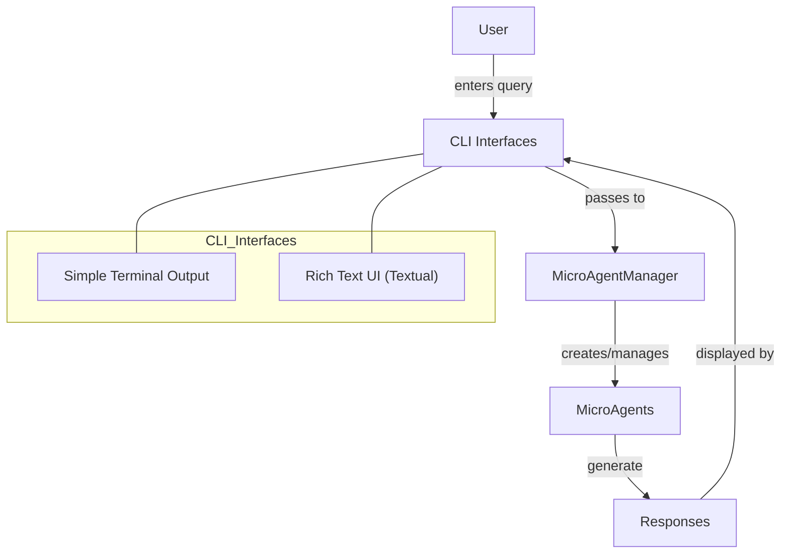
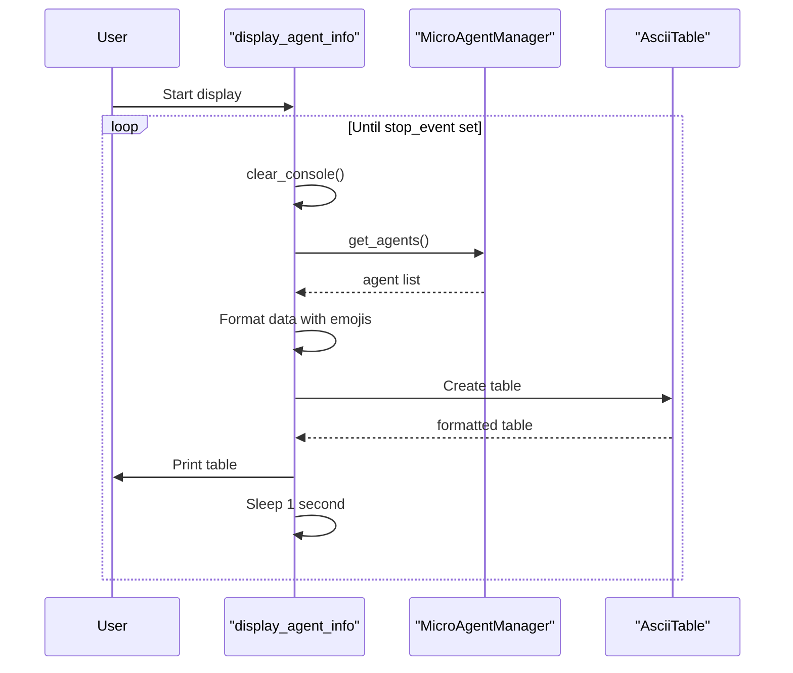
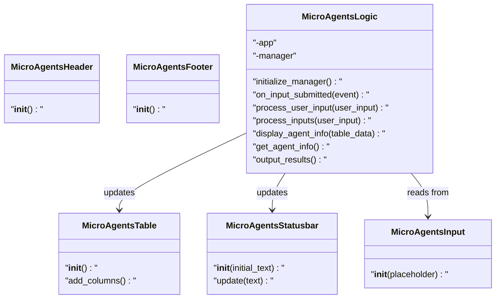
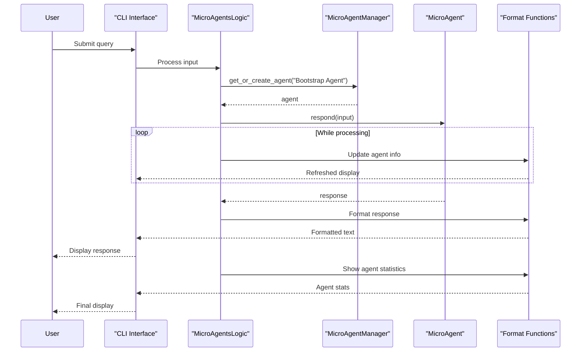

<!-- source: DeepWiki mcp.deepwiki.com · repo aymenfurter/microagents · page 6.2 CLI Interface · fetched 2026-10-26 -->

# CLI Interface

<details>
<summary>Relevant source files</summary>

The following files were used as context for generating this wiki page:

- [.devcontainer/devcontainer.json](.devcontainer/devcontainer.json)
- [agents/response_handler.py](agents/response_handler.py)
- [tests/test_agent_lifecycle.py](tests/test_agent_lifecycle.py)
- [tests/test_microagent_manager.py](tests/test_microagent_manager.py)
- [ui/components.py](ui/components.py)
- [ui/constants.py](ui/constants.py)
- [ui/format.py](ui/format.py)
- [ui/logging.py](ui/logging.py)
- [ui/logic.py](ui/logic.py)
- [ui/text_handler.py](ui/text_handler.py)

</details>


The CLI Interface provides command-line tools for interacting with the MicroAgents system, allowing users to submit tasks, monitor agent activities in real-time, and receive formatted responses. This terminal-based interface offers an alternative to the graphical interface described in the [Gradio Web Interface](#6.1) page.

## Overview of CLI Components

The MicroAgents system implements two distinct command-line interface approaches:

1. **Simple Terminal Output** - A lightweight interface using ASCII tables and colored text
2. **Rich Text-based UI** - An interactive interface built with the Textual library

Both interfaces connect to the central `MicroAgentManager` component, enabling real-time monitoring of agent activities while processing tasks.



Sources:
- [ui/format.py:11-67]()
- [ui/logic.py:9-38]()

## Simple Terminal Interface

The simple terminal interface provides a straightforward way to monitor agent activities and view responses using standard terminal output with formatted tables and colored text.

### Agent Status Display

The terminal interface shows comprehensive agent information in real-time using ASCII tables:



This function continuously updates the terminal with the latest agent information, displayed in a structured table with columns marked by emojis:

| Column | Emoji | Description |
|--------|-------|-------------|
| Agent purpose | 👤 | The agent's name or primary function |
| Evolve count | 🔁 | Number of prompt evolutions |
| Code executions | 💻 | Number of code executions |
| Usage count | 📈 | Number of times the agent was used |
| Depth | 🌟 | Agent's depth in the hierarchy |
| Working status | 💡 | Whether the agent is working (✅ or ❌) |
| Last input | 💬 | The most recent input to the agent |
| Current status | 🚦 | Agent's current operational status |

The display includes an animated indicator (moon phases: 🌑, 🌒, 🌓, etc.) to show that the system is running.

Sources:
- [ui/format.py:11-55]()

### Response Formatting

The simple terminal interface formats responses with color coding to distinguish questions from answers:

```
🔍 Question 1: What is the purpose of microagents?
💡 Response: Microagents are small, specialized AI agents that can...
```

Questions are highlighted in yellow and responses in green using the Colorama library.

Sources:
- [ui/format.py:89-94]()

### Agent Statistics Output

After task processing completes, detailed statistics are displayed for each agent:

```
📊 Stats for Bootstrap Agent:
🔁 Evolve Count: 2
💻 Code Executions: 5
👥 Active Agents: {"SubAgent1": "Helper"}
📈 Usage Count: 3
🏔️ Max Depth: 3
🌟 Depth: 1
🛠️ Working Agent: True
📝 Last Input: What is the purpose of microagents?
🚦 Status: Sleeping
Prompt for Bootstrap Agent:
[Agent prompt text...]
```

This comprehensive output provides insights into each agent's operation, including its current state, evolution history, and the full prompt being used.

Sources:
- [ui/format.py:57-86]()

## Rich Text UI (Textual)

The more advanced CLI interface uses the Textual library to create an interactive text-based UI with components like tables, input fields, and status bars.

### Component Architecture



Sources:
- [ui/components.py:1-33]()
- [ui/logic.py:9-106]()

### UI Layout and Styling

The rich text UI defines its layout using CSS-like styling:

```
+------------------------------------------+
| MicroAgents                              | <- Header
+------------------------------------------+
|                                          |
| +--------------------------------------+ |
| |              Agent Table             | | <- DataTable showing agent status
| | Agent | Status | Depth | Working |...| |
| +--------------------------------------+ |
|                                          |
| +--------------------------------------+ |
| |           Response Output            | | <- Log panel showing responses
| +--------------------------------------+ |
|                                          |
| Enter question here: __________________ | <- Input field
+------------------------------------------+
| Status: Processing...                    | <- Status bar
+------------------------------------------+
| q: quit | d: toggle dark mode            | <- Footer with key bindings
+------------------------------------------+
```

The interface styling is defined using CSS-like syntax in `constants.py`:

Sources:
- [ui/constants.py:5-27]()

### Key Bindings

The rich text UI provides keyboard shortcuts for common operations:

| Key | Action | Description |
|-----|--------|-------------|
| q | quit | Exit the application |
| d | toggle_dark | Switch between light and dark mode |

Sources:
- [ui/constants.py:29-32]()

## Data Processing Flow

The following sequence diagram illustrates how user input is processed through the CLI interface:



Sources:
- [ui/format.py:11-94]()
- [ui/logic.py:24-56]()

## Implementation Details

### Core Functions in Simple Terminal Interface

The simple terminal interface is built around several key functions:

1. `clear_console()` - Clears the terminal screen for fresh output
   ```python
   def clear_console():
       """Clears the console screen."""
       os.system('cls' if os.name == 'nt' else 'clear')
   ```

2. `display_agent_info()` - Continuously displays agent information in a table format
   - Takes a `manager` object to retrieve agent information
   - Uses a `stop_event` to control when to stop updating
   - Formats data into an ASCII table with headers and emoji indicators

3. `print_final_output()` - Displays final results and agent statistics
   - Calls `print_agent_statistics()` for each agent

4. `print_agent_statistics()` - Shows detailed information about a specific agent
   - Displays evolve count, code executions, active agents, etc.
   - Shows the agent's current prompt

5. `format_text()` - Formats questions and responses with color and styling
   - Uses Colorama to add color (yellow for questions, green for responses)

Sources:
- [ui/format.py:7-94]()

### Core Functions in Rich Text UI

The rich text UI is implemented using the `MicroAgentsLogic` class, which contains these key methods:

1. `initialize_manager()` - Sets up the MicroAgentManager
   - Creates an OpenAI API wrapper
   - Initializes the MicroAgentManager with the wrapper
   - Handles any initialization errors

2. `on_input_submitted()` - Processes user input submissions
   - Starts a worker to display agent information
   - Updates the status bar
   - Runs a worker to process the input

3. `process_user_input()` - Gets a response from the agent system
   - Gets or creates a "Bootstrap Agent"
   - Passes the user input to the agent to get a response

4. `get_agent_info()` - Retrieves and formats agent information
   - Gets the list of agents from the manager
   - Formats their information for display in the table
   - Updates the UI with the formatted data

5. `output_results()` - Displays final results and statistics
   - Writes detailed information about each agent to the log panel

Sources:
- [ui/logic.py:9-106]()

## Conclusion

The CLI Interface provides two different ways to interact with the MicroAgents system via the command line:

1. A simple terminal interface with ASCII tables and colored text that focuses on displaying agent information and responses in a clean, formatted way.

2. A rich text-based UI with interactive components that provides a more application-like experience with structured components.

Both interfaces offer comprehensive visibility into agent activities and formatted output of responses, making them valuable tools for interacting with and debugging the MicroAgents system.

The CLI interfaces serve as alternative entry points to the MicroAgents system, complementing the web-based interface detailed in the [Gradio Web Interface](#6.1) page.

Sources:
- [ui/format.py:7-94]()
- [ui/logic.py:9-106]()
- [ui/components.py:1-33]()
- [ui/constants.py:5-32]()

---

