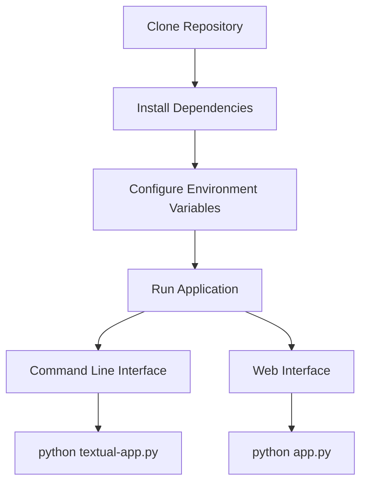
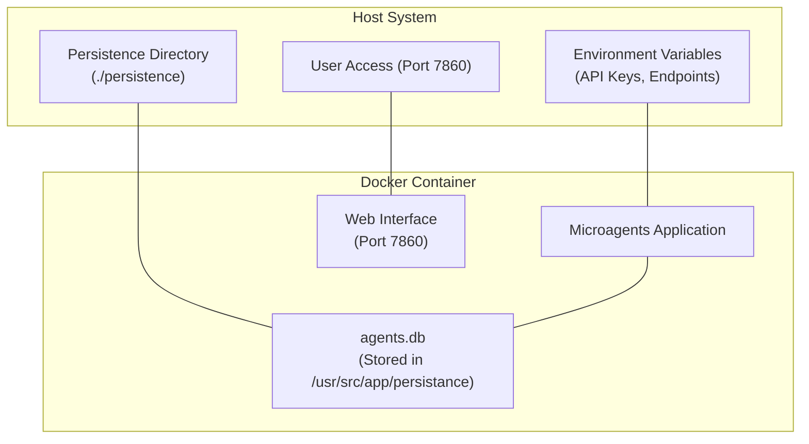
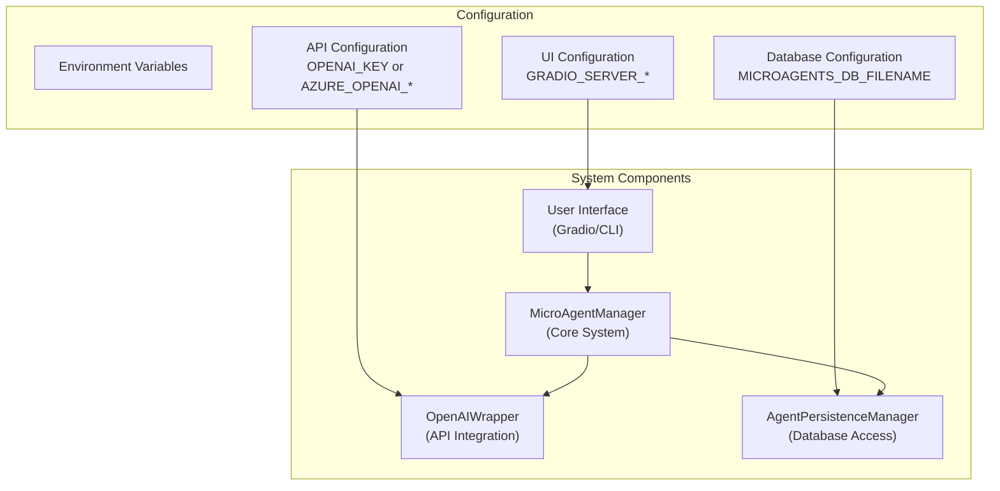

<!-- source: DeepWiki mcp.deepwiki.com · repo aymenfurter/microagents · page 7 Deployment · fetched 2026-10-26 -->

# Deployment

<details>
<summary>Relevant source files</summary>

The following files were used as context for generating this wiki page:

- [Dockerfile](Dockerfile)
- [README-Docker.md](README-Docker.md)
- [README.md](README.md)

</details>


This page provides comprehensive instructions for deploying the Microagents system in various environments. The documentation covers both local deployment and containerized deployment using Docker. For detailed information about configuration options and environment variables, see [Configuration Options](#7.1).

## Local Deployment

### Prerequisites

Before deploying the Microagents system, ensure you have:

1. Python 3 installed
2. An OpenAI account with access to `gpt-4-turbo` and `text-embedding-ada-002`
3. Appropriate API keys for OpenAI or Azure OpenAI

### Installation Steps

To deploy Microagents locally:



1. Clone the repository:
   ```
   git clone https://github.com/aymenfurter/microagents.git
   ```

2. Install required Python packages:
   ```
   pip install -r requirements.txt
   ```

3. Configure environment variables (see Environment Configuration below)

4. Run the application:
   - For web interface: `python app.py`
   - For CLI: `python textual-app.py`

Sources: [README.md:33-85]()

### Environment Configuration

Configure the Microagents system using environment variables:

#### For OpenAI API:
```
export OPENAI_KEY='your_api_key_here'
```

#### For Azure OpenAI with API Key:
```
export AZURE_OPENAI_API_KEY='your_api_key_here'
export AZURE_OPENAI_ENDPOINT='https://my_endpoint_name_here.openai.azure.com/'
# Optional configurations:
# export OPENAI_EMBEDDING=''  # Azure deployment name of your ada embedding
# export OPENAI_MODEL=''      # Azure deployment name of your GPT-4
```

#### For Azure OpenAI with Entra ID (AAD):
```
export AZURE_OPENAI_ENDPOINT='https://my_endpoint_name_here.openai.azure.com/'
export AZURE_OPENAI_USE_AAD='true'  # Enables DefaultAzureCredential
# Optional configurations:
# export AZURE_OPENAI_AD_TOKEN=''    # AAD token
# export AZURE_CLIENT_ID=''          # Client ID of the managed identity
# export OPENAI_EMBEDDING=''         # Azure deployment name of your ada embedding
# export OPENAI_MODEL=''             # Azure deployment name of your GPT-4
```

Sources: [README.md:51-71]()

## Docker Deployment

Docker provides an isolated environment for running Microagents, which is recommended for security reasons.

### Docker Deployment Architecture



### Building the Docker Image

To build the Docker image:

```
docker build -t microagents:latest .
```

Sources: [README-Docker.md:6-8](), [Dockerfile:1-19]()

### Preparing for Container Deployment

Create a persistence directory for storing agent data:

```
mkdir -p persistance
# Optional: Copy existing agents.db to persistence directory
cp agents.db persistance/
```

Sources: [README-Docker.md:14-18]()

### Running the Docker Container

#### With OpenAI API:

```
docker run -it --rm \
    -e OPENAI_KEY='your_api_key_here' \
    -v "$(pwd)/persistance:/usr/src/app/persistance" \
    -p "7860:7860" \
    microagents:latest
```

#### With Azure OpenAI API Key:

```
docker run -it --rm \
    -e AZURE_OPENAI_API_KEY='your_api_key_here' \
    -e AZURE_OPENAI_ENDPOINT='https://my_endpoint_name_here.openai.azure.com/' \
    -e OPENAI_EMBEDDING='text-embedding-ada-002' \
    -e OPENAI_MODEL='gpt-4-1106-preview' \
    -v "$(pwd)/persistance:/usr/src/app/persistance" \
    -p "7860:7860" \
    microagents:latest
```

#### With Azure OpenAI Entra ID (AAD):

```
docker run -it --rm \
    -e AZURE_OPENAI_USE_AAD='true' \
    -e AZURE_OPENAI_AD_TOKEN="$(az account get-access-token --scope "https://cognitiveservices.azure.com/.default" --query 'accessToken' -o tsv)" \
    -e AZURE_OPENAI_ENDPOINT='https://my_endpoint_name_here.openai.azure.com/' \
    -e OPENAI_EMBEDDING='text-embedding-ada-002' \
    -e OPENAI_MODEL='gpt-4-1106-preview' \
    -v "$(pwd)/persistance:/usr/src/app/persistance" \
    -p "7860:7860" \
    microagents:latest
```

Sources: [README-Docker.md:20-50]()

## Environment Variables and Deployment Configuration

The following table summarizes the key environment variables that can be configured during deployment:

| Variable | Description | Default Value | Required |
|----------|-------------|---------------|----------|
| `OPENAI_KEY` | OpenAI API key | None | Yes (if using OpenAI) |
| `AZURE_OPENAI_API_KEY` | Azure OpenAI API key | None | Yes (if using Azure with API key) |
| `AZURE_OPENAI_ENDPOINT` | Azure OpenAI endpoint URL | None | Yes (if using Azure) |
| `AZURE_OPENAI_USE_AAD` | Enable Azure Active Directory authentication | None | No |
| `AZURE_OPENAI_AD_TOKEN` | Azure AD token | None | No |
| `AZURE_CLIENT_ID` | Client ID for managed identity | None | No |
| `OPENAI_EMBEDDING` | Azure deployment name for embeddings | text-embedding-ada-002 | No |
| `OPENAI_MODEL` | Azure deployment name for GPT-4 | gpt-4-1106-preview | No |
| `MICROAGENTS_DB_FILENAME` | Custom path for the agents database file | agents.db | No |
| `GRADIO_SERVER_PORT` | Port for Gradio web interface | 7860 | No |
| `GRADIO_SERVER_NAME` | Host for Gradio web interface | 0.0.0.0 (in Docker) | No |

Sources: [README.md:51-71](), [Dockerfile:14-17]()

## Deployment Flow



## Security Considerations

> [!CAUTION]
> Microagents execute Python code directly and currently do not operate within a sandbox. It's highly recommended to run them in isolated environments such as GitHub Codespaces or Docker to limit potential damage.

The Docker deployment approach is strongly recommended for production environments as it provides isolation for the Python code execution that occurs within the Microagents system.

Sources: [README.md:74-75]()

## Performance and Data Persistence

### Database Storage

The agents database file (`agents.db`) stores all created and validated agents. This file persists across runs, allowing the system to learn and improve over time.

When using Docker, the database is mounted from the host system's `persistance` directory to `/usr/src/app/persistance/agents.db` inside the container, ensuring that agents are preserved even when containers are restarted.

To reset all agents, simply delete the `agents.db` file:
```
rm agents.db  # For local deployment
# or
rm persistance/agents.db  # For Docker deployment
```

Sources: [README.md:87](), [Dockerfile:10-14](), [README-Docker.md:14-18]()

### Cost Considerations

Be mindful that the system makes multiple calls to OpenAI's APIs, which may incur costs based on your usage. The parallel agent creation feature (which creates three agents and keeps the best one) increases API usage but improves system performance.

Sources: [README.md:74-75]()

---

