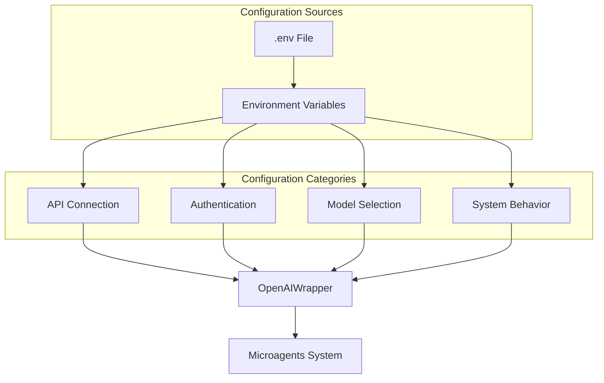
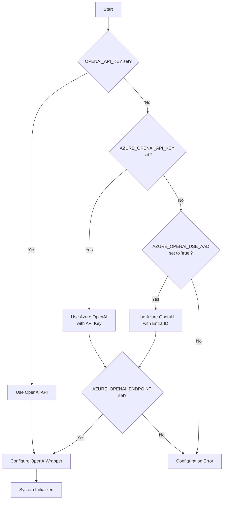
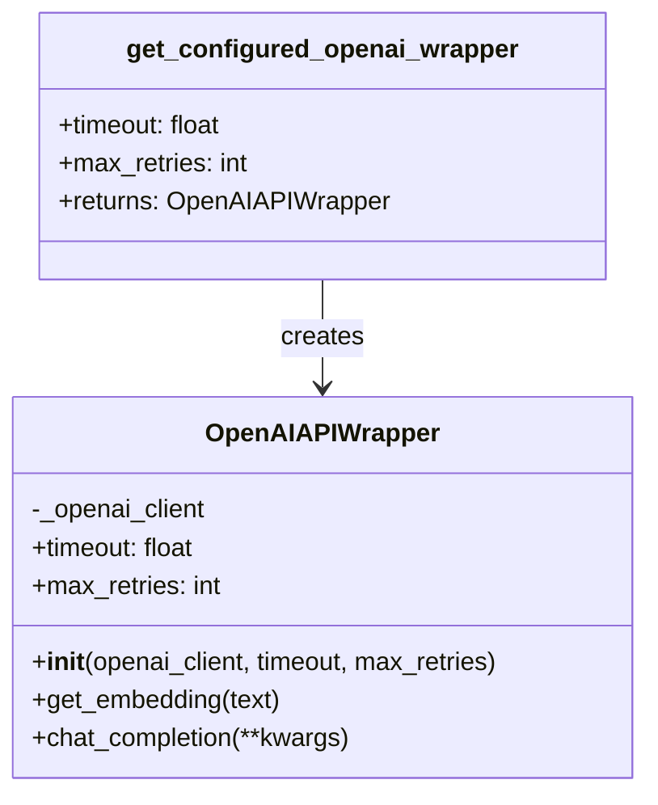

<!-- source: DeepWiki mcp.deepwiki.com · repo aymenfurter/microagents · page 7.1 Configuration Options · fetched 2026-10-26 -->

# Configuration Options

<details>
<summary>Relevant source files</summary>

The following files were used as context for generating this wiki page:

- [.gitignore](.gitignore)
- [README.md](README.md)
- [integrations/openaiwrapper.py](integrations/openaiwrapper.py)

</details>


This document details the environment variables and configuration options available in the Microagents framework. It covers all configuration settings necessary for connecting to OpenAI or Azure OpenAI APIs, setting up authentication, and customizing model behavior.

## Overview

Microagents uses environment variables as its primary configuration method. These variables control:

1. API connectivity (OpenAI or Azure OpenAI)
2. Authentication methods
3. Model selection and parameters
4. Timeout and retry settings



Sources: [integrations/openaiwrapper.py:1-123]()

## API Connection Configuration

The Microagents system supports both OpenAI API and Azure OpenAI API. Configuration options differ slightly depending on which service you're connecting to.

### Configuration Decision Flow



Sources: [integrations/openaiwrapper.py:16-96]()

### OpenAI API Configuration

For standard OpenAI API usage, the following environment variables are available:

| Environment Variable | Required | Default | Description |
|----------------------|----------|---------|-------------|
| `OPENAI_API_KEY` | Yes | None | Your OpenAI API key |
| `OPENAI_BASE_URL` | No | None | Custom base URL for OpenAI API |
| `OPENAI_API_BASE` | No | None | Legacy alias for OPENAI_BASE_URL |
| `OPENAI_ORG_ID` | No | None | Organization ID for OpenAI API |

Sources: [integrations/openaiwrapper.py:23-70](), [README.md:51-55]()

### Azure OpenAI Configuration

For Azure OpenAI API usage, configure the following:

| Environment Variable | Required | Default | Description |
|----------------------|----------|---------|-------------|
| `AZURE_OPENAI_API_KEY` | Yes* | None | Your Azure OpenAI API key |
| `AZURE_OPENAI_ENDPOINT` | Yes | None | Your Azure OpenAI endpoint URL |
| `AZURE_OPENAI_API_VERSION` | No | "2024-03-01-preview" | Azure OpenAI API version |

*Not required if using Azure AD authentication.

Sources: [integrations/openaiwrapper.py:71-96](), [README.md:56-71]()

## Authentication Methods

Microagents supports multiple authentication methods for connecting to AI services.

### API Key Authentication

The simplest authentication method is using API keys:
- For OpenAI: `OPENAI_API_KEY`
- For Azure OpenAI: `AZURE_OPENAI_API_KEY`

### Azure Entra ID (AAD) Authentication

For Azure OpenAI with Entra ID authentication:

| Environment Variable | Required | Default | Description |
|----------------------|----------|---------|-------------|
| `AZURE_OPENAI_USE_AAD` | Yes | "false" | Set to "true" to enable Azure AD auth |
| `AZURE_OPENAI_AD_TOKEN` | No | None | Explicitly provide an Azure AD token |
| `AZURE_CLIENT_ID` | No | None | Client ID for managed identity |

When `AZURE_OPENAI_USE_AAD` is set to "true" and no token is provided, the system uses Azure's `DefaultAzureCredential` to obtain a token automatically.

Sources: [integrations/openaiwrapper.py:32-88](), [README.md:63-71]()

## Model Configuration

Customize model selection and behavior with these options:

| Environment Variable | Required | Default | Description |
|----------------------|----------|---------|-------------|
| `OPENAI_MODEL` | No | "gpt-4-1106-preview" | Model for completions |
| `OPENAI_EMBEDDING` | No | "text-embedding-ada-002" | Model for embeddings |

For Azure deployments, these variables should match your deployment names if they differ from the default model names.

Sources: [integrations/openaiwrapper.py:13-14](), [README.md:60-61](), [README.md:69-70]()

## OpenAIWrapper Configuration

The `OpenAIWrapper` class can be configured with additional parameters:

| Parameter | Default | Description |
|-----------|---------|-------------|
| `timeout` | 10 seconds | Maximum time to wait for API responses |
| `max_retries` | 5 | Number of retries for failed API calls |



Sources: [integrations/openaiwrapper.py:98-198]()

## Database and Persistence Configuration

The Microagents system uses SQLite for persistence. The primary database is `agents.db` for storing created agents. API responses for embeddings are cached in `openai_embedding_cache.db`.

Sources: [.gitignore:51-52](), [integrations/openaiwrapper.py:124]()

## Environment Variable Format Guidelines

- String values: Simple strings with no quotes needed
- Boolean values: Use "true"/"false", "1"/"0", "yes"/"no", or "y"/"n" (case insensitive)
- URLs: Include the full URL with protocol (https://)

Sources: [integrations/openaiwrapper.py:32-38]()

## Configuration Example

Here's a complete example configuration for using Azure OpenAI with API key:

```bash
# Azure OpenAI Configuration
export AZURE_OPENAI_API_KEY='your_api_key_here'
export AZURE_OPENAI_ENDPOINT='https://my_endpoint_name_here.openai.azure.com/'

# Optional model configurations
export OPENAI_EMBEDDING='text-embedding-ada-002'  # Azure deployment name for embeddings
export OPENAI_MODEL='gpt-4-turbo'                # Azure deployment name for completions
```

Sources: [README.md:56-62]()

## Error Handling

The system performs configuration validation during initialization. Common errors include:

1. Missing required environment variables (API keys or endpoints)
2. Conflicting configuration (e.g., setting both OpenAI and Azure OpenAI keys)
3. Authentication errors (invalid credentials)

When errors occur, the system will raise a `ValueError` with details about the misconfiguration.

Sources: [integrations/openaiwrapper.py:48-54](), [integrations/openaiwrapper.py:72-88]()