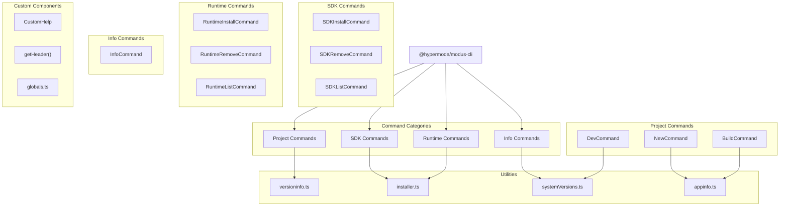
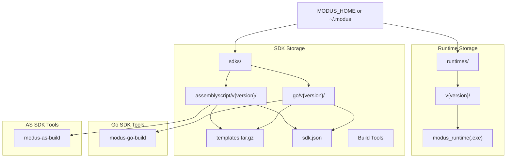
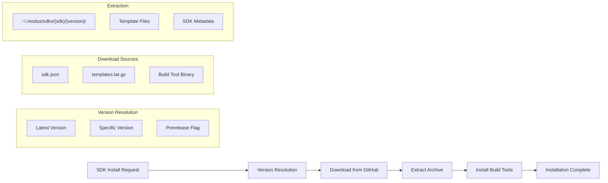
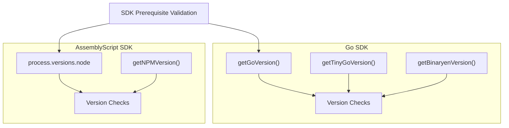
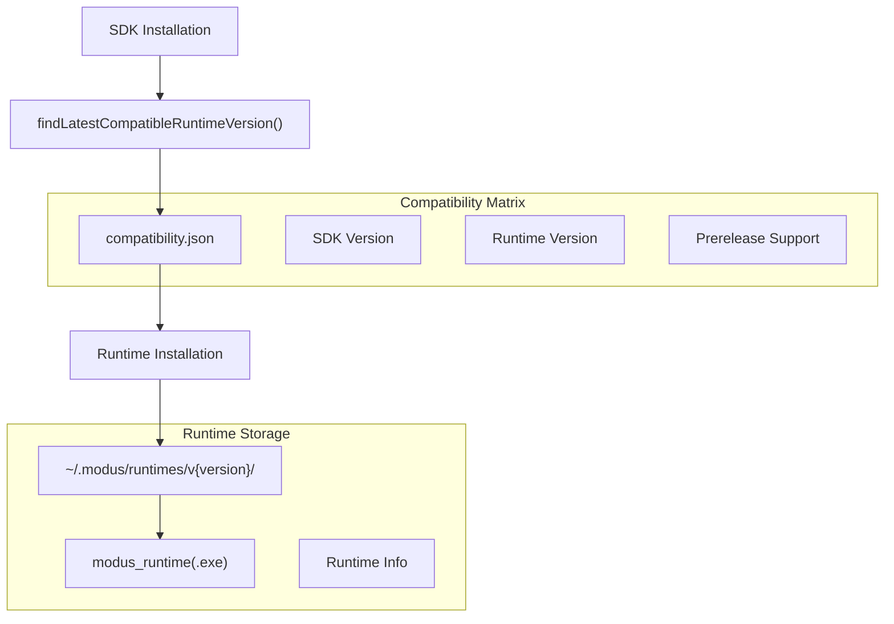
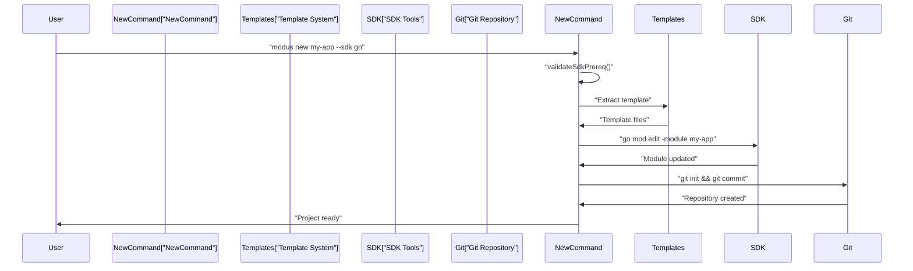
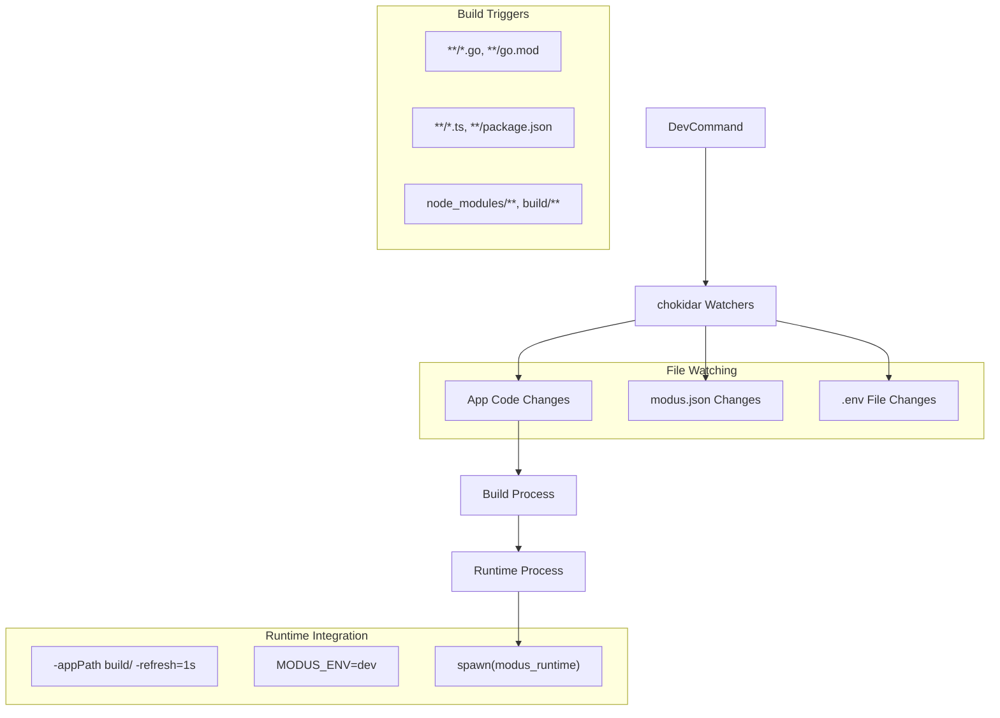
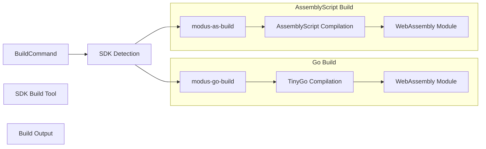
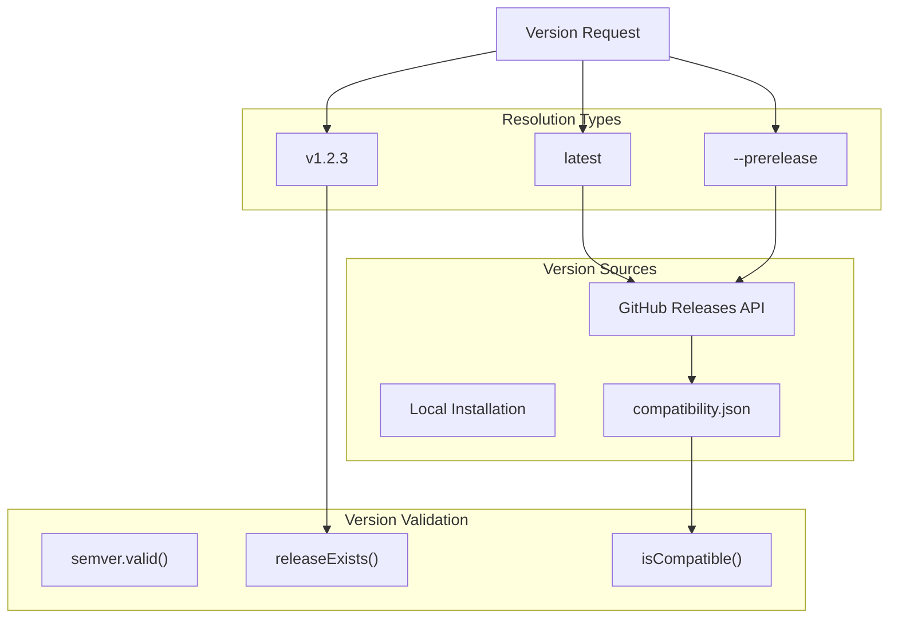

<!-- source: DeepWiki mcp.deepwiki.com · repo hypermodeinc/modus · page 3 Modus CLI · fetched 2026-10-26 -->

# Modus CLI

<details>
<summary>Relevant source files</summary>

The following files were used as context for generating this wiki page:

- [CHANGELOG.md](CHANGELOG.md)
- [cli/package-lock.json](cli/package-lock.json)
- [cli/package.json](cli/package.json)
- [cli/src/commands/build/index.ts](cli/src/commands/build/index.ts)
- [cli/src/commands/dev/index.ts](cli/src/commands/dev/index.ts)
- [cli/src/commands/info/index.ts](cli/src/commands/info/index.ts)
- [cli/src/commands/new/index.ts](cli/src/commands/new/index.ts)
- [cli/src/commands/runtime/install/index.ts](cli/src/commands/runtime/install/index.ts)
- [cli/src/commands/runtime/list/index.ts](cli/src/commands/runtime/list/index.ts)
- [cli/src/commands/runtime/remove/index.ts](cli/src/commands/runtime/remove/index.ts)
- [cli/src/commands/sdk/install/index.ts](cli/src/commands/sdk/install/index.ts)
- [cli/src/commands/sdk/list/index.ts](cli/src/commands/sdk/list/index.ts)
- [cli/src/commands/sdk/remove/index.ts](cli/src/commands/sdk/remove/index.ts)
- [cli/src/custom/help.ts](cli/src/custom/help.ts)
- [cli/src/util/installer.ts](cli/src/util/installer.ts)
- [cli/src/util/systemVersions.ts](cli/src/util/systemVersions.ts)
- [runtime/languages/assemblyscript/testdata/build/testdata.wasm](runtime/languages/assemblyscript/testdata/build/testdata.wasm)
- [runtime/languages/assemblyscript/testdata/package-lock.json](runtime/languages/assemblyscript/testdata/package-lock.json)
- [sdk/assemblyscript/templates/default/package-lock.json](sdk/assemblyscript/templates/default/package-lock.json)
- [sdk/assemblyscript/templates/default/package.json](sdk/assemblyscript/templates/default/package.json)
- [tools/release-info/package-lock.json](tools/release-info/package-lock.json)
- [tools/release-info/package.json](tools/release-info/package.json)

</details>


The Modus CLI is the primary developer tool for creating, building, and managing Modus applications. It provides commands for project creation, SDK and runtime management, local development, and building WebAssembly modules from Go and AssemblyScript code.

For information about the Modus Runtime system that executes the applications, see [Modus Runtime](#5). For details about the SDKs themselves, see [Software Development Kits](#4).

## CLI Architecture

The Modus CLI is built using the oclif framework and implemented in TypeScript. It manages local installations of SDKs and runtimes, handles project templates, and orchestrates the development workflow.

### Core CLI Components



Sources: [cli/package.json:1-89](), [cli/src/commands/](), [cli/src/util/](), [cli/src/custom/]()

### File System Organization

The CLI manages a local directory structure for storing SDKs, runtimes, and project templates:



Sources: [cli/src/util/versioninfo.ts:1-67](), [cli/src/util/installer.ts:1-116]()

## Command Structure

The CLI follows a hierarchical command structure with top-level commands and sub-commands organized by functionality.

### Primary Commands

| Command | Purpose | Implementation |
|---------|---------|----------------|
| `modus new` | Create new Modus applications | [NewCommand]() |
| `modus dev` | Local development server | [DevCommand]() |
| `modus build` | Build applications | [BuildCommand]() |
| `modus info` | System information | [InfoCommand]() |

### SDK Management Commands

| Command | Purpose | Implementation |
|---------|---------|----------------|
| `modus sdk install` | Install SDK versions | [SDKInstallCommand]() |
| `modus sdk remove` | Remove SDK versions | [SDKRemoveCommand]() |
| `modus sdk list` | List installed SDKs | [SDKListCommand]() |

### Runtime Management Commands

| Command | Purpose | Implementation |
|---------|---------|----------------|
| `modus runtime install` | Install runtime versions | [RuntimeInstallCommand]() |
| `modus runtime remove` | Remove runtime versions | [RuntimeRemoveCommand]() |
| `modus runtime list` | List installed runtimes | [RuntimeListCommand]() |

Sources: [cli/src/commands/](), [cli/package.json:61-84]()

### Command Flow Architecture

```mermaid
sequenceDiagram
    participant User
    participant CLI["@hypermode/modus-cli"]
    participant VersionInfo["versioninfo.ts"]
    participant Installer["installer.ts"]
    participant GitHub["GitHub Releases"]
    participant FileSystem["Local FileSystem"]
    
    User->>CLI: "modus sdk install go"
    CLI->>VersionInfo: "getLatestSdkVersion()"
    VersionInfo->>GitHub: "Fetch release info"
    GitHub->>VersionInfo: "Return version info"
    CLI->>Installer: "installSDK()"
    Installer->>GitHub: "Download SDK archive"
    GitHub->>Installer: "SDK tar.gz"
    Installer->>FileSystem: "Extract to ~/.modus/sdks/"
    CLI->>User: "Installation complete"
```

Sources: [cli/src/commands/sdk/install/index.ts:1-208](), [cli/src/util/versioninfo.ts:1-67](), [cli/src/util/installer.ts:1-116]()

## SDK Management

The CLI manages two types of SDKs: Go and AssemblyScript. Each SDK includes templates, build tools, and compatibility information.

### SDK Installation Process



Sources: [cli/src/commands/sdk/install/index.ts:86-155](), [cli/src/util/installer.ts:19-70]()

### SDK Types and Dependencies

The CLI supports two SDK types with different system requirements:

#### Go SDK Requirements
- Go >= 1.23.0
- TinyGo >= 0.35.0  
- Binaryen (wasm-opt)

#### AssemblyScript SDK Requirements
- Node.js >= 22.0
- NPM package manager



Sources: [cli/src/commands/new/index.ts:183-269](), [cli/src/util/systemVersions.ts:1-67](), [cli/src/custom/globals.ts:1-67]()

## Runtime Management

The CLI downloads and manages Modus Runtime binaries that execute WebAssembly modules. Runtime versions are matched to SDK compatibility requirements.

### Runtime Installation and Compatibility



Sources: [cli/src/commands/sdk/install/index.ts:156-172](), [cli/src/util/versioninfo.ts:1-67](), [cli/src/util/installer.ts:71-116]()

## Development Workflow

The CLI provides a complete development workflow from project creation to local execution with hot reloading.

### Project Creation Workflow



Sources: [cli/src/commands/new/index.ts:271-378](), [cli/src/util/tar.ts:1-67]()

### Development Server Architecture

The `modus dev` command provides a local development environment with file watching and automatic rebuilding:



Sources: [cli/src/commands/dev/index.ts:1-398](), [cli/src/commands/dev/index.ts:366-385](), [cli/src/commands/dev/index.ts:300-359]()

### Build Process Integration



Sources: [cli/src/commands/build/index.ts:1-116](), [cli/src/commands/build/index.ts:68-95]()

## Version Management

The CLI implements sophisticated version management for SDKs and runtimes, including support for prerelease versions and compatibility matrices.

### Version Resolution System



Sources: [cli/src/util/versioninfo.ts:1-67](), [cli/src/commands/sdk/install/index.ts:89-137]()

The CLI provides a comprehensive development environment for Modus applications, managing the entire toolchain from SDK installation through local development and building. Its architecture separates concerns between project management, SDK/runtime management, and development workflow orchestration.

---

