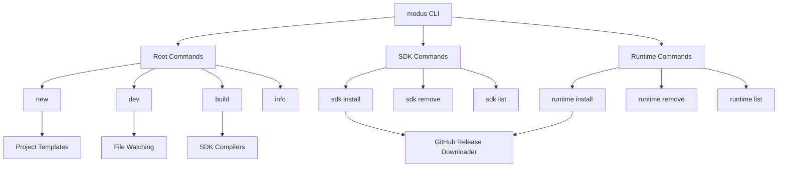
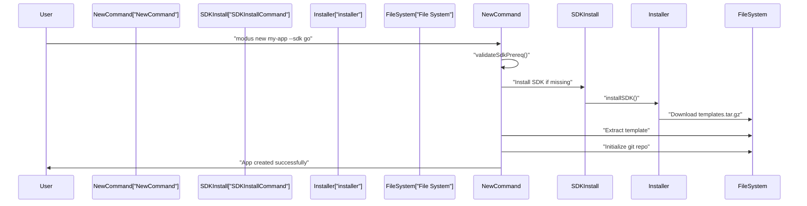
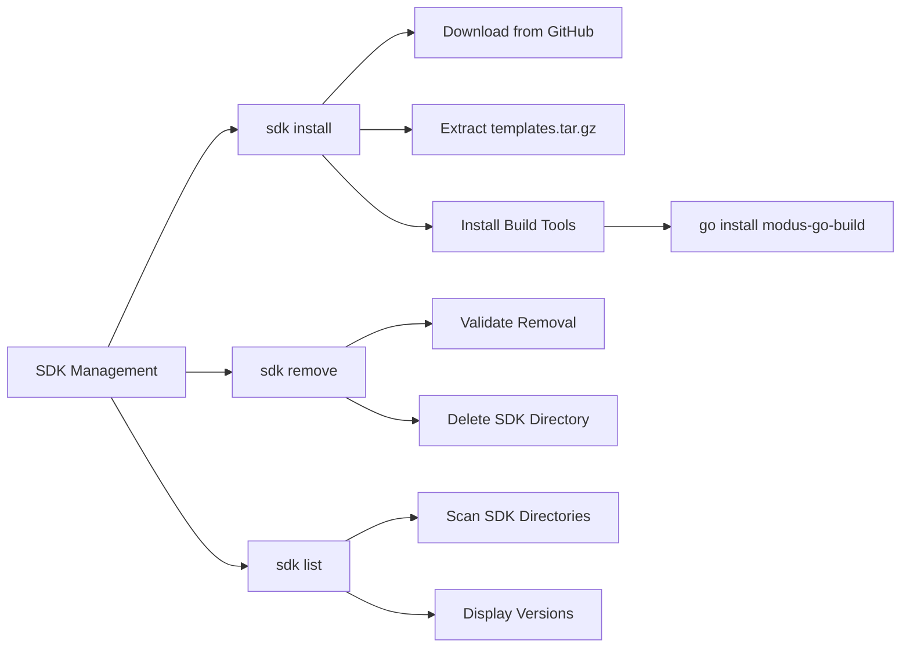
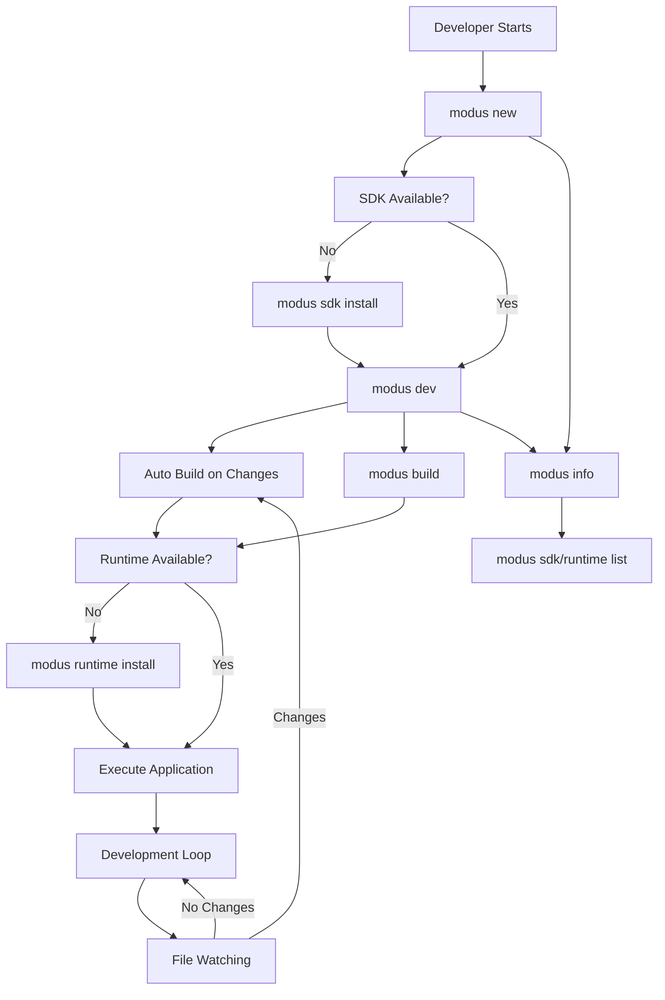

<!-- source: DeepWiki mcp.deepwiki.com · repo hypermodeinc/modus · page 3.1 CLI Commands Reference · fetched 2026-10-26 -->

# CLI Commands Reference

<details>
<summary>Relevant source files</summary>

The following files were used as context for generating this wiki page:

- [CHANGELOG.md](CHANGELOG.md)
- [cli/src/commands/build/index.ts](cli/src/commands/build/index.ts)
- [cli/src/commands/dev/index.ts](cli/src/commands/dev/index.ts)
- [cli/src/commands/info/index.ts](cli/src/commands/info/index.ts)
- [cli/src/commands/new/index.ts](cli/src/commands/new/index.ts)
- [cli/src/commands/runtime/install/index.ts](cli/src/commands/runtime/install/index.ts)
- [cli/src/commands/runtime/list/index.ts](cli/src/commands/runtime/list/index.ts)
- [cli/src/commands/runtime/remove/index.ts](cli/src/commands/runtime/remove/index.ts)
- [cli/src/commands/sdk/install/index.ts](cli/src/commands/sdk/install/index.ts)
- [cli/src/commands/sdk/list/index.ts](cli/src/commands/sdk/list/index.ts)
- [cli/src/commands/sdk/remove/index.ts](cli/src/commands/sdk/remove/index.ts)
- [cli/src/custom/help.ts](cli/src/custom/help.ts)
- [cli/src/util/installer.ts](cli/src/util/installer.ts)
- [cli/src/util/systemVersions.ts](cli/src/util/systemVersions.ts)

</details>


This document provides a comprehensive reference for all Modus CLI commands, their usage patterns, command-line arguments, and implementation details. The Modus CLI serves as the primary developer interface for creating, building, running, and managing Modus applications and their dependencies.

For information about setting up the development environment and VS Code debugging, see [Development Environment](#7.1). For details about CI/CD integration with these commands, see [CI/CD Integration](#8.2).

## CLI Architecture Overview

The Modus CLI is built using the OCLIF framework and implements a hierarchical command structure with grouped subcommands. The CLI manages two primary types of components: SDKs (for building applications) and runtimes (for executing applications).



Sources: [cli/src/custom/help.ts:17-90](), [cli/src/commands/new/index.ts:36-39](), [cli/src/commands/dev/index.ts:34-69]()

## Command Categories

The CLI organizes commands into logical groups based on their primary function:

| Category | Commands | Purpose |
|----------|----------|---------|
| **Application Lifecycle** | `new`, `dev`, `build` | Create, develop, and build Modus applications |
| **SDK Management** | `sdk install`, `sdk remove`, `sdk list` | Manage development SDKs (Go, AssemblyScript) |
| **Runtime Management** | `runtime install`, `runtime remove`, `runtime list` | Manage execution runtimes |
| **System Information** | `info` | Display system and installation status |

## Core Application Commands

### modus new

Creates a new Modus application from templates with interactive setup.

**Syntax:**
```bash
modus new [--name <app-name>] [--dir <directory>] [--sdk <sdk-type>] [--no-git] [--no-prompt] [--prerelease]
```

**Key Implementation Details:**
- Validates SDK prerequisites before project creation
- Downloads and extracts project templates from SDK packages
- Initializes Git repository by default (unless `--no-git` specified)
- Supports both Go and AssemblyScript SDKs
- Automatically installs required SDK version if missing



Sources: [cli/src/commands/new/index.ts:78-163](), [cli/src/commands/new/index.ts:271-378]()

### modus dev

Runs a Modus application locally with hot reloading and file watching.

**Syntax:**
```bash
modus dev [<path>] [--runtime <version>] [--prerelease] [--no-build] [--no-watch] [--delay <ms>]
```

**Key Features:**
- Automatic runtime version detection and installation
- File watching for source code, manifest, and environment files
- Hot reloading with configurable delay
- Integration with Hypermode API keys for model access
- Cross-platform runtime process management

The dev command implements sophisticated file watching patterns based on SDK type:

| SDK | Watched Files | Excluded Files |
|-----|---------------|----------------|
| **Go** | `**/*.go`, `**/go.mod` | `**/*_test.go`, `**/*_generated.go` |
| **AssemblyScript** | `**/*.ts`, `**/asconfig.json`, `**/package.json` | `node_modules/**` |

Sources: [cli/src/commands/dev/index.ts:71-205](), [cli/src/commands/dev/index.ts:366-385]()

### modus build

Compiles a Modus application using the appropriate SDK compiler.

**Syntax:**
```bash
modus build [<path>]
```

**Build Process:**
1. Validates `modus.json` manifest exists
2. Installs required SDK version if missing
3. Invokes SDK-specific build tools:
   - **Go**: Uses `modus-go-build` executable
   - **AssemblyScript**: Uses `npx modus-as-build`

Sources: [cli/src/commands/build/index.ts:39-110]()

### modus info

Displays comprehensive system information including installed components and system dependencies.

**Output Includes:**
- Modus installation path and CLI version
- Operating system and architecture details
- Node.js, NPM, Go, TinyGo, and Binaryen versions
- Installed SDK and runtime versions

Sources: [cli/src/commands/info/index.ts:18-93]()

## SDK Management Commands

The SDK management commands handle installation, removal, and listing of development SDKs.



Sources: [cli/src/commands/sdk/install/index.ts:22-84](), [cli/src/util/installer.ts:19-94]()

### modus sdk install

Downloads and installs Modus SDKs with automatic dependency resolution.

**Syntax:**
```bash
modus sdk install <sdk-name> [<version>] [--force] [--prerelease]
```

**Supported SDKs:**
- `go`, `golang` - Go SDK with TinyGo compiler
- `assemblyscript`, `as` - AssemblyScript SDK
- `all` - Install all available SDKs

**Installation Process:**
1. Validates internet connectivity
2. Resolves latest version if `latest` specified
3. Downloads SDK package and templates from GitHub releases
4. Installs SDK-specific build tools
5. Automatically installs compatible runtime versions

Sources: [cli/src/commands/sdk/install/index.ts:51-154]()

### modus sdk remove

Removes installed SDK versions with confirmation prompts.

**Syntax:**
```bash
modus sdk remove [<sdk-name>] [<version>] [--runtimes] [--force]
```

**Features:**
- Interactive selection when no arguments provided
- Batch removal with `all` keyword
- Optional runtime cleanup with `--runtimes` flag
- Safety confirmations unless `--force` specified

Sources: [cli/src/commands/sdk/remove/index.ts:49-195]()

### modus sdk list

Lists all installed SDK versions organized by SDK type.

Sources: [cli/src/commands/sdk/list/index.ts:22-54]()

## Runtime Management Commands

Runtime management commands control the installation and maintenance of Modus execution runtimes.

### modus runtime install

Downloads and installs Modus runtime binaries for the current platform.

**Syntax:**
```bash
modus runtime install [<version>] [--force] [--prerelease]
```

**Platform Support:**
- Windows (x64, arm64)
- macOS (x64, arm64) 
- Linux (x64, arm64)

**Installation Details:**
- Downloads platform-specific archives from GitHub releases
- Extracts runtime binaries to versioned directories
- Validates installation integrity

Sources: [cli/src/commands/runtime/install/index.ts:44-107](), [cli/src/util/installer.ts:39-63]()

### modus runtime remove

Removes installed runtime versions with safety checks.

**Syntax:**
```bash
modus runtime remove [<version>] [--force]
```

Sources: [cli/src/commands/runtime/remove/index.ts:31-119]()

### modus runtime list

Lists all installed runtime versions.

Sources: [cli/src/commands/runtime/list/index.ts:21-44]()

## Global Flags and Options

All commands support common global flags:

| Flag | Short | Description |
|------|-------|-------------|
| `--help` | `-h` | Show command help |
| `--version` | `-v` | Show CLI version |
| `--no-logo` | | Suppress header logo output |

## Command Dependencies and Flow

The CLI commands have interdependencies that create a natural workflow:



**Command Execution Context:**
- Commands validate prerequisites before execution
- Missing dependencies trigger automatic installation prompts
- Version compatibility checking prevents runtime conflicts
- File system operations use platform-specific paths

Sources: [cli/src/commands/dev/index.ts:89-138](), [cli/src/commands/build/index.ts:58-60](), [cli/src/util/versioninfo.ts]()

## Error Handling and Validation

The CLI implements comprehensive error handling and validation:

**Version Validation:**
- SDK and runtime versions must follow semantic versioning
- Version strings must be prefixed with 'v'
- Prerelease versions are handled separately from stable releases

**Prerequisite Checking:**
- Go SDK requires Go ≥1.23.0, TinyGo ≥0.35.0, and Binaryen
- AssemblyScript SDK requires Node.js ≥18.0.0
- Internet connectivity required for downloads

**File System Operations:**
- Graceful handling of permission errors
- Automatic directory creation for installations
- Safe removal with recursive deletion protection

Sources: [cli/src/commands/new/index.ts:183-269](), [cli/src/util/systemVersions.ts:18-66]()

---

