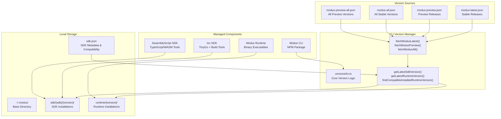
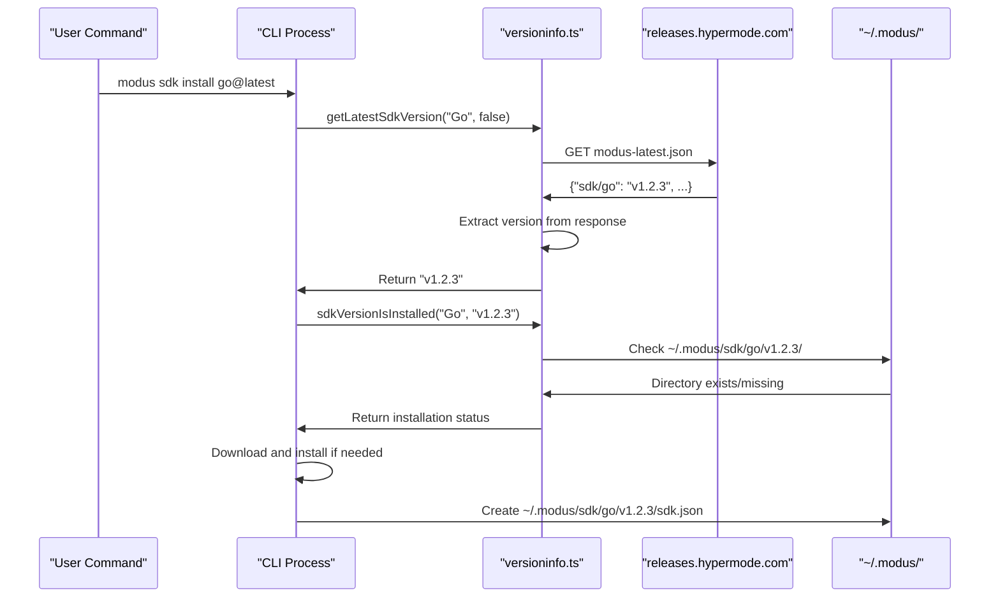
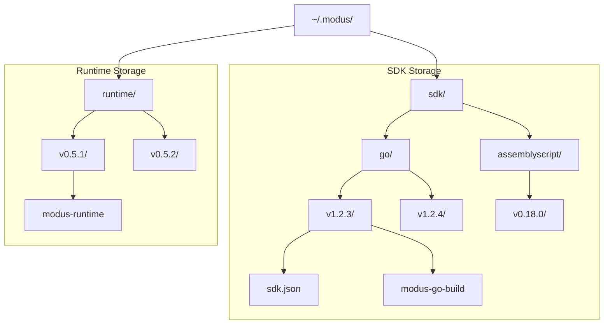
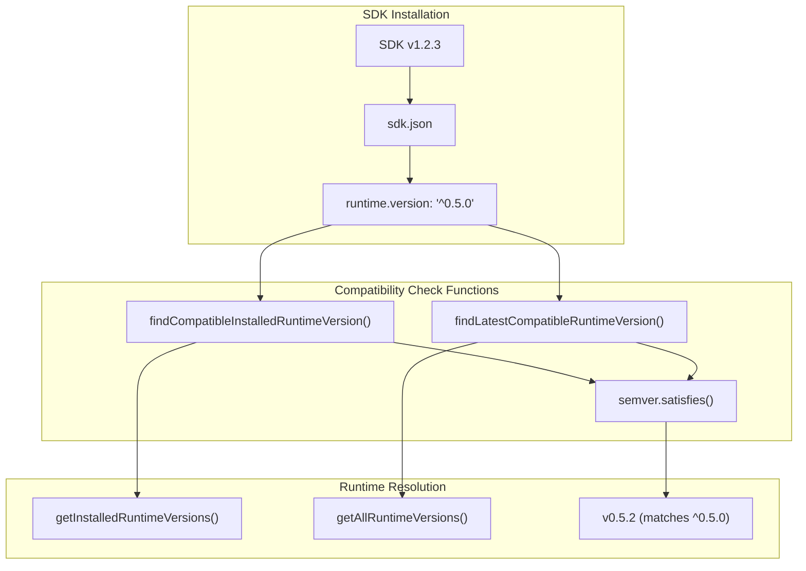
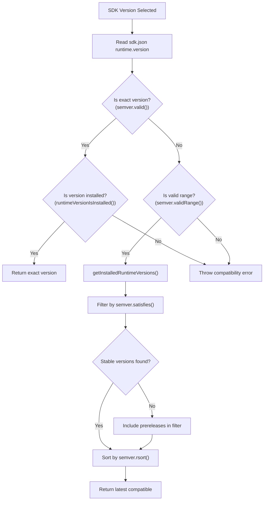
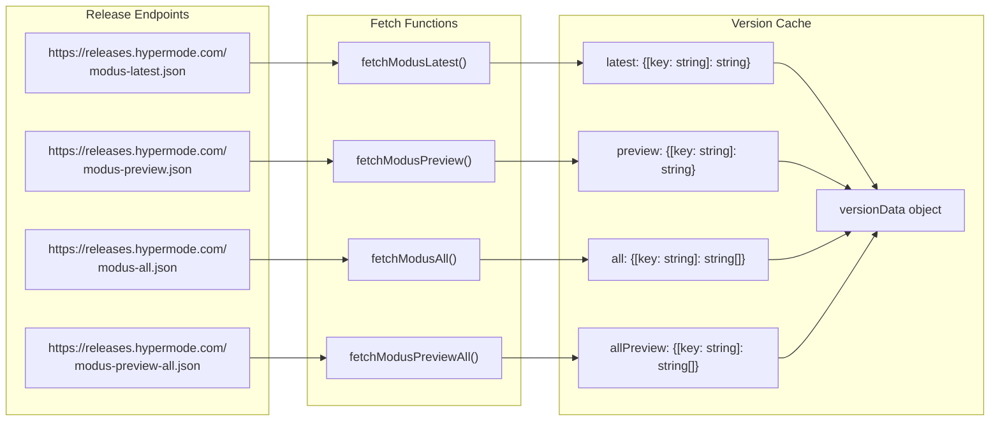
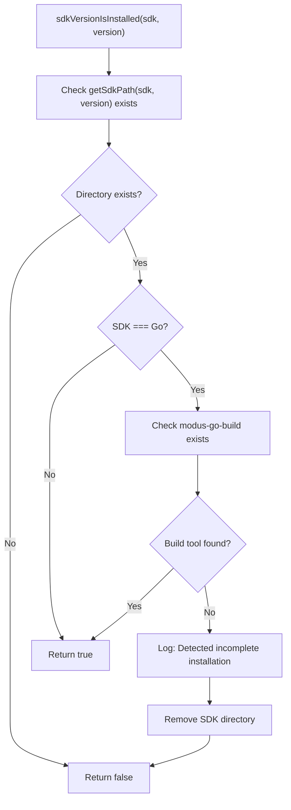
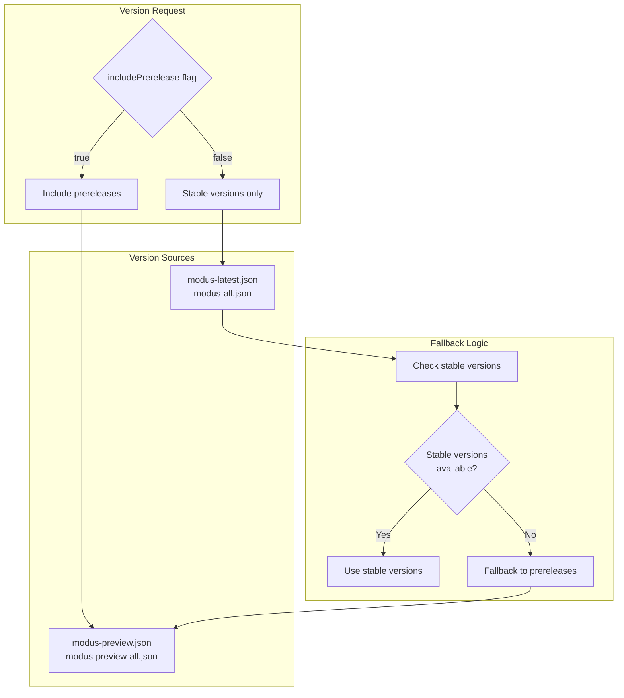

<!-- source: DeepWiki mcp.deepwiki.com · repo hypermodeinc/modus · page 3.2 Version Management · fetched 2026-10-26 -->

# Version Management

Relevant source files

The following files were used as context for generating this wiki page:

- [.github/renovate.json](.github/renovate.json)
- [.github/workflows/ci-cli-build.yml](.github/workflows/ci-cli-build.yml)
- [.github/workflows/ci-cli-lint.yml](.github/workflows/ci-cli-lint.yml)
- [.github/workflows/ci-sdk-as-build.yml](.github/workflows/ci-sdk-as-build.yml)
- [.github/workflows/ci-sdk-as-lint.yml](.github/workflows/ci-sdk-as-lint.yml)
- [.github/workflows/ci-sdk-as-test.yml](.github/workflows/ci-sdk-as-test.yml)
- [cli/eslint.config.js](cli/eslint.config.js)
- [cli/install.sh](cli/install.sh)
- [cli/src/custom/globals.ts](cli/src/custom/globals.ts)
- [cli/src/util/http.ts](cli/src/util/http.ts)
- [cli/src/util/index.ts](cli/src/util/index.ts)
- [cli/src/util/versioninfo.ts](cli/src/util/versioninfo.ts)
- [runtime/plugins/plugins.go](runtime/plugins/plugins.go)
- [sdk/assemblyscript/src/plugin.asconfig.json](sdk/assemblyscript/src/plugin.asconfig.json)
- [sdk/go/tools/modus-go-build/compiler/compiler.go](sdk/go/tools/modus-go-build/compiler/compiler.go)

This document covers how the Modus CLI manages versions of SDKs, runtime components, and the CLI itself. It explains the version resolution algorithms, compatibility checking, local storage structure, and update mechanisms used throughout the system.

For information about CLI commands that interact with version management, see [CLI Commands Reference](#3.1). For details about SDK installation and configuration, see [Software Development Kits](#4).

## Version Management Architecture

The Modus CLI implements a comprehensive version management system that handles multiple components with different release cycles and compatibility requirements.

### Version Management Components

Sources: [cli/src/util/versioninfo.ts:1-320](), [cli/src/custom/globals.ts:14]()

### Version Data Flow

Sources: [cli/src/util/versioninfo.ts:138-147](), [cli/src/util/versioninfo.ts:183-206]()

## Version Storage Structure

The CLI maintains a structured directory layout for managing different component versions locally.

### Local Storage Layout

| Path Pattern | Purpose | Example |
|-------------|---------|---------|
| `~/.modus/` | Base directory for all Modus data | `/home/user/.modus/` |
| `sdk/{sdk}/{version}/` | SDK installation directory | `sdk/go/v1.2.3/` |
| `runtime/{version}/` | Runtime installation directory | `runtime/v0.5.1/` |
| `sdk/{sdk}/{version}/sdk.json` | SDK metadata and compatibility info | Contains runtime version constraints |

Sources: [cli/src/util/versioninfo.ts:18-24](), [cli/src/custom/globals.ts:14]()

## Version Resolution and Compatibility

The CLI implements sophisticated version resolution that considers compatibility constraints between SDKs and runtime versions.

### SDK-Runtime Compatibility System

Sources: [cli/src/util/versioninfo.ts:253-285](), [cli/src/util/versioninfo.ts:287-319]()

### Version Resolution Algorithm

The CLI uses a multi-step resolution process for finding compatible versions:

1. **Exact Version Match**: If `sdk.json` specifies an exact version (e.g., `"0.5.1"`), check if that version is available
2. **Range Satisfaction**: If `sdk.json` specifies a range (e.g., `"^0.5.0"`), find the latest version that satisfies the constraint
3. **Prerelease Fallback**: If no stable versions match and prereleases are not explicitly requested, try prerelease versions
4. **Installation Priority**: Prefer already-installed versions over downloading new ones when multiple versions satisfy constraints

Sources: [cli/src/util/versioninfo.ts:253-285](), [cli/src/util/versioninfo.ts:299-318]()

## Version Fetching and Caching

The CLI fetches version information from Hypermode's release API and implements in-memory caching to avoid redundant requests.

### Release API Integration

Sources: [cli/src/util/versioninfo.ts:33-106](), [cli/src/util/http.ts:15-20]()

## Installation Validation

The CLI performs comprehensive validation to ensure installed components are complete and functional.

### SDK Installation Validation

For Go SDK installations, the CLI performs additional validation beyond directory existence:

Sources: [cli/src/util/versioninfo.ts:183-206]()

### Version Validation Process

The CLI validates component versions using semantic versioning and platform-specific checks:

| Component | Validation Method | Key Checks |
|-----------|------------------|------------|
| **Go SDK** | Directory + build tool presence | `modus-go-build` executable exists |
| **AssemblyScript SDK** | Directory existence | Basic directory structure |
| **Runtime** | Directory existence | Runtime binary present |
| **CLI** | NPM version check | Semantic version format |

Sources: [cli/src/util/versioninfo.ts:183-210](), [sdk/go/tools/modus-go-build/compiler/compiler.go:52-68]()

## Prerelease and Stable Channel Management

The CLI distinguishes between stable and prerelease versions, with fallback mechanisms for compatibility.

### Release Channel Logic

Sources: [cli/src/util/versioninfo.ts:138-147](), [cli/src/util/versioninfo.ts:241-250](), [cli/src/util/versioninfo.ts:26-31]()

The system uses `semver.prerelease()` to identify prerelease versions and `semver.rsort()` to order versions appropriately, ensuring that the latest stable version is always preferred when available.

---

