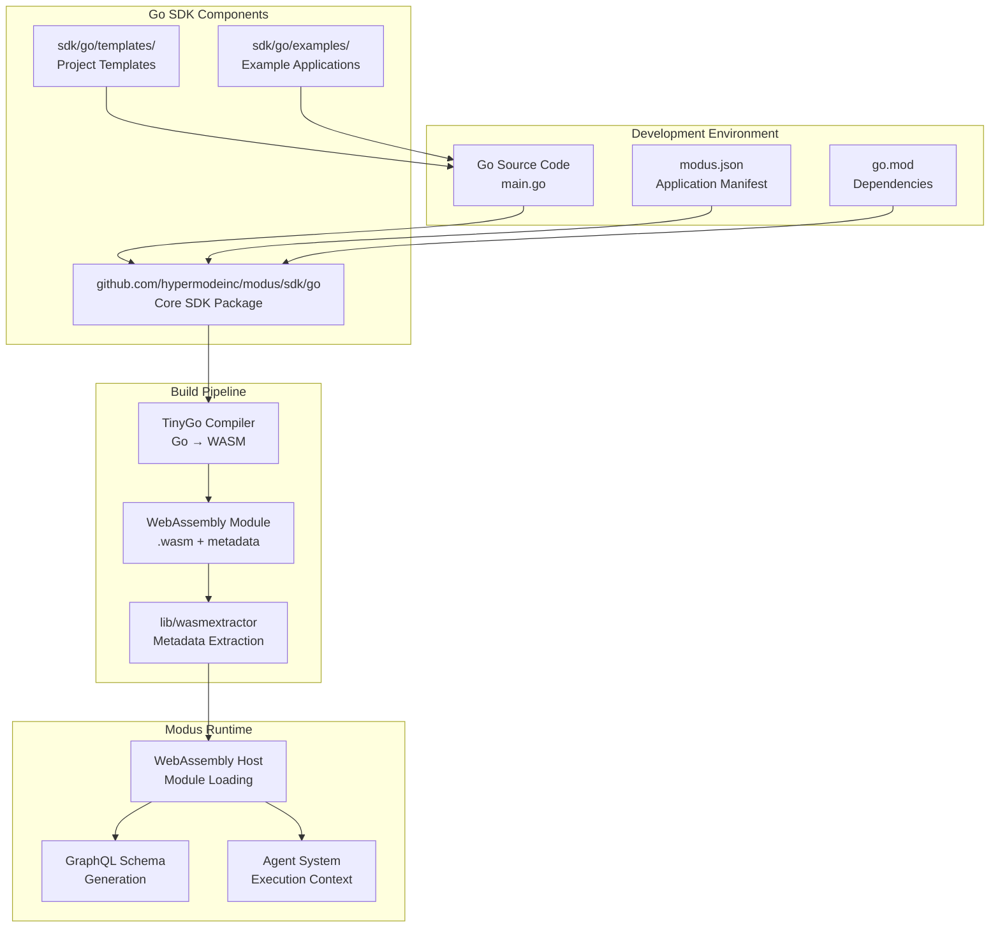
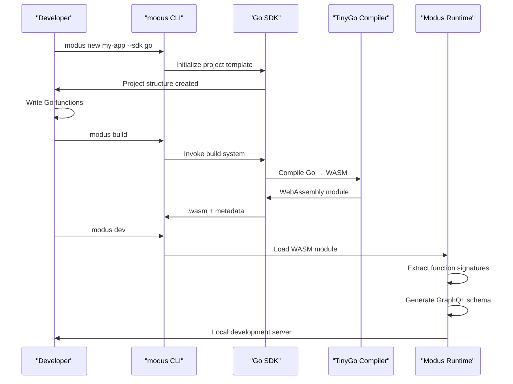
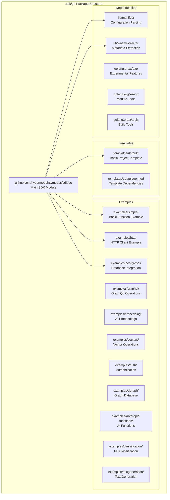
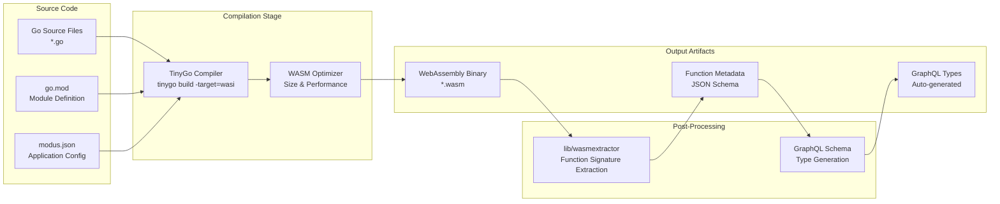
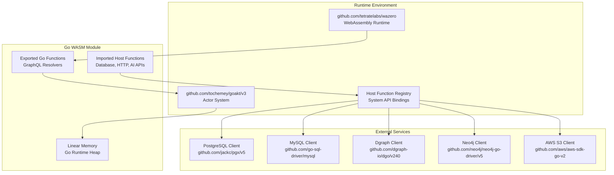

<!-- source: DeepWiki mcp.deepwiki.com · repo hypermodeinc/modus · page 4.1 Go SDK · fetched 2026-10-26 -->

# Go SDK

Relevant source files

The following files were used as context for generating this wiki page:

- [lib/manifest/go.mod](lib/manifest/go.mod)
- [lib/metadata/go.mod](lib/metadata/go.mod)
- [lib/wasmextractor/go.mod](lib/wasmextractor/go.mod)
- [runtime/go.mod](runtime/go.mod)
- [runtime/go.sum](runtime/go.sum)
- [runtime/languages/golang/testdata/go.mod](runtime/languages/golang/testdata/go.mod)
- [runtime/languages/golang/testdata/go.sum](runtime/languages/golang/testdata/go.sum)
- [sdk/go/examples/anthropic-functions/go.mod](sdk/go/examples/anthropic-functions/go.mod)
- [sdk/go/examples/auth/go.mod](sdk/go/examples/auth/go.mod)
- [sdk/go/examples/classification/go.mod](sdk/go/examples/classification/go.mod)
- [sdk/go/examples/dgraph/go.mod](sdk/go/examples/dgraph/go.mod)
- [sdk/go/examples/embedding/go.mod](sdk/go/examples/embedding/go.mod)
- [sdk/go/examples/graphql/go.mod](sdk/go/examples/graphql/go.mod)
- [sdk/go/examples/http/go.mod](sdk/go/examples/http/go.mod)
- [sdk/go/examples/postgresql/go.mod](sdk/go/examples/postgresql/go.mod)
- [sdk/go/examples/simple/go.mod](sdk/go/examples/simple/go.mod)
- [sdk/go/examples/textgeneration/go.mod](sdk/go/examples/textgeneration/go.mod)
- [sdk/go/examples/vectors/go.mod](sdk/go/examples/vectors/go.mod)
- [sdk/go/go.mod](sdk/go/go.mod)
- [sdk/go/go.sum](sdk/go/go.sum)
- [sdk/go/templates/default/go.mod](sdk/go/templates/default/go.mod)
- [sdk/go/templates/default/go.sum](sdk/go/templates/default/go.sum)

The Go SDK enables developers to build Modus applications using the Go programming language. It provides the necessary APIs, build tools, and runtime integration to compile Go functions into WebAssembly modules that execute within the Modus Runtime. The SDK handles the compilation pipeline using TinyGo, metadata extraction, and seamless integration with the GraphQL engine and agent system.

For information about the runtime that executes Go-compiled WebAssembly modules, see [Runtime Architecture](#5.1). For details about the CLI commands that manage Go SDK installations and builds, see [CLI Commands Reference](#3.1).

## Architecture Overview

The Go SDK operates as part of a larger compilation and execution pipeline that transforms Go source code into executable WebAssembly modules.

### Go SDK in the Modus Ecosystem

Sources: [sdk/go/go.mod:1-35](), [sdk/go/templates/default/go.mod:1-10](), [lib/wasmextractor/go.mod:1-6](), [runtime/go.mod:26-27]()

## Development Workflow

The Go SDK supports a streamlined development workflow from project initialization through runtime execution.

### Build and Execution Flow

Sources: [sdk/go/templates/default/)(), [runtime/languages/golang/testdata/go.mod:1-10]()

## SDK Structure and Components

The Go SDK is organized into several key components that provide the development experience and build functionality.

### Core SDK Package Structure

Sources: [sdk/go/go.mod:1-35](), [sdk/go/templates/default/go.mod:1-10](), [sdk/go/examples/simple/go.mod:1-9](), [sdk/go/examples/http/go.mod:1-9](), [sdk/go/examples/postgresql/go.mod:1-9](), [sdk/go/examples/graphql/go.mod:1-9]()

## Compilation Process

The Go SDK uses TinyGo as the compiler to generate WebAssembly modules from Go source code. This process involves several stages of compilation and metadata extraction.

### TinyGo Compilation Pipeline

Sources: [sdk/go/go.mod:7-21](), [lib/wasmextractor/go.mod:1-6](), [lib/manifest/go.mod:1-18]()

## Runtime Integration

The compiled Go WebAssembly modules integrate with the Modus Runtime through a well-defined interface that supports function invocation, host function calls, and agent lifecycle management.

### Runtime Execution Architecture

Sources: [runtime/go.mod:42](), [runtime/go.mod:45](), [runtime/go.mod:15](), [runtime/go.mod:29](), [runtime/go.mod:20](), [runtime/go.mod:33](), [runtime/go.mod:10-12]()

## Example Applications

The Go SDK includes comprehensive examples demonstrating various integration patterns and use cases.

| Example | Purpose | Key Dependencies | Features Demonstrated |
|---------|---------|------------------|----------------------|
| `simple` | Basic function definition | Core SDK only | Function export, basic types |
| `http` | HTTP client operations | Core SDK | External API calls, request/response handling |
| `postgresql` | Database operations | Core SDK | SQL queries, connection management |
| `graphql` | GraphQL operations | Core SDK | Query execution, schema introspection |
| `embedding` | AI embeddings | `tidwall/gjson`, `tidwall/sjson` | Vector generation, JSON processing |
| `vectors` | Vector operations | `golang.org/x/exp` | Mathematical computations, experimental APIs |
| `auth` | Authentication | Core SDK | JWT handling, authorization |
| `dgraph` | Graph database | Core SDK | Graph queries, relationships |
| `anthropic-functions` | AI function calling | `tidwall/gjson` | LLM integration, structured responses |
| `classification` | ML classification | Core SDK | Machine learning, categorization |
| `textgeneration` | Text generation | `tidwall/gjson` | Content generation, prompt engineering |

Sources: [sdk/go/examples/simple/go.mod:1-9](), [sdk/go/examples/http/go.mod:1-9](), [sdk/go/examples/postgresql/go.mod:1-9](), [sdk/go/examples/graphql/go.mod:1-9](), [sdk/go/examples/embedding/go.mod:1-16](), [sdk/go/examples/vectors/go.mod:1-12](), [sdk/go/examples/auth/go.mod:1-9](), [sdk/go/examples/dgraph/go.mod:1-9](), [sdk/go/examples/anthropic-functions/go.mod:1-16](), [sdk/go/examples/classification/go.mod:1-9](), [sdk/go/examples/textgeneration/go.mod:1-18]()

## Version Management and Dependencies

The Go SDK maintains compatibility with specific Go versions and manages dependencies through Go modules. The SDK requires Go 1.23.1 or later with toolchain support for Go 1.24.4.

### Dependency Structure

```mermaid
graph TB
    subgraph "Core Dependencies"
        GoSDK["github.com/hypermodeinc/modus/sdk/go<br/>v0.18.0-alpha.7"]
        Manifest["github.com/hypermodeinc/modus/lib/manifest<br/>v0.17.2"]
        WasmExtractor["github.com/hypermodeinc/modus/lib/wasmextractor<br/>v0.13.0"]
    end
    
    subgraph "Utility Libraries"
        Color["github.com/fatih/color<br/>v1.18.0<br/>Terminal Output"]
        Version["github.com/hashicorp/go-version<br/>v1.7.0<br/>Version Parsing"]
        XID["github.com/rs/xid<br/>v1.6.0<br/>ID Generation"]
        GJSON["github.com/tidwall/gjson<br/>v1.18.0<br/>JSON Processing"]
        SJSON["github.com/tidwall/sjson<br/>v1.2.5<br/>JSON Modification"]
    end
    
    subgraph "Go Standard Extensions"
        Exp["golang.org/x/exp<br/>v0.0.0-20250606033433<br/>Experimental Features"]
        Mod["golang.org/x/mod<br/>v0.25.0<br/>Module Tools"]
        Tools["golang.org/x/tools<br/>v0.34.0<br/>Build Tools"]
    end
    
    GoSDK --> Manifest
    GoSDK --> WasmExtractor
    GoSDK --> Color
    GoSDK --> Version
    GoSDK --> XID
    GoSDK --> GJSON
    GoSDK --> SJSON
    GoSDK --> Exp
    GoSDK --> Mod
    GoSDK --> Tools
```

Sources: [sdk/go/go.mod:1-35](), [sdk/go/templates/default/go.mod:1-10](), [lib/manifest/go.mod:1-18](), [lib/wasmextractor/go.mod:1-6]()

---

