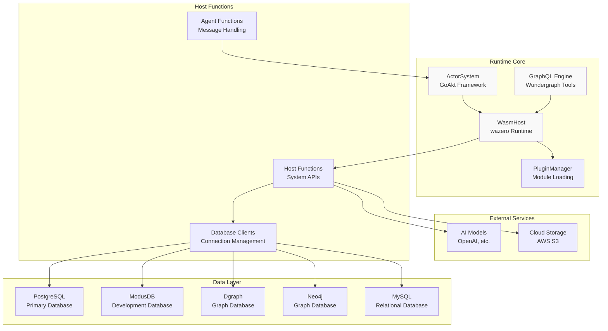
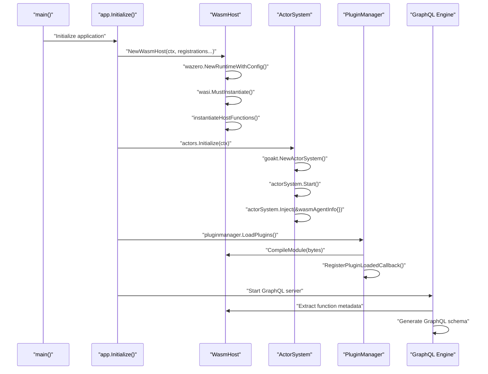
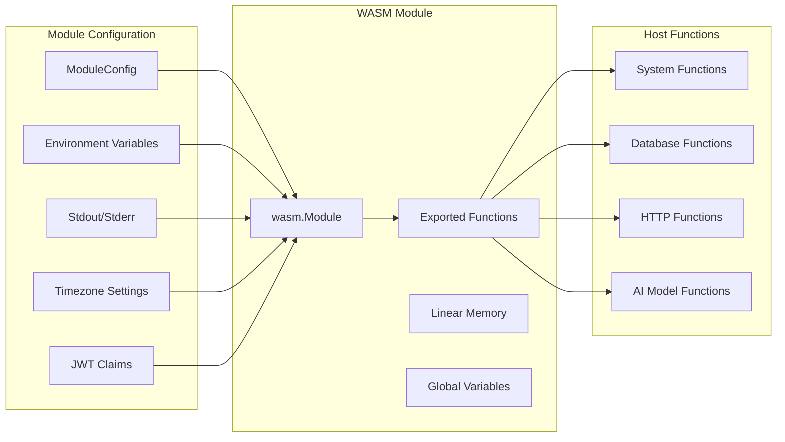
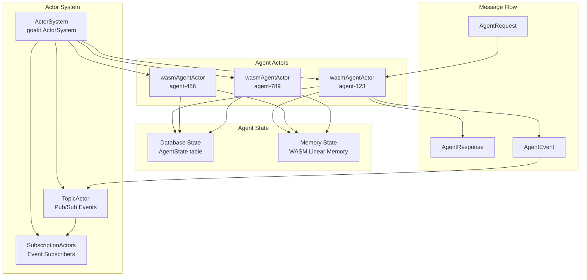
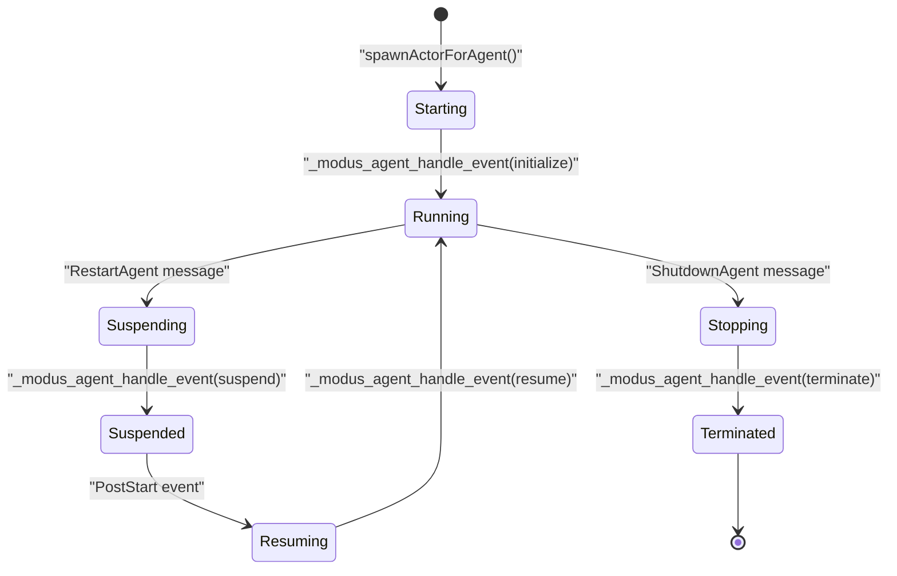

<!-- source: DeepWiki mcp.deepwiki.com · repo hypermodeinc/modus · page 5 Modus Runtime · fetched 2026-10-26 -->

# Modus Runtime

<details>
<summary>Relevant source files</summary>

The following files were used as context for generating this wiki page:

- [lib/manifest/go.mod](lib/manifest/go.mod)
- [lib/metadata/go.mod](lib/metadata/go.mod)
- [lib/wasmextractor/go.mod](lib/wasmextractor/go.mod)
- [runtime/actors/actorsystem.go](runtime/actors/actorsystem.go)
- [runtime/actors/subscriber.go](runtime/actors/subscriber.go)
- [runtime/actors/wasmagent.go](runtime/actors/wasmagent.go)
- [runtime/app/app.go](runtime/app/app.go)
- [runtime/db/agentstate.go](runtime/db/agentstate.go)
- [runtime/db/inferencehistory.go](runtime/db/inferencehistory.go)
- [runtime/go.mod](runtime/go.mod)
- [runtime/go.sum](runtime/go.sum)
- [runtime/languages/golang/testdata/go.mod](runtime/languages/golang/testdata/go.mod)
- [runtime/languages/golang/testdata/go.sum](runtime/languages/golang/testdata/go.sum)
- [runtime/wasmhost/wasmhost.go](runtime/wasmhost/wasmhost.go)
- [sdk/assemblyscript/src/assembly/exports.ts](sdk/assemblyscript/src/assembly/exports.ts)
- [sdk/go/go.mod](sdk/go/go.mod)
- [sdk/go/go.sum](sdk/go/go.sum)
- [sdk/go/templates/default/go.mod](sdk/go/templates/default/go.mod)
- [sdk/go/templates/default/go.sum](sdk/go/templates/default/go.sum)

</details>


The Modus Runtime is the core execution environment that hosts and orchestrates WebAssembly modules compiled from Go and AssemblyScript code. It provides a complete runtime system featuring WebAssembly execution, actor-based agent management, GraphQL schema generation and query processing, database connectivity, and AI model integration.

This document covers the runtime architecture, core subsystems, and execution flow. For information about developing applications that run on this runtime, see [Software Development Kits](#4). For details about the CLI tools that manage runtime deployment, see [Modus CLI](#3). For specific subsystem details, see [Runtime Architecture](#5.1), [GraphQL Engine](#5.2), [Agent System](#5.3), [Database Integration](#5.4), and [AI Model Integration](#5.5).

## Runtime Architecture Overview

The Modus Runtime is built around several interconnected subsystems that work together to provide a complete execution environment for WebAssembly modules.

### Core System Components



**Sources:** [runtime/wasmhost/wasmhost.go:45-79](), [runtime/actors/actorsystem.go:28-56](), [runtime/go.mod:7-59]()

### Runtime Initialization Flow



**Sources:** [runtime/wasmhost/wasmhost.go:51-79](), [runtime/actors/actorsystem.go:28-56]()

## WebAssembly Host System

The `WasmHost` interface provides the core WebAssembly execution environment using the wazero runtime. It manages module compilation, instantiation, and function execution with proper isolation and resource management.

### WASM Host Interface

The `WasmHost` interface at [runtime/wasmhost/wasmhost.go:33-43]() defines the primary operations:

- `RegisterHostFunction()` - Registers Go functions as host functions callable from WASM
- `CallFunction()` - Executes WASM functions with parameter mapping
- `CallFunctionInModule()` - Executes functions in a specific module instance
- `CompileModule()` - Compiles WASM bytes into reusable compiled modules
- `GetModuleInstance()` - Creates isolated module instances for execution

### Module Configuration and Isolation



The `getModuleConfig()` function at [runtime/wasmhost/wasmhost.go:135-183]() creates isolated module instances with:

- Dedicated stdout/stderr streams with logging integration
- Environment variable injection (including `MODUS_*` prefixed variables)
- Timezone configuration from context or system default
- JWT claims from request middleware
- Anonymous module naming for performance and concurrency

**Sources:** [runtime/wasmhost/wasmhost.go:135-183](), [runtime/wasmhost/wasmhost.go:110-121]()

### Host Function Registration

Host functions bridge the WASM sandbox with the runtime environment. The system supports automatic parameter marshaling and provides access to:

- Database connections and query execution
- HTTP client operations
- AI model inference
- File system operations (limited)
- Logging and telemetry

**Sources:** [runtime/wasmhost/wasmhost.go:33-43]()

## Actor System

The actor system provides concurrent, stateful agent management using the GoAkt framework. Each agent runs as an independent actor with its own WASM module instance and managed lifecycle.

### Agent Actor Architecture



**Sources:** [runtime/actors/actorsystem.go:26-56](), [runtime/actors/wasmagent.go:31-41]()

### Agent Lifecycle Management

The `wasmAgentActor` struct at [runtime/actors/wasmagent.go:31-41]() manages the complete agent lifecycle:

#### Agent States



#### Agent Actor Methods

- `PreStart()` - Activates agent and initializes WASM module
- `Receive()` - Handles incoming messages and lifecycle events
- `PostStop()` - Suspends agent and cleans up resources
- `activateAgent()` - Creates WASM module instance and calls `_modus_agent_activate`
- `startAgent()` / `resumeAgent()` - Transitions agent to running state
- `suspendAgent()` / `stopAgent()` - Persists state and transitions to inactive states

**Sources:** [runtime/actors/wasmagent.go:43-151](), [runtime/actors/wasmagent.go:322-447]()

### Message Handling

Agent message processing occurs in `handleAgentRequest()` at [runtime/actors/wasmagent.go:153-206]():

1. Validates agent is in `AgentStatusRunning` state
2. Calls `_modus_agent_handle_message` WASM function with message data
3. Returns response if `msg.Respond` is true
4. Saves agent state after successful message processing

**Sources:** [runtime/actors/wasmagent.go:153-206]()

### Event Publishing and Subscription

The system supports real-time event streaming through the actor pub/sub system:

- `PublishAgentEvent()` - Publishes events to agent-specific topics
- `SubscribeForAgentEvents()` - Creates subscription actors for event streaming
- Agent status changes automatically trigger events

**Sources:** [runtime/actors/subscriber.go:32-91]()

## State Persistence

Agent state is automatically persisted to the database through the `AgentState` structure at [runtime/db/agentstate.go:23-30]():

```go
type AgentState struct {
    Id        string `json:"id" db:"constraint=unique"`
    Name      string `json:"name"`
    Status    string `json:"status"`
    Data      string `json:"data,omitempty"`
    UpdatedAt string `json:"updated"`
}
```

State operations support both PostgreSQL and ModusDB backends:
- `WriteAgentState()` - Upserts complete agent state
- `UpdateAgentStatus()` - Updates only status field
- `GetAgentState()` - Retrieves agent state by ID
- `QueryActiveAgents()` - Finds all non-terminated agents

**Sources:** [runtime/db/agentstate.go:23-30](), [runtime/db/agentstate.go:32-62]()

---

