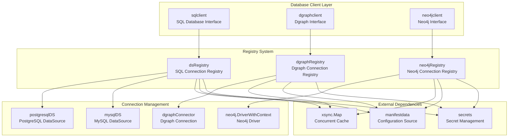
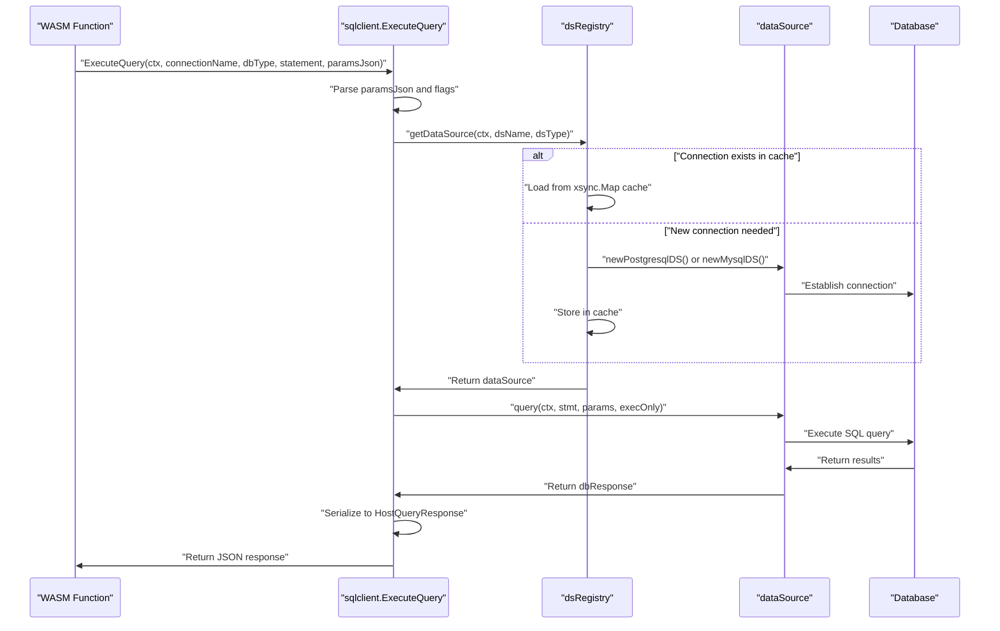
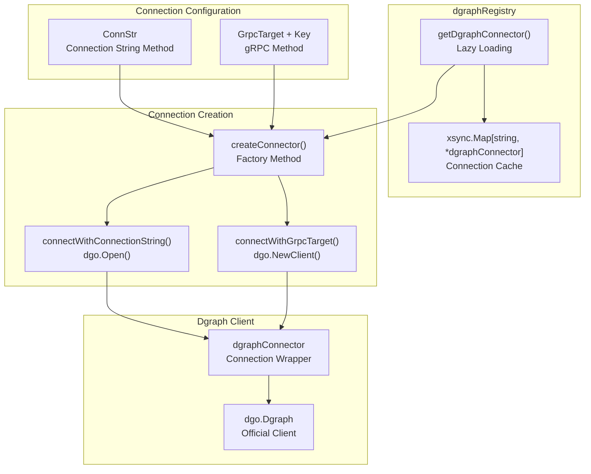
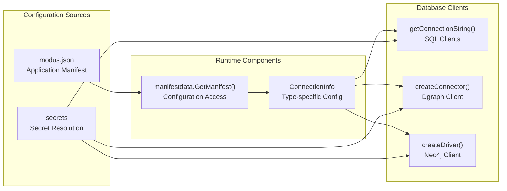

<!-- source: DeepWiki mcp.deepwiki.com · repo hypermodeinc/modus · page 5.4 Database Integration · fetched 2026-10-26 -->

# Database Integration

Relevant source files

The following files were used as context for generating this wiki page:

- [runtime/dgraphclient/registry.go](runtime/dgraphclient/registry.go)
- [runtime/neo4jclient/registry.go](runtime/neo4jclient/registry.go)
- [runtime/sqlclient/registry.go](runtime/sqlclient/registry.go)
- [runtime/sqlclient/sqlclient.go](runtime/sqlclient/sqlclient.go)
- [runtime/timezones/timezones.go](runtime/timezones/timezones.go)

This document covers the database integration system within the Modus Runtime, detailing how the runtime manages connections to various database systems including PostgreSQL, MySQL, Dgraph, and Neo4j. The system provides a unified interface for database operations while maintaining type-specific optimizations for each database technology.

For information about configuring database connections, see [Connections and Secrets](#6.2). For details about the overall runtime architecture, see [Runtime Architecture](#5.1).

## Architecture Overview

The Modus Runtime implements a registry-based database client system that manages persistent connections to multiple database types. Each database type has its own specialized client registry that handles connection pooling, lifecycle management, and type-specific optimizations.

### Database Client Architecture

Sources: [runtime/sqlclient/registry.go:19-64](), [runtime/dgraphclient/registry.go:27-97](), [runtime/neo4jclient/registry.go:24-97]()

## SQL Database Integration

The SQL database system supports PostgreSQL and MySQL through a unified interface that abstracts connection management and query execution.

### SQL Registry Implementation

The `dsRegistry` maintains a cache of database connections using the `xsync.Map` for thread-safe operations:

| Component | Purpose | Key Methods |
|-----------|---------|-------------|
| `dsRegistry` | Connection cache and factory | `getDataSource()`, `shutdown()` |
| `dataSource` | Abstract database interface | `query()`, `Shutdown()` |
| `postgresqlDS` | PostgreSQL implementation | Database-specific query handling |
| `mysqlDS` | MySQL implementation | Database-specific query handling |

The registry uses a lazy-loading pattern where connections are created on first access and cached for subsequent use. The `getDataSource` method in [runtime/sqlclient/registry.go:40-64]() implements this pattern with error handling for unsupported database types.

### Query Execution Flow

Sources: [runtime/sqlclient/sqlclient.go:34-88](), [runtime/sqlclient/registry.go:40-64]()

## Dgraph Integration

The Dgraph client provides integration with Dgraph graph databases, supporting both connection string and gRPC target configurations.

### Dgraph Connection Management

The `dgraphRegistry` implements connection caching with support for multiple connection methods:

The connection creation logic in [runtime/dgraphclient/registry.go:61-97]() handles different authentication methods:
- Connection strings for direct connections
- gRPC targets with API keys for Dgraph Cloud
- Bearer tokens for custom deployments
- Insecure connections for localhost development

Sources: [runtime/dgraphclient/registry.go:48-134]()

## Neo4j Integration

The Neo4j client manages connections to Neo4j graph databases using the official Neo4j Go driver with basic authentication.

### Neo4j Connection Lifecycle

The `neo4jRegistry` follows the same caching pattern as other database clients:

| Function | Purpose | Key Operations |
|----------|---------|----------------|
| `getDriver()` | Retrieve cached or create new driver | Cache lookup, lazy creation |
| `createDriver()` | Factory method for Neo4j drivers | Manifest validation, secret resolution |
| `validateNeo4jConnection()` | Configuration validation | Required field checking |
| `CloseDrivers()` | Cleanup on shutdown | Driver cleanup, cache clearing |

The driver creation process in [runtime/neo4jclient/registry.go:58-97]() involves:
1. Loading connection configuration from manifest
2. Validating required fields (DbUri, Username, Password)
3. Applying secret resolution to connection parameters
4. Creating Neo4j driver with basic authentication

Sources: [runtime/neo4jclient/registry.go:45-120]()

## Configuration Integration

All database clients integrate with the Modus manifest system for configuration and the secrets system for credential management.

### Manifest Integration Pattern

Each database client follows a consistent pattern for configuration access:
1. Retrieve connection configuration from `manifestdata.GetManifest()`
2. Validate connection type matches expected database type
3. Apply secret resolution using `secrets.ApplySecretsToString()`
4. Create database-specific connection objects

Sources: [runtime/sqlclient/sqlclient.go:90-121](), [runtime/dgraphclient/registry.go:61-96](), [runtime/neo4jclient/registry.go:58-87]()

## Connection Lifecycle Management

The database integration system implements proper lifecycle management with initialization callbacks and shutdown procedures.

### Shutdown Coordination

Each database client registry implements cleanup methods that are coordinated through the runtime:

| Registry | Shutdown Method | Cleanup Actions |
|----------|----------------|-----------------|
| `dsRegistry` | `shutdown()` | Close all cached data sources |
| `dgraphRegistry` | `ShutdownConns()` | Close all Dgraph clients |
| `neo4jRegistry` | `CloseDrivers()` | Close all Neo4j drivers |

The SQL client also registers a manifest reload callback in [runtime/sqlclient/sqlclient.go:23-28]() to ensure connections are refreshed when configuration changes.

Sources: [runtime/sqlclient/registry.go:31-38](), [runtime/dgraphclient/registry.go:39-46](), [runtime/neo4jclient/registry.go:36-43]()

---

