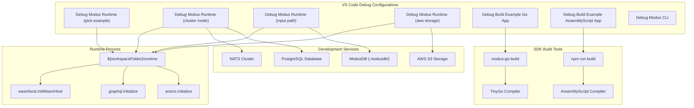
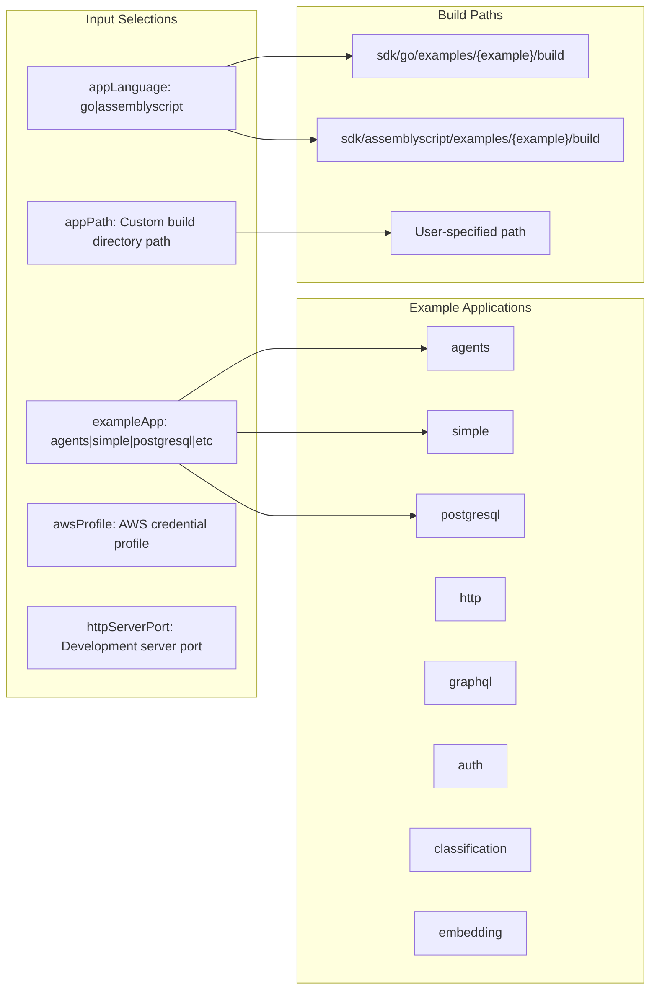
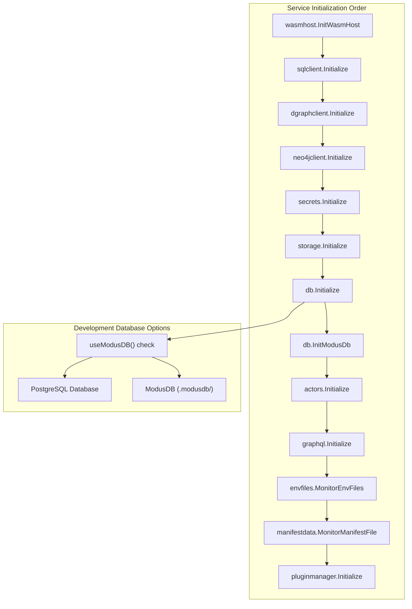
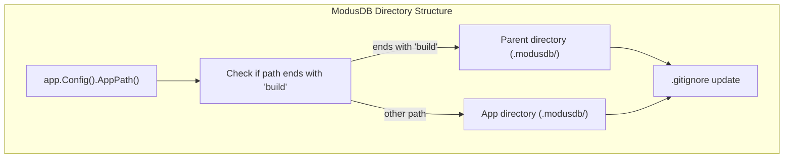
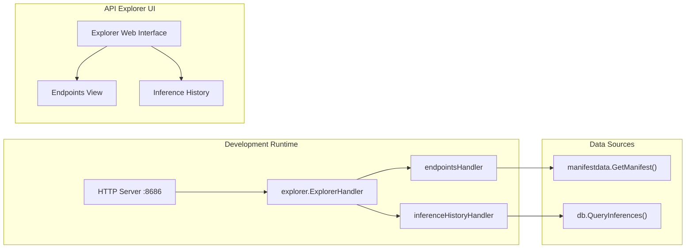

<!-- source: DeepWiki mcp.deepwiki.com · repo hypermodeinc/modus · page 7.1 Development Environment · fetched 2026-10-26 -->

# Development Environment

Relevant source files

The following files were used as context for generating this wiki page:

- [.trunk/configs/cspell.json](.trunk/configs/cspell.json)
- [.vscode/launch.json](.vscode/launch.json)
- [runtime/db/db.go](runtime/db/db.go)
- [runtime/db/modusdb.go](runtime/db/modusdb.go)
- [runtime/explorer/explorer.go](runtime/explorer/explorer.go)
- [runtime/services/services.go](runtime/services/services.go)
- [sdk/assemblyscript/examples/agents/.gitignore](sdk/assemblyscript/examples/agents/.gitignore)
- [sdk/go/examples/agents/.gitignore](sdk/go/examples/agents/.gitignore)

This document covers setting up and using the local development environment for Modus applications. It includes VS Code debugging configurations, local development workflows, and troubleshooting common development issues. For information about the API Explorer web interface, see [API Explorer](#7.2). For CLI command reference, see [CLI Commands Reference](#3.1).

## VS Code Debugging Configuration

Modus provides comprehensive VS Code debugging support through pre-configured launch configurations in [.vscode/launch.json:1-259](). These configurations enable debugging of the runtime, SDK build tools, and CLI components.

### Runtime Debug Configurations

The following table shows the available runtime debugging configurations:

| Configuration Name | Purpose | Key Arguments |
|-------------------|---------|---------------|
| `Debug Modus Runtime (pick example)` | Debug runtime with example apps | `--refresh=1s`, `--appPath` with input selection |
| `Debug Modus Runtime (cluster mode)` | Debug runtime in NATS cluster mode | `--port`, cluster environment variables |
| `Debug Modus Runtime (input path)` | Debug runtime with custom app path | `--refresh=1s`, `--appPath` with manual input |
| `Debug Modus Runtime (aws storage)` | Debug runtime with AWS S3 storage | `--useAwsStorage`, S3 configuration |

**Sources:** [.vscode/launch.json:5-78]()

### Environment Variables for Debugging

The debug configurations set specific environment variables to enable development features:

| Variable | Purpose | Configurations Using It |
|----------|---------|-------------------------|
| `MODUS_ENV=dev` | Enable development mode | All runtime configurations |
| `MODUS_DEBUG=true` | Enable debug logging | All configurations |
| `MODUS_CLUSTER_MODE=NATS` | Enable NATS clustering | Cluster mode configuration |
| `MODUS_USE_MODUSDB=false` | Disable ModusDB in cluster mode | Cluster mode configuration |
| `FORCE_COLOR=1` | Enable colored output in VS Code | All configurations |

**Sources:** [.vscode/launch.json:10-14](), [.vscode/launch.json:28-35]()

### Interactive Input System

VS Code debugging uses an interactive input system for selecting examples and configuration options:

**Sources:** [.vscode/launch.json:136-257]()

## Local Development Workflow

### Development Service Initialization

The runtime initializes development services in a specific order through the `services.Start` function:

**Sources:** [runtime/services/services.go:34-62]()

### ModusDB Development Database

For local development, Modus automatically configures ModusDB when `useModusDB()` returns true:

| Condition | Database Used | Configuration |
|-----------|---------------|---------------|
| `MODUS_USE_MODUSDB=true` | ModusDB | Uses environment variable |
| `MODUS_USE_MODUSDB=false` | PostgreSQL | Uses environment variable |
| Environment variable not set | ModusDB if `app.IsDevEnvironment()` | Default behavior |

The ModusDB data directory is automatically configured and added to `.gitignore`:

**Sources:** [runtime/db/db.go:111-124](), [runtime/db/modusdb.go:27-46](), [runtime/db/modusdb.go:55-90]()

## Development Dependencies

### Required Development Tools

The development environment relies on several external tools and dependencies:

| Tool | Purpose | Configuration File |
|------|---------|-------------------|
| TinyGo | Go to WebAssembly compilation | SDK build tools |
| Node.js/npm | AssemblyScript compilation | package.json files |
| PostgreSQL | Development database (optional) | Connection strings |
| NATS | Cluster mode development | Environment variables |
| AWS CLI | S3 storage development | AWS credentials |

### Spell Checking Configuration

Development includes spell checking configuration for code and documentation:

**Sources:** [.trunk/configs/cspell.json:1-234]()

### Git Ignore Patterns

Standard development artifacts are ignored in Git:

| Pattern | Purpose | Files |
|---------|---------|-------|
| `.modusdb/` | ModusDB data directory | [sdk/assemblyscript/examples/agents/.gitignore:17](), [sdk/go/examples/agents/.gitignore:1]() |
| `.postgres/` | PostgreSQL data directory | [sdk/assemblyscript/examples/agents/.gitignore:18](), [sdk/go/examples/agents/.gitignore:2]() |
| `build/` | Compiled WebAssembly output | [sdk/assemblyscript/examples/agents/.gitignore:9]() |
| `.env*` | Environment variable files | [sdk/assemblyscript/examples/agents/.gitignore:5-6]() |

## API Explorer Integration

The development environment includes the API Explorer for testing and introspection:

**Sources:** [runtime/explorer/explorer.go:27-83]()

## Troubleshooting Development Issues

### Database Connection Issues

The runtime handles database connection problems gracefully in development:

| Error Type | Log Level | Message |
|------------|-----------|---------|
| `pgconn.ConnectError` | Warning | "Database connection error" |
| `errDbNotConfigured` | Warning (if not using ModusDB) | "Database has not been configured" |
| Other database errors | Error | Generic error message |

**Sources:** [runtime/db/db.go:52-62]()

### Service Shutdown Order

During development, services shut down in reverse order to prevent dependency issues:

```mermaid
graph TD
    subgraph "Shutdown Sequence"
        ActorsShutdown["actors.Shutdown()"]
        WasmHostClose["wasmhost.GetWasmHost().Close()"]
        MiddlewareShutdown["middleware.Shutdown()"]
        SqlShutdown["sqlclient.Shutdown()"]
        DgraphShutdown["dgraphclient.ShutdownConns()"]
        Neo4jShutdown["neo4jclient.CloseDrivers()"]
        LoggerClose["logger.Close()"]
        DbStop["db.Stop()"]
        ModusDbClose["db.CloseModusDb()"]
    end
    
    ActorsShutdown --> WasmHostClose
    WasmHostClose --> MiddlewareShutdown
    MiddlewareShutdown --> SqlShutdown
    SqlShutdown --> DgraphShutdown
    DgraphShutdown --> Neo4jShutdown
    Neo4jShutdown --> LoggerClose
    LoggerClose --> DbStop
    DbStop --> ModusDbClose
```

**Sources:** [runtime/services/services.go:66-88]()

---

