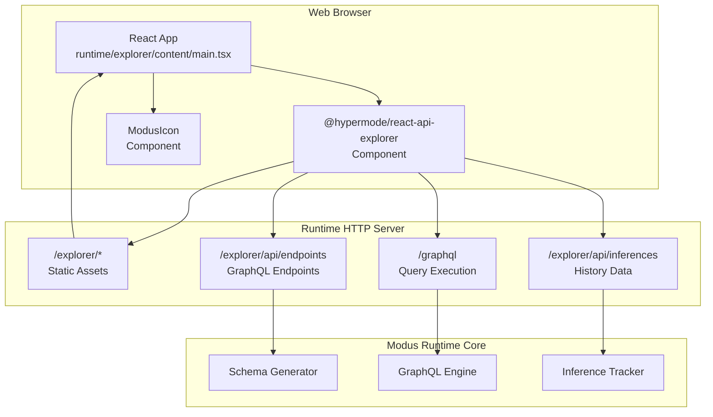
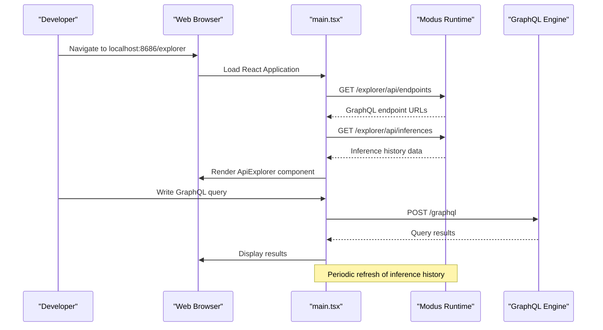
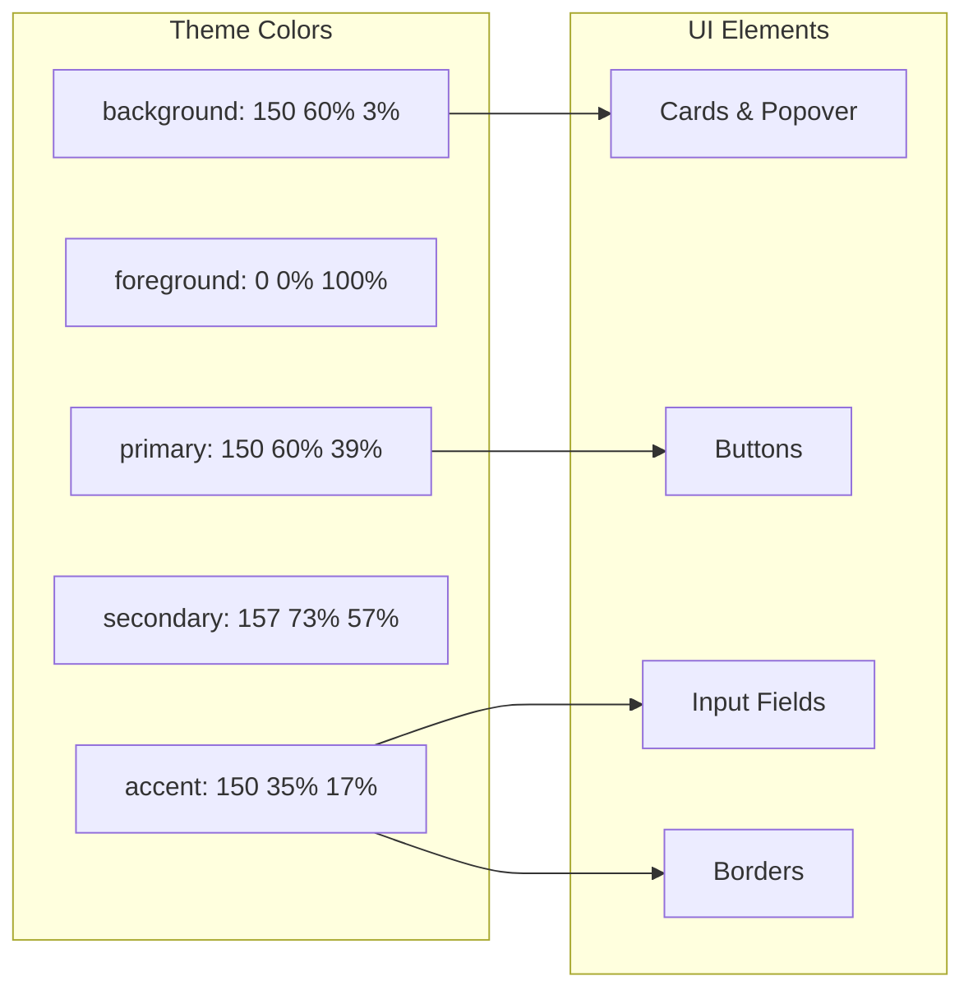
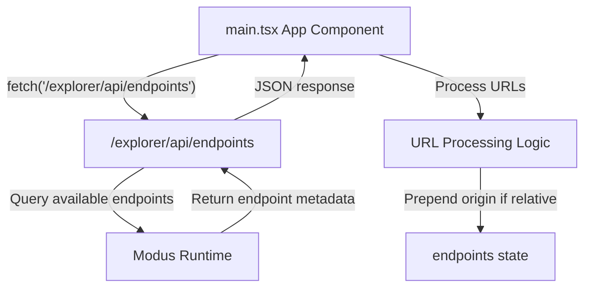
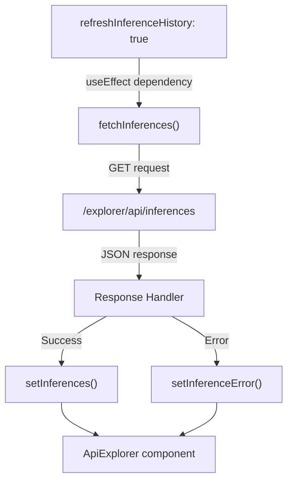
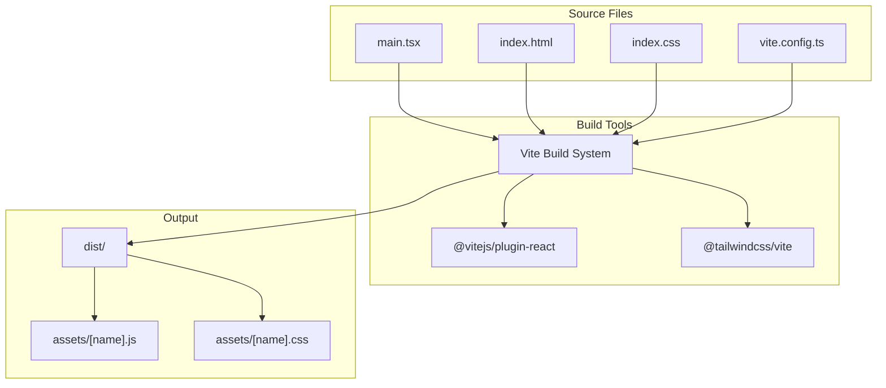
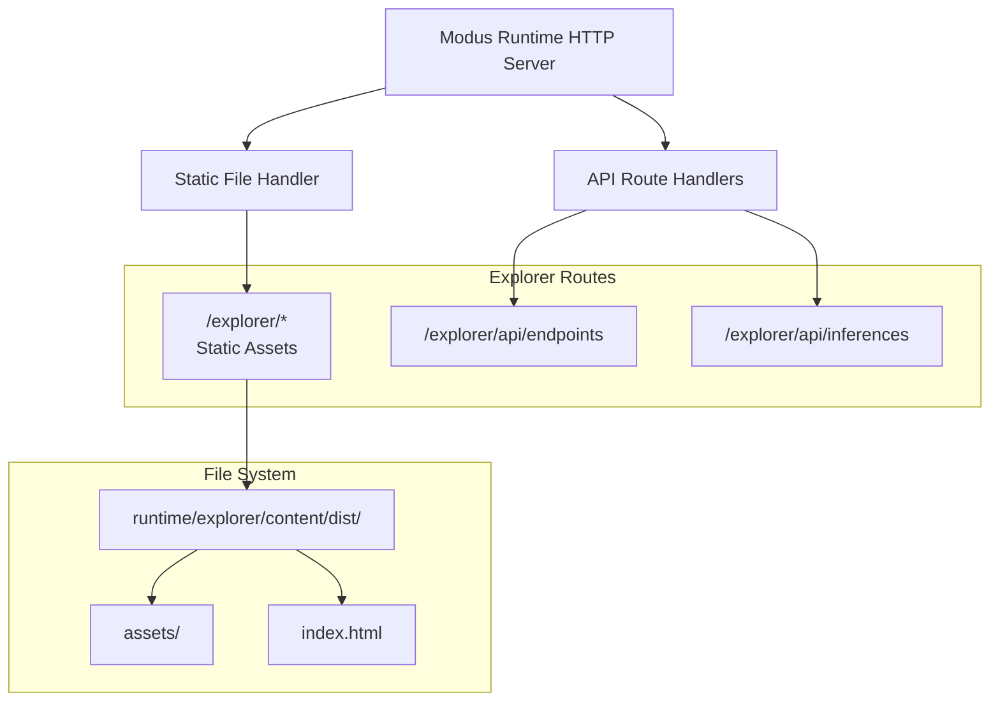

<!-- source: DeepWiki mcp.deepwiki.com · repo hypermodeinc/modus · page 7.2 API Explorer · fetched 2026-10-26 -->

# API Explorer

Relevant source files

The following files were used as context for generating this wiki page:

- [.trunk/trunk.yaml](.trunk/trunk.yaml)
- [go.work](go.work)
- [runtime/.gitignore](runtime/.gitignore)
- [runtime/explorer/content/ModusIcon.tsx](runtime/explorer/content/ModusIcon.tsx)
- [runtime/explorer/content/index.css](runtime/explorer/content/index.css)
- [runtime/explorer/content/index.html](runtime/explorer/content/index.html)
- [runtime/explorer/content/main.tsx](runtime/explorer/content/main.tsx)
- [runtime/explorer/content/package-lock.json](runtime/explorer/content/package-lock.json)
- [runtime/explorer/content/package.json](runtime/explorer/content/package.json)
- [runtime/explorer/content/postcss.config.js](runtime/explorer/content/postcss.config.js)
- [runtime/explorer/content/tailwind.config.js](runtime/explorer/content/tailwind.config.js)
- [runtime/explorer/content/vite.config.ts](runtime/explorer/content/vite.config.ts)
- [sdk/assemblyscript/src/assembly/index.ts](sdk/assemblyscript/src/assembly/index.ts)

The API Explorer is a web-based development interface that provides GraphQL schema introspection, query testing, and inference history monitoring for Modus applications. It serves as an interactive debugging and testing tool for developers working with Modus functions and their generated GraphQL endpoints.

For information about the underlying GraphQL engine that powers the API Explorer, see [GraphQL Engine](#5.2). For details about the development CLI commands, see [CLI Commands Reference](#3.1).

## Architecture Overview

The API Explorer is a React-based single-page application that integrates with the Modus Runtime to provide real-time GraphQL schema exploration and query execution capabilities.

### Component Architecture

Sources: [runtime/explorer/content/main.tsx:1-113](), [runtime/explorer/content/package.json:1-29]()

### Data Flow Architecture

Sources: [runtime/explorer/content/main.tsx:46-91]()

## User Interface Components

The API Explorer consists of several key UI components that work together to provide a comprehensive GraphQL development experience.

### Main Application Component

The main application is defined in `main.tsx` and includes:

| Component | Purpose | Configuration |
|-----------|---------|---------------|
| `App` | Root React component | Manages state and API calls |
| `ApiExplorer` | Main explorer interface | From `@hypermode/react-api-explorer` package |
| `ModusIcon` | Branding logo | Custom SVG component |

Sources: [runtime/explorer/content/main.tsx:19-112]()

### Theme Configuration

The explorer uses a custom dark theme with Modus branding colors:

Sources: [runtime/explorer/content/main.tsx:20-40]()

### State Management

The application manages several key state variables:

| State Variable | Type | Purpose |
|----------------|------|---------|
| `endpoints` | `string[]` | GraphQL endpoint URLs |
| `inferences` | `any[]` | Historical inference data |
| `inferenceError` | `InferenceError` | Error state for inference loading |
| `refreshInferenceHistory` | `boolean` | Trigger for refreshing history |

Sources: [runtime/explorer/content/main.tsx:41-44]()

## API Integration

The API Explorer integrates with the Modus Runtime through several HTTP endpoints to provide real-time data and functionality.

### Endpoint Discovery

Sources: [runtime/explorer/content/main.tsx:72-91]()

### Inference History Tracking

The explorer fetches and displays historical inference data:

Sources: [runtime/explorer/content/main.tsx:46-70]()

### Error Handling

The application includes comprehensive error handling for API failures:

| Error Type | Handler | Response |
|------------|---------|----------|
| Network Error | `catch` block | Console error logging |
| HTTP Error | Status check | `InferenceError` state update |
| JSON Parse Error | Try-catch | Graceful degradation |

Sources: [runtime/explorer/content/main.tsx:47-63]()

## Build System and Configuration

The API Explorer uses a Vite-based build system with React and TypeScript support.

### Build Configuration

Sources: [runtime/explorer/content/vite.config.ts:1-31](), [runtime/explorer/content/package.json:6-9]()

### Dependencies

The API Explorer relies on several key dependencies:

| Package | Version | Purpose |
|---------|---------|---------|
| `@hypermode/react-api-explorer` | `^1.0.0-alpha.32` | Core GraphQL explorer component |
| `react` | `^19.1.0` | React framework |
| `@tailwindcss/vite` | `^4.1.3` | Styling framework |
| `vite` | `^6.2.6` | Build tool |

Sources: [runtime/explorer/content/package.json:11-26]()

## Runtime Integration

The API Explorer is served directly by the Modus Runtime as part of its web interface capabilities.

### Serving Architecture

Sources: [runtime/explorer/content/vite.config.ts:29](), [runtime/explorer/content/main.tsx:49-50](), [runtime/explorer/content/main.tsx:76]()

### Development vs Production

The explorer supports both development and production deployment modes:

| Mode | Base URL | Build Command | Serving Method |
|------|----------|---------------|----------------|
| Development | `/explorer/` | `npm run dev` | Vite dev server |
| Production | `/explorer/` | `npm run build` | Static assets from `dist/` |

Sources: [runtime/explorer/content/package.json:7-9](), [runtime/explorer/content/vite.config.ts:29]()

---

