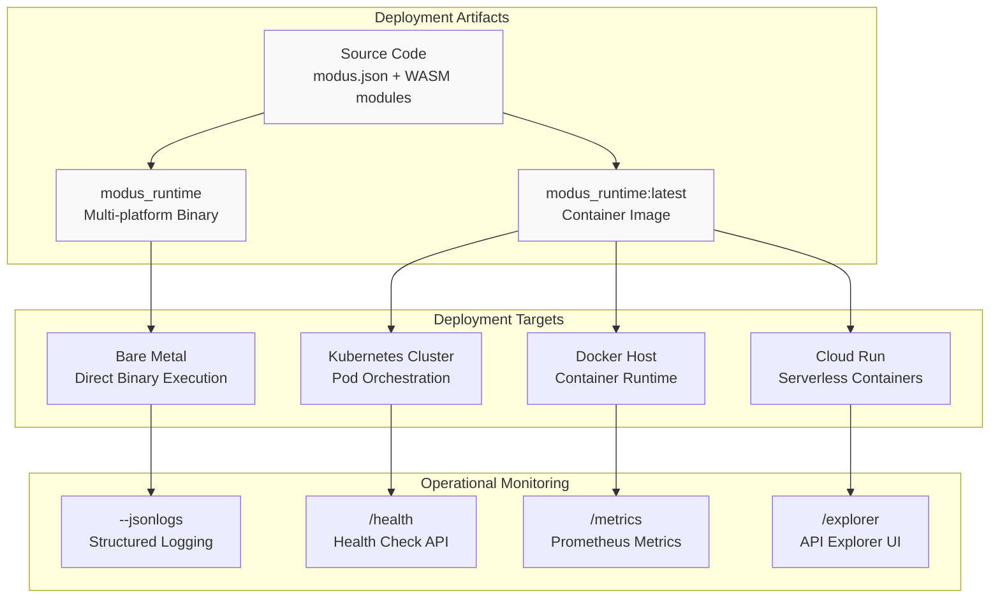
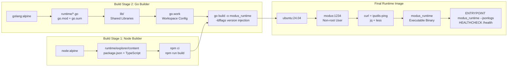
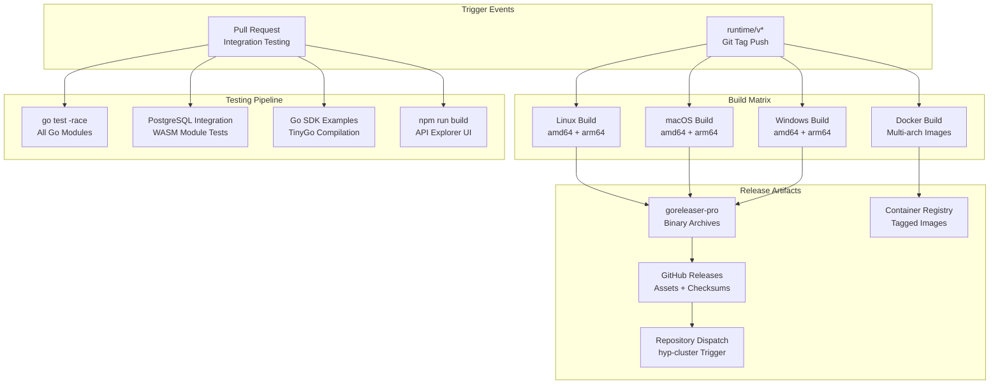
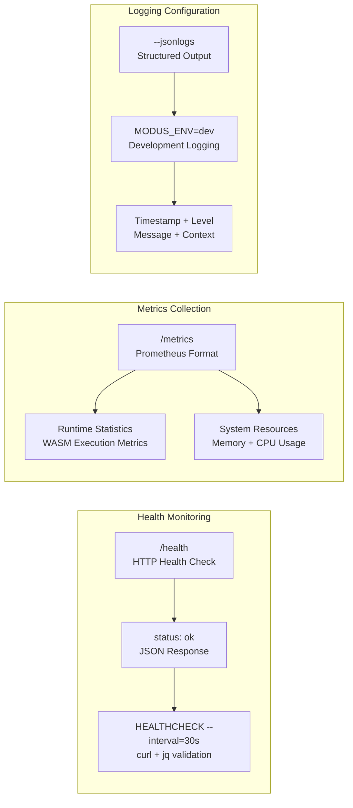
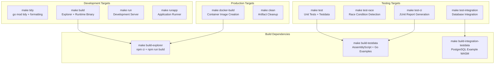

<!-- source: DeepWiki mcp.deepwiki.com · repo hypermodeinc/modus · page 8 Deployment and Operations · fetched 2026-10-26 -->

# Deployment and Operations

Relevant source files

The following files were used as context for generating this wiki page:

- [.github/workflows/ci-go-test.yml](.github/workflows/ci-go-test.yml)
- [.github/workflows/ci-runtime-build.yml](.github/workflows/ci-runtime-build.yml)
- [.github/workflows/ci-runtime-integration-tests.yml](.github/workflows/ci-runtime-integration-tests.yml)
- [.github/workflows/ci-sdk-go-build.yml](.github/workflows/ci-sdk-go-build.yml)
- [.github/workflows/codeql.yml](.github/workflows/codeql.yml)
- [.github/workflows/release-runtime.yaml](.github/workflows/release-runtime.yaml)
- [.github/workflows/release-sdk-go.yaml](.github/workflows/release-sdk-go.yaml)
- [.gitignore](.gitignore)
- [Dockerfile](Dockerfile)
- [runtime/.goreleaser.yaml](runtime/.goreleaser.yaml)
- [runtime/Makefile](runtime/Makefile)
- [runtime/integration_tests/testdata/postgresql-example.wasm](runtime/integration_tests/testdata/postgresql-example.wasm)

This document covers production deployment strategies, operational monitoring, and release management for Modus applications and runtime infrastructure. It focuses on containerized deployments, CI/CD automation, and production operational considerations.

For development environment setup and local debugging workflows, see [Development Environment](#7.1). For Docker-specific deployment configurations, see [Docker Deployment](#8.1). For CI/CD pipeline integration details, see [CI/CD Integration](#8.2).

## Production Deployment Architecture

Modus applications can be deployed using multiple strategies depending on operational requirements. The runtime supports both containerized and binary deployment models with comprehensive health monitoring and operational tooling.

Sources: [Dockerfile:1-75](), [runtime/.goreleaser.yaml:13-34](), [runtime/Makefile:89-91]()

## Container Build Pipeline

The Modus runtime uses a multi-stage Docker build process that optimizes for both development tooling and production deployment efficiency.

Sources: [Dockerfile:1-75](), [runtime/Makefile:22-28]()

## CI/CD Release Pipeline

The automated release system supports multiple artifact types with comprehensive testing and multi-platform distribution.

### Runtime Release Process

Sources: [.github/workflows/release-runtime.yaml:1-61](), [.github/workflows/ci-runtime-integration-tests.yml:1-42](), [.github/workflows/ci-go-test.yml:1-66]()

### SDK Release Process

The SDK release pipeline supports independent versioning and package distribution for different language targets.

| SDK Type | Version Pattern | Artifacts | Distribution |  
|----------|----------------|-----------|--------------|
| Go SDK | `sdk/go/v*` | `sdk.json`, `templates_go_*.tar.gz` | GitHub Releases |
| AssemblyScript SDK | `sdk/as/v*` | NPM packages | NPM Registry |

Sources: [.github/workflows/release-sdk-go.yaml:1-47]()

## Operational Monitoring

### Health Check System

The runtime provides comprehensive health monitoring through standardized endpoints and structured logging.

Sources: [Dockerfile:74-74](), [runtime/Makefile:33-33]()

### Production Configuration

Production deployments require specific configuration for security, performance, and operational requirements.

#### Container Security

- **Non-root execution**: Runtime runs as `modus:1234` user account
- **Minimal base image**: Ubuntu 24.04 with essential tools only
- **Resource isolation**: Container-based process isolation
- **Network security**: Configurable port binding (default `:8686`)

#### Resource Requirements

| Component | Memory | CPU | Storage |
|-----------|--------|-----|---------|
| Runtime Base | 64MB | 0.1 vCPU | 100MB |
| WASM Modules | Variable | Variable | Variable |
| Explorer UI | 32MB | 0.05 vCPU | 50MB |
| Database Connections | 16MB each | Minimal | Minimal |

Sources: [Dockerfile:42-75]()

## Build System Integration

### Makefile Targets

The runtime includes comprehensive build automation through standardized make targets.

Sources: [runtime/Makefile:1-96]()

### Cross-Platform Build Configuration

The runtime supports native compilation across multiple operating systems and architectures through GoReleaser configuration.

#### Supported Platforms

| OS | Architecture | Binary Format | Archive Format |
|----|-----------|--------------|--------------| 
| Linux | amd64, arm64 | ELF | tar.gz |
| macOS | amd64, arm64 | Mach-O | tar.gz |
| Windows | amd64, arm64 | PE (.exe) | zip |

#### Build Optimization

- **CGO disabled**: Pure Go compilation for portability
- **Link-time optimization**: `-s -w` flags for size reduction  
- **Version injection**: Build-time version embedding
- **Windows compatibility**: `-checklinkname=0` flag for Windows builds

Sources: [runtime/.goreleaser.yaml:13-34](), [runtime/Makefile:9-12]()

---

