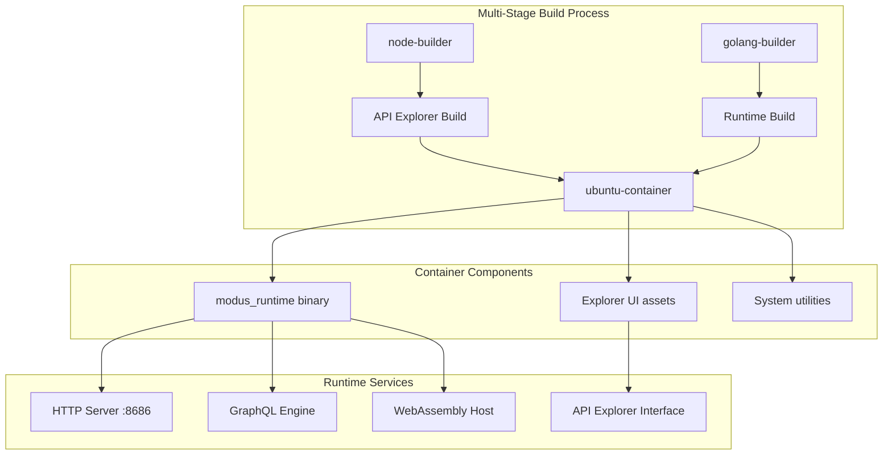
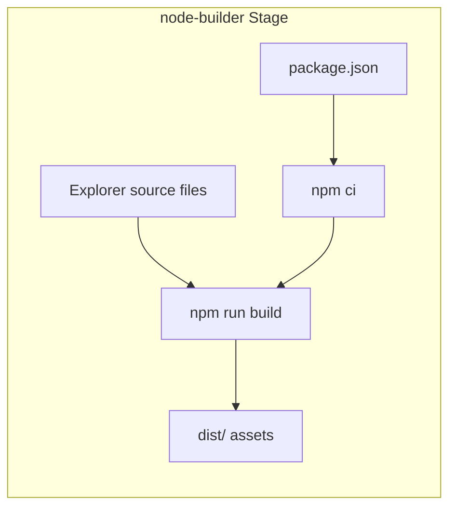
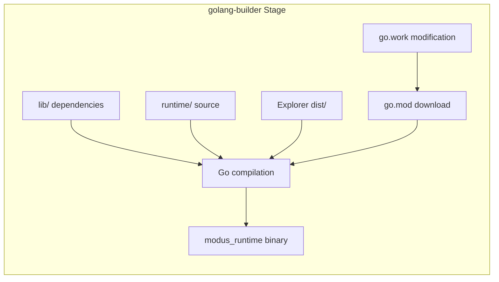
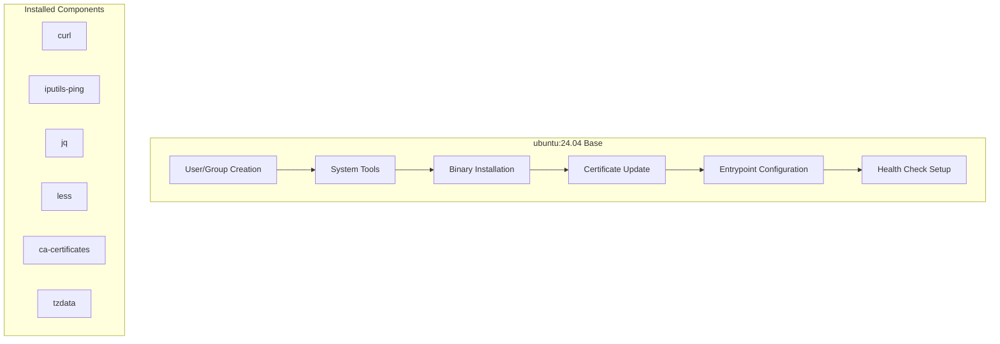
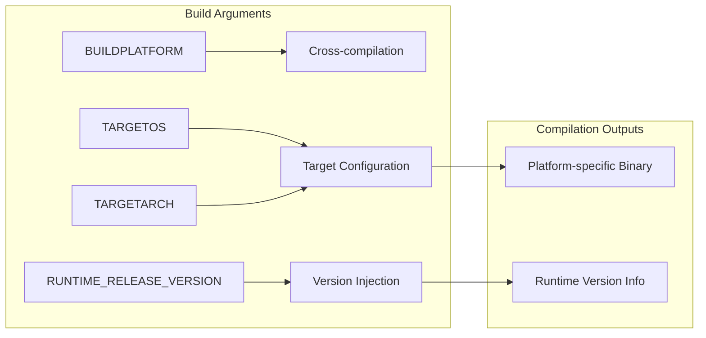
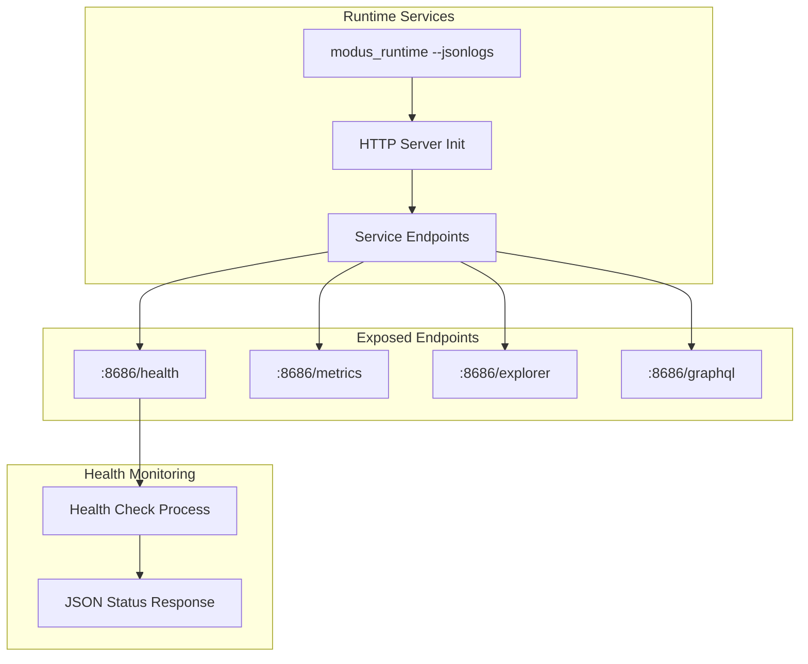

<!-- source: DeepWiki mcp.deepwiki.com · repo hypermodeinc/modus · page 8.1 Docker Deployment · fetched 2026-10-26 -->

# Docker Deployment

<details>
<summary>Relevant source files</summary>

The following files were used as context for generating this wiki page:

- [.gitignore](.gitignore)
- [Dockerfile](Dockerfile)
- [runtime/.goreleaser.yaml](runtime/.goreleaser.yaml)
- [runtime/Makefile](runtime/Makefile)
- [runtime/integration_tests/testdata/postgresql-example.wasm](runtime/integration_tests/testdata/postgresql-example.wasm)

</details>


This document covers the containerization and Docker deployment strategy for Modus applications and the Modus Runtime. It details the multi-stage build process, container configuration, and deployment workflows for running Modus applications in containerized environments.

For information about CI/CD integration and automated deployment pipelines, see [CI/CD Integration](#8.2).

## Container Architecture

The Modus Docker deployment uses a multi-stage build approach that packages both the API Explorer web interface and the Modus Runtime into a single container image. The containerization process is optimized for production deployment while maintaining development tooling accessibility.



Sources: [Dockerfile:1-75](), [runtime/Makefile:89-91]()

## Build Stages

### Stage 1: Explorer Application Build

The first build stage compiles the API Explorer web application using Node.js and npm. This stage creates the static assets needed for the web-based development interface.



The explorer build process installs dependencies first for optimal Docker layer caching, then copies source files and builds the application:

- Dependency installation: [Dockerfile:6-7]()
- Source compilation: [Dockerfile:10-11]()
- Output generation to `dist/` directory

Sources: [Dockerfile:2-11]()

### Stage 2: Runtime Binary Build

The second stage builds the Modus Runtime binary using Go, incorporating workspace dependencies and excluding SDK components not needed for runtime execution.



Key build optimizations include:
- Workspace file modification to exclude SDK directories: [Dockerfile:22-23]()
- Dependency caching through separate `go mod download`: [Dockerfile:30-31]()
- Cross-platform compilation support: [Dockerfile:38-39]()
- Version injection via build flags: [Dockerfile:39]()

Sources: [Dockerfile:14-39]()

### Stage 3: Production Container

The final stage creates a minimal Ubuntu-based container with the runtime binary, explorer assets, and essential system utilities.



Container security and operational features:
- Non-root user execution with UID/GID 1234: [Dockerfile:46-47]()
- Essential debugging tools installation: [Dockerfile:50-55]()
- JSON logging by default: [Dockerfile:71]()
- Health check endpoint monitoring: [Dockerfile:74]()

Sources: [Dockerfile:42-75]()

## Build Configuration

### Makefile Integration

The runtime Makefile provides Docker build automation with version management and dependency coordination.

| Target | Description | Dependencies |
|--------|-------------|--------------|
| `docker-build` | Build Docker image with version tagging | Explorer build completion |
| `build-explorer` | Compile API Explorer assets | Node.js dependencies |
| `build` | Create runtime binary | Go compilation, explorer assets |

The Docker build process integrates with the broader build system:
- Version extraction from Git tags: [runtime/Makefile:2]()
- Automatic explorer building: [runtime/Makefile:91]()
- Build context from repository root: [runtime/Makefile:91]()

Sources: [runtime/Makefile:89-95]()

### Build Arguments and Versioning

The Docker build accepts several build arguments for customization:



Version management is handled through:
- Git-based version detection: [runtime/Makefile:2]()
- Build-time version injection: [Dockerfile:39]()
- Runtime version reporting through build flags

Sources: [Dockerfile:38-39](), [runtime/Makefile:2-3]()

## Container Runtime Configuration

### Service Initialization

The containerized Modus Runtime starts with JSON logging enabled and exposes several key endpoints for application and infrastructure management.



The container is configured for operational monitoring:
- Default port 8686 exposure
- JSON-structured logging: [Dockerfile:71]()
- Health endpoint with JSON validation: [Dockerfile:74]()
- Automated health check every 30 seconds with 5-second timeout

Sources: [Dockerfile:71-74]()

### User and Security Context

The container implements security best practices through non-privileged execution:

- Custom user/group creation with fixed IDs: [Dockerfile:46-47]()
- Non-root execution context: [Dockerfile:67]()
- Working directory in user home: [Dockerfile:68]()
- Minimal privilege escalation surface

Sources: [Dockerfile:46-47](), [Dockerfile:67-68]()

## Deployment Workflows

### Local Development

For local development and testing, the Docker container can be built and run using the provided Makefile targets:

```bash
make docker-build
```

This command builds the complete container image with the current codebase version.

### Production Deployment

The container is designed for production deployment with:
- Health check integration for orchestrator monitoring
- JSON logging for log aggregation systems
- Certificate and timezone updates for enterprise environments
- Minimal attack surface through Ubuntu LTS base

The health check endpoint returns JSON status information that can be monitored by container orchestration platforms like Kubernetes or Docker Swarm.

Sources: [Dockerfile:61-64](), [Dockerfile:74]()

## Integration with Release Process

The Docker build process integrates with the broader release automation through GoReleaser configuration, enabling automated container image publication as part of the release pipeline.

The release configuration supports:
- Multi-platform binary compilation: [runtime/.goreleaser.yaml:18-24]()
- Version-aware builds: [runtime/.goreleaser.yaml:29]()
- Archive generation for distribution: [runtime/.goreleaser.yaml:47-56]()

Sources: [runtime/.goreleaser.yaml:13-64]()

---

