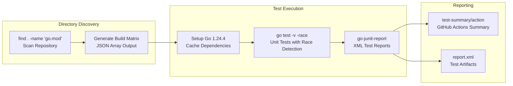
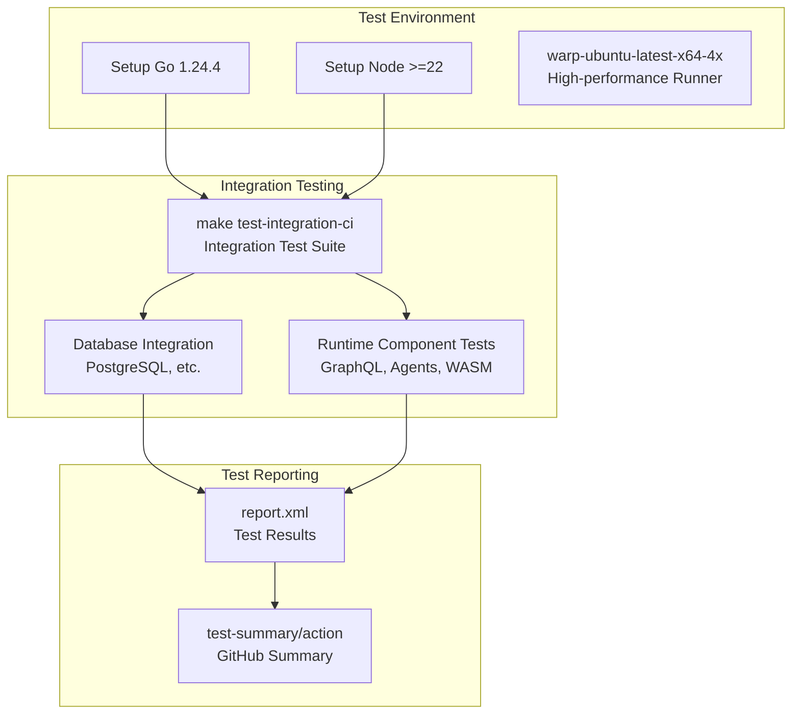
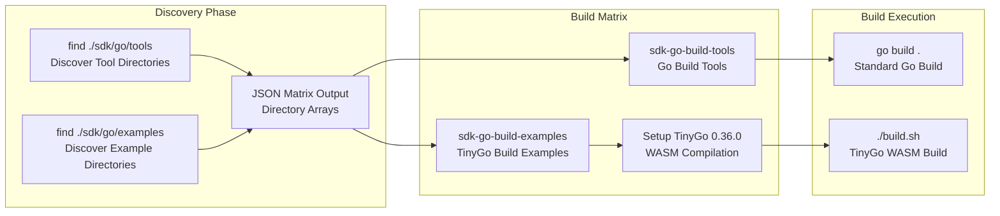
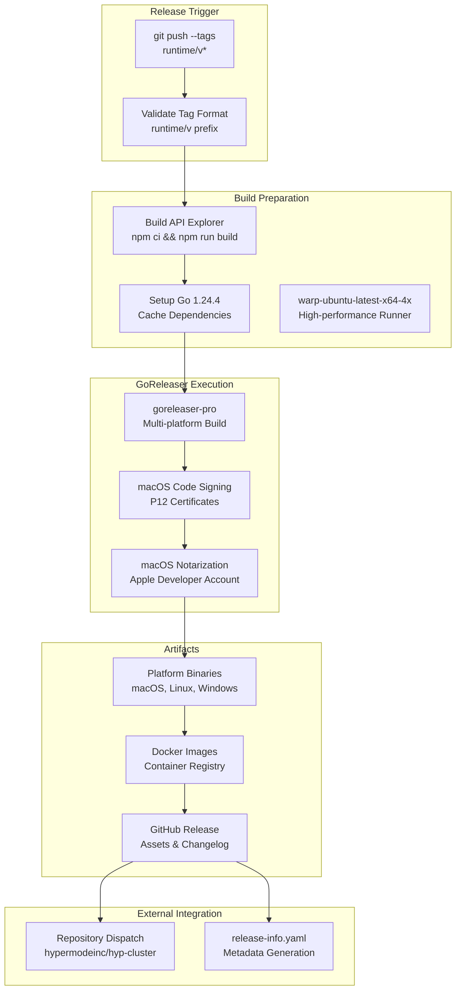
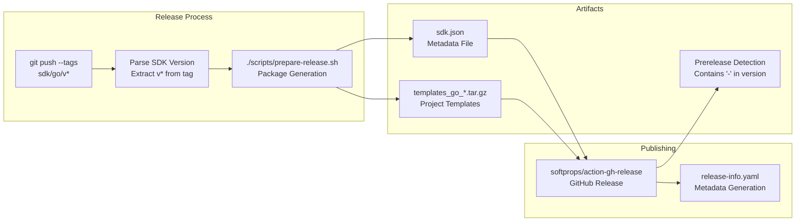
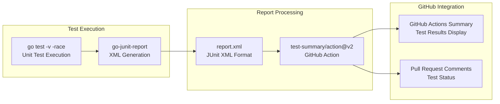
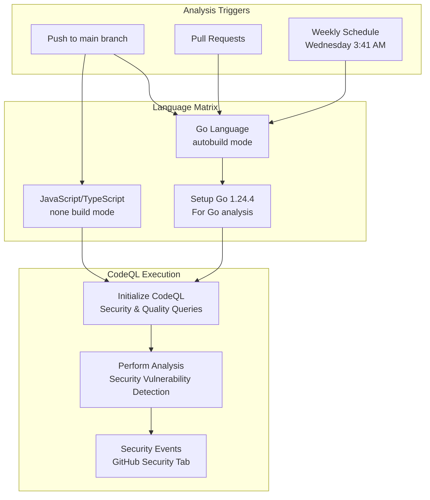
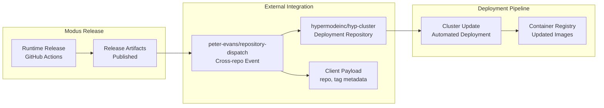

<!-- source: DeepWiki mcp.deepwiki.com · repo hypermodeinc/modus · page 8.2 CI/CD Integration · fetched 2026-10-26 -->

# CI/CD Integration

Relevant source files

The following files were used as context for generating this wiki page:

- [.github/renovate.json](.github/renovate.json)
- [.github/workflows/ci-cli-build.yml](.github/workflows/ci-cli-build.yml)
- [.github/workflows/ci-cli-lint.yml](.github/workflows/ci-cli-lint.yml)
- [.github/workflows/ci-go-test.yml](.github/workflows/ci-go-test.yml)
- [.github/workflows/ci-runtime-build.yml](.github/workflows/ci-runtime-build.yml)
- [.github/workflows/ci-runtime-integration-tests.yml](.github/workflows/ci-runtime-integration-tests.yml)
- [.github/workflows/ci-sdk-as-build.yml](.github/workflows/ci-sdk-as-build.yml)
- [.github/workflows/ci-sdk-as-lint.yml](.github/workflows/ci-sdk-as-lint.yml)
- [.github/workflows/ci-sdk-as-test.yml](.github/workflows/ci-sdk-as-test.yml)
- [.github/workflows/ci-sdk-go-build.yml](.github/workflows/ci-sdk-go-build.yml)
- [.github/workflows/codeql.yml](.github/workflows/codeql.yml)
- [.github/workflows/release-runtime.yaml](.github/workflows/release-runtime.yaml)
- [.github/workflows/release-sdk-go.yaml](.github/workflows/release-sdk-go.yaml)
- [cli/eslint.config.js](cli/eslint.config.js)

This document covers the continuous integration and continuous deployment (CI/CD) infrastructure for the Modus framework. It details automated testing workflows, build pipelines, release processes, and quality gates that ensure code reliability and enable automated delivery of runtime binaries, SDK packages, and development tools.

For information about Docker-based deployment strategies, see [Docker Deployment](#8.1).

## Workflow Architecture

The Modus CI/CD system uses GitHub Actions to orchestrate testing, building, and releasing across multiple components. The system is designed around path-based triggers to optimize build times and resource usage.

### CI/CD Pipeline Overview

```mermaid
flowchart TD
    subgraph "Source Control"
        PR["Pull Request"]
        Tags["Git Tags<br/>runtime/v*, sdk/go/v*"]
        Main["main branch"]
    end
    
    subgraph "Continuous Integration"
        GoTest["ci-go-test<br/>Go Unit Tests"]
        RuntimeBuild["ci-runtime-build<br/>Cross-platform Build"]
        RuntimeIntegration["ci-runtime-integration-tests<br/>Integration Tests"]
        SDKGoBuild["ci-sdk-go-build<br/>Go SDK Build"]
        SDKASBuild["ci-sdk-as-build<br/>AssemblyScript Build"]
        CLIBuild["ci-cli-build<br/>CLI Build & Test"]
        CodeQL["codeql<br/>Security Analysis"]
    end
    
    subgraph "Quality Gates"
        Lint["Linting<br/>ESLint, Go fmt"]
        RaceDetection["Race Detection<br/>go test -race"]
        TestReporting["Test Summary<br/>XML Reports"]
    end
    
    subgraph "Release Pipelines"
        RuntimeRelease["release-runtime<br/>GoReleaser"]
        SDKRelease["release-sdk-go<br/>Go Module Release"]
        ReleaseInfo["release-info<br/>Metadata Generation"]
    end
    
    subgraph "Artifacts"
        Binaries["Runtime Binaries<br/>Multi-platform"]
        DockerImages["Docker Images<br/>Container Registry"]
        SDKPackages["SDK Packages<br/>Go Modules"]
        CLIPackages["CLI Packages<br/>npm"]
    end
    
    PR --> GoTest
    PR --> RuntimeBuild
    PR --> RuntimeIntegration
    PR --> SDKGoBuild
    PR --> SDKASBuild
    PR --> CLIBuild
    
    Main --> CodeQL
    
    GoTest --> RaceDetection
    RuntimeIntegration --> TestReporting
    SDKGoBuild --> Lint
    
    Tags --> RuntimeRelease
    Tags --> SDKRelease
    
    RuntimeRelease --> Binaries
    RuntimeRelease --> DockerImages
    RuntimeRelease --> ReleaseInfo
    
    SDKRelease --> SDKPackages
    SDKRelease --> ReleaseInfo
```

**Sources:** [.github/workflows/ci-go-test.yml](), [.github/workflows/ci-runtime-build.yml](), [.github/workflows/release-runtime.yaml](), [.github/workflows/release-sdk-go.yaml]()

### Path-Based Trigger Strategy

The CI system implements intelligent path-based triggers to minimize unnecessary builds and optimize resource usage:

| Workflow | Trigger Paths | Purpose |
|----------|---------------|---------|
| `ci-go-test` | `**/*.go`, `**/go.mod`, `**/testdata/**` | Go code changes |
| `ci-runtime-build` | `runtime/**/*.go`, `runtime/go.mod` | Runtime-specific changes |
| `ci-runtime-integration-tests` | `runtime/**` | Runtime integration changes |
| `ci-sdk-go-build` | `sdk/go/**` | Go SDK changes |
| `ci-sdk-as-build` | `sdk/assemblyscript/**` | AssemblyScript SDK changes |
| `ci-cli-build` | `cli/**` | CLI changes |

**Sources:** [.github/workflows/ci-go-test.yml:11-15](), [.github/workflows/ci-runtime-build.yml:10-14](), [.github/workflows/ci-sdk-go-build.yml:10-12]()

## Continuous Integration Pipelines

### Go Testing Infrastructure

The `ci-go-test` workflow provides comprehensive testing for all Go modules in the repository using a dynamic discovery strategy:

The workflow uses the `jstemmer/go-junit-report/v2` tool to convert Go test output to JUnit XML format for integration with GitHub's test reporting system.

**Sources:** [.github/workflows/ci-go-test.yml:31-38](), [.github/workflows/ci-go-test.yml:58-60]()

### Runtime Integration Testing

The runtime integration tests run on high-performance `warp-ubuntu-latest-x64-4x` runners and include database connectivity testing:

**Sources:** [.github/workflows/ci-runtime-integration-tests.yml:21-22](), [.github/workflows/ci-runtime-integration-tests.yml:34-36]()

### SDK Build Validation

The Go SDK build workflow validates both tools and examples using a matrix strategy:

**Sources:** [.github/workflows/ci-sdk-go-build.yml:28-43](), [.github/workflows/ci-sdk-go-build.yml:84-89]()

## Release Automation

### Runtime Release Pipeline

The runtime release process uses GoReleaser Pro for multi-platform binary distribution:

The runtime release includes macOS code signing and notarization using certificates and keys stored in GitHub Secrets.

**Sources:** [.github/workflows/release-runtime.yaml:14-49](), [.github/workflows/release-runtime.yaml:50-56]()

### SDK Release Management

The Go SDK release workflow creates packaged distributions and updates Go module metadata:

**Sources:** [.github/workflows/release-sdk-go.yaml:22-33](), [.github/workflows/release-sdk-go.yaml:34-41]()

## Testing Strategy

### Test Matrix Configuration

The testing infrastructure uses dynamic matrix generation to handle multiple Go modules and SDK examples:

| Component | Test Strategy | Tools |
|-----------|---------------|-------|
| Go Modules | Unit tests with race detection | `go test -v -race` |
| Runtime | Integration tests with databases | `make test-integration-ci` |
| Go SDK Examples | TinyGo compilation validation | `./build.sh` |
| AssemblyScript SDK | npm test suite | `npm run test` |
| CLI | Build validation | `npm run build` |

### Test Reporting Infrastructure

All test workflows generate structured reports using the `test-summary/action@v2` GitHub Action:

**Sources:** [.github/workflows/ci-go-test.yml:58-65](), [.github/workflows/ci-runtime-integration-tests.yml:37-41]()

## Code Quality and Security

### CodeQL Security Analysis

The repository uses GitHub's CodeQL for automated security analysis of Go and TypeScript/JavaScript code:

**Sources:** [.github/workflows/codeql.yml:14-20](), [.github/workflows/codeql.yml:49-53]()

### Linting Infrastructure

Code quality is enforced through multiple linting workflows:

- **CLI**: ESLint with TypeScript rules configured in [cli/eslint.config.js]()
- **AssemblyScript SDK**: ESLint and Prettier formatting checks
- **Go Code**: Built-in `go fmt` and race detection

**Sources:** [.github/workflows/ci-cli-lint.yml](), [.github/workflows/ci-sdk-as-lint.yml:51-54](), [cli/eslint.config.js:6-24]()

## Deployment Integration

### External System Integration

The runtime release workflow integrates with external deployment systems through repository dispatch events:

**Sources:** [.github/workflows/release-runtime.yaml:50-56]()

### Dependency Management

The repository uses Renovate for automated dependency updates with a custom configuration extending `github>hypermodeinc/renovate-config`:

**Sources:** [.github/renovate.json:1-5]()