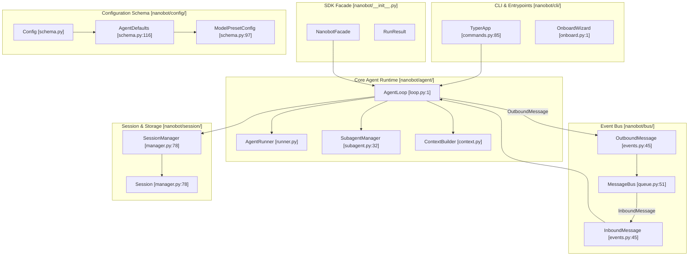

<!-- source: DeepWiki mcp.deepwiki.com · repo HKUDS/nanobot · page 1 Overview · fetched 2026-10-26 -->

# Overview

<details>
<summary>Relevant source files</summary>

The following files were used as context for generating this wiki page:

- [CONTRIBUTING.md](CONTRIBUTING.md)
- [README.md](README.md)
- [docs/README.md](docs/README.md)
- [docs/chat-commands.md](docs/chat-commands.md)
- [docs/concepts.md](docs/concepts.md)
- [docs/configuration.md](docs/configuration.md)
- [docs/multiple-instances.md](docs/multiple-instances.md)
- [docs/providers.md](docs/providers.md)
- [docs/quick-start.md](docs/quick-start.md)
- [docs/releasing.md](docs/releasing.md)
- [docs/start-without-technical-background.md](docs/start-without-technical-background.md)
- [docs/troubleshooting.md](docs/troubleshooting.md)
- [docs/webui.md](docs/webui.md)
- [nanobot/__init__.py](nanobot/__init__.py)
- [nanobot/agent/loop.py](nanobot/agent/loop.py)
- [nanobot/cli/commands.py](nanobot/cli/commands.py)
- [nanobot/cli/onboard.py](nanobot/cli/onboard.py)
- [nanobot/config/schema.py](nanobot/config/schema.py)
- [nanobot/providers/registry.py](nanobot/providers/registry.py)
- [pyproject.toml](pyproject.toml)
- [scripts/build_tui_wheels.py](scripts/build_tui_wheels.py)
- [tests/agent/test_onboard_logic.py](tests/agent/test_onboard_logic.py)
- [tests/cli/test_commands.py](tests/cli/test_commands.py)
- [tests/cli/test_tui_wheels.py](tests/cli/test_tui_wheels.py)
- [tui/scripts/build.ts](tui/scripts/build.ts)

</details>


## Purpose and Scope

This document provides a comprehensive technical introduction to **nanobot**, an open-source, ultra-lightweight personal AI agent framework written in Python designed for complete user ownership [README.md:37-37](). It covers the system's design philosophy, high-level architecture, core functional layers, and end-to-end event and data flow patterns. nanobot is built to maintain a small, readable core while supporting rich capabilities including a React-based WebUI [docs/webui.md:5-8](), 25+ communication channels [README.md:56-56](), Model Context Protocol (MCP) integrations [README.md:57-57](), automated memory consolidation (`Dream`) [nanobot/config/schema.py:53-68](), and an OpenAI-compatible API server [README.md:37-37]().

Sources: [README.md:37-70](), [pyproject.toml:1-12](), [nanobot/config/schema.py:23-68]()

## System Description

nanobot operates as a self-hosted personal AI agent runtime. Its design philosophy prioritizes local control, transparency, and extensibility without heavyweight platform lock-in [README.md:65-69](). 

The system architecture is organized into distinct modular subsystems:

1. **Gateway & Process Runtime** — Manages process supervision, daemon lifecycles, and multi-instance workspace isolation [docs/configuration.md:69-69]().
2. **Message Bus & Event Routing** — An asynchronous publish-subscribe event routing core (`MessageBus`) using `InboundMessage` and `OutboundMessage` events [nanobot/agent/loop.py:45-51]().
3. **Agent Loop & Execution Engine** — The core `AgentLoop` coordinates iterative turn execution, tool resolution, step constraints (`max_tool_iterations`), and state persistence [nanobot/agent/loop.py:118-183](), [nanobot/config/schema.py:129-131]().
4. **Provider Abstraction Layer** — Unified LLM integration supporting OpenAI, Anthropic, Azure OpenAI, Bedrock, and local models via a centralized registry (`PROVIDERS`) [nanobot/providers/registry.py:2-10]().
5. **Memory & Context Governance** — Atomic JSONL session persistence, dynamic context building (`ContextBuilder`), and background memory consolidation (`DreamConfig`) [nanobot/agent/loop.py:26-29](), [nanobot/config/schema.py:53-68]().
6. **Capabilities & Tool Registry** — Built-in filesystem, shell, web search, MCP servers, and subagent orchestration [README.md:57-57](), [nanobot/agent/tools/registry.py:1-44]().

Sources: [README.md:37-70](), [nanobot/agent/loop.py:23-51](), [nanobot/providers/registry.py:1-11](), [nanobot/config/schema.py:23-68]()

## Core Architecture

The following diagram bridges natural language functional concepts to concrete code entities within the nanobot codebase:

Title: Architecture Mapping (Natural Language to Code Entity Space)

Sources: [nanobot/cli/commands.py:85-130](), [nanobot/agent/loop.py:1-51](), [nanobot/bus/queue.py:51-51](), [nanobot/config/schema.py:97-128](), [nanobot/session/manager.py:78-78]()

## Key Components

| Component | Code Location | Description |
| :--- | :--- | :--- |
| **Agent Defaults** | `nanobot/config/schema.py` | Pydantic model (`AgentDefaults`) defining `workspace`, `model`, `temperature`, and `max_tool_iterations`. [nanobot/config/schema.py:116-168]() |
| **Agent Loop** | `nanobot/agent/loop.py` | Core processing engine (`AgentLoop`) managing conversation turns, execution iterations, and tool dispatch. [nanobot/agent/loop.py:1-183]() |
| **Config Schema** | `nanobot/config/schema.py` | Defines Pydantic configuration schemas for agents, providers, channels, and security settings. [nanobot/config/schema.py:1-168]() |
| **Python SDK Facade** | `nanobot/__init__.py` | Provides programmatic embedding interface (`Nanobot` class and `RunResult`). [nanobot/__init__.py:31-83]() |
| **CLI Commands** | `nanobot/cli/commands.py` | Typer-based entry points for CLI commands (`onboard`, `gateway`, `agent`, `webui`). [nanobot/cli/commands.py:85-171]() |
| **Subagent Manager** | `nanobot/agent/subagent.py` | Handles concurrent execution and task delegation to isolated subagent instances. [nanobot/agent/subagent.py:32-32]() |

Sources: [nanobot/config/schema.py:116-168](), [nanobot/agent/loop.py:1-183](), [nanobot/__init__.py:31-83](), [nanobot/cli/commands.py:85-171](), [nanobot/agent/subagent.py:32-32]()

## Message Processing Flow

The following sequence diagram illustrates how an inbound event flows from a communication channel or API client through the message bus, agent loop, session manager, and LLM provider back to the output sink, referencing concrete codebase symbols.

Title: Data Flow Sequence (Channel to Agent Loop & Provider)
```mermaid
sequenceDiagram
    participant User as "User / Channel"
    participant Bus as "MessageBus [queue.py]"
    participant Loop as "AgentLoop [loop.py]"
    participant Session as "SessionManager [manager.py]"
    participant Provider as "LLMProvider [base.py]"

    User->>Bus: "publish(InboundMessage)"
    Bus->>Loop: "process_turn(InboundMessage)"
    Loop->>Session: "get_or_create_session(session_key)"
    
    loop Agent Iteration (max_tool_iterations: 200)
        Loop->>Loop: "ContextBuilder.build()"
        Loop->>Provider: "generate_response(messages)"
        alt Tool Call Detected
            Loop-->>Loop: "ToolRegistry.execute()"
        else Final Response
            Loop-->>Loop: "finalize_content()"
        end
    end

    Loop->>Session: "save_session()"
    Loop->>Bus: "publish_outbound(OutboundMessage)"
    Bus->>User: "Deliver OutboundMessage"
```
Sources: [nanobot/bus/queue.py:51-51](), [nanobot/agent/loop.py:45-183](), [nanobot/session/manager.py:78-78](), [nanobot/providers/base.py:57-57]()

## Technology Stack

nanobot is constructed with a modular, lightweight Python toolchain:

| Technology | Purpose | File Reference |
| :--- | :--- | :--- |
| **Python 3.11+** | Core execution runtime | [pyproject.toml:6-6]() |
| **Pydantic / Settings** | Schema validation and configuration management | [pyproject.toml:28-29]() |
| **Anthropic / OpenAI SDKs** | Native API client libraries | [pyproject.toml:27-47]() |
| **Typer / Prompt Toolkit** | Command-line interface and interactive REPL | [pyproject.toml:26-41]() |
| **Model Context Protocol (MCP)** | Extensible external tool integration | [pyproject.toml:44-44]() |
| **Hatchling** | Packaging, build backend, and wheel construction | [pyproject.toml:119-122]() |
| **Loguru** | Structured logging framework | [nanobot/cli/commands.py:25-31]() |

Sources: [pyproject.toml:1-122](), [nanobot/cli/commands.py:25-31]()

## Workspace & Configuration

The agent maintains local execution state within a designated workspace directory (defaulting to `~/.nanobot/workspace`) [nanobot/config/schema.py:119-120]().

### Configuration (`config.json`)
Configuration parameters are managed through typed Pydantic models in `nanobot/config/schema.py`:
* **`AgentDefaults`**: Governs core agent settings such as `model`, `provider`, `temperature`, and auto-compaction intervals (`session_ttl_minutes`) [nanobot/config/schema.py:116-168]().
* **`ChannelsConfig`**: Controls messaging platform behaviors, progress streaming (`send_progress`), and tool hint displays (`send_tool_hints`) [nanobot/config/schema.py:23-40]().
* **`DreamConfig`**: Configures periodic memory consolidation schedules (`interval_h`) [nanobot/config/schema.py:53-68]().
* **`TranscriptionConfig`**: Manages voice-to-text audio processing settings [nanobot/config/schema.py:42-51]().

### Workspace Files
* **`MEMORY.md`**: Long-term consolidated facts produced by background dream jobs [README.md:58-58]().
* **`HISTORY.md`**: Event-based transactional conversation logs [README.md:58-58]().
* **`SOUL.md`**: Core agent persona and operational instructions.
* **`USER.md`**: User preferences and contextual metadata.

Sources: [nanobot/config/schema.py:23-168](), [README.md:57-60]()

---

