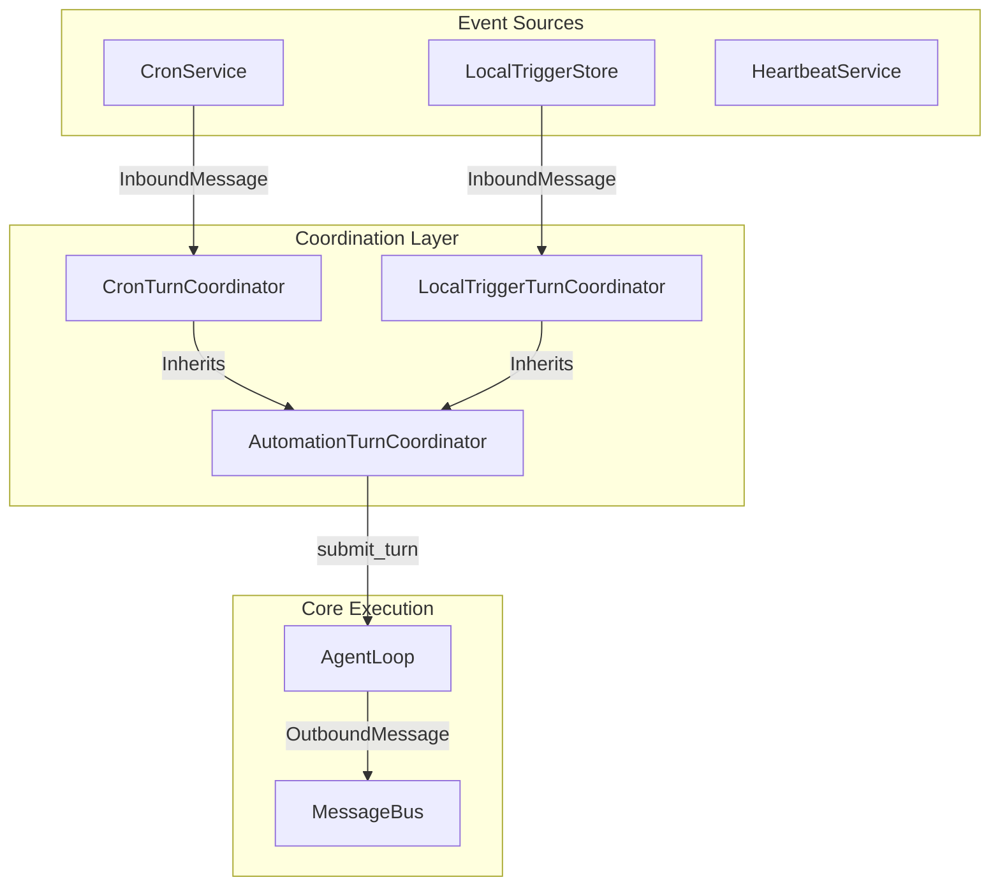
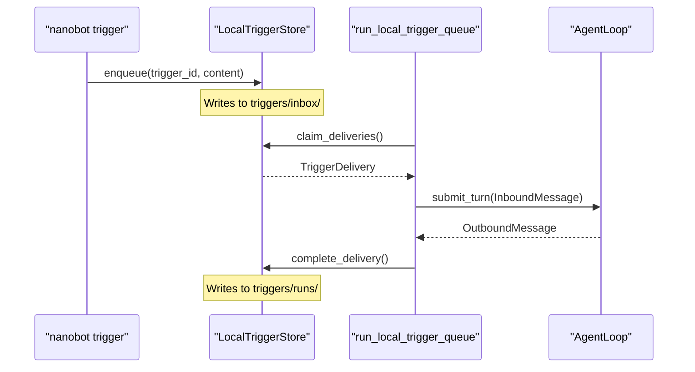

<!-- source: DeepWiki mcp.deepwiki.com · repo HKUDS/nanobot · page 10 Automation & Scheduling · fetched 2026-10-26 -->

# Automation & Scheduling

Relevant source files

The following files were used as context for generating this wiki page:

- [nanobot/agent/tools/cron.py](nanobot/agent/tools/cron.py)
- [nanobot/cron/service.py](nanobot/cron/service.py)
- [nanobot/cron/types.py](nanobot/cron/types.py)
- [tests/cron/test_cron_active_rearm.py](tests/cron/test_cron_active_rearm.py)
- [tests/cron/test_cron_persistence.py](tests/cron/test_cron_persistence.py)
- [tests/cron/test_cron_service.py](tests/cron/test_cron_service.py)
- [tests/cron/test_cron_tool_list.py](tests/cron/test_cron_tool_list.py)

This document describes the automated task execution systems in nanobot. The framework provides three complementary mechanisms for scheduled, proactive, and externally-triggered agent actions: **CronService** for user-defined scheduled tasks, **HeartbeatService** for periodic workspace checks, and **LocalTriggerStore** for local command-line or script-based triggers.

For details on individual service implementations, see:
- [Cron Service](#10.1) — Document cron job scheduling with cron expression parsing, job execution callbacks, and cron directory structure
- [Heartbeat Service](#10.2) — Explain the three-phase heartbeat workflow (decision, execution, evaluation) and HEARTBEAT.md file usage
- [Local Triggers](#10.3) — Document the local trigger system — how triggers are created via /trigger, stored in LocalTriggerStore, delivered via nanobot trigger CLI, and coordinated with the agent loop via LocalTriggerTurnCoordinator

---

## Overview

nanobot's automation layer enables the agent to operate autonomously without direct user initiation. These services bridge the gap between static time/event triggers and the dynamic `AgentLoop`.

| Service | Purpose | Trigger | Data Store |
|---------|---------|---------|---------------|
| **CronService** | Schedule specific tasks with cron expressions | Time-based (cron/at/every) | `jobs.json` [nanobot/cron/service.py:182]() |
| **HeartbeatService** | Proactive periodic task checking | Fixed interval (default: 30m) | `HEARTBEAT.md` |
| **Local Triggers** | External script/CLI event injection | Local file system events | `triggers/` directory |

All automation tasks are routed through specialized coordinators—`CronTurnCoordinator` and `LocalTriggerTurnCoordinator`—to ensure they do not interrupt active user sessions unless configured to do so.

Sources: [nanobot/cron/service.py:177-182]()

---

## Architecture & Coordination

Automation services integrate with the `AgentLoop` by submitting `InboundMessage` objects with specific metadata. To prevent race conditions and context mixing, nanobot uses a "turn coordination" pattern.

**Diagram: Automation Coordination Flow**

The `AutomationTurnCoordinator` manages the queue. For instance, if a cron job triggers while a user is actively chatting, the `_should_defer_cron_turn` logic can hold the automated task until the session is idle by checking the `defer_cron_until_session_idle` condition.

---

## CronService

The `CronService` [nanobot/cron/service.py:168]() manages tasks defined by the `CronTool` [nanobot/agent/tools/cron.py:57](). It supports three schedule types in `CronSchedule` [nanobot/cron/types.py:27-37](): `at` (one-time), `every` (interval), and `cron` (standard expression via `croniter` [nanobot/cron/service.py:55-65]()).

### Persistence & Safety
Jobs are stored in `jobs.json` [nanobot/cron/service.py:182](). The service uses atomic write operations to prevent store corruption. If a store is found to be corrupt on startup, it is moved to a `.corrupt` backup rather than being overwritten [tests/cron/test_cron_persistence.py:140-156]().

### Session Binding
Modern nanobot cron jobs are "session-bound". The `CronTool` captures the `session_key`, `origin_channel`, and `origin_chat_id` from the `current_request_context()` [nanobot/agent/tools/cron.py:76-85]() when a job is added. This ensures the agent has the correct context when the job triggers. Jobs lacking this context are considered "unbound" and are disabled for safety [nanobot/cron/service.py:172-175](), [tests/cron/test_cron_service.py:186-204]().

Sources: [nanobot/cron/service.py:168](), [nanobot/cron/types.py:27-37](), [nanobot/cron/service.py:55-65](), [nanobot/agent/tools/cron.py:57](), [nanobot/agent/tools/cron.py:76-85](), [nanobot/cron/service.py:182](), [tests/cron/test_cron_persistence.py:140-156](), [nanobot/cron/service.py:172-175](), [tests/cron/test_cron_service.py:186-204]()

---

## Local Triggers

The Local Trigger system allows external processes to trigger agent actions via the file system.

**Diagram: Local Trigger Delivery Pipeline**

### Components
- **LocalTriggerStore**: Manages the `triggers/` directory structure, including `inbox`, `processing`, `failed`, and `runs`.
- **run_local_trigger_queue**: A background loop in the gateway that polls the inbox and submits tasks to the agent via `_deliver_delivery`.
- **Run Records**: Every execution generates a `TriggerRunRecord` (or `CronRunRecord` [nanobot/cron/types.py:93-101]() for cron), providing a durable audit log of automated actions.

Sources: [nanobot/cron/types.py:93-101]()

---

## HeartbeatService

The `HeartbeatService` provides a proactive "pull" mechanism. It periodically checks a `HEARTBEAT.md` file in the workspace.

1.  **Decision**: The service uses an LLM to decide if any text in the heartbeat file requires action.
2.  **Execution**: If action is required, it triggers a turn in the `AgentLoop`.
3.  **Evaluation**: The result is evaluated to determine if the user should be notified, suppressing low-signal updates.

---

