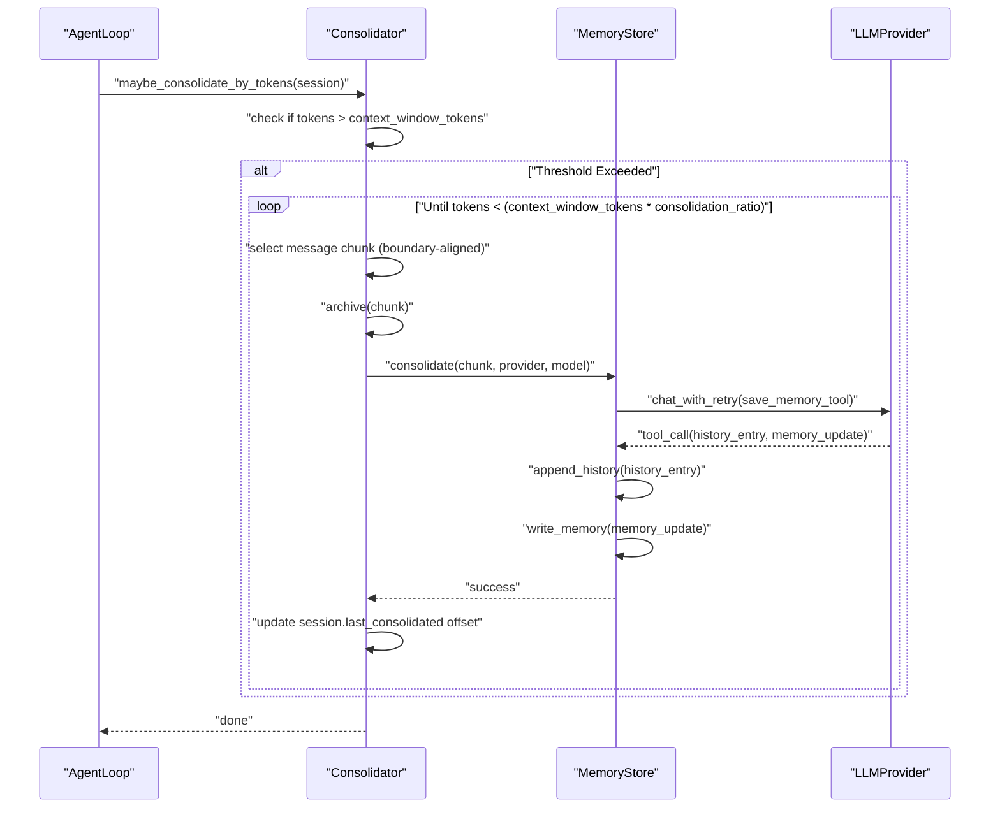
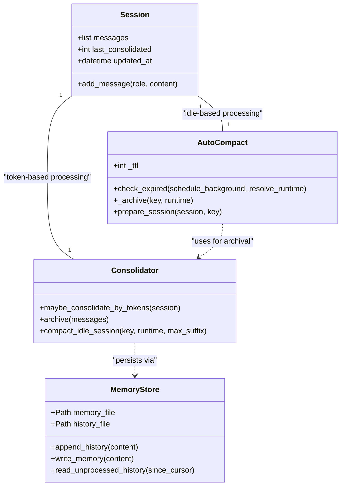

<!-- source: DeepWiki mcp.deepwiki.com · repo HKUDS/nanobot · page 11.2 Memory Consolidation & Auto-Compaction · fetched 2026-10-26 -->

# Memory Consolidation & Auto-Compaction

Relevant source files

The following files were used as context for generating this wiki page:

- [nanobot/agent/autocompact.py](nanobot/agent/autocompact.py)
- [nanobot/agent/memory.py](nanobot/agent/memory.py)
- [nanobot/channels/mochat/runtime.py](nanobot/channels/mochat/runtime.py)
- [nanobot/channels/signal/runtime.py](nanobot/channels/signal/runtime.py)
- [nanobot/channels/signal/tests/test_signal_channel.py](nanobot/channels/signal/tests/test_signal_channel.py)
- [nanobot/channels/signal/tests/test_signal_markdown.py](nanobot/channels/signal/tests/test_signal_markdown.py)
- [nanobot/channels/slack/runtime.py](nanobot/channels/slack/runtime.py)
- [nanobot/channels/slack/tests/test_slack_channel.py](nanobot/channels/slack/tests/test_slack_channel.py)
- [nanobot/session/manager.py](nanobot/session/manager.py)
- [nanobot/templates/agent/consolidator_archive.md](nanobot/templates/agent/consolidator_archive.md)
- [nanobot/utils/helpers.py](nanobot/utils/helpers.py)
- [tests/agent/test_auto_compact.py](tests/agent/test_auto_compact.py)
- [tests/agent/test_autocompact_unit.py](tests/agent/test_autocompact_unit.py)
- [tests/agent/test_consolidator.py](tests/agent/test_consolidator.py)
- [tests/agent/test_dream_session.py](tests/agent/test_dream_session.py)
- [tests/agent/test_loop_consolidation_tokens.py](tests/agent/test_loop_consolidation_tokens.py)
- [tests/agent/test_memory_store.py](tests/agent/test_memory_store.py)
- [tests/agent/test_new_command_archival.py](tests/agent/test_new_command_archival.py)
- [tests/agent/test_session_atomic.py](tests/agent/test_session_atomic.py)
- [tests/agent/test_session_manager_history.py](tests/agent/test_session_manager_history.py)
- [tests/session/test_consolidated_offset_clamp.py](tests/session/test_consolidated_offset_clamp.py)
- [tests/session/test_session_fsync.py](tests/session/test_session_fsync.py)
- [tests/utils/test_helpers.py](tests/utils/test_helpers.py)
- [tests/utils/test_strip_think.py](tests/utils/test_strip_think.py)

Memory Consolidation is the process by which nanobot manages the growth of conversation history to prevent exceeding LLM context window limits. It compresses older messages into persistent storage while maintaining a sliding window of recent messages for immediate context through offset tracking and proactive idle archival.

## Overview

The consolidation system serves three primary purposes:
1.  **Context Window Management**: It identifies when a session's message history is approaching the provider's token limit and "archives" older chunks to free up space. [nanobot/agent/memory.py:397-400]()
2.  **Long-term Knowledge Extraction**: It uses an LLM to summarize archived messages into a searchable history log and a structured set of long-term facts. [nanobot/agent/memory.py:246-260]()
3.  **Proactive Cost Reduction**: Through `AutoCompact`, it compresses idle sessions to reduce the latency and token cost of subsequent re-activations. [nanobot/agent/autocompact.py:1-2]()

The system utilizes a `MemoryStore` [nanobot/agent/memory.py:57-58]() to manage specific files within the workspace:
*   `memory/MEMORY.md`: A markdown file containing consolidated long-term facts. [nanobot/agent/memory.py:81-81]()
*   `memory/history.jsonl`: Structured storage for conversation history using append-only JSONL format. [nanobot/agent/memory.py:82-82]()
*   `memory/HISTORY.md`: A legacy chronological log (migrated to `history.jsonl` on startup). [nanobot/agent/memory.py:83-83]()
*   `SOUL.md` & `USER.md`: Core identity and preference files. [nanobot/agent/memory.py:84-85]()

Sources: [nanobot/agent/memory.py:57-110](), [nanobot/agent/memory.py:397-400](), [nanobot/agent/autocompact.py:1-2]()

## Consolidation Workflow

Consolidation is triggered within the `AgentLoop` when the estimated token count of the current session exceeds a defined threshold (the `context_window_tokens` setting). [nanobot/agent/memory.py:397-400]()

### The Trigger Logic
The `Consolidator` monitors the session. If the total tokens (including system prompt, tools, and history) exceed the limit, it enters a loop to archive messages until the token count falls below a target calculated via `consolidation_ratio` (default 0.5). [nanobot/agent/memory.py:421-435](), [nanobot/session/manager.py:25-29]()

### The Consolidation Tool
To ensure structured output, the system defines a hidden tool called `save_memory` via the `_SAVE_MEMORY_TOOL` definition. The LLM is forced to call this tool to submit its summary. [nanobot/agent/memory.py:321-345]()

| Field | Type | Description |
| :--- | :--- | :--- |
| `history_entry` | string | A paragraph summarizing key events/decisions, prefixed with `[YYYY-MM-DD HH:MM]`. |
| `memory_update` | string | The complete, updated content for `MEMORY.md` including existing and new facts. |

Sources: [nanobot/agent/memory.py:321-345](), [nanobot/agent/memory.py:421-435](), [tests/agent/test_consolidator.py:62-67](), [nanobot/session/manager.py:25-29]()

### Data Flow Diagram: Consolidation Loop
This diagram shows how the `AgentLoop` interacts with the `Consolidator` and `MemoryStore` to process a session.

Sources: [nanobot/agent/memory.py:397-440](), [nanobot/agent/memory.py:246-319](), [tests/agent/test_consolidator.py:158-173]()

## Auto-Compact (Idle Archival)

The `AutoCompact` system [nanobot/agent/autocompact.py:19-19]() proactively compresses sessions that have been idle for a configurable period (`idleCompactAfterMinutes`). [nanobot/agent/autocompact.py:23-27]()

### Logic and Retention
*   **TTL Check**: The system checks if the time since `session.updated_at` exceeds the TTL via `_is_expired`. [nanobot/agent/autocompact.py:31-47]()
*   **Retention**: Unlike token-based consolidation which clears the window, `AutoCompact` retains a recent suffix of messages (defined by `MIN_COMPACTED_REPLAY_MESSAGES`) to maintain conversational continuity. [nanobot/agent/memory.py:403-403](), [nanobot/agent/autocompact.py:87-91]()
*   **Summary Injection**: When a user returns to a compacted session, the summary of the archived portion is injected as a special system-like message during `prepare_session`. [nanobot/agent/autocompact.py:105-123]()

Sources: [nanobot/agent/autocompact.py:19-123](), [tests/agent/test_auto_compact.py:127-173](), [nanobot/agent/memory.py:403-403]()

## Offset Tracking and Immutability

To maintain performance and cache efficiency, nanobot uses an offset tracker rather than deleting messages from the `Session.messages` list during standard consolidation.

### Key Mechanisms
1.  **`last_consolidated`**: An integer stored in the `Session` [nanobot/session/manager.py:27-27]() that marks the count of messages that have already been archived to files.
2.  **Message Slicing**: When building context, the system considers messages starting from the `last_consolidated` index. [nanobot/agent/autocompact.py:51-51]()
3.  **User Boundary Alignment**: Consolidation attempts to stop at a "User" message boundary via `find_legal_message_start` [nanobot/utils/helpers.py:38-38]() to ensure conversational integrity. [nanobot/session/manager.py:25-29]()
4.  **Thinking Stripping**: Before persistence or display, the system applies `strip_think` [nanobot/utils/helpers.py:170-171]() to remove internal reasoning blocks. [nanobot/agent/memory.py:37-37](), [nanobot/agent/memory.py:232-232]()

### Code Entity Space: Session and Consolidation
The following diagram maps the internal attributes and functions used to track consolidation state across the codebase.

Sources: [nanobot/agent/memory.py:57-110](), [nanobot/agent/memory.py:397-410](), [nanobot/agent/autocompact.py:19-27](), [tests/agent/test_consolidator.py:53-67](), [nanobot/utils/helpers.py:38-38](), [nanobot/utils/helpers.py:170-171]()

## Robustness and Cursor Tracking

The `MemoryStore` implements a cursor system for `history.jsonl` to allow background processes to track what they have already processed.

*   **Cursor Persistence**: The current history cursor is stored in `.cursor`. [nanobot/agent/memory.py:86-86]()
*   **Dream Cursor**: A separate `.dream_cursor` tracks progress for the background Dream processor. [nanobot/agent/memory.py:87-87]()
*   **Raw Archiving**: If LLM consolidation fails (e.g., content filters or errors), the system performs a "raw archive," appending raw message text to history to ensure no data is lost. [nanobot/agent/memory.py:348-375](), [tests/agent/test_consolidator.py:197-212]()
*   **Atomic History**: History entries are appended to a JSONL file, with each entry containing a unique `cursor` and `session_key`. [nanobot/agent/memory.py:228-244]()
*   **Legacy Migration**: The `_maybe_migrate_legacy_history` method [nanobot/agent/memory.py:107-107]() handles one-time upgrades from the older `HISTORY.md` format to `history.jsonl`, ensuring continuity of historical data. [nanobot/agent/memory.py:107-145]()

Sources: [nanobot/agent/memory.py:57-110](), [nanobot/agent/memory.py:107-145](), [nanobot/agent/memory.py:348-390](), [tests/agent/test_consolidator.py:197-212]()

---

