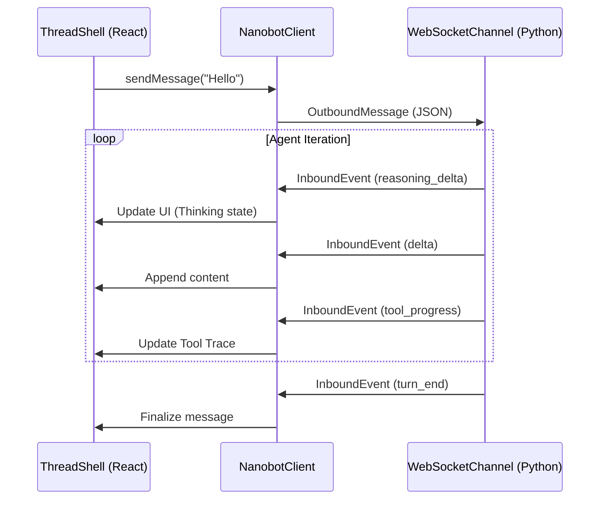

<!-- source: DeepWiki mcp.deepwiki.com · repo HKUDS/nanobot · page 14 WebUI · fetched 2026-10-26 -->

# WebUI

<details>
<summary>Relevant source files</summary>

The following files were used as context for generating this wiki page:

- [docs/release-archive.md](docs/release-archive.md)
- [images/nanobot-apps.png](images/nanobot-apps.png)
- [images/nanobot-automations.png](images/nanobot-automations.png)
- [images/nanobot-context.png](images/nanobot-context.png)
- [images/nanobot-workbench.png](images/nanobot-workbench.png)
- [images/nanobot_webui-source.png](images/nanobot_webui-source.png)
- [images/nanobot_webui.png](images/nanobot_webui.png)
- [webui/README.md](webui/README.md)
- [webui/src/App.tsx](webui/src/App.tsx)
- [webui/src/components/ChatList.tsx](webui/src/components/ChatList.tsx)
- [webui/src/components/Sidebar.tsx](webui/src/components/Sidebar.tsx)
- [webui/src/components/settings/SettingsView.tsx](webui/src/components/settings/SettingsView.tsx)
- [webui/src/components/thread/ThreadHeader.tsx](webui/src/components/thread/ThreadHeader.tsx)
- [webui/src/tests/app-layout.test.tsx](webui/src/tests/app-layout.test.tsx)
- [webui/src/tests/chat-list.test.tsx](webui/src/tests/chat-list.test.tsx)

</details>


The Nanobot WebUI is a modern, React-based frontend designed for real-time interaction with AI agents. It is served directly by the Nanobot gateway over a WebSocket multiplex protocol, providing a rich, conversational interface that supports streaming text, reasoning (thinking) processes, tool execution traces, and media handling.

While Nanobot can be used via CLI or third-party channels (Telegram, Feishu, etc.), the WebUI offers the most comprehensive access to agent internals, including settings management, MCP (Model Context Protocol) server configuration, and visual debugging of agent "thinking" steps.

## High-Level Architecture

The WebUI is built using a modern frontend stack: **Vite**, **React 18**, **TypeScript**, **Tailwind CSS**, and **shadcn/ui**. It talks to the gateway over the WebSocket multiplex protocol and reads session metadata from the embedded REST surface on the same port.
Sources: [[webui/README.md:20-23]]()

### Communication & Protocol
- **WebSocket Multiplexing**: A single WebSocket connection handles chat messages, streaming deltas, tool progress updates, and agent status changes. The `NanobotClient` class manages this singleton connection, routing events to specific chat handlers based on `chat_id`.
Sources: [[webui/src/App.tsx:65]](), [[webui/src/tests/app-layout.test.tsx:161-162]]()
- **Bootstrap Process**: Before opening the WebSocket, the UI performs a "bootstrap" request to obtain a short-lived session token and the correct WebSocket path via `fetchBootstrap`. This allows the UI to work across different runtime environments, including native host bridges.
Sources: [[webui/src/App.tsx:59-62]](), [[webui/src/App.tsx:89-91]]()
- **REST API Surface**: For non-streaming operations like fetching settings, managing workspaces, or listing available CLI apps, the UI uses a standard fetch-based API defined in `lib/api.ts`.
Sources: [[webui/src/App.tsx:82-86]]()

### Visual Interface
The UI is divided into several primary functional areas:
- **Sidebar**: Manages session history via `ChatList`, pinned/archived chats, and provides entry points for settings, apps, and automations.
Sources: [[webui/src/App.tsx:14]](), [[webui/src/components/Sidebar.tsx:21-70]]()
- **Thread Shell**: The main chat container (`ThreadShell`) that manages the message list and input composer.
Sources: [[webui/src/App.tsx:134-136]]()
- **Settings View**: A comprehensive panel (`SettingsView`) for configuring LLM providers, model presets, and runtime parameters like image generation and web search.
Sources: [[webui/src/App.tsx:138-141]](), [[webui/src/components/settings/SettingsView.tsx:57-65]]()

### System Component Mapping

The following diagram bridges the WebUI components to their underlying code entities and communication hooks.

```mermaid
graph TD
    subgraph "WebUI (React Space)"
        App["App.tsx"]
        Client["NanobotClient (lib/nanobot-client.ts)"]
        Thread["ThreadShell.tsx"]
        Settings["SettingsView.tsx"]
        Sidebar["Sidebar.tsx"]
        ChatList["ChatList.tsx"]
    end

    subgraph "Backend (Python Space)"
        WSChannel["WebSocketChannel"]
        Bus["MessageBus"]
        SettingsAPI["settings_api.py"]
        Gateway["GatewayServices"]
    end

    App -->|Initializes| Client
    Client <--- "ws_path" ---> WSChannel
    WSChannel <-->|Pub/Sub| Bus
    Thread -->|Subscribes to Events| Client
    Settings -->|fetchSettings / fetchWorkspaces| SettingsAPI
    WSChannel -->|Uses| Gateway
    Sidebar -->|Contains| ChatList
    ChatList -->|Session State| App
```
Sources: [[webui/src/App.tsx:65]](), [[webui/src/lib/nanobot-client.ts:121-130]](), [[webui/src/components/settings/SettingsView.tsx:57-65]](), [[webui/src/App.tsx:82-86]](), [[webui/src/components/Sidebar.tsx:21-70]]()

## Core Functionalities

### 1. Real-time Streaming
The UI handles distinct types of streaming data through a specialized state machine:
- **Reasoning Deltas**: Displays the agent's internal thought process via `reasoning_delta` frames.
- **Answer Deltas**: Standard LLM response chunks (`delta` events) appended to the message content.
- **Tool Traces**: Live updates of tool execution, showing "breadcrumbs" and merging progress events to show active/completed status.

### 2. Session & Persistence
Sessions are keyed by `channel:chat_id`. The UI uses the `useSessions` hook to manage the list of active conversations, supporting creation, deletion, and renaming of chats. The system supports both persistent history and "Temporary Chats" which are not saved to memory.
Sources: [[webui/src/App.tsx:43]](), [[webui/src/tests/app-layout.test.tsx:161-198]](), [[webui/src/components/thread/ThreadHeader.tsx:120-155]]()

### 3. Settings & i18n
The `SettingsView` serves as the primary management console. Users can configure LLM providers, model presets, and runtime parameters like context window size and temperature. The interface supports extensive internationalization (i18n) via `react-i18next` with localized strings for English, Chinese, Japanese, French, Spanish, and more.
Sources: [[webui/src/components/settings/SettingsView.tsx:57-65]](), [[webui/src/tests/app-layout.test.tsx:75-158]](), [[webui/src/App.tsx:12]]()

## Interaction Flow

The following diagram illustrates how a user message travels from the UI through the system and back as a streamed response.


Sources: [[webui/src/lib/nanobot-client.ts:121-130]](), [[webui/src/App.tsx:26]]()

## Detailed Documentation

For more specific information on implementation and customization, refer to the child pages:

- [WebUI Architecture & Components](#14.1) — Explain the Vite+React+TypeScript stack, App/Shell bootstrap, Sidebar, ChatList, ThreadShell/ThreadComposer, MessageBubble, activity clusters, markdown rendering, and the WebSocket streaming protocol
- [WebUI Development & i18n](#14.2) — Cover the Vite HMR dev workflow, bun build, PWA service worker, tailwind/ui primitives, local preferences, and internationalization locale files
- [WebUI Backend APIs & Gateway Transport](#14.3) — Document nanobot/webui/ HTTP+WebSocket routes, bootstrap tokens, transcript conversion, session list index, workspace scopes, session access, and the nanobot-client/useNanobotStream hooks
- [WebUI Settings & Management Panels](#14.4) — Document the settings surfaces: runtime config, provider/model settings and BYOK, skills catalog & marketplace, apps/MCP, automations, and channel setup flows

---
Sources: [[webui/src/App.tsx:1-188]](), [[webui/src/components/settings/SettingsView.tsx:1-84]](), [[webui/src/tests/app-layout.test.tsx:1-215]](), [[webui/src/components/Sidebar.tsx:1-197]](), [[webui/src/components/ChatList.tsx:1-230]](), [[webui/src/tests/chat-list.test.tsx:1-200]](), [[webui/README.md:1-24]](), [[webui/src/components/thread/ThreadHeader.tsx:1-201]]()

---

