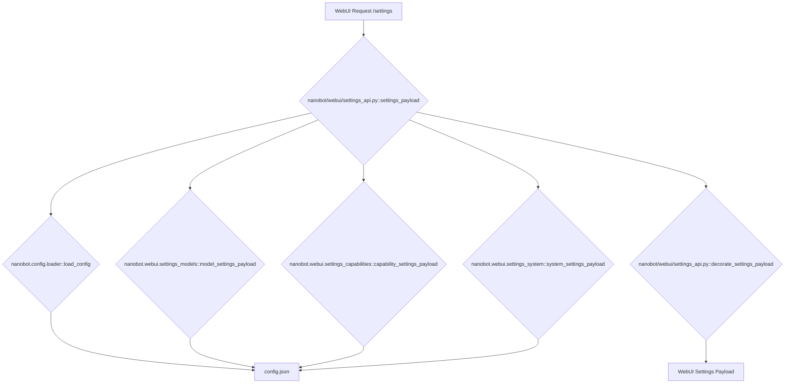

<!-- source: DeepWiki mcp.deepwiki.com · repo HKUDS/nanobot · page 14.4 WebUI Settings & Management Panels · fetched 2026-10-26 -->

# WebUI Settings & Management Panels

<details>
<summary>Relevant source files</summary>

The following files were used as context for generating this wiki page:

- [nanobot/channels/email/webui/index.ts](nanobot/channels/email/webui/index.ts)
- [nanobot/channels/feishu/webui/index.tsx](nanobot/channels/feishu/webui/index.tsx)
- [nanobot/channels/linear/tests/webui/LinearPanel.test.tsx](nanobot/channels/linear/tests/webui/LinearPanel.test.tsx)
- [nanobot/channels/linear/webui/LinearPanel.tsx](nanobot/channels/linear/webui/LinearPanel.tsx)
- [nanobot/channels/linear/webui/index.tsx](nanobot/channels/linear/webui/index.tsx)
- [nanobot/channels/qq/webui/index.ts](nanobot/channels/qq/webui/index.ts)
- [nanobot/providers/factory.py](nanobot/providers/factory.py)
- [nanobot/webui/session_automations.py](nanobot/webui/session_automations.py)
- [nanobot/webui/settings_api.py](nanobot/webui/settings_api.py)
- [tests/agent/test_self_model_preset.py](tests/agent/test_self_model_preset.py)
- [tests/command/test_model_command.py](tests/command/test_model_command.py)
- [tests/config/test_model_presets.py](tests/config/test_model_presets.py)
- [tests/webui/test_settings_api.py](tests/webui/test_settings_api.py)
- [webui/src/components/settings/SettingsPage.tsx](webui/src/components/settings/SettingsPage.tsx)
- [webui/src/components/settings/SkillsCatalogSettings.tsx](webui/src/components/settings/SkillsCatalogSettings.tsx)
- [webui/src/components/settings/SkillsMarketplace.tsx](webui/src/components/settings/SkillsMarketplace.tsx)
- [webui/src/components/settings/ToggleButton.tsx](webui/src/components/settings/ToggleButton.tsx)
- [webui/src/components/settings/channels/ChannelCatalogRow.tsx](webui/src/components/settings/channels/ChannelCatalogRow.tsx)
- [webui/src/components/settings/channels/ChannelCredentialFields.tsx](webui/src/components/settings/channels/ChannelCredentialFields.tsx)
- [webui/src/components/settings/channels/ChannelIdentity.tsx](webui/src/components/settings/channels/ChannelIdentity.tsx)
- [webui/src/components/settings/channels/ChannelInstancesPanel.tsx](webui/src/components/settings/channels/ChannelInstancesPanel.tsx)
- [webui/src/components/settings/channels/ChannelQrConnectFlow.tsx](webui/src/components/settings/channels/ChannelQrConnectFlow.tsx)
- [webui/src/components/settings/channels/ChannelSetupPanel.tsx](webui/src/components/settings/channels/ChannelSetupPanel.tsx)
- [webui/src/components/settings/channels/ChannelSetupParts.tsx](webui/src/components/settings/channels/ChannelSetupParts.tsx)
- [webui/src/components/settings/channels/ChannelValidationProgress.tsx](webui/src/components/settings/channels/ChannelValidationProgress.tsx)
- [webui/src/components/settings/channels/CredentialForm.tsx](webui/src/components/settings/channels/CredentialForm.tsx)
- [webui/src/components/settings/channels/catalog.ts](webui/src/components/settings/channels/catalog.ts)
- [webui/src/components/settings/models/ModelsSettings.tsx](webui/src/components/settings/models/ModelsSettings.tsx)
- [webui/src/components/settings/models/ProviderSettings.tsx](webui/src/components/settings/models/ProviderSettings.tsx)
- [webui/src/components/settings/overview/OverviewSettings.tsx](webui/src/components/settings/overview/OverviewSettings.tsx)
- [webui/src/components/settings/shared/ModelControls.tsx](webui/src/components/settings/shared/ModelControls.tsx)
- [webui/src/components/settings/system/AutomationsSettings.tsx](webui/src/components/settings/system/AutomationsSettings.tsx)
- [webui/src/components/settings/system/ChannelsSettings.tsx](webui/src/components/settings/system/ChannelsSettings.tsx)
- [webui/src/hooks/useSkills.ts](webui/src/hooks/useSkills.ts)
- [webui/src/lib/provider-brand.ts](webui/src/lib/provider-brand.ts)
- [webui/src/lib/skill-events.ts](webui/src/lib/skill-events.ts)
- [webui/src/tests/automation-run-dialog.test.tsx](webui/src/tests/automation-run-dialog.test.tsx)
- [webui/src/tests/automations-settings.test.tsx](webui/src/tests/automations-settings.test.tsx)
- [webui/src/tests/channel-logo.test.tsx](webui/src/tests/channel-logo.test.tsx)
- [webui/src/tests/model-catalog-feedback.test.tsx](webui/src/tests/model-catalog-feedback.test.tsx)
- [webui/src/tests/provider-brand.test.ts](webui/src/tests/provider-brand.test.ts)
- [webui/src/tests/provider-icon-surfaces.test.tsx](webui/src/tests/provider-icon-surfaces.test.tsx)
- [webui/src/tests/provider-icon.test.tsx](webui/src/tests/provider-icon.test.tsx)
- [webui/src/tests/settings-capabilities.test.tsx](webui/src/tests/settings-capabilities.test.tsx)
- [webui/src/tests/settings-channels.test.tsx](webui/src/tests/settings-channels.test.tsx)
- [webui/src/tests/settings-models.test.tsx](webui/src/tests/settings-models.test.tsx)
- [webui/src/tests/settings-providers.test.tsx](webui/src/tests/settings-providers.test.tsx)
- [webui/src/tests/settings-system.test.tsx](webui/src/tests/settings-system.test.tsx)
- [webui/src/tests/settings-test-utils.tsx](webui/src/tests/settings-test-utils.tsx)
- [webui/src/tests/skills-marketplace.test.tsx](webui/src/tests/skills-marketplace.test.tsx)
- [webui/src/tests/toggle-button.test.tsx](webui/src/tests/toggle-button.test.tsx)

</details>


This page documents the various settings and management panels available in the Nanobot WebUI. These panels provide a user-friendly interface for configuring the Nanobot agent's runtime behavior, managing LLM providers and models, discovering and installing skills, setting up automations, and configuring communication channels. The WebUI interacts with the Nanobot backend through a stable API facade, primarily handled by `nanobot/webui/settings_api.py` [nanobot/webui/settings_api.py:1-6]().

## 1. Runtime Configuration

The runtime configuration panel allows users to adjust core Nanobot settings that affect its overall operation. This includes general agent parameters and system-level configurations.

### Implementation Details

The `settings_payload` function in `nanobot/webui/settings_api.py` [nanobot/webui/settings_api.py:158-190]() is the primary entry point for retrieving the complete settings payload for the WebUI. This function aggregates data from various modules:
*   `models.model_settings_payload`: Provides model and provider-related settings.
*   `capabilities.capability_settings_payload`: Provides settings related to agent capabilities.
*   `system.system_settings_payload`: Provides general system settings, including the Nanobot version and configuration file path.

The `decorate_settings_payload` function [nanobot/webui/settings_api.py:119-155]() adds runtime-specific metadata, such as `runtime_capabilities` and `restart_behavior_by_section`, which inform the UI about available actions and restart requirements.

The `_load_settings_config` and `_save_settings_config` functions [nanobot/webui/settings_api.py:76-84]() handle reading and writing the `config.json` file, which is the persistent storage for all settings.

### Data Flow



Sources:
*   `nanobot/webui/settings_api.py` [nanobot/webui/settings_api.py:1-6, 76-84, 119-155, 158-190]()

## 2. Provider & Model Settings (BYOK)

This section covers the configuration of Large Language Model (LLM) providers and individual model presets, including Bring Your Own Key (BYOK) scenarios.

### Implementation Details

The `ModelsSettings` component in `webui/src/components/settings/models/ModelsSettings.tsx` [webui/src/components/settings/models/ModelsSettings.tsx:180-206]() is responsible for rendering the UI for model and provider settings. It manages the `AgentSettingsDraft` state [webui/src/components/settings/models/ModelsSettings.tsx:46-56]() which represents the current configuration being edited.

Key functions and components:
*   `agentDraftFromPayload`: Converts the backend `SettingsPayload` into the `AgentSettingsDraft` format for the UI [webui/src/components/settings/models/ModelsSettings.tsx:100-122]().
*   `ModelPresetDeleteDialog`: Handles the deletion of custom model presets [webui/src/components/settings/models/ModelsSettings.tsx:124-179]().
*   `ProviderSettings` component (`webui/src/components/settings/models/ProviderSettings.tsx`): Provides detailed configuration for individual LLM providers, including API keys, base URLs, and advanced settings like `extra_headers` or `extra_body` [webui/src/components/settings/models/ProviderSettings.tsx:65-77]().
*   `ProviderIcon`: Displays provider logos, with fallback mechanisms for missing images [webui/src/components/settings/models/ProviderSettings.tsx:1-1](). The `providerBrand` utility (`webui/src/lib/provider-brand.ts`) provides branding information like logo URLs and colors for various providers [webui/src/lib/provider-brand.ts:1-8]().

The backend API for updating these settings is handled by functions like `update_model_configuration`, `create_model_configuration`, `delete_model_configuration`, and `update_provider_settings` in `nanobot/webui/settings_api.py` [tests/webui/test_settings_api.py:27-44]().

Model presets allow users to define specific configurations for different models, including `max_tokens`, `context_window_tokens`, `temperature`, and `reasoning_effort` [nanobot/config/schema.py:1-1](). The `_resolve_model_preset` function in `nanobot/providers/factory.py` [nanobot/providers/factory.py:33-39]() is used to resolve the active model preset.

### Provider Branding and Icons

The WebUI uses a sophisticated system for displaying provider branding, including logos and initials.
*   `providerBrand` function (`webui/src/lib/provider-brand.ts`): Maps provider names to branding information, including `logoUrl`, `logoUrls` (for fallbacks), `color`, and `initials` [webui/src/lib/provider-brand.ts:155-283]().
*   `browserSafeFaviconUrls` and `faviconUrls`: Provide logic for retrieving favicons from various sources, prioritizing cross-origin safe proxies [webui/src/lib/provider-brand.ts:26-49]().
*   `isGenericRepositoryLogoUrl`: Helps distinguish generic repository favicons from actual product identities [webui/src/lib/provider-brand.ts:99-104]().
*   `ProviderIcon` component (`webui/src/components/settings/models/ProviderSettings.tsx`): Renders the provider icon, utilizing the branding information and handling image loading and fallback states [webui/src/components/settings/models/ProviderSettings.tsx:1-1]().

### Model Call Order

The `model_call_order` setting allows users to define a priority list for model usage. This is managed in the `ModelsSettings` component [webui/src/components/settings/models/ModelsSettings.tsx:191](). The `update_model_call_order` function in `nanobot/webui/settings_api.py` [tests/webui/test_settings_api.py:38]() handles the backend update.

### Diagram: Provider & Model Settings Data Flow

```mermaid
graph TD
    A[WebUI ModelsSettings Component] --> B{settings_payload (GET)}
    B --> C[SettingsPayload (Backend)]
    C --> D[agentDraftFromPayload]
    D --> E[AgentSettingsDraft (Frontend State)]

    E -- User Edits --> F[ProviderSettings Component]
    F -- User Edits --> G[ModelPresetEditor Component]

    F -- Update Provider --> H{update_provider_settings (POST)}
    G -- Create/Update Preset --> I{create_model_configuration / update_model_configuration (POST)}
    G -- Delete Preset --> J{delete_model_configuration (POST)}
    A -- Update Call Order --> K{update_model_call_order (POST)}

    H --> L[config.json]
    I --> L
    J --> L
    K --> L

    L --> M[nanobot.providers.factory::make_provider_core]
    M --> N[LLMProvider Instance]
    N --> O[AgentLoop]

    subgraph "WebUI Frontend"
        A
        F
        G
        E
    end

    subgraph "Nanobot Backend (settings_api.py)"
        B
        H
        I
        J
        K
    end

    subgraph "Nanobot Backend (Core)"
        C
        D
        L
        M
        N
        O
    end
```

Sources:
*   `nanobot/webui/settings_api.py` [nanobot/webui/settings_api.py:27-44]()
*   `nanobot/providers/factory.py` [nanobot/providers/factory.py:33-39]()
*   `nanobot/config/schema.py` [nanobot/config/schema.py:1-1]()
*   `webui/src/components/settings/models/ModelsSettings.tsx` [webui/src/components/settings/models/ModelsSettings.tsx:46-56, 100-122, 124-179, 180-206]()
*   `webui/src/components/settings/models/ProviderSettings.tsx` [webui/src/components/settings/models/ProviderSettings.tsx:1-1, 65-77]()
*   `webui/src/lib/provider-brand.ts` [webui/src/lib/provider-brand.ts:1-8,26-49,99-104,155-283]()
*   `tests/webui/test_settings_api.py` [tests/webui/test_settings_api.py:27-44]()

## 3. Skills Catalog & Marketplace

The WebUI provides interfaces for discovering, installing, and managing skills.

### Implementation Details

The `SkillsCatalogSettings` component (`webui/src/components/settings/SkillsCatalogSettings.tsx`) and `SkillsMarketplace` component (`webui/src/components/settings/SkillsMarketplace.tsx`) are the primary UI surfaces for skill management.

Key functionalities include:
*   Listing available skills.
*   Displaying skill details.
*   Installing and uninstalling skills.
*   Searching and filtering skills.

The `useSkills` hook (`webui/src/hooks/useSkills.ts`) likely provides the frontend logic for interacting with the backend skill APIs. The `skill-events.ts` file (`webui/src/lib/skill-events.ts`) suggests an event-driven mechanism for skill-related actions.

Sources:
*   `webui/src/components/settings/SkillsCatalogSettings.tsx`
*   `webui/src/components/settings/SkillsMarketplace.tsx`
*   `webui/src/hooks/useSkills.ts`
*   `webui/src/lib/skill-events.ts`

## 4. Apps / MCP

This section refers to the management of CLI applications integrated via CLI-Anything and potentially other Model Context Protocol (MCP) integrations.

### Implementation Details

While specific WebUI components for managing CLI-Anything apps are not explicitly detailed in the provided snippets, the `capabilities.capability_settings_payload` function [nanobot/webui/settings_api.py:173-176]() would include settings related to these capabilities. The `ProviderSettings` component also includes `PROVIDER_REQUEST_OPTIONS` [webui/src/components/settings/models/ProviderSettings.tsx:90-125]() which define hosted tools like web search capabilities for certain providers, indicating how some "apps" or tools are integrated and configured.

Sources:
*   `nanobot/webui/settings_api.py` [nanobot/webui/settings_api.py:173-176]()
*   `webui/src/components/settings/models/ProviderSettings.tsx` [webui/src/components/settings/models/ProviderSettings.tsx:90-125]()

## 5. Automations

The automations panel allows users to schedule tasks and manage recurring agent activities.

### Implementation Details

The `AutomationsSettings` component (`webui/src/components/settings/system/AutomationsSettings.tsx`) is the central component for managing automations.
*   It displays a list of `SessionAutomationJob` objects [webui/src/components/settings/system/AutomationsSettings.tsx:47-48]().
*   Users can filter automations by status (all, active, paused, failed) [webui/src/components/settings/system/AutomationsSettings.tsx:52-52]().
*   It includes a calendar view (`AutomationCalendar`) and a run-at picker (`AutomationRunAtPicker`) for scheduling [webui/src/components/settings/system/AutomationsSettings.tsx:17-18]().
*   Actions like enable, disable, delete, and run are supported [webui/src/components/settings/system/AutomationsSettings.tsx:53-53]().

The backend interaction for automations is handled by `nanobot/webui/session_automations.py`. This module likely exposes APIs for listing, creating, updating, and deleting automation jobs.

### Diagram: Automations Management

```mermaid
graph TD
    A[WebUI AutomationsSettings Component] --> B{nanobot/webui/session_automations.py (API)}
    B --> C[AutomationsPayload (Backend)]
    C --> D[SessionAutomationJob List]

    D -- Filter/Sort --> E[Visible Jobs]
    E -- User Selects Job --> F[Inspected Job Detail]

    F -- Edit Job --> G[AutomationEditDialog]
    G -- Save Changes --> H{nanobot/webui/session_automations.py::update_automation (POST)}

    F -- Delete Job --> I[AutomationDeleteDialog]
    I -- Confirm Delete --> J{nanobot/webui/session_automations.py::delete_automation (POST)}

    F -- Run Job --> K{nanobot/webui/session_automations.py::run_automation (POST)}
    F -- Enable/Disable Job --> L{nanobot/webui/session_automations.py::toggle_automation (POST)}

    subgraph "WebUI Frontend"
        A
        F
        G
        I
    end

    subgraph "Nanobot Backend"
        B
        C
        H
        J
        K
        L
    end
```

Sources:
*   `webui/src/components/settings/system/AutomationsSettings.tsx` [webui/src/components/settings/system/AutomationsSettings.tsx:1-1255]()
*   `nanobot/webui/session_automations.py`

## 6. Channel Setup Flows

The channel setup flows allow users to configure various communication channels for the Nanobot agent.

### Implementation Details

The `ChannelsSettings` component (`webui/src/components/settings/system/ChannelsSettings.tsx`) provides the main interface for managing channels.
*   It lists configured channels and allows adding new ones.
*   `ChannelSetupPanel` (`webui/src/components/settings/channels/ChannelSetupPanel.tsx`) guides users through the setup process for a specific channel.
*   `ChannelQrConnectFlow` (`webui/src/components/settings/channels/ChannelQrConnectFlow.tsx`) handles QR code-based connection flows, common for chat applications.
*   `ChannelCredentialFields` (`webui/src/components/settings/channels/ChannelCredentialFields.tsx`) and `CredentialForm` (`webui/src/components/settings/channels/CredentialForm.tsx`) manage input fields for API keys, tokens, and other credentials.
*   `ChannelValidationProgress` (`webui/src/components/settings/channels/ChannelValidationProgress.tsx`) displays the status of channel connection attempts.
*   Channel-specific UI components are dynamically loaded from `channel-plugins/registry` [webui/src/components/settings/system/AutomationsSettings.tsx:15](), such as `nanobot/channels/linear/webui/LinearPanel.tsx` [nanobot/channels/linear/webui/LinearPanel.tsx:1-1]() for Linear.

The `channelTranslator` [webui/src/components/settings/system/AutomationsSettings.tsx:14]() and `channelUiOwner`, `channelUiPresentation` [webui/src/components/settings/system/AutomationsSettings.tsx:15]() utilities help in rendering channel-specific information and UI.

Sources:
*   `webui/src/components/settings/system/ChannelsSettings.tsx`
*   `webui/src/components/settings/channels/ChannelSetupPanel.tsx`
*   `webui/src/components/settings/channels/ChannelQrConnectFlow.tsx`
*   `webui/src/components/settings/channels/ChannelCredentialFields.tsx`
*   `webui/src/components/settings/channels/CredentialForm.tsx`
*   `webui/src/components/settings/channels/ChannelValidationProgress.tsx`
*   `nanobot/channels/linear/webui/LinearPanel.tsx` [nanobot/channels/linear/webui/LinearPanel.tsx:1-1]()
*   `webui/src/components/settings/system/AutomationsSettings.tsx` [webui/src/components/settings/system/AutomationsSettings.tsx:14-15]()

---

