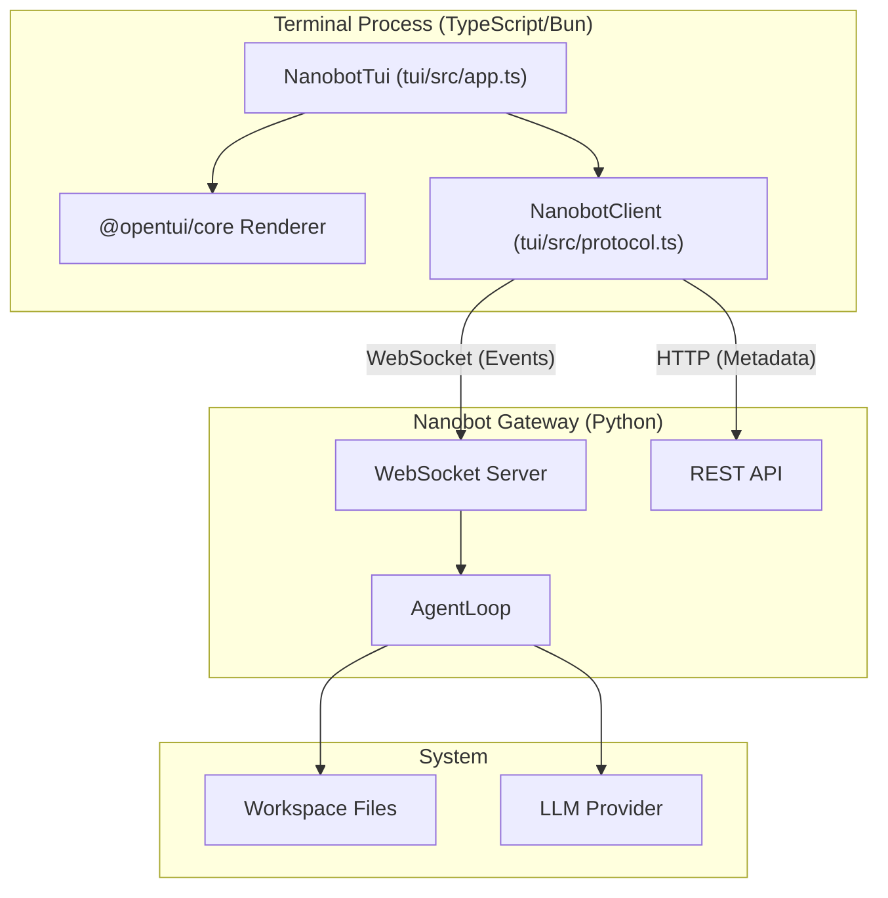
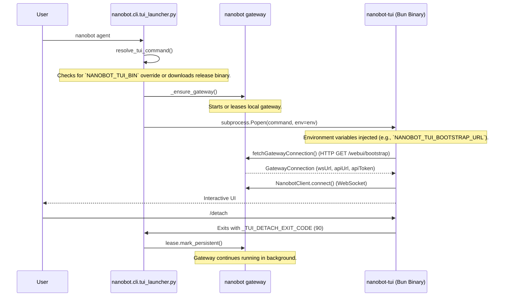

<!-- source: DeepWiki mcp.deepwiki.com · repo HKUDS/nanobot · page 15 Terminal UI (TUI) · fetched 2026-10-26 -->

# Terminal UI (TUI)

Relevant source files

The following files were used as context for generating this wiki page:

- [docs/cli-reference.md](docs/cli-reference.md)
- [nanobot/cli/agent.py](nanobot/cli/agent.py)
- [nanobot/cli/tui_launcher.py](nanobot/cli/tui_launcher.py)
- [tests/cli/test_tui_launcher.py](tests/cli/test_tui_launcher.py)
- [tui/README.md](tui/README.md)
- [tui/src/app.test.ts](tui/src/app.test.ts)
- [tui/src/app.ts](tui/src/app.ts)
- [tui/src/index.ts](tui/src/index.ts)
- [tui/src/protocol.test.ts](tui/src/protocol.test.ts)
- [tui/src/protocol.ts](tui/src/protocol.ts)
- [tui/src/runtime-controls.ts](tui/src/runtime-controls.ts)
- [tui/src/transcript.ts](tui/src/transcript.ts)

The nanobot Terminal UI is a high-performance, TypeScript-based interactive client that provides a full-featured alternative to the classic Python prompt. Built on the `@opentui/core` framework, it offers a modern terminal experience including Markdown rendering, live tool progress, session management, and integrated diff viewing.

The TUI operates as a thin presentation layer. While it handles layout and user input, the **Python Gateway** remains the authoritative implementation for sessions, the agent loop, tool execution, and security policies [tui/README.md:3-4]().

### High-Level Architecture

The TUI follows a client-server model where the TypeScript frontend communicates with the local Python Gateway via WebSockets and REST APIs.

**Sources:** [tui/src/app.ts:21-42](), [tui/src/protocol.ts:181-183](), [tui/README.md:3-4]()

---

### Core Components

The TUI utilizes a **retained layout** system, meaning components are persistent objects that reflow automatically when the terminal is resized [tui/src/app.test.ts:166-167](). The main application class is `NanobotTui` [tui/src/app.ts:19]().

| Component | Responsibility | Code Entity |
| :--- | :--- | :--- |
| **Transcript** | Manages the scrollable conversation history, Markdown rendering, and tool activity folding. | `Transcript` [tui/src/transcript.ts:109]() |
| **Composer** | The input area for user prompts, supporting multi-line editing and steering during active turns. | `TextareaRenderable` [tui/src/app.ts:7]() |
| **Command Menu** | Slash-command discovery and completion (`/sessions`, `/diff`, etc.). | `CommandMenu` [tui/src/app.ts:57]() |
| **Session Menu** | Allows finding and switching conversations. | `SessionMenu` [tui/src/app.ts:58]() |
| **Context Panel** | Displays token usage, session summaries, and model information. | `ContextPanel` [tui/src/app.ts:59]() |
| **Usage Panel** | Shows context occupancy and recent model-call input tokens. | `UsagePanel` [tui/src/app.ts:60]() |
| **Diff Viewer** | A full-screen unified diff viewer for inspecting file changes from the last agent turn. | `DiffViewer` [tui/src/app.ts:61]() |
| **Mention Menu** | Triggered by `@`, allows referencing CLI apps, MCP servers, or saved sessions. | `MentionMenu` [tui/src/app.ts:79]() |
| **Skill Menu** | Triggered by `@`, allows inserting skills. | `SkillMenu` [tui/src/app.ts:86]() |
| **Prompt Queue** | Manages queued prompts for sequential execution. | `PromptQueue` [tui/src/app.ts:91]() |
| **Queue Preview** | Displays a preview of the next queued prompt. | `QueuePreview` [tui/src/app.ts:92]() |
| **Recovery Notice** | Informs the user about session recovery states. | `RecoveryNotice` [tui/src/app.ts:93]() |
| **Runtime Controls** | Manages model preset and workspace access selection. | `RuntimeControls` [tui/src/app.ts:94]() |
| **Footer Hints** | Provides contextual hints and telemetry in the footer. | `contextualFooterHints`, `footerTelemetry` [tui/src/app.ts:97-98]() |

For a deep dive into component implementation and the WebSocket protocol, see **[TUI Architecture & Components](#15.1)**.

---

### Lifecycle & Distribution

The TUI is distributed as a platform-specific binary (powered by Bun) and is managed by a Python launcher. The `nanobot agent` command (or bare `nanobot`) will attempt to launch the TUI by default [nanobot/cli/agent.py:86]().

**Sources:** [nanobot/cli/tui_launcher.py:74-136](), [tui/src/protocol.ts:185-197](), [tui/src/index.ts:11](), [nanobot/cli/agent.py:86]()

#### Key Features:
*   **Binary Management:** The launcher resolves the TUI command via `resolve_tui_command()` [nanobot/cli/tui_launcher.py:165](), checking for environment variable overrides or downloading a version-matched, checksum-verified release binary [nanobot/cli/tui_launcher.py:45-65]().
*   **Bootstrap Protocol:** The TUI obtains fresh credentials via a bootstrap URL (`NANOBOT_TUI_BOOTSTRAP_URL`), allowing it to connect to a shared gateway without hardcoded secrets [tui/src/protocol.test.ts:134-159]().
*   **Detachment:** Using `/detach` exits the TUI with exit code `90` (`TUI_DETACH_EXIT_CODE`) [tui/src/index.ts:11](), signaling the launcher to promote the gateway's lease to a persistent background process [nanobot/cli/tui_launcher.py:141-145]().
*   **Host Mode:** The TUI supports a host mode, such as for Herdr, where it reports the latest user task as the pane title [tui/README.md:20-24]().

For details on the launcher, binary fetching, and multiplexer integration, see **[TUI Launcher & Binary Distribution](#15.2)**.

---

### Navigation & Commands

The TUI provides several built-in local commands that do not require LLM processing, accessible via the `CommandMenu` [tui/src/app.ts:57]():

*   **`/sessions`**: Search and switch between conversation histories using the `SessionMenu` [tui/src/app.ts:204]().
*   **`/new-chat`**: Preserves the current conversation and starts a new one [tui/src/app.ts:211]().
*   **`/context`**: View the current session summary and token estimates using the `ContextPanel` [tui/src/app.ts:218]().
*   **`/usage`**: Shows the latest measured context occupancy and recent model-call input tokens via the `UsagePanel` [tui/src/app.ts:225]().
*   **`/diff`**: Inspect file edits from the most recent turn in a unified diff format using the `DiffViewer` [tui/src/app.ts:232]().
*   **`/branch`**: Create a new saved conversation from a specific reply in the history using the `BranchMenu` [tui/src/app.ts:239]().
*   **`/detach`**: Closes the TUI and keeps the agent running in the background [tui/src/app.ts:246]().
*   **`/exit`**: Closes the terminal UI [tui/src/app.ts:249]().

**Sources:** [tui/src/app.ts:178-251](), [tui/README.md:50-70]()

---

