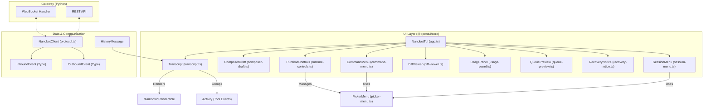
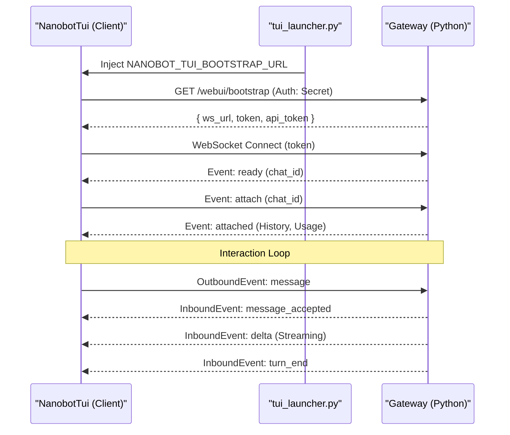

<!-- source: DeepWiki mcp.deepwiki.com · repo HKUDS/nanobot · page 15.1 TUI Architecture & Components · fetched 2026-10-26 -->

# TUI Architecture & Components

Relevant source files

The following files were used as context for generating this wiki page:

- [docs/cli-reference.md](docs/cli-reference.md)
- [nanobot/cli/agent.py](nanobot/cli/agent.py)
- [nanobot/cli/tui_launcher.py](nanobot/cli/tui_launcher.py)
- [tests/cli/test_tui_launcher.py](tests/cli/test_tui_launcher.py)
- [tui/README.md](tui/README.md)
- [tui/src/app.test.ts](tui/src/app.test.ts)
- [tui/src/app.ts](tui/src/app.ts)
- [tui/src/command-menu.test.ts](tui/src/command-menu.test.ts)
- [tui/src/command-menu.ts](tui/src/command-menu.ts)
- [tui/src/footer-hints.test.ts](tui/src/footer-hints.test.ts)
- [tui/src/footer-hints.ts](tui/src/footer-hints.ts)
- [tui/src/index.ts](tui/src/index.ts)
- [tui/src/picker-menu.ts](tui/src/picker-menu.ts)
- [tui/src/protocol.test.ts](tui/src/protocol.test.ts)
- [tui/src/protocol.ts](tui/src/protocol.ts)
- [tui/src/queue-preview.test.ts](tui/src/queue-preview.test.ts)
- [tui/src/queue-preview.ts](tui/src/queue-preview.ts)
- [tui/src/recovery-notice.ts](tui/src/recovery-notice.ts)
- [tui/src/runtime-controls.ts](tui/src/runtime-controls.ts)
- [tui/src/session-menu.test.ts](tui/src/session-menu.test.ts)
- [tui/src/session-menu.ts](tui/src/session-menu.ts)
- [tui/src/transcript.ts](tui/src/transcript.ts)
- [tui/src/usage-app.test.ts](tui/src/usage-app.test.ts)
- [tui/src/usage-panel.test.ts](tui/src/usage-panel.test.ts)
- [tui/src/usage-panel.ts](tui/src/usage-panel.ts)
- [tui/src/usage-protocol.test.ts](tui/src/usage-protocol.test.ts)

The nanobot Terminal UI (TUI) is a high-performance TypeScript client built on the `@opentui/core` framework. It serves as a full-featured alternative to the classic Python prompt and the WebUI, providing a retained-layout terminal experience. The TUI does not implement the agent logic itself; instead, it acts as a presentation layer for the local WebSocket gateway, which handles session persistence, tool execution, and LLM communication [tui/README.md:1-12]().

## Architecture Overview

The TUI utilizes a **retained layout** model where UI components are persistent objects that reflow automatically when the terminal is resized [tui/src/app.test.ts:166-174](). It communicates with the Nanobot Gateway via a specialized WebSocket protocol for streaming events and a REST API for metadata and history retrieval [tui/src/protocol.ts:67-170]().

### Component Hierarchy & Layout
The layout is divided into a scrollable transcript area and a fixed input/status area at the bottom.

1.  **Transcript**: A `ScrollBoxRenderable` that manages the conversation history, including Markdown rendering and tool activity [tui/src/transcript.ts:62-113]().
2.  **Composer**: The primary input area for user prompts, supporting multi-line editing and mention triggers [tui/src/app.ts:192-196]().
3.  **ContextPanel**: Displays token usage, model information, and session summaries [tui/src/context-panel.ts:1-20]().
4.  **Floating Menus**: Transient overlays for commands (`/`), mentions (`@`), and session switching [tui/src/app.ts:43-75]().

### System Component Mapping
This diagram maps the logical TUI components to their implementation classes and data structures.

**TUI Component to Code Entity Map**

**Sources:** [tui/src/app.ts:1-82](), [tui/src/transcript.ts:62-75](), [tui/src/protocol.ts:67-170](), [tui/src/usage-panel.ts:1-20](), [tui/src/queue-preview.ts:1-10](), [tui/src/recovery-notice.ts:1-10](), [tui/src/runtime-controls.ts:1-41](), [tui/src/picker-menu.ts:1-20]()

---

## Key Components

### Transcript & Activity Rendering
The `Transcript` class projects gateway events into reflowable conversation cells. It handles:
*   **Markdown Coalescing**: To prevent quadratic work during high-speed LLM streaming, it buffers deltas and flushes them at the renderer's cadence (~32ms) [tui/src/transcript.ts:54-60]().
*   **Activity Grouping**: Tool execution events (e.g., `read_file`, `shell_execute`) are collapsed into `Activity` blocks to keep the transcript concise while allowing expansion via `Ctrl+O` [tui/src/transcript.ts:40-52]().
*   **Latex Support**: Renders math formulas as Unicode plain text for terminal compatibility [tui/src/transcript.ts:24]().

### Composer
The `ComposerDraft` class manages the input buffer, including handling large pastes and image attachments. It supports `MAX_DRAFT_IMAGES` [tui/src/composer-draft.ts:1-10](). The `NanobotTui` class uses `COMPOSER_PLACEHOLDER` and `ACTIVE_COMPOSER_PLACEHOLDER` for visual cues [tui/src/app.ts:192-196]().

### Command & Mention Menus
*   **CommandMenu**: Triggered by `/`, it displays `LOCAL_COMMANDS` (like `/sessions`, `/diff`, `/detach`) alongside slash commands dynamically published by the gateway [tui/src/app.ts:202-251](). The `resolveSlashCommandLifecycle` function handles command execution [tui/src/command-menu.ts:5-6]().
*   **SessionMenu**: Triggered by `/sessions`, it allows searching and switching between persisted conversations [tui/src/session-menu.ts:1-10]().
*   **MentionMenu**: Triggered by `@`, it fetches `MentionCandidate` objects from the gateway, allowing the user to reference other sessions, MCP tools, or CLI apps [tui/src/mention-menu.ts:1-20](), [tui/src/protocol.ts:41-42]().
*   **SkillMenu**: Triggered by `@` followed by a skill-like query, it allows inserting skills into the prompt [tui/src/skill-menu.ts:1-10]().
*   **PickerMenu**: A generic menu component used by `CommandMenu`, `SessionMenu`, and `RuntimeControls` for selection from a list of choices [tui/src/picker-menu.ts:1-20]().

### Usage Panel
The `UsagePanel` displays token usage and context occupancy, similar to the WebUI's usage chart [tui/src/usage-panel.ts:1-20](). It shows input tokens (cached vs. uncached) and generation time [tui/README.md:77-89]().

### Footer Hints
The `contextualFooterHints` function dynamically generates hints based on the current UI mode (e.g., `mention`, `command`, `usage`) and terminal width [tui/src/footer-hints.ts:29-36](). `footerTelemetry` displays context window occupancy as a percentage [tui/src/footer-hints.ts:39-57]().

### Queue Preview
The `QueuePreview` component displays prompts that have been queued while the agent is busy [tui/src/queue-preview.ts:1-10]().

### Recovery Notice
The `RecoveryNotice` component displays messages related to session recovery states [tui/src/recovery-notice.ts:1-10]().

### Runtime Controls
The `RuntimeControls` component provides interactive elements for changing the model preset and workspace access mode. It fetches available controls via `fetchRuntimeControls` [tui/src/runtime-controls.ts:9-12]().

### DiffViewer
When a tool modifies files, the gateway sends `file_edit` events [tui/src/protocol.ts:36-58](). The `DiffViewer` component provides a full-screen unified diff interface to inspect these changes [tui/src/diff-viewer.ts:1-20]().

---

## Communication & Connection Lifecycle

The `NanobotClient` manages the lifecycle of the connection to the Python gateway.

### Connection Flow
1.  **Bootstrap**: The client hits the `/webui/bootstrap` endpoint using a `bootstrapSecret` to obtain a short-lived WebSocket token and REST API token [tui/src/protocol.test.ts:134-158]().
2.  **WebSocket Upgrade**: It establishes a persistent connection to the gateway's `/ws` endpoint [tui/src/protocol.ts:217-218]().
3.  **Attachment**: The client sends an `attach` event for a specific `chat_id` to start receiving the event stream for that conversation [tui/src/protocol.ts:172-173]().

**NanobotClient Lifecycle**

**Sources:** [nanobot/cli/tui_launcher.py:82-110](), [tui/src/protocol.ts:67-170](), [tui/src/protocol.test.ts:134-158]()

### Protocol Events
The TUI reacts to a variety of `InboundEvent` types:
| Event | Purpose |
| :--- | :--- |
| `delta` | Incremental LLM text tokens [tui/src/protocol.ts:119]() |
| `reasoning_delta` | Tokens for internal "thinking" chains [tui/src/protocol.ts:129]() |
| `file_edit` | Unified diff data for workspace modifications [tui/src/protocol.ts:118]() |
| `message` | Tool hints and progress indicators [tui/src/protocol.ts:111-116]() |
| `turn_end` | Final usage statistics and goal state [tui/src/protocol.ts:132-144]() |

**Sources:** [tui/src/protocol.ts:84-169]()

---

## TUI Launcher & Detachment

The `tui_launcher.py` script manages the TUI binary. It verifies SHA-256 checksums of release binaries before execution [nanobot/cli/tui_launcher.py:5-14]().

### Detach Logic
A unique feature of the TUI is the `/detach` command.
1.  When `/detach` is invoked, the TUI exits with a specific code (`90`) [tui/src/index.ts:10-11]().
2.  The launcher catches this code and calls `lease.mark_persistent()` on the gateway handle [nanobot/cli/tui_launcher.py:141-142]().
3.  This prevents the on-demand gateway from shutting down, allowing the agent to continue its work in the background without an active terminal attached [nanobot/cli/tui_launcher.py:157-162]().

**Sources:** [nanobot/cli/tui_launcher.py:68-152](), [tui/src/index.ts:1-49](), [tui/src/app.ts:240-243]()

---

